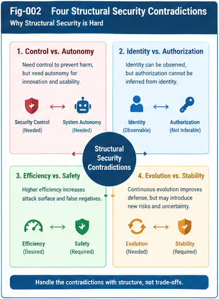

# FIGURE INDEX — Adversarial Structural Security Intelligence (ASSI)

**Release:** v0.1.0 — Research Foundation  
**Status:** Publication navigation and figure-placement guide  
**Repository location:** `FIGURE-INDEX.md` (root)  
**License:** Apache-2.0 (subject to verification of image-asset rights and attribution)  

> **Asset-status notice (important).** The eight names below are the *canonical standalone PNG assets*. At the time this index was prepared, the available image artifact was a combined eight-panel infographic, **not eight verified, separately exported PNGs**. The links below describe the intended repository layout; do not treat them as proof that the files already exist. Before release, export and inspect eight individual images, using the exact filenames, and then verify every Markdown link.

## 1. Purpose and usage

This index defines the eight figures for the ASSI research foundation, their intended meaning, canonical filenames, primary article placements, secondary reuse opportunities, and accessibility captions. It is a publication map, not experimental evidence. Diagrams depict *proposed* architectures, hypotheses, and validation programs; they do not establish implemented functionality or certified security.

The canonical GitHub figure path is `figures/Fig-###-Title.png`. When embedding from a document under `docs/`, `specs/`, `cases/`, or `extensions/`, use `../figures/Fig-###-Title.png`. From root-level Markdown, use `figures/Fig-###-Title.png`.

## 2. Canonical figure inventory

| Figure | Canonical asset | Primary placement | Core message |
|---|---|---|---|
| 001 | [ASSI Grand Architecture](figures/Fig-001-ASSI-Grand-Architecture.png) | `docs/ASSI-010` | Six domains; evidence, reasoning, safety, adversarial evaluation, and governed learning |
| 002 | [Four Structural Security Contradictions](figures/Fig-002-Four-Structural-Security-Contradictions.png) | `docs/ASSI-002` | Four interacting structural tensions, not isolated technical bugs |
| 003 | [UTN Compositional Identity Hypergraph](figures/Fig-003-UTN-Compositional-Identity-Hypergraph.png) | `docs/ASSI-004` | Typed, time-indexed, overlapping identity hypotheses |
| 004 | [BCEF and Scoring Tree Feedback](figures/Fig-004-BCEF-and-Scoring-Tree-Feedback.png) | `docs/ASSI-006` | Four IF modes and hypothesis-scoped structural impact |
| 005 | [Structural Authorization Control Plane](figures/Fig-005-Structural-Authorization-Control-Plane.png) | `docs/ASSI-007` | Advisory inference separated from independent authorization and execution |
| 006 | [Adversarial Drives and Competitive Relay](figures/Fig-006-Adversarial-Drives-and-Competitive-Relay.png) | `docs/ASSI-008` | Red, Blue, Evaluation, and Governance drives with controlled relay |
| 007 | [Security Residual to Validated RSI](figures/Fig-007-Security-Residual-to-Validated-RSI.png) | `docs/ASSI-009` | Residual → question → candidate → validation → governance → relay |
| 008 | [ASSI Benchmark and Validation Roadmap](figures/Fig-008-ASSI-Benchmark-and-Validation-Roadmap.png) | `docs/ASSI-011` | BM-001–004, baselines, falsifiability, and staged validation |

## 3. Figure-by-figure editorial specifications

### Fig-001 — ASSI Grand Architecture

**File:** `figures/Fig-001-ASSI-Grand-Architecture.png`  
**Primary insertion:** `docs/ASSI-010-ASSI-Grand-Architecture-and-Structural-Security-Units.md`, immediately after **§2, “The Grand Architecture: Six Functional Domains”** introduces the domain overview, and before the detailed domain discussion.  
**Secondary placements:** root `README.md` after the research architecture overview; `docs/ASSI-001-From-Cryptographic-Validity-to-Structural-Security.md` as a forward-looking map.

**Diagram specification:** Depict (1) structural assets, trust and identity; (2) UTN/REN/MDT evidence and provenance; (3) BCEF conditional tests and scoring/structural feedback; (4) an independent safety and authorization control plane; (5) adversarial Red/Blue/Evaluation/Governance drives; and (6) Security Residual/AQSI/Validated RSI/Structural Relay. Use visually distinct arrows for **advisory information** and **authorized execution**. The safety boundary must not appear subordinate to a scoring loop.

**Suggested caption:** *Figure 1. Proposed ASSI grand architecture: structural evidence and adaptive learning inform, but do not override, independently governed authorization and safety enforcement.*

**Suggested alt text:** *Six-domain ASSI architecture with evidence, identity, BCEF reasoning, independent safety enforcement, adversarial evaluation, and validated learning connected by typed interfaces.*

### Fig-002 — Four Structural Security Contradictions

**File:** `figures/Fig-002-Four-Structural-Security-Contradictions.png`  
**Primary insertion:** `docs/ASSI-002-Four-Structural-Contradictions-of-Cryptocurrency-Security.md`, after **§6, “Contradiction IV — Concentrated governance versus independent security enforcement”**, before **§7, “The four tensions interact.”**  
**Secondary placements:** `docs/ASSI-001-From-Cryptographic-Validity-to-Structural-Security.md`; root `START-HERE.md`.

**Diagram specification:** Four linked tensions: (I) liquidity/utility versus custody/loss containment; (II) protocol trust minimization versus operational trust concentration; (III) public on-chain observability versus uncertain controller identity; (IV) concentrated governance versus independent enforcement. Include a center node for structural security and feedback arrows among tensions; do not depict the four as mutually exclusive.

**Suggested caption:** *Figure 2. Four interacting contradictions in cryptocurrency security: local cryptographic validity does not resolve system-level trust, identity, liquidity, and governance risks.*

**Suggested alt text:** *Four quadrants show liquidity, operational trust, identity uncertainty, and governance tensions converging on structural security.*

### Fig-003 — UTN Compositional Identity Hypergraph

**File:** `figures/Fig-003-UTN-Compositional-Identity-Hypergraph.png`  
**Primary insertion:** `docs/ASSI-004-UTN-and-Compositional-Identity-Intelligence.md`, immediately after **§3, “The compositional identity model.”**  
**Secondary placements:** `specs/SPEC-002-Compositional-Identity-and-UTN-Contract.md` near the temporal hypergraph definition; `cases/CASE-002-UTN-On-Chain-Identity-Sandbox.md` near the synthetic identity model.

**Diagram specification:** Show distinct types for observed address, service, inferred operator, individual, team, shared service, and independently verified principal. Show a hyperedge connecting several people and a service to a time-bounded team activity, with overlapping membership and competing explanations. Label hypothesis alternatives rather than collapsing all nodes into one identity. Draw a hard separation from authorization.

**Suggested caption:** *Figure 3. UTN-typed, time-indexed compositional identity: overlapping participants and shared services support multiple controller hypotheses without implying verified identity or authority.*

**Suggested alt text:** *Temporal identity hypergraph connecting on-chain observations to alternative individual, team, and shared-service hypotheses with typed links and time intervals.*

### Fig-004 — BCEF and Scoring Tree Feedback

**File:** `figures/Fig-004-BCEF-and-Scoring-Tree-Feedback.png`  
**Primary insertion:** `docs/ASSI-006-Bidirectional-Conditional-Evidence-Feedback.md`, after **§4, “BCEF architecture: test, evaluate, impact, revise.”**  
**Secondary placements:** `specs/SPEC-003-Bidirectional-IF-and-Evidence-Impact-Contract.md` near the typed test/impact contracts; `cases/CASE-003-Bidirectional-IF-and-False-Rejection.md` near false-rejection analysis.

**Diagram specification:** Evidence and dependency graph feed a portfolio of scoped hypotheses. Show four IF modes (Forward, Reverse, Counterfactual, Contradiction), then four-valued assessment (supported, refuted, conflict, unknown). A typed **Impact** object may propose score revision, graph-edge revision, hypothesis split/merge, or evidence request. Add dependency-aware deduplication, provenance, and review gates. Distinguish **proposed revision** from **committed structural change**.

**Suggested caption:** *Figure 4. BCEF uses scoped conditional tests to produce traceable evidence impacts on scoring and hypothesis structure, while preserving dependence and authorization boundaries.*

**Suggested alt text:** *BCEF feedback loop from provenance-aware evidence through four IF tests to hypothesis-scoped impact proposals and scoring-tree updates.*

### Fig-005 — Structural Authorization Control Plane

**File:** `figures/Fig-005-Structural-Authorization-Control-Plane.png`  
**Primary insertion:** `docs/ASSI-007-Structural-Authorization-and-Independent-Control-Planes.md`, after **§4, “Independent Safety Control Plane.”**  
**Secondary placements:** `specs/SPEC-004-Authorization-and-Safety-Control-Contract.md` near the PDP/PEP architecture; `cases/CASE-004-Compromised-Signing-Service-Defense.md` near the signing-service threat model.

**Diagram specification:** Separate advisory UTN/REN/BCEF scoring from independent policy decision (PDP), policy enforcement (PEP), transaction-intent binding, atomic exposure budgets, approvals, audit, and recovery. A valid signature alone must not connect directly to asset execution. Include DENY/HOLD/ESCALATE/ALLOW outcomes and a protected execution boundary. The control plane must have independent authority and no bypass path in the assumed model.

**Suggested caption:** *Figure 5. Structural authorization requires independently enforced policy, transaction binding, and bounded exposure; cryptographic validity alone is insufficient.*

**Suggested alt text:** *Security architecture showing advisory inference separated from independent authorization, risk budget checks, policy enforcement, and protected execution.*

### Fig-006 — Adversarial Drives and Competitive Relay

**File:** `figures/Fig-006-Adversarial-Drives-and-Competitive-Relay.png`  
**Primary insertion:** `docs/ASSI-008-Adversarial-Security-Drives-and-Competitive-Relay.md`, after **§4, “Canonical Competitive Relay Lifecycle.”**  
**Secondary placements:** `specs/SPEC-005-Adversarial-Drive-and-Relay-Contract.md` near drive roles and lifecycle; `cases/CASE-005-Adversarial-Drives-and-Security-RSI.md` near the four-drive architecture.

**Diagram specification:** Four explicitly separated lanes for Red (authorized synthetic challenges), Blue (defense proposals), Evaluation (independent measurement), and Governance (authorization/promotion). Relay objects carry hypotheses, provenance, tests, residuals, and decisions between rounds. Include sandbox boundary, stopping conditions, and an explicit barrier preventing Red/Blue agents from approving their own deployments.

**Suggested caption:** *Figure 6. Four-drive adversarial research and competitive structural relay, with independent evaluation and governance gates between experimentation and deployment.*

**Suggested alt text:** *Red, Blue, Evaluation, and Governance swimlanes exchange traceable experiment and improvement units through an isolated relay lifecycle.*

### Fig-007 — Security Residual to Validated RSI

**File:** `figures/Fig-007-Security-Residual-to-Validated-RSI.png`  
**Primary insertion:** `docs/ASSI-009-Security-Residuals-and-Validated-Recursive-Self-Improvement.md`, after **§4, “The Validated Improvement Loop.”**  
**Secondary placements:** `specs/SPEC-006-Validated-RSI-and-Governance-Contract.md` near the lifecycle state machine; `extensions/EXT-004-Open-Ended-Security-Evolution-and-Governance.md` near the dual-loop model.

**Diagram specification:** Security Residual → AQSI Question Unit → candidate improvement → conformance and isolated experiment → independent validation → governance approval → bounded promotion/rollback → structural relay. Draw failed/unknown validation outcomes back to the residual registry. Show recursive budgets, versioning, evidence lineage, and the independent safety boundary spanning all stages.

**Suggested caption:** *Figure 7. Validated security RSI converts residuals into testable questions and governed improvements; unvalidated candidates remain outside production authority.*

**Suggested alt text:** *Governed improvement loop showing residual discovery, AQSI questions, candidate defenses, independent validation, approval, deployment monitoring, and rollback.*

### Fig-008 — ASSI Benchmark and Validation Roadmap

**File:** `figures/Fig-008-ASSI-Benchmark-and-Validation-Roadmap.png`  
**Primary insertion:** `docs/ASSI-011-Benchmark-Laboratories-and-Falsifiable-Security-Hypotheses.md`, after **§3, “Common Benchmark Architecture,”** before the four laboratory descriptions.  
**Secondary placements:** root `VALIDATION-ROADMAP.md` once authored; `docs/ASSI-010-ASSI-Grand-Architecture-and-Structural-Security-Units.md` near its benchmark architecture section.

**Diagram specification:** Four benchmark families: BM-001 Compositional Identity; BM-002 BCEF Evidence Revision; BM-003 Authorization and Bounded Loss; BM-004 Adversarial Relay and Validated RSI. Below them show stages: contract conformance → synthetic ground truth → baseline/ablation → adversarial holdouts → independent replication → governed limited pilot. Label common metrics, leakage controls, negative results, and explicit stop conditions. Stages are *planned*, not completed.

**Suggested caption:** *Figure 8. Proposed ASSI benchmark families and staged validation roadmap, emphasizing falsifiable hypotheses, independent evaluation, and documented failures.*

**Suggested alt text:** *Four benchmark laboratories feed a staged validation sequence from conformance and synthetic testing to independent replication and governed pilots.*

## 4. Insertion syntax and path examples

**From a `docs/` article:**

```markdown


*Figure 1. Proposed ASSI grand architecture: structural evidence and adaptive learning inform, but do not override, independently governed authorization and safety enforcement.*
```

**From the root `README.md`:**

```markdown

```

**From a `specs/`, `cases/`, or `extensions/` article:** use `../figures/` as for `docs/`.

Do not copy the root-relative path `figures/...` unchanged into a nested article; the link would resolve to the wrong location.

## 5. Editorial consistency and safety checks

- **Exact filenames:** Use the eight canonical names, including capitalization, hyphens, and `.png` suffix.
- **One diagram per asset:** The repository should contain eight individually viewable PNGs. A composite poster may be included as an *additional* overview, but it does not satisfy eight individual asset paths.
- **Text legibility:** Inspect exported figures at normal GitHub display width; labels and arrow directions must be readable. Redraw or simplify panels that are too dense.
- **Technical accuracy:** Confirm arrows, labels, and boundary semantics against the primary articles and relevant SPEC documents.
- **No accidental claims:** Mark unimplemented components, experimental results, and future validation stages as *proposed* or *planned*.
- **Inference versus authority:** Never draw identity inference, evidence scores, or recursive learning as directly granting execution privileges.
- **Accessibility:** Use meaningful alt text and a descriptive caption for each figure; avoid alt text that simply repeats the filename.
- **Traceability:** Keep a figure revision log if a diagram changes the meaning of a contract, research hypothesis, or boundary.
- **Image rights:** Verify that included assets can be redistributed under the repository's intended license; document exceptions and attribution where needed.
- **Release validation:** Check every referenced path in GitHub's rendered Markdown and confirm no missing images or broken links.

## 6. Figure-to-document cross-reference

| Figure | Primary document | Additional recommended documents |
|---|---|---|
| Fig-001 | `ASSI-010` | `README.md`, `ASSI-001` |
| Fig-002 | `ASSI-002` | `ASSI-001`, `START-HERE.md` |
| Fig-003 | `ASSI-004` | `SPEC-002`, `CASE-002` |
| Fig-004 | `ASSI-006` | `SPEC-003`, `CASE-003` |
| Fig-005 | `ASSI-007` | `SPEC-004`, `CASE-004` |
| Fig-006 | `ASSI-008` | `SPEC-005`, `CASE-005`, `EXT-001` |
| Fig-007 | `ASSI-009` | `SPEC-006`, `EXT-002`, `EXT-004` |
| Fig-008 | `ASSI-011` | `ASSI-010`, `VALIDATION-ROADMAP.md` |

The figure index is a guide to *recommended* placements, not a claim that the images are already embedded in each article. A single primary placement per figure is sufficient for v0.1.0; secondary placements are optional.

## 7. Pre-release asset checklist

- [ ] Export Fig-001 through Fig-008 as eight separate PNGs.
- [ ] Inspect visual content and correct any mislabeled or misleading arrows.
- [ ] Confirm figure filenames match `CONTENTS.md` and this index exactly.
- [ ] Place all eight files under the repository's `figures/` directory.
- [ ] Embed each figure in its primary article at the recommended section.
- [ ] Verify GitHub renders every image and caption correctly.
- [ ] Check alt text, accessibility, licensing, and attribution.
- [ ] Confirm that all diagrams clearly distinguish research proposals from validated results.

---

**Research position:** ASSI v0.1.0 is a research foundation comprising architectural hypotheses, draft specifications, and synthetic benchmark designs. The figures support comprehension and navigation; they are not evidence of validated security performance.

**Related navigation:** [README](README.md) · [START-HERE](START-HERE.md) · [CONTENTS](CONTENTS.md) · [GLOSSARY](GLOSSARY.md)
