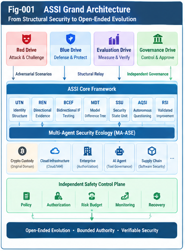

# Adversarial Structural Security Intelligence (ASSI)

**Research foundation · v0.1.0 · Open research / collective learning**

> **Cryptographic validity is not structural security.** A technically valid signature, a plausible identity inference, or a high confidence score is not, by itself, sufficient authorization for a consequential action.

**ASSI (Adversarial Structural Security Intelligence)** is a specification-first research program for understanding, testing, and improving security in systems where identities, evidence, authority, incentives, and dependencies change over time. Cryptocurrency custody and exchange operations provide an initial motivating setting; the intended research scope also includes cloud infrastructure, enterprise authorization, AI agents, software supply chains, and other multi-actor systems.

ASSI combines structural identity modeling, directional evidence, conditional hypothesis testing, independent safety controls, adversarial experiments, and governed learning. Its central engineering distinction is between **adaptive security intelligence**, which may discover and recommend, and **independently enforced authority**, which alone may permit consequential actions.

**Research status:** This repository presents architectural proposals, draft contracts, synthetic case studies, and falsifiable experimental designs. It does **not** claim a deployed security product, completed benchmark results, independently verified performance improvements, or formal security certification.

## 1. Why ASSI?

Security failures can arise even when local technical checks pass. A cryptographic signature may be valid while the transaction intent is unauthorized; multiple on-chain addresses may appear related without identifying a single human controller; apparently independent observations may share the same upstream source; a defense may succeed in one simulation while failing under different assumptions; and iterative improvements may gradually widen privileges without an obvious single dangerous change.

ASSI investigates four recurring tensions:

1. **Control versus autonomy:** useful automation must not acquire unreviewed authority.
2. **Identity versus authorization:** observed behavior or inferred control does not establish a legitimate right to act.
3. **Efficiency versus safety:** operational speed and liquidity can enlarge reachable loss exposure.
4. **Evolution versus stability:** continuous learning must preserve independent safety boundaries and accountable governance.

These tensions are not assumed to be eliminable. The objective is to make them explicit, measurable, and governable.

## 2. Research principles

- **Cryptographic validity ≠ legitimate intent ≠ acceptable exposure.** Each requires a distinct check.
- **Identity is compositional, temporal, and hypothesis-dependent.** Persons, teams, services, and coalitions may overlap and change.
- **Evidence is not authority.** A model's inference cannot confer permissions or override a protected policy.
- **Contradictions are hypothesis-scoped.** Evidence against one-person control does not automatically disprove team control.
- **Direction and provenance matter.** Similarity, directional relevance, source quality, and evidence dependence must be distinguished.
- **Feedback should be structural.** A test can revise a score, split a hypothesis, reclassify a relationship, or request evidence; it must not silently promote an inference to a fact.
- **Bounded loss before perfect defense.** Independent controls and recoverability remain necessary when intelligence is wrong.
- **Simulation is not validation; validation is not deployment approval.** Independent evaluation and governance are separate gates.
- **Failures are reusable research artifacts.** Security Residuals, negative transfers, and inconclusive results belong in the structural learning record.

## 3. Architecture at a glance

```text
          Observed events / systems / dependencies
                            |
               Typed structural representation
             UTN + temporal/compositional identity
                            |
             Evidence, hypotheses, provenance
                    REN + MDT + BCEF
                            |
             Candidate findings and proposals
                            |
       +--------------------+--------------------+
       |                                         |
       v                                         v
Adaptive intelligence & experiments      Independent safety plane
AQSI / Red / Blue / Evaluation           Policy / authorization / risk
Security Residual / Validated RSI        Enforcement / recovery / audit
       |                                         |
       v                                         v
Structural Relay & knowledge base         Bounded consequential action
       |                                         ^
       +--- independently validated proposals --+
             (only through governance gates)
```

**Structural Security Units (SSUs)** provide a typed, versioned, auditable interchange layer for observations, hypotheses, test results, authorization requests, adversarial scenarios, residuals, validation records, and governance decisions. The six specifications under [`specs/`](specs/) define proposed contracts and conformance requirements. They are research drafts, not an implemented standard.


    
*Figure 1. Proposed ASSI grand architecture: structural evidence and adaptive learning inform, but do not override, independently governed authorization and safety enforcement.*


### Major mechanisms

| Mechanism | Role | Boundary / caution |
|---|---|---|
| **UTN — Universal Typing and Naming** | Typed naming and compositional, time-dependent identity hypotheses | Observed address ≠ verified controller ≠ authorized subject |
| **REN — Relational Evidence Navigation** | Directional weak-evidence assessment and alternative-hypothesis navigation | Correlated evidence must not be counted as independent confirmation |
| **MDT — Metric Differential Tree** | Structural differences, time-indexed changes, and revisions | A structural change requires provenance and scope |
| **BCEF — Bidirectional Conditional Evidence Feedback** | Forward, reverse, counterfactual, and contradiction IF tests with structured impact | Reverse implication is not automatically valid; contradictions remain hypothesis-scoped |
| **Independent Safety Control Plane** | Policy decision/enforcement, transaction binding, exposure budgets, recovery | Adaptive scores cannot bypass independent authorization |
| **Adversarial Drives** | Red, Blue, Evaluation, and Governance roles for bounded experiments | Evaluation and approval are not interchangeable |
| **AQSI / Validated RSI** | Generate research questions and test candidate improvements | No self-approval, unbounded recursion, or autonomous privilege expansion |
| **Structural Relay** | Preserve verified knowledge, residuals, uncertainty, and negative results | Relay acceptance is not evidence validation |

## 4. Research program and reading paths

The **27 core research documents** are organized as 12 articles, 6 draft specifications, 5 synthetic cases, and 4 extensions. A reader may begin with the overview and proceed through one of three paths:

- **Conceptual:** ASSI-001 → ASSI-002 → ASSI-004 → ASSI-006 → ASSI-007 → ASSI-010 → ASSI-012.
- **Engineering / contracts:** ASSI-010 → SPEC-001 → SPEC-002 → SPEC-003 → SPEC-004 → SPEC-005 → SPEC-006.
- **Experimental / falsification:** ASSI-011 → CASE-001 → CASE-002 → CASE-003 → CASE-004 → CASE-005 → [VALIDATION-ROADMAP.md](VALIDATION-ROADMAP.md).

### A. Core research articles (`docs/`)

| ID | Document | Focus |
|---|---|---|
| ASSI-001 | [From Cryptographic Validity to Structural Security](docs/ASSI-001-From-Cryptographic-Validity-to-Structural-Security.md) | Why local technical validity is insufficient |
| ASSI-002 | [Four Structural Contradictions of Cryptocurrency Security](docs/ASSI-002-Four-Structural-Contradictions-of-Cryptocurrency-Security.md) | Fundamental security tensions |
| ASSI-003 | [Trust Relocation and Structural Security Boundaries](docs/ASSI-003-Trust-Relocation-and-Structural-Security-Boundaries.md) | Trust movement and control boundaries |
| ASSI-004 | [UTN and Compositional Identity Intelligence](docs/ASSI-004-UTN-and-Compositional-Identity-Intelligence.md) | Temporal and multi-actor identity |
| ASSI-005 | [REN and Directional Weak Evidence Intelligence](docs/ASSI-005-REN-and-Directional-Weak-Evidence-Intelligence.md) | Directional evidence and provenance |
| ASSI-006 | [Bidirectional Conditional Evidence Feedback](docs/ASSI-006-Bidirectional-Conditional-Evidence-Feedback.md) | Four IF modes and structural impact |
| ASSI-007 | [Structural Authorization and Independent Control Planes](docs/ASSI-007-Structural-Authorization-and-Independent-Control-Planes.md) | Independent permission and loss controls |
| ASSI-008 | [Adversarial Security Drives and Competitive Relay](docs/ASSI-008-Adversarial-Security-Drives-and-Competitive-Relay.md) | Red/Blue/Evaluation/Governance |
| ASSI-009 | [Security Residuals and Validated Recursive Self-Improvement](docs/ASSI-009-Security-Residuals-and-Validated-Recursive-Self-Improvement.md) | Failure-to-learning lifecycle |
| ASSI-010 | [ASSI Grand Architecture and Structural Security Units](docs/ASSI-010-ASSI-Grand-Architecture-and-Structural-Security-Units.md) | Integrated architecture and SSUs |
| ASSI-011 | [Benchmark Laboratories and Falsifiable Security Hypotheses](docs/ASSI-011-Benchmark-Laboratories-and-Falsifiable-Security-Hypotheses.md) | Experimental design and baselines |
| ASSI-012 | [From Cryptocurrency Security to General Structural Defense](docs/ASSI-012-From-Cryptocurrency-Security-to-General-Structural-Defense.md) | Cross-domain generalization and limits |

### B. Draft specifications (`specs/`)

| ID | Document | Contract |
|---|---|---|
| SPEC-001 | [Structural Security Unit Contract](specs/SPEC-001-Structural-Security-Unit-Contract.md) | Canonical SSU envelope, provenance, lifecycle |
| SPEC-002 | [Compositional Identity and UTN Contract](specs/SPEC-002-Compositional-Identity-and-UTN-Contract.md) | Typed identities, temporal composition, merge/split |
| SPEC-003 | [Bidirectional IF and Evidence Impact Contract](specs/SPEC-003-Bidirectional-IF-and-Evidence-Impact-Contract.md) | Conditional tests and controlled feedback |
| SPEC-004 | [Authorization and Safety Control Contract](specs/SPEC-004-Authorization-and-Safety-Control-Contract.md) | Independent PDP/PEP, risk budgets, recovery |
| SPEC-005 | [Adversarial Drive and Relay Contract](specs/SPEC-005-Adversarial-Drive-and-Relay-Contract.md) | Experiment roles, isolation, relay, evaluation |
| SPEC-006 | [Validated RSI and Governance Contract](specs/SPEC-006-Validated-RSI-and-Governance-Contract.md) | Independent validation, promotion, rollback |

### C. Synthetic cases (`cases/`)

| ID | Document | Research scenario |
|---|---|---|
| CASE-001 | [Cryptocurrency Trust and Liquidity](cases/CASE-001-Cryptocurrency-Trust-and-Liquidity.md) | Liquidity versus reachable exposure |
| CASE-002 | [UTN On-Chain Identity Sandbox](cases/CASE-002-UTN-On-Chain-Identity-Sandbox.md) | Compositional identity with synthetic ground truth |
| CASE-003 | [Bidirectional IF and False Rejection](cases/CASE-003-Bidirectional-IF-and-False-Rejection.md) | Scope-aware contradiction and scoring revisions |
| CASE-004 | [Compromised Signing-Service Defense](cases/CASE-004-Compromised-Signing-Service-Defense.md) | Valid signatures with unauthorized intent |
| CASE-005 | [Adversarial Drives and Security RSI](cases/CASE-005-Adversarial-Drives-and-Security-RSI.md) | Multi-round experiments and validated learning |

**Case studies describe proposed synthetic laboratories, not documented real-world incidents or completed experimental results.**

### D. Research extensions (`extensions/`)

| ID | Document | Direction |
|---|---|---|
| EXT-001 | [Multi-Agent Adversarial Security Ecology](extensions/EXT-001-Multi-Agent-Adversarial-Security-Ecology.md) | Multi-agent competition, cooperation, common failures |
| EXT-002 | [Autonomous Security Questioning and Exploration](extensions/EXT-002-Autonomous-Security-Questioning-and-Exploration.md) | AQSI question units and bounded exploration |
| EXT-003 | [Cross-Domain Structural Security Transfer](extensions/EXT-003-Cross-Domain-Structural-Security-Transfer.md) | Typed transfer, domain adapters, negative transfer |
| EXT-004 | [Open-Ended Security Evolution and Governance](extensions/EXT-004-Open-Ended-Security-Evolution-and-Governance.md) | Authority drift and governance of evolution |

## 5. Figures

The illustration set is located under `figures/`:

1. `Fig-001-ASSI-Grand-Architecture.png`
2. `Fig-002-Four-Structural-Security-Contradictions.png`
3. `Fig-003-UTN-Compositional-Identity-Hypergraph.png`
4. `Fig-004-BCEF-and-Scoring-Tree-Feedback.png`
5. `Fig-005-Structural-Authorization-Control-Plane.png`
6. `Fig-006-Adversarial-Drives-and-Competitive-Relay.png`
7. `Fig-007-Security-Residual-to-Validated-RSI.png`
8. `Fig-008-ASSI-Benchmark-and-Validation-Roadmap.png`

> **Publication check:** Verify that all eight standalone image files are present under these exact filenames before enabling image embeds or publishing a release. A composite infographic does not by itself satisfy eight separate file paths.

## 6. Benchmarks and falsifiable hypotheses

ASSI proposes four primary benchmark families:

| Benchmark | Target | Example metrics |
|---|---|---|
| **BM-001: Compositional Identity** | Distinguish individuals, teams, shared services, and temporal changes | False merge/split rates; temporal consistency |
| **BM-002: BCEF Evidence Revision** | Test scoped contradiction and dependency-aware feedback | False rejection; correct rejection; scope leakage |
| **BM-003: Authorization and Bounded Loss** | Contain unauthorized execution despite compromised components | Unauthorized exposure; false blocks; latency; recovery |
| **BM-004: Adversarial Relay and Validated RSI** | Assess multi-round improvements and out-of-distribution robustness | Residual recurrence; generalization; governance violations |

The expected validation sequence is **contract conformance → controlled baselines → component ablations → adversarial scenarios → independent evaluation → reproducibility → narrowly governed pilots, if justified**. Improvements are hypotheses until demonstrated with appropriate controls and disclosed limitations.

## 7. Safety, scope, and responsible experimentation

ASSI is intended for defensive research and authorized evaluation. Synthetic identities, simulated transactions, isolated infrastructure, and non-production datasets are preferred for early tests. Any experiment involving real assets, credentials, third-party systems, or production services requires explicit authorization, containment, resource limits, auditability, and recovery plans.

In particular:

- No inferred identity or confidence score automatically grants access.
- No AI-generated candidate may approve its own deployment or alter protected safety policy.
- A sandbox result does not establish a production loss bound.
- Independent controls must cover every consequential execution path; shared administrative compromise and bypass paths remain explicit failure hypotheses.
- Negative results, uncertainty, and unsuccessful transfer attempts should be documented rather than suppressed.

## 8. Collaboration and research maturity

The repository is designed for **open, low-key, collective learning**. Useful contributions include logical counterexamples, threat-model corrections, contract ambiguities, conformance test vectors, synthetic benchmarks, independent replications, negative results, and proposals that make assumptions or failure boundaries more explicit.

Suggested contribution format:

1. State the claim or contract clause being tested.
2. Specify assumptions, actor capabilities, evidence sources, and authorization boundaries.
3. Provide a reproducible synthetic example or test vector.
4. Identify the baseline, observable outcome, and potential falsification condition.
5. Record provenance, limitations, and unresolved Security Residuals.

This research foundation is **not** a replacement for established security engineering, audits, formal verification, incident response, or operational governance. The architecture should be judged by reproducible evidence, not by its conceptual completeness.

## 9. Repository navigation and publication assets

Additional navigation and release assets are at the repository root: `START-HERE.md`, `CONTENTS.md`, `GLOSSARY.md`, `FIGURE-INDEX.md`, `FUTURE-DIRECTIONS.md`, `OPEN-QUESTIONS.md`, `TESTABLE-HYPOTHESES.md`, `VALIDATION-ROADMAP.md`, `CHANGELOG.md`, `CITATION.cff`, `.zenodo.json`, and `LICENSE`. Release materials are under `release/`.

Links above assume the corresponding research files are committed to their designated folders. Verify links, figures, metadata, licensing, and version consistency before creating a tagged release or DOI deposit.

## 10. License and citation

**Intended license:** Apache License 2.0. See [`LICENSE`](LICENSE) once the license file has been added to the repository. Until then, this README alone is not a substitute for a complete license grant.

Citation metadata will be provided in `CITATION.cff` and `.zenodo.json`. **Do not insert or infer a DOI before one has actually been assigned.** Refer to the specific release version and permanent archive record when available.

---

## 📚 DBM-SI Series Navigation

See:\
[./docs/DBM-SI-Series-of-gitHub-Repositories/DBM-SI-Series-of-gitHub-Repositories.md](./docs/DBM-SI-Series-of-gitHub-Repositories/DBM-SI-Series-of-gitHub-Repositories.md)

---

**ASSI research maxim:** *Keep discovery open-ended, evidence revisable, authority bounded, governance accountable, and failure learnable.*

