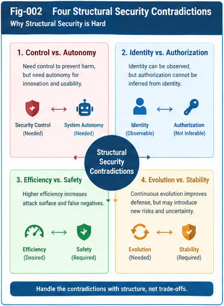

# START HERE — Adversarial Structural Security Intelligence (ASSI)

**Version:** v0.1.0 — Research Foundation  
**Status:** Open research, draft specifications, and synthetic validation designs  
**License:** Apache-2.0  
**Audience:** Security researchers, systems architects, protocol designers, AI safety engineers, evaluators, and prospective collaborators

> **Cryptographic validity is not structural security.**  
> **Evidence is not authorization. Simulation is not validation. Validation is not deployment approval.**

Welcome to **Adversarial Structural Security Intelligence (ASSI)**. This guide provides a short route into the research program, explains its central distinctions, and shows where to begin reading, evaluating, or contributing. For the full repository overview, see [README.md](README.md); for a complete document inventory, see [CONTENTS.md](CONTENTS.md) when available.

ASSI is **not** a claim that an AI security system has been implemented or proven secure. The repository contains research hypotheses, proposed interfaces and conformance conditions, and synthetic experiments intended to make those hypotheses testable. Treat its architectures and examples as proposals requiring independent implementation and validation.

---



*Figure 2. Four interacting contradictions in cryptocurrency security: local cryptographic validity does not resolve system-level trust, identity, liquidity, and governance risks.*

---

## 1. The research problem in three minutes

A digital system may pass a local check yet still behave insecurely at the structural level:

- A **valid cryptographic signature** can accompany a transaction that the asset owner never legitimately authorized.
- Several **on-chain addresses** can be associated with a team, shared service, or coordinated process without proving that they belong to one person.
- Multiple apparently confirming **signals** may all derive from one upstream observation, creating false confidence.
- A successful **defensive simulation** may fail to generalize to new adversarial conditions.
- A sequence of seemingly minor **policy updates** may cumulatively widen authority beyond its intended boundary.

ASSI asks how to represent, test, and govern these structures rather than relying on a single score, signature, model prediction, or security checklist.

The motivating domain is cryptocurrency custody and exchange security, but the research also explores cloud IAM, enterprise workflows, AI agent tool use, and software supply chains. Cross-domain reuse is a **hypothesis to test**, not a transferable security guarantee.

## 2. Four tensions to keep in view

| Structural tension | Typical failure mode | ASSI research response |
|---|---|---|
| **Control vs. autonomy** | An adaptive agent acquires authority through its own recommendations | Separate learning and decision support from independent policy enforcement |
| **Identity vs. authorization** | An inferred controller is treated as a verified or permitted actor | Typed, time-indexed compositional identity and distinct authorization checks |
| **Efficiency vs. safety** | High liquidity or automation expands reachable loss | Explicit exposure accounting, transaction binding, independent budgets and recovery |
| **Evolution vs. stability** | Continuous optimization silently changes protected boundaries | Independent evaluation, governance gates, versioned policies and rollback |

These tensions are not presumed solvable by intelligence alone. A useful result may be a better detection mechanism, a narrower authorization surface, an explicitly identified failure condition, or a well-supported negative result.

## 3. The architecture in one view

```text
 Observations / events / actors / assets / permissions
                         |
            UTN + compositional identity
             (typed, temporal hypotheses)
                         |
              REN + MDT + BCEF
        (directional evidence, differences,
         conditional tests, structured impact)
                         |
           Findings / questions / proposals
                    /             \
                   v               v
       Adaptive research loop     Independent safety plane
       AQSI + Red/Blue Drives     Policy + authorization
       Evaluation + Residuals     Exposure limits + PEP
       Validated RSI + Relay      Recovery + audit
                   |               ^
                   +-- independent governance gate --+

 No inference, score, relay message, or self-improvement
 directly grants permission for a consequential action.
```

**Structural Security Units (SSUs)** are the proposed common interchange format: typed and versioned records for observations, hypotheses, tests, impacts, requests, evaluations, residuals, and governance decisions. The contracts under [`specs/`](specs/) specify their intended boundaries.

### A compact glossary

| Term | Working meaning |
|---|---|
| **UTN** | Universal Typing and Naming: distinguish addresses, inferred controllers, composite subjects, verified identities, and authorized subjects |
| **Compositional identity** | An actor may be an individual, team, coalition, service, or overlapping and changing combination |
| **REN** | Relational Evidence Navigation: assess evidence in a directional, contextual, hypothesis-aware manner |
| **MDT** | Metric Differential Tree: represent structural differences and revisions over time |
| **BCEF** | Bidirectional Conditional Evidence Feedback: forward, reverse, counterfactual, and contradiction IF tests, with structured impact |
| **SSU** | Structural Security Unit: typed, versioned, provenance-aware security research record |
| **Control plane** | Independently governed policy, authorization, exposure, enforcement, and recovery functions |
| **Adversarial Drives** | Red, Blue, Evaluation, and Governance roles in bounded experiments |
| **Security Residual** | A recorded unresolved weakness, ambiguity, failure, or validation gap |
| **AQSI** | Autonomous Questioning Structural Intelligence: formulate and prioritize testable research questions |
| **Validated RSI** | Recursive improvement only after independent testing and governance review |
| **Structural Relay** | Traceable transfer of questions, evidence, findings, residuals, and independently validated improvements |

For terminology beyond this introduction, consult [GLOSSARY.md](GLOSSARY.md) when published.

## 4. Choose a reading path

You do **not** need to read all 27 principal documents sequentially. Select a path that matches your role.

### Path A — First-time reader: the essential argument (approximately 60–90 minutes)

1. [ASSI-001 — From Cryptographic Validity to Structural Security](docs/ASSI-001-From-Cryptographic-Validity-to-Structural-Security.md)
2. [ASSI-002 — Four Structural Contradictions of Cryptocurrency Security](docs/ASSI-002-Four-Structural-Contradictions-of-Cryptocurrency-Security.md)
3. [ASSI-004 — UTN and Compositional Identity Intelligence](docs/ASSI-004-UTN-and-Compositional-Identity-Intelligence.md)
4. [ASSI-006 — Bidirectional Conditional Evidence Feedback](docs/ASSI-006-Bidirectional-Conditional-Evidence-Feedback.md)
5. [ASSI-007 — Structural Authorization and Independent Control Planes](docs/ASSI-007-Structural-Authorization-and-Independent-Control-Planes.md)
6. [ASSI-010 — ASSI Grand Architecture and Structural Security Units](docs/ASSI-010-ASSI-Grand-Architecture-and-Structural-Security-Units.md)

**Question to carry through this path:** Which conclusions can intelligence legitimately support, and which actions must remain under independent authority?

### Path B — Engineer or protocol implementer: contracts first

1. [ASSI-010 — Grand Architecture and SSUs](docs/ASSI-010-ASSI-Grand-Architecture-and-Structural-Security-Units.md)
2. [SPEC-001 — Structural Security Unit Contract](specs/SPEC-001-Structural-Security-Unit-Contract.md)
3. [SPEC-002 — Compositional Identity and UTN Contract](specs/SPEC-002-Compositional-Identity-and-UTN-Contract.md)
4. [SPEC-003 — Bidirectional IF and Evidence Impact Contract](specs/SPEC-003-Bidirectional-IF-and-Evidence-Impact-Contract.md)
5. [SPEC-004 — Authorization and Safety Control Contract](specs/SPEC-004-Authorization-and-Safety-Control-Contract.md)
6. [SPEC-005 — Adversarial Drive and Relay Contract](specs/SPEC-005-Adversarial-Drive-and-Relay-Contract.md)
7. [SPEC-006 — Validated RSI and Governance Contract](specs/SPEC-006-Validated-RSI-and-Governance-Contract.md)

**Suggested first implementation:** A *non-production* SSU parser/validator with schema checks, provenance validation, and negative conformance tests. Do not begin by connecting a prototype to live signing keys or asset execution paths.

### Path C — Experimentalist: falsify the claims

1. [ASSI-011 — Benchmark Laboratories and Falsifiable Security Hypotheses](docs/ASSI-011-Benchmark-Laboratories-and-Falsifiable-Security-Hypotheses.md)
2. [CASE-002 — UTN On-Chain Identity Sandbox](cases/CASE-002-UTN-On-Chain-Identity-Sandbox.md)
3. [CASE-003 — Bidirectional IF and False Rejection](cases/CASE-003-Bidirectional-IF-and-False-Rejection.md)
4. [CASE-004 — Compromised Signing-Service Defense](cases/CASE-004-Compromised-Signing-Service-Defense.md)
5. [CASE-005 — Adversarial Drives and Security RSI](cases/CASE-005-Adversarial-Drives-and-Security-RSI.md)
6. [TESTABLE-HYPOTHESES.md](TESTABLE-HYPOTHESES.md) and [VALIDATION-ROADMAP.md](VALIDATION-ROADMAP.md), when available

**Suggested first experiment:** In a synthetic identity dataset, compare a flat one-controller-per-cluster baseline with a temporal compositional identity model. Report both false merges and false splits, not only aggregate accuracy.

### Path D — Governance or safety reviewer

1. [ASSI-003 — Trust Relocation and Structural Security Boundaries](docs/ASSI-003-Trust-Relocation-and-Structural-Security-Boundaries.md)
2. [ASSI-007 — Structural Authorization and Independent Control Planes](docs/ASSI-007-Structural-Authorization-and-Independent-Control-Planes.md)
3. [SPEC-004 — Authorization and Safety Control Contract](specs/SPEC-004-Authorization-and-Safety-Control-Contract.md)
4. [SPEC-006 — Validated RSI and Governance Contract](specs/SPEC-006-Validated-RSI-and-Governance-Contract.md)
5. [EXT-004 — Open-Ended Security Evolution and Governance](extensions/EXT-004-Open-Ended-Security-Evolution-and-Governance.md)

**Review question:** Can an adaptive component, a compromised signing service, or a policy update bypass the independently governed execution boundary?

### Path E — Generalization and collective learning

1. [ASSI-012 — From Cryptocurrency Security to General Structural Defense](docs/ASSI-012-From-Cryptocurrency-Security-to-General-Structural-Defense.md)
2. [EXT-001 — Multi-Agent Adversarial Security Ecology](extensions/EXT-001-Multi-Agent-Adversarial-Security-Ecology.md)
3. [EXT-002 — Autonomous Security Questioning and Exploration](extensions/EXT-002-Autonomous-Security-Questioning-and-Exploration.md)
4. [EXT-003 — Cross-Domain Structural Security Transfer](extensions/EXT-003-Cross-Domain-Structural-Security-Transfer.md)
5. [EXT-004 — Open-Ended Security Evolution and Governance](extensions/EXT-004-Open-Ended-Security-Evolution-and-Governance.md)

**Review question:** What can transfer as a reusable structural mechanism, and what must be revalidated because the target domain's authority and failure semantics differ?

## 5. Four proposed benchmark families

These are **planned experiments**, not completed benchmark results.

| Benchmark | Core hypothesis area | Representative measures | Important failure condition |
|---|---|---|---|
| **BM-001: Compositional Identity** | Dynamic, overlapping, time-dependent identity | False merge/split, temporal error, identity calibration | Composite model fails to improve on simpler baselines or creates new scope errors |
| **BM-002: BCEF Evidence Revision** | Conditional reasoning and structural feedback | False rejection, correct rejection, scope leakage, dependency error | Reverse inference or repeated evidence causes unwarranted certainty |
| **BM-003: Authorization and Bounded Loss** | Independent execution controls | Unauthorized execution, exposure, false blocks, latency, recovery | A bypass or common-mode failure invalidates the claimed loss bound |
| **BM-004: Adversarial Relay and Validated RSI** | Learning from security residuals | Out-of-sample effectiveness, recurrence, regression, governance cost | Improvements overfit simulation, contaminate evaluation, or expand authority |

A valid study should predefine its baselines, scenario generation, ground-truth boundaries, independent evaluator, acceptance thresholds, negative tests, and limitations. A promising result in a synthetic laboratory is not evidence of production-grade safety.

## 6. What a first contribution could look like

ASSI favors **small, independently checkable contributions** over unverified claims of a complete intelligent security platform. Useful contributions include:

- A minimal SSU schema validator with explicit invalid examples and test reports.
- A reproducible synthetic UTN identity dataset with hidden ground truth and temporal composition.
- A BCEF counterexample demonstrating when an inverse implication is invalid or a contradiction is over-scoped.
- A non-production authorization simulator that exposes bypass paths and budget race conditions.
- A benchmark replication with pre-registered metrics and a documented negative result.
- A cross-domain mapping that explicitly records non-transferable authorization semantics.
- A governance review identifying policy drift or a common-mode control-plane failure.

A proposed contribution should state: **claim → assumptions → evidence → method → baseline → metrics → counterexamples → residuals → reproducibility artifacts**. If an experiment fails, retain the failure and its provenance; it may be a valuable Structural Relay output.

## 7. A safe, bounded first research exercise

The following exercise requires no live chain access, credentials, real assets, or external targets.

**Objective:** Test whether hypothesis-scoped contradiction prevents an invalid identity rejection.

1. Create synthetic actors: `person-A`, `person-B`, `team-T`, and `service-S`.
2. Define competing hypotheses: `H1 = one person controls all events`, `H2 = team-T coordinates them`, `H3 = shared service-S explains the overlap`.
3. Generate synthetic observations in which two events overlap in time in a way incompatible with **H1**, but compatible with **H2** and **H3**.
4. Apply a naive global rejection rule and record which hypotheses it incorrectly removes.
5. Apply BCEF contradiction tests with explicit hypothesis, role, time interval, assumptions, and provenance.
6. Compare **false rejection**, **correct rejection**, and **scope leakage**. Preserve any inconclusive assessments.
7. Record the resulting Security Residual and a candidate AQSI follow-up question.

**Expected outcome:** A reproducible comparison, not a presumption that BCEF wins. The experiment should report conditions where the scoped method fails, adds cost, or has insufficient evidence.

**Safety boundary:** Keep all identities, events, signing flows, and assets synthetic. Do not probe third-party systems or execute real transactions.

## 8. Non-negotiable distinctions

Before interpreting any ASSI result, verify that these boundaries remain intact:

1. **Observed event ≠ inferred controller ≠ verified identity ≠ authorized subject.**
2. **Evidence support ≠ logical proof; absence of evidence ≠ contradiction.**
3. **A contradiction is limited to the tested hypothesis and conditions.**
4. **Correlated evidence must not be silently treated as independent evidence.**
5. **A high score does not grant execution permission.**
6. **A valid signature does not prove legitimate intent.**
7. **Relay acceptance does not constitute independent validation.**
8. **Independent validation does not constitute deployment approval.**
9. **Self-improvement cannot modify its own non-bypassable safety limits.**
10. **Claims of bounded loss depend on explicit assumptions about enforcement coverage, compromise boundaries, and recovery.**

If a proposed implementation violates any of these distinctions, treat it as a design defect or an unresolved research question—not as an acceptable simplification.

## 9. Repository map

```text
Adversarial-Structural-Security-Intelligence/
├── README.md                 Project overview and full navigation
├── START-HERE.md             This guide
├── CONTENTS.md               Document inventory (planned publication asset)
├── GLOSSARY.md               Terminology (planned publication asset)
├── FIGURE-INDEX.md           Figure guide (planned publication asset)
├── FUTURE-DIRECTIONS.md      Research directions (planned publication asset)
├── OPEN-QUESTIONS.md         Unresolved problems (planned publication asset)
├── TESTABLE-HYPOTHESES.md    Falsifiable claims (planned publication asset)
├── VALIDATION-ROADMAP.md     Validation stages (planned publication asset)
├── docs/                     ASSI-001 through ASSI-012 (12 papers)
├── specs/                    SPEC-001 through SPEC-006 (6 drafts)
├── cases/                    CASE-001 through CASE-005 (5 synthetic cases)
├── extensions/               EXT-001 through EXT-004 (4 extensions)
├── figures/                  Fig-001 through Fig-008 (8 planned assets)
└── release/                  Release notes and ResearchGate materials
```

### Visual entry points

- [Fig-001 — ASSI Grand Architecture](figures/Fig-001-ASSI-Grand-Architecture.png)
- [Fig-002 — Four Structural Security Contradictions](figures/Fig-002-Four-Structural-Security-Contradictions.png)
- [Fig-003 — UTN Compositional Identity Hypergraph](figures/Fig-003-UTN-Compositional-Identity-Hypergraph.png)
- [Fig-004 — BCEF and Scoring Tree Feedback](figures/Fig-004-BCEF-and-Scoring-Tree-Feedback.png)
- [Fig-005 — Structural Authorization Control Plane](figures/Fig-005-Structural-Authorization-Control-Plane.png)
- [Fig-006 — Adversarial Drives and Competitive Relay](figures/Fig-006-Adversarial-Drives-and-Competitive-Relay.png)
- [Fig-007 — Security Residual to Validated RSI](figures/Fig-007-Security-Residual-to-Validated-RSI.png)
- [Fig-008 — ASSI Benchmark and Validation Roadmap](figures/Fig-008-ASSI-Benchmark-and-Validation-Roadmap.png)

*Links describe the intended repository layout; availability depends on which publication assets have been committed.*

## 10. Publication, citation, and limitations

**Research foundation:** v0.1.0. The version describes the publication package, not an independently certified implementation. Statements of architecture, conformance, or potential improvement are proposals until supported by documented tests.

**License:** Apache-2.0; see [LICENSE](LICENSE) when included in the repository. Citation metadata should be taken from [CITATION.cff](CITATION.cff) and the eventual DOI record after release. Do not invent a DOI before registration.

**Responsible use:** Experiments should be performed only in owned, explicitly authorized, or synthetic environments. Avoid using inferred identity claims to identify real people without independent substantiation. No material in this repository authorizes intrusion, asset movement, or bypass of third-party controls.

**Invitation:** Read critically, reproduce carefully, propose counterexamples, preserve negative results, and distinguish structural hypotheses from established security guarantees.

---

**Recommended next step:** Choose one of the five reading paths above, then formulate one falsifiable claim with an explicit independent baseline and a documented safety boundary.

**Core principle:** *Keep discovery open-ended, evidence revisable, authority bounded, governance accountable, and failure learnable.*
