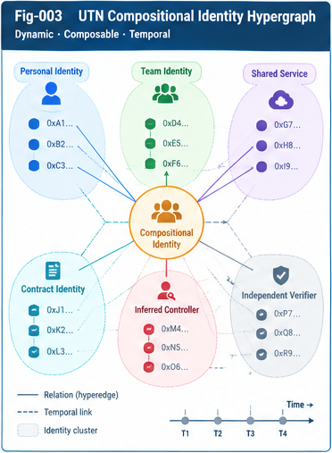

# CASE-002 — UTN On-Chain Identity Sandbox

**Project:** Adversarial Structural Security Intelligence (ASSI)  
**Version:** v0.1.0 — Research Foundation  
**Status:** Synthetic research case and proposed benchmark; not an executed experiment or validated identity-attribution method  
**Date:** 2026-11-02  
**License:** Apache-2.0  
**Repository path:** `cases/CASE-002-UTN-On-Chain-Identity-Sandbox.md`  
**Related:** ASSI-004–006, ASSI-010–011; SPEC-001–003, SPEC-005–006; CASE-001

## Abstract

A blockchain can expose transactions, addresses, contract calls, event logs, and other protocol artifacts without revealing who ultimately controls them. A single person may use multiple addresses; a team may act through shared infrastructure; unrelated actors may exhibit similar transaction patterns because they use the same service or respond to the same external event. Conventional address clustering can therefore confuse observed connectivity with common control, common control with a single person, and inferred identity with independently verified identity. This case proposes a reproducible **synthetic on-chain identity sandbox** using Universal Typing and Naming (UTN), temporal compositional identity hypotheses, Relational Evidence Navigation (REN), and Bidirectional Conditional Evidence Feedback (BCEF). The sandbox retains competing explanations, evaluates hypothesis-scoped contradictions, and measures false merges, false splits, calibration, temporal continuity, and evidence provenance. It separates structural inference from verified identity and authorization. The case specifies a synthetic data generator, ground-truth manifest, experimental conditions, reference schemas, test vectors, falsifiable hypotheses, and governance controls. No real-world deanonymization, chain attribution, or benchmark result is claimed.

**Keywords:** UTN; on-chain evidence; compositional identity; temporal hypergraph; hypothesis portfolio; weak evidence; REN; BCEF; address clustering; synthetic benchmark; structural security.

---

## 1. Research Objective

**Primary question:** Can a typed, temporal, hypothesis-aware structural representation distinguish individual control, team control, shared infrastructure, and coincidental behavioral similarity more reliably than flat address clustering under controlled synthetic conditions?

**Secondary questions:**

1. Can a system preserve meaningful uncertainty without collapsing every address into a single identity assignment?
2. Can evidence dependency controls prevent multiple correlated features from creating unjustified confidence?
3. Can BCEF reject a specific identity hypothesis without discarding plausible alternatives?
4. Can a temporal identity model recognize membership changes and service migrations without rewriting history?
5. What is the operational cost of richer identity representations, and when does that cost outweigh their benefit?

This is an **experimental proposal**, not evidence that UTN, REN, or BCEF already outperform conventional methods.

### 1.1 Boundaries

The sandbox uses fictional addresses, fictional actors, inert tokens, simulated contract events, and synthetic transaction metadata. It does not ingest private customer records, exchange credentials, live wallet keys, or personal identifiers. No attempt is made to identify real wallet owners. Any future use of public-chain data requires a separately approved purpose, lawful basis, privacy assessment, and documented limits on attribution.

### 1.2 Four non-equivalences

The experiment must preserve these distinctions:

- **Same transaction pattern ≠ same controller.**
- **Same operational controller ≠ same natural person.**
- **Structural identity hypothesis ≠ independently verified identity.**
- **Inferred or verified identity ≠ authority to act.**

## 2. Synthetic Environment and Ground Truth

The reference sandbox, **UTN-ChainLab-01**, models a permissioned local ledger with an Ethereum-like event vocabulary but no connection to a public network. It is an abstraction for experimental comparison, not a production blockchain implementation.

### 2.1 Entities

| Synthetic entity | Role | Ground-truth complication |
|---|---|---|
| Person P-A | Individual operator | Uses multiple addresses over time |
| Person P-B | Individual operator | Shares team infrastructure with P-A |
| Person P-C | Independent operator | Uses same external service as the team |
| Team T-1 | Compositional controller | Membership changes mid-run |
| Team T-2 | Separate organization | Temporarily shares a service provider |
| Service S-1 | Transaction relay | Processes transactions for multiple controllers |
| Service S-2 | Custody or automation service | Changes ownership/management across epochs |
| Contract C-1 | Synthetic batch executor | Aggregates actions from unrelated principals |
| Contract C-2 | Synthetic treasury | Enforces a separate authorization policy |

An address is an **on-chain artifact**; a person, team, or service is a **controller candidate**. These types are never silently substituted for one another.

### 2.2 Time and episodes

The generator uses four epochs:

- **E0 — Stable operations:** individuals and teams follow distinct but partially overlapping routines.
- **E1 — Shared-service convergence:** unrelated controllers route transactions through S-1 and C-1.
- **E2 — Recomposition:** P-B leaves T-1; a new participant joins; S-2 changes its management role.
- **E3 — Adversarial ambiguity:** synchronized activity, synthetic decoys, and delayed observations create plausible but conflicting identity explanations.

Each episode carries a ground-truth **valid-time interval**, separate from event time, observation time, and the time an assessment was recorded.

### 2.3 Ground-truth partitioning

The hidden truth manifest records controllers, membership intervals, service-provider relationships, delegated operational roles, and the generating causal mechanism. It must be inaccessible to the inference pipeline. The evaluator alone reads it after predictions are frozen. Ground truth is richer than a single address-to-person label: a transaction may have an initiating person, an executing service, an approving team, and a policy owner.

## 3. Observation Model

The observable stream contains only synthetic chain-level and permitted simulation telemetry:

| Observation | Examples | Attribution limitation |
|---|---|---|
| Ledger event | Transfer, contract call, approval, event log | Reveals an event, not necessarily a human controller |
| Transaction relation | Input/output association, contract interaction | Can reflect shared infrastructure |
| Temporal feature | Burst, cadence, sequence | Can reflect a shared scheduler or common trigger |
| Behavioral feature | Reused contract route, amount distribution | Can reflect standardized software |
| Synthetic service signal | Explicit relay marker, simulated service receipt | Identifies a service relation, not the service's customers |
| Delayed or missing event | Partial indexer view | Missing observation is not automatically negative evidence |

Observations must be tagged with provenance, visibility limits, and their generation lineage. Derived features are not new independent observations.

## 4. UTN Typed Naming Scheme

---



*Figure 3. UTN-typed, time-indexed compositional identity: overlapping participants and shared services support multiple controller hypotheses without implying verified identity or authority.*

---

UTN names identify **what kind of object is being referenced**, not what the analyst hopes it represents. Example namespaces:

```text
utn:chainlab:chain:local-01
utn:chainlab:address:a-104
utn:chainlab:tx:tx-00219
utn:chainlab:contract:c-1
utn:chainlab:actor-person:p-a
utn:chainlab:actor-team:t-1
utn:chainlab:service:s-1
utn:chainlab:hypothesis:h-003
utn:chainlab:evidence:ev-078
utn:chainlab:relation:rel-015
```

The `actor-*` ground-truth namespaces are evaluator-only unless a fictional identity is deliberately revealed in a test. Inference-facing identifiers use `candidate-controller` or `hypothesis` types. An inferred candidate must never be relabeled as a verified person by changing a string prefix.

### 4.1 Naming requirements

1. Names are stable within the experiment and scoped by namespace authority.
2. Type and identifier are separately validated; an address identifier cannot stand in for a person identifier.
3. Aliases preserve lineage and cannot silently erase previous names.
4. Identity hypotheses reference observations through provenance-bearing links.
5. An identity merge or split creates a new version; historical versions remain queryable.
6. External verification, if modeled, requires a separate explicit attestation object.
7. An attestation does not automatically confer transaction authority.

## 5. Temporal Compositional Identity Hypergraph

Represent the structural model as a time-indexed typed hypergraph:

$$
\mathcal{G}_t=(V_t,\mathcal{E}_t,\tau,\pi,\nu),
$$

where $V_t$ are typed nodes, $\mathcal{E}_t$ are possibly multi-party relations, $\tau$ records type, $\pi$ records provenance, and $\nu$ records validity intervals. A hyperedge may encode a team composed of people, a shared execution service, or a joint approval relation without asserting that all participants are one person.

### 5.1 Distinct relations

`uses_address`, `operates_service`, `member_of_team`, `delegates_to`, `initiated_action`, `executed_action`, `approved_action`, and `shares_infrastructure_with` are different relations. Their domains, ranges, time semantics, and evidence requirements differ. In particular, `shares_infrastructure_with` does **not** entail `same_controller_as`.

### 5.2 Dynamic composition

A team hypothesis may be represented as:

$$
T_1(t)=\{P_A,P_B\}\quad (t\in E0\cup E1),
$$

$$
T_1(t)=\{P_A,P_D\}\quad (t\in E2\cup E3).
$$

These equations describe **synthetic evaluator truth**, not facts automatically visible to the inference engine. The inferred model must propose and revise membership from permitted evidence.

## 6. Competing Identity Hypotheses

For a cluster of related synthetic transactions, the candidate portfolio should include at least:

- **H1 — Single-person control:** one person directly controls the observed addresses.
- **H2 — Team control:** several people coordinate under one team-level controller.
- **H3 — Shared-service mediation:** unrelated principals use a common executor or relay.
- **H4 — Common external trigger:** independent controllers react to the same event.
- **H5 — Mixed explanation:** some addresses share a controller while others share only infrastructure.
- **H6 — Insufficient evidence:** current observations cannot distinguish the alternatives.

These are not always mutually exclusive at every granularity. H2 and H3 may both be true when a team uses a shared service. The evaluator must specify which predicates are exclusive and which are composable.

### 6.1 Hypothesis-scoped contradiction

A finding inconsistent with H1 must not be treated as a contradiction of H2, H3, or H5 unless the relevant predicates are independently tested. For example, simultaneous synthetic actions under incompatible exclusive-person constraints may refute **single-person direct execution**, but do not refute team coordination or automated service execution.

## 7. REN: Directional Weak-Evidence Navigation

REN ranks evidence relative to a question and a hypothesis, rather than treating generic similarity as proof of identity.

For evidence $e$, hypothesis $h$, direction $d$, and context $c$, define an illustrative relevance function:

$$
R(e,h\mid d,c)=f(\text{feature match},\text{direction},\text{reliability},\text{dependencies},\text{alternatives}).
$$

This is a research abstraction, not a calibrated posterior probability. Its implementation must record how the score was computed and which observations contributed.

### 7.1 Example directional questions

- Does temporal co-activity favor **shared scheduling** over **common ownership**?
- Does a contract route favor **shared service** over **single-person control**?
- Does a membership change explain a structural split without implying adversarial behavior?
- Does evidence that weakens H1 strengthen H2, or merely increase uncertainty?

### 7.2 Dependence-aware evidence

Suppose three features—similar timestamps, similar intervals, and synchronized bursts—are all derived from one scheduling event. They are three descriptions of a shared source, not three independent confirmations. The scoring layer must track a dependency group and compare outcomes with and without deduplication.

## 8. BCEF: Bidirectional Conditional Tests

Each conditional test declares a target hypothesis, scope, premises, evidence dependencies, and permissible impact.

| Mode | Sandbox question | Required caution |
|---|---|---|
| Forward IF | If H2 is true, what coordinated behavior should be observable? | Prediction failure matters only if the observation channel could have seen it |
| Reverse IF | Given synchronized events, which hypotheses could explain them? | Observing a consequence does not prove its antecedent |
| Counterfactual IF | Without S-1, would the apparent cluster remain? | Counterfactuals require a documented simulator intervention |
| Contradiction IF | Is H1 inconsistent with independent synthetic constraints? | Contradiction must target a precise predicate and interval |

### 8.1 Four-valued assessment

Use `support`, `refute`, `both`, or `unknown`. `Both` records conflicting evidence rather than forcing a binary verdict. Missing data should usually produce `unknown` unless a valid, documented observability assumption justifies a stronger conclusion.

### 8.2 Structured impact

An IF result may propose: revise a hypothesis score; narrow a validity interval; split a candidate group; add a shared-service relation; request further observations; or defer a decision. Structural changes require versioning and review. No BCEF result may create a verified identity attestation or authorize an asset transfer.

## 9. Reference Structural Security Unit Contracts

The following YAML is **illustrative**, not a complete normative schema. Implementations must additionally conform to SPEC-001–003.

```yaml
ssu_type: identity_hypothesis
schema_version: "0.1.0"
unit_id: "utn:chainlab:hypothesis:h-003"
status: hypothesized
subject:
  type: candidate_controller_group
  id: "utn:chainlab:candidate-controller:cg-07"
predicate: shared_service_mediation
object:
  type: service
  id: "utn:chainlab:service:s-1"
valid_time:
  start: "2026-01-01T00:00:00Z"
  end: "2026-01-02T00:00:00Z"
evidence_refs:
  - "utn:chainlab:evidence:ev-078"
  - "utn:chainlab:evidence:ev-079"
dependency_groups:
  - "schedule-source-4"
alternatives:
  - "utn:chainlab:hypothesis:h-001"
  - "utn:chainlab:hypothesis:h-002"
authorization_effect: none
provenance:
  producer: synthetic_inference_engine
  dataset_version: "chainlab-01-v0.1"
```

```yaml
ssu_type: conditional_evidence_test
schema_version: "0.1.0"
unit_id: "utn:chainlab:test:test-044"
mode: contradiction_if
target_hypothesis: "utn:chainlab:hypothesis:h-001"
target_predicate: single_person_direct_execution
scope:
  epoch: E2
  transaction_set: [tx-210, tx-211]
preconditions:
  - "exclusive_execution_constraints_verified_in_simulator"
observability: complete_for_declared_test
input_evidence_refs: [ev-102, ev-103]
assessment: refute
impact_proposal:
  operation: narrow_or_reject_hypothesis
  target: "utn:chainlab:hypothesis:h-001"
  preserve_alternatives: true
  requires_review: true
authorization_effect: none
```

## 10. Synthetic Data Generation

A generator should accept a published seed, scenario configuration, and a hidden ground-truth manifest. Its stages are:

1. Sample fictional people, teams, services, contracts, and address assignments.
2. Sample time-varying membership and delegation intervals.
3. Generate legitimate transaction sequences conditioned on controller roles.
4. Route a subset through shared services and batch contracts.
5. Inject controlled common-trigger responses and benign behavioral overlap.
6. Add observation delay, missing events, and derived-feature dependencies.
7. Add scenario-specific decoys and structural changes.
8. Write an observable event stream and a sealed evaluator-only truth manifest.
9. Record seed, generator version, schema version, and scenario parameters.
10. Run leakage checks before releasing the observable stream to an inference method.

### 10.1 Leakage prevention

Ground-truth controller IDs must not appear in observable event labels, deterministic address prefixes, file names, or metadata accessible to the model. Dataset partitions should separate generating templates, not merely transaction rows, to reduce memorization of synthetic patterns.

### 10.2 Example configuration

```yaml
benchmark: UTN-ChainLab-01
seed: 41721
epochs: [E0, E1, E2, E3]
actors:
  people: 24
  teams: 6
  services: 4
  contracts: 8
scenario_rates:
  shared_service: 0.35
  common_trigger: 0.20
  membership_recomposition: 0.25
observation_model:
  missing_event_rate: 0.08
  delayed_event_rate: 0.12
  correlated_feature_groups: true
split_policy: by_actor_group_and_generator_template
assets: inert_only
network_access: disabled
```

All values above are **example parameters**; they are not recommended real-world prevalence estimates.

## 11. Experimental Arms and Baselines

| Arm | Method | Purpose |
|---|---|---|
| B0 | Naive address connectivity clustering | Establish a simple structural baseline |
| B1 | Heuristic behavioral clustering | Test temporal/amount similarity without explicit composition |
| B2 | Typed UTN graph, no hypergraph composition | Isolate benefits of type separation |
| B3 | UTN + temporal compositional relations | Measure effect of teams, shared services, and membership changes |
| B4 | B3 + REN | Measure directional evidence selection and alternative explanations |
| B5 | B4 + BCEF | Measure conditional revision and scoped contradiction |
| B6 | B5 without evidence-dependency controls | Quantify double-counting failure |
| B7 | B5 without temporal validity | Quantify historical identity drift |

All methods must receive the same permitted observations, computational budget policy, and evaluation splits. More complex methods must report their runtime and annotation burden.

## 12. Evaluation Metrics

### 12.1 Identity errors

- **False Merge Rate (FMR):** fraction of evaluator-defined distinct controller pairs incorrectly asserted to share the target controller relation.
- **False Split Rate (FSR):** fraction of evaluator-defined same-controller pairs incorrectly separated at a specified granularity.
- **Role confusion:** conflating executor, initiator, approver, service, or team.
- **Temporal boundary error:** deviation between inferred and true membership/change intervals.

Pairwise measures must specify the exact relation and granularity. A team-level grouping is not necessarily a false merge when the evaluation target is team control, but may be one when the target is single-person control.

### 12.2 Hypothesis quality

- Top-k hypothesis recall and rank quality.
- Abstention/unknown rate and selective error at fixed coverage.
- Calibration, only when a model explicitly emits probability-like predictions and a valid calibration protocol exists.
- Contradiction scope violation rate.
- Evidence dependency inflation: score or decision changes when duplicated derived features are injected.
- Provenance completeness and reproducibility of structural revisions.

### 12.3 Operational costs

Measure graph size, memory, latency, compute, human review effort, and failure-recovery cost. Report the Pareto tradeoff between attribution quality and complexity; do not assume the most elaborate model is best.

## 13. Experimental Scenarios

| ID | Synthetic scenario | Expected challenge |
|---|---|---|
| S01 | One person rotates addresses | Avoid false splits |
| S02 | Two people share a service | Avoid false merges |
| S03 | Team jointly controls a treasury | Preserve team-level composition |
| S04 | Team member exits mid-run | Respect validity intervals |
| S05 | Shared service changes management | Distinguish provider and controller changes |
| S06 | Batch contract aggregates unrelated actors | Avoid contract-based identity collapse |
| S07 | Independent actors respond to same trigger | Avoid temporal similarity overreach |
| S08 | Three features share one underlying source | Detect evidence dependence |
| S09 | Delayed indexer data hides an expected event | Avoid treating missing as refuting |
| S10 | Contradiction refutes single-person model | Preserve viable team/shared-service models |
| S11 | Partial overlap of teams and services | Support nonexclusive hypotheses |
| S12 | Synthetic identity attestation is introduced | Keep attestation separate from authorization |
| S13 | Decoy transaction resembles a known cluster | Test weak-evidence robustness |
| S14 | Structural split is later reversed | Preserve version and audit lineage |
| S15 | Inference proposes policy change | Verify independent authorization boundary |
| S16 | Previously unseen generator template | Test out-of-distribution generalization |

Each scenario requires a pre-registered success criterion, ground-truth predicate, baseline comparison, and a documented failure interpretation.

## 14. Conformance Test Vectors

The following are **proposed** tests, not executed results.

| Vector | Input condition | Required behavior |
|---|---|---|
| CV-01 | Valid typed address observation | Accept as observation only |
| CV-02 | Address supplied as verified person | Reject type promotion |
| CV-03 | Shared relay connects unrelated controllers | Preserve service alternative |
| CV-04 | H1 refuted, H2 untested | Do not refute H2 |
| CV-05 | Derived feature duplicated | Do not count as independent confirmation |
| CV-06 | Missing event with incomplete visibility | Return unknown where appropriate |
| CV-07 | Team membership interval changes | Version temporal composition |
| CV-08 | Historical hypothesis revised | Retain original record and audit link |
| CV-09 | Two overlapping teams | Permit nonexclusive membership |
| CV-10 | Mixed person/team/service relation | Enforce typed edge semantics |
| CV-11 | Counterfactual lacks intervention model | Mark test unsupported |
| CV-12 | Reverse IF infers unique controller from shared effect | Reject logical overreach |
| CV-13 | Identity score requests wallet permission | Deny authority escalation |
| CV-14 | Evaluator-only truth leaks into features | Fail benchmark integrity check |
| CV-15 | Ground-truth epoch boundary crossed | Re-evaluate temporal scope |
| CV-16 | Unknown scenario template | Record abstention and generalization error |
| CV-17 | Conflicting credible evidence | Preserve conflict rather than force certainty |
| CV-18 | Synthetic attestation expires | Prevent stale verified-status reuse |
| CV-19 | Shared-service relation removed | Reassess dependent hypotheses |
| CV-20 | Evaluation attempts live-chain execution | Reject sandbox boundary violation |

## 15. Falsifiable Research Hypotheses

These hypotheses are **proposals**. The study must publish negative and null results.

**HYP-01 — Type separation.** UTN-typed representations reduce person/service confusion relative to B0/B1 at matched coverage. **Falsification:** no statistically credible reduction on held-out scenarios.

**HYP-02 — Composition.** Temporal hypergraph modeling reduces false merges for shared-service scenarios compared with a flat typed graph. **Falsification:** equal or worse error after accounting for complexity.

**HYP-03 — Recomposition.** Explicit validity intervals improve membership-change localization. **Falsification:** temporal errors do not improve against B2/B3 ablations.

**HYP-04 — Hypothesis portfolios.** Retaining H1–H6 alternatives reduces unjustified definitive attribution. **Falsification:** selective error at fixed coverage is not improved.

**HYP-05 — Directional evidence.** REN improves discrimination between common-trigger and common-controller explanations. **Falsification:** no improvement on unseen triggers.

**HYP-06 — Scoped contradiction.** BCEF reduces collateral rejection of valid team/shared-service hypotheses. **Falsification:** scope-violation rate is unchanged or higher.

**HYP-07 — Dependency awareness.** Provenance-based dependence controls reduce confidence inflation from duplicated features. **Falsification:** perturbation sensitivity is not reduced.

**HYP-08 — Missingness semantics.** Explicit observability assumptions reduce false rejections under delayed or missing data. **Falsification:** error is unchanged at comparable abstention.

**HYP-09 — Transfer.** The typed composition approach retains a measurable advantage on withheld generator templates. **Falsification:** gains disappear out of distribution.

**HYP-10 — Practical utility.** Improvements remain meaningful under pre-registered latency, memory, and reviewer-effort constraints. **Falsification:** gains require unacceptable operational cost.

## 16. Statistical and Reproducibility Plan

Pre-register primary metrics (FMR, FSR, contradiction scope violations, selective error) and minimum practically important effects before running experiments. Use multiple generator seeds and held-out scenario families. Report confidence intervals and paired comparisons where valid; correct for multiple testing or identify exploratory analyses. Do not tune hyperparameters on the final holdout. Publish both aggregate and per-scenario results, including failures and abstentions.

### 16.1 Required artifacts

- Generator source and versioned scenario specification.
- Observable synthetic dataset and checksum.
- Evaluator-only truth schema and controlled access policy.
- UTN namespace registry and SSU schema versions.
- Baseline implementations and experiment configuration.
- Frozen predictions, scored results, and error analysis.
- Evidence-dependency audit and structural revision logs.
- Security, privacy, and benchmark leakage assessment.

### 16.2 Negative results

If B5 does not outperform B3, the result may indicate that additional reasoning adds cost without information. If B3 fails on shared-service cases, the representation or inference mechanism may be insufficient. Such outcomes must be reported rather than reframed as proof of the architectural hypothesis.

## 17. Threats to Validity

**Synthetic realism:** Generators can encode the assumptions of their designers; an algorithm may exploit unrealistic cues. **Mitigation:** multiple generators, hidden templates, external review, and carefully scoped claims.

**Ground-truth ambiguity:** Control is role- and time-dependent; a single label can be misleading. **Mitigation:** typed relations and multiple granularities.

**Information leakage:** Identifier patterns or metadata may reveal hidden labels. **Mitigation:** leakage audits and independent data partitioning.

**Benchmark overfitting:** Repeated adaptation to published scenarios may create false confidence. **Mitigation:** sealed holdouts, versioned evaluations, and independent replication.

**Evidence dependence:** Correlated features can inflate confidence. **Mitigation:** provenance groups, sensitivity analyses, and dependency ablations.

**Interpretability:** A richly typed graph can still produce unjustified conclusions. **Mitigation:** explanation traces, hypothesis alternatives, and explicit uncertainty.

**External validity:** Public chains, cross-chain bridges, privacy technologies, custodial intermediaries, and adversarial behavior may differ substantially from the sandbox. **Mitigation:** limit conclusions to tested assumptions and require new approvals for real-world study.

## 18. Security, Privacy, and Governance

The sandbox must remain isolated from live signing, custody, or transfer infrastructure. No private keys or real assets are used. Research outputs are **structural hypotheses**, not public allegations about persons or organizations. Real-world attribution, if ever considered, requires separate privacy, legal, and governance review and must not rely on a single similarity score. The system must not autonomously initiate punitive actions, freeze accounts, publish personal accusations, or elevate privileges based on inferred identity.

The independent authorization control plane from SPEC-004 remains authoritative for consequential actions. Any identity evidence transferred into a security workflow must retain source, uncertainty, temporal validity, and intended-use constraints. A high score is not an authorization token.

## 19. Security Residuals and AQSI Relay

Each failed or ambiguous scenario produces a versioned Security Residual Unit rather than an unstructured anecdote. Example residual classes:

- `RES-IDENTITY-FALSE-MERGE`: unrelated principals grouped as one controller.
- `RES-IDENTITY-FALSE-SPLIT`: one controller fragmented across addresses.
- `RES-TEMPORAL-DRIFT`: outdated membership or control relation reused.
- `RES-EVIDENCE-DEPENDENCE`: correlated observations counted independently.
- `RES-CONTRADICTION-SCOPE`: a narrow refutation improperly generalized.
- `RES-OBSERVABILITY`: missing data misread as negative evidence.
- `RES-GOVERNANCE`: inference output improperly treated as authority.

AQSI may generate follow-up questions, such as: *Which additional synthetic observation best separates shared-service mediation from common ownership?* A candidate improvement enters the SPEC-006 validation and governance lifecycle; it is not promoted because an automated discussion finds it persuasive.

### 19.1 Example residual relay

```yaml
ssu_type: security_residual
unit_id: "utn:chainlab:residual:res-014"
source_case: CASE-002
scenario: S08
failure_class: RES-EVIDENCE-DEPENDENCE
observed_failure: duplicated_derived_features_changed_decision
hypothesis_scope: "utn:chainlab:hypothesis:h-003"
evidence_refs: [ev-078, ev-079]
proposed_question: >-
  Would dependency-group normalization prevent this decision change
  without reducing recall on independent evidence?
status: open
promotion_authority: independent_governance_only
```

## 20. Phased Implementation Roadmap

**Phase 0 — Contracts first.** Freeze typed SSU envelopes, UTN namespace semantics, time fields, relation predicates, and conformance rules. Establish independent evaluator access.

**Phase 1 — Minimal synthetic generator.** Implement E0 and E1 with address rotation, team control, and shared services. Validate that observable data do not leak ground truth.

**Phase 2 — Baselines.** Implement B0–B3 and establish metric definitions, evaluation splits, and reproducibility checks.

**Phase 3 — REN/BCEF.** Add hypothesis portfolios, conditional tests, evidence dependencies, and structural impact revisions. Execute the specified ablations.

**Phase 4 — Adversarial ambiguity.** Introduce E2/E3 recomposition, delayed observations, decoys, and withheld templates; run independent evaluation.

**Phase 5 — Validated relay.** Register residuals, generate bounded AQSI questions, validate candidate improvements, and publish both successful and failed experiments.

**Phase 6 — External replication.** Invite independent teams to reproduce results on the synthetic benchmark before considering any real-world transfer.

## 21. Acceptance Criteria and Exit Conditions

A research release is **contract-complete** when its schema, generator, scenario manifest, metrics, conformance vectors, and safety boundaries are documented. It is **experiment-complete** only when results have actually been executed and recorded. It is **validated for the tested sandbox** only after independent checks and predefined acceptance thresholds are met. None of these statuses implies reliable attribution of real people.

The benchmark must halt or reject an experimental run if truth data leak into inference inputs, type promotions bypass validation, evidence provenance is lost, the sandbox attempts live network execution, or the evaluation cannot reproduce a claimed result. A failed run remains an auditable artifact.

## 22. Conclusions

On-chain evidence provides a valuable record of events, but identity inference requires explicit distinctions between addresses, controllers, people, teams, services, and authorizing principals. UTN supplies typed naming; temporal compositional structures represent overlapping and changing control; REN directs weak evidence toward specific questions; BCEF tests conditions and revises hypotheses without treating every contradiction as global rejection. The proposed sandbox makes these claims testable through synthetic ground truth, independent evaluation, ablations, and explicit failure conditions.

The governing principle is:

> **Observe the chain; hypothesize the controller; preserve composition and time; test alternatives; never infer authorization from identity.**

The next step is not to claim that a richer graph solves attribution, but to determine—under reproducible, falsifiable conditions—where it helps, where it fails, and what uncertainty must remain visible.

---

## Appendix A — Minimal Reference Evaluation Pseudocode

```python
# Conceptual pseudocode only: no live-chain integration.
config = load_versioned_synthetic_config()
observations, sealed_truth = generate_sandbox(config)
assert no_truth_leakage(observations, sealed_truth)

for arm in registered_baselines_and_variants():
    model = initialize_arm(arm, fixed_budget=config.budget)
    predictions = model.fit_and_predict(observations.train,
                                        observations.holdout)
    freeze(predictions)
    results = independent_evaluator(predictions, sealed_truth,
                                    metrics=config.preregistered_metrics)
    record_results(arm, results, provenance=True)

compare_paired_results()
register_failures_as_security_residuals()
publish_limitations_and_negative_results()
```

## Appendix B — Glossary of Key Relations

| Term | Meaning in this case |
|---|---|
| Address | A protocol-level identifier observed in synthetic ledger data |
| Controller | An entity or composition that can direct a defined action under specified conditions |
| Executor | Entity or service that performs an action; may differ from initiator and approver |
| Team | A temporally valid, potentially overlapping set of participating entities |
| Shared service | Infrastructure used by multiple controllers without implying shared identity |
| Identity hypothesis | An explicit, scoped, falsifiable structural claim |
| Verified identity | Identity supported by a separate, valid attestation process |
| Authorization | Permission granted by a distinct, governed control mechanism |
| Hypothesis-scoped contradiction | Refutation restricted to the precise proposition tested |
| Security Residual | A versioned record of a gap, failure, or unresolved security question |

## Appendix C — Related Repository Navigation

- `docs/ASSI-004-UTN-and-Compositional-Identity-Intelligence.md`
- `docs/ASSI-005-REN-and-Directional-Weak-Evidence-Intelligence.md`
- `docs/ASSI-006-Bidirectional-Conditional-Evidence-Feedback.md`
- `docs/ASSI-011-Benchmark-Laboratories-and-Falsifiable-Security-Hypotheses.md`
- `specs/SPEC-001-Structural-Security-Unit-Contract.md`
- `specs/SPEC-002-Compositional-Identity-and-UTN-Contract.md`
- `specs/SPEC-003-Bidirectional-IF-and-Evidence-Impact-Contract.md`
- `specs/SPEC-004-Authorization-and-Safety-Control-Contract.md`
- `specs/SPEC-005-Adversarial-Drive-and-Relay-Contract.md`
- `specs/SPEC-006-Validated-RSI-and-Governance-Contract.md`
- `cases/CASE-001-Cryptocurrency-Trust-and-Liquidity.md`
- **Next:** `cases/CASE-003-Bidirectional-IF-and-False-Rejection.md`

**License:** Apache-2.0. All scenarios, identifiers, and parameter values are fictional research examples.
