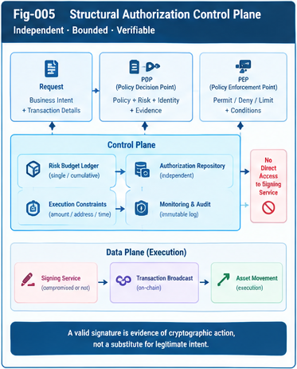

# CASE-004 — Compromised Signing-Service Defense

**Project:** Adversarial Structural Security Intelligence (ASSI)  
**Version:** v0.1.0 — Research Foundation  
**Status:** Synthetic defensive case study and falsifiable benchmark proposal; no experiments executed or security guarantees established  
**Date:** 2026-11-02  
**License:** Apache-2.0  
**Repository path:** `cases/CASE-004-Compromised-Signing-Service-Defense.md`  
**Related:** ASSI-001–003, ASSI-007–011; SPEC-001, SPEC-004–006; CASE-001–003

## Abstract

A cryptographically valid signature proves that a signing operation occurred under a particular cryptographic key; it does not, by itself, establish legitimate business intent, an uncompromised signing workflow, or acceptable aggregate exposure. This case proposes a **fully synthetic, isolated defense laboratory** in which a fictional custody operator's signing service is compromised while key operations remain cryptographically valid. The experiment compares signature-only verification, static authorization, risk monitoring, independently enforced transaction controls, and ASSI-informed defensive recommendations. It defines a threat model, trust boundaries, an authorization state machine, exposure accounting, evaluation metrics, benchmark scenarios, negative conformance tests, and falsifiable hypotheses. Its primary question is whether an independent, non-bypassable authorization and execution boundary can limit unauthorized asset movement without unacceptable interruption of legitimate withdrawals. UTN, REN, and BCEF may inform investigation and escalation, but never supply authority to execute. All accounts, addresses, credentials, balances, and events are invented. No attack against real infrastructure is described or authorized.

**Keywords:** signing service; compromised signer; independent authorization; bounded loss; policy decision point; policy enforcement point; transaction binding; custody; structural security; conformance; adversarial laboratory; security residual.

---

## 1. Motivation: A Valid Signature Is Not a Sufficient Authorization

A digital signature can establish integrity of signed bytes relative to a public key. Whether those bytes were requested by an authorized business actor, whether the signer was coerced or compromised, whether a withdrawal exceeds an acceptable risk budget, and whether the executed transaction matches the approved intent are separate questions.

This distinction creates a security gap in systems that treat signing capability as sufficient authority. A signing service may hold a legitimate key and still act on an illegitimate request. Conversely, a defense that blocks every anomalous transaction may destroy service availability. ASSI therefore separates **cryptographic validity**, **structural authorization**, **execution binding**, and **bounded exposure**.

### 1.1 Primary question

Under a synthetic signing-service compromise, can independently enforced authorization constraints reduce unauthorized asset exposure relative to signature-only and signer-local policy baselines, while maintaining pre-registered service-quality thresholds?

### 1.2 Research objectives

1. Define which controls remain trustworthy after the signing service is assumed compromised.
2. Measure loss ceilings and reachable exposure, not only anomaly detection accuracy.
3. Distinguish preventive controls from investigative intelligence.
4. Test concurrency, replay, stale authorization, policy drift, and recovery.
5. Record failures as typed Security Residuals for independently governed improvement.

### 1.3 Non-goals

This document does not claim that an AI system can guarantee safe custody, provide a production wallet implementation, infer real-world identity from an address, or replace security audits, operational controls, insurance, or legal compliance. It provides no real keys, exploitable endpoints, or operational instructions for compromising a service.

---

## 2. Fictional Laboratory and Explicit Assumptions

The synthetic operator **HarborLedger** runs a withdrawal service with customer balances, a transaction builder, a signing service, and an independent policy-enforcement gateway. All names and figures are illustrative.

| Element | Fictional role | Trust assumption |
|---|---|---|
| Request intake | Receives authenticated withdrawal intents | May receive malformed or unauthorized requests |
| Business approval service | Confirms account and withdrawal eligibility | Independently administered for benchmark purposes |
| Transaction builder | Produces canonical execution intent | Potentially faulty or compromised in selected scenarios |
| Signing service | Signs approved payloads | **Assumed compromised** in primary scenario |
| Independent PDP | Evaluates authorization and exposure policy | Not controlled by signer; may fail separately |
| Independent PEP | Mediates all modeled asset-moving operations | Complete mediation is a prerequisite to any loss-bound claim |
| Budget ledger | Tracks outstanding and consumed exposure | Atomic, durable, independently governed |
| Audit/evidence registry | Stores tamper-evident event references | Provenance and temporal integrity are evaluated |
| Recovery controller | Freezes, revokes, and restores service | Requires separate authority and documented procedure |
| Evaluation oracle | Knows synthetic ground truth | Hidden from Red/Blue inference components |

The lab operates in a closed simulator with **nontransferable synthetic assets**. No public-chain broadcasting, live signing keys, customer information, or real financial exposure is permitted.

### 2.1 Initial conditions

Illustrative configuration, not a recommended production threshold:

- Synthetic customer assets: 10,000 accounting units.
- Normal withdrawal requests: 1–100 units each, with occasional preauthorized larger requests.
- Illustrative independent maximum per transaction: 150 units.
- Illustrative rolling aggregate outflow ceiling: 500 units per interval.
- Separate high-risk destination and new-beneficiary review requirements.
- Emergency freeze must be operable independently of the signing service.

These figures exist solely to make benchmark outcomes comparable. Real limits require institution-specific risk modeling and governance.

---

## 3. Threat Model and Security Objectives

### 3.1 Adversary capability classes

The synthetic adversary may, depending on the scenario, influence signer-local requests, submit duplicate signing requests, alter proposed transaction metadata, exploit stale approvals, or generate high volumes of otherwise well-formed requests. The adversary does **not** automatically control the independent PDP, PEP, budget ledger, or recovery authority. Scenarios that relax those assumptions are separately labeled as common-mode failures.

The distinction matters: an independent gateway cannot limit loss if an alternate path allows signed transactions to reach the asset system without mediation. **Complete mediation must be established, not presumed.**

### 3.2 Protected properties

- **P1 — Authorized intent:** every executed withdrawal corresponds to a specific approved business request.
- **P2 — Exact execution binding:** approved canonical payload and executed payload are equivalent under a documented equivalence rule.
- **P3 — Non-bypassability:** every asset-moving path is mediated by the independent PEP.
- **P4 — Bounded exposure:** per-action and aggregate exposure ceilings are enforced atomically.
- **P5 — Freshness:** stale, expired, revoked, or already consumed approvals cannot be reused.
- **P6 — Separation of duties:** signer compromise does not imply authority to change policy or approve exceptions.
- **P7 — Recoverability:** freeze, revocation, reconciliation, and controlled restart remain available.
- **P8 — Accountability:** all consequential decisions and transitions are auditable.

### 3.3 Explicit failure assumptions

If the PEP is bypassable, if a signing key alone can move assets without the gateway, or if a common administrator can silently change both signer and independent policy, the claimed boundary may not hold. Such failures are benchmark outcomes, not exceptions to be hidden.

---



*Figure 5. Structural authorization requires independently enforced policy, transaction binding, and bounded exposure; cryptographic validity alone is insufficient.*

---

## 4. Structural Trust and Authorization Architecture

```text
Customer / Business Request
          |
          v
  Typed Intent + UTN References
          |
          v
  Independent Business Approval
          |
          v
  Canonical Transaction Commitment
          |
          v
  Independent PDP ----> Exposure Budget Ledger
          |                      |
     DENY/HOLD/ESCALATE/ALLOW    |
          |                      |
          +--------+-------------+
                   |
                   v
       Independent PEP / Execution Gate
                   |
           approved + bound + fresh
                   |
                   v
          Signing / Settlement Path
                   |
                   v
      Execution Receipt + Reconciliation

REN / BCEF / Scoring Tree --> advisory evidence / escalation
Governance Authority ------> controlled policy changes
```

The diagram is conceptual. A real deployment must prove that the signing/settlement path cannot bypass the PEP. The signer may be placed before or after an authorization gate depending on the platform, but an independent, complete enforcement boundary must remain effective **at the point where asset movement becomes possible**.

### 4.1 Four planes

1. **Evidence plane:** collects signed-request metadata, business approvals, identity assertions, anomalies, and receipts.
2. **Adaptive intelligence plane:** UTN, REN, BCEF, and scoring components produce typed assessments and proposed investigations.
3. **Independent authorization plane:** PDP and PEP decide and enforce permitted actions under governed policy.
4. **Governance and recovery plane:** separately authorizes policy revisions, emergency actions, rollback, and restoration.

No evidence-plane score, AI model output, or experimental Relay may directly mutate protected policy or authorize asset movement.

---

## 5. Canonical Authorization and Execution Binding

An approval must identify the *specific operation* rather than merely a broad permission to sign. The synthetic canonical intent contains:

- request ID and idempotency key;
- verified account and independently approved business purpose;
- asset identifier, source, destination, amount, fees, and relevant chain/network identifier;
- contract call or operation type and material parameters;
- allowed execution window and nonce/freshness constraints;
- applicable policy version and approval provenance;
- risk-budget reservation reference;
- canonicalization algorithm/version and payload digest.

The PEP rejects or holds any operation that cannot be matched to a current, unconsumed approval. Canonicalization must be explicit: byte-for-byte equality may be too strict for some protocols, while loose semantic equivalence may permit dangerous parameter changes. The equivalence policy itself is versioned and independently tested.

### 5.1 Decision semantics

| Decision | Meaning | Execution permitted? |
|---|---|---|
| `DENY` | Policy prohibits action | No |
| `HOLD` | Evidence or infrastructure insufficient | No |
| `ESCALATE` | Independent review required | No, pending separate approval |
| `ALLOW` | All applicable checks satisfied | Yes, once, under exact binding |

Unknown, contradictory, stale, or unverifiable authorization states default to non-execution. This does not mean every uncertain observation is treated as malicious; uncertainty may lead to a temporary hold or review.

### 5.2 Reference state machine

`REQUESTED → VERIFIED → APPROVED → BUDGET_RESERVED → EXECUTION_AUTHORIZED → EXECUTED → RECONCILED`

Alternative terminal or intermediate states include `DENIED`, `HELD`, `EXPIRED`, `REVOKED`, `FAILED`, `ROLLBACK_REQUIRED`, and `RECONCILIATION_EXCEPTION`. Every transition requires a typed actor, authority, timestamp, and audit record. Retried operations must preserve idempotency semantics.

---

## 6. Exposure Accounting and Bounded-Loss Claims

Define, for a fixed benchmark interval, a policy-controlled exposure function:

\[
X_t = X_{\mathrm{executed},t} + X_{\mathrm{reserved},t} + X_{\mathrm{delegated},t} + X_{\mathrm{contingent},t}.
\]

Terms are not necessarily additive in every real system: overlaps and correlated exposures require a documented aggregation rule to avoid double counting. The lab records both a conservative upper bound and a disaggregated exposure vector.

A proposed hard constraint is:

\[
\operatorname{Authorize}(r,t) \Rightarrow
  \operatorname{VerifiedIntent}(r,t)
  \land \operatorname{BoundPayload}(r,t)
  \land \operatorname{WithinLimits}(r,t)
  \land \operatorname{Fresh}(r,t).
\]

This is a **specification target**, not a proof that an implementation satisfies it.

### 6.1 Atomic reservations

Two concurrent requests must not each independently consume the same remaining budget. The budget ledger therefore models atomic reservation, execution consumption, expiry, and release. The benchmark includes race conditions, delayed receipts, duplicate messages, and crash/restart cases.

### 6.2 What a loss bound actually requires

A measured or proven bound depends on: complete PEP mediation; correct asset valuation; atomic budget enforcement; no unmodeled privileged path; controlled policy updates; bounded delegated permissions; and explicit time windows. The experiment must list which assumptions were tested, simulated, or merely stipulated. A low observed loss in one simulation is **not** a universal loss guarantee.

---

## 7. UTN, REN, and BCEF: Intelligence Without Authority

### 7.1 UTN typing

The experiment distinguishes `ObservedSigner`, `SigningService`, `BusinessRequester`, `ApprovedAccount`, `Destination`, `PolicyAuthority`, and `ExecutionController`. A service's cryptographic identity is not equivalent to a verified human controller or a business authorization principal. Time-indexed and compositional identity hypotheses remain available when multiple operators or shared services are plausible.

### 7.2 REN directional evidence

Evidence may be relevant to different questions: compromise likelihood, legitimate intent, urgency, recovery readiness, or expected operational harm. A single anomaly score cannot faithfully encode these distinct directions. Evidence includes provenance and dependence metadata; multiple alerts derived from one event are not counted as independent confirmation.

### 7.3 BCEF conditional tests

- **Forward IF:** if the request was legitimately approved, what independent approval and payload-binding records should exist?
- **Reverse IF:** if such records exist, what competing explanations still fit, including forged, stale, or misbound approval artifacts?
- **Counterfactual IF:** if signer-local controls were compromised but the independent gate remained intact, what transactions would still be blocked?
- **Contradiction IF:** which *specific* hypothesis is inconsistent with an observed independent fact?

For example, failure of a sole-operator hypothesis does not automatically refute a team or shared-service hypothesis. A BCEF result may propose `HOLD`, request additional evidence, or revise an investigation graph. It cannot directly create an `ALLOW` authorization.

---

## 8. Machine-Readable Synthetic Contracts

The following YAML is **illustrative**, not a finalized interoperable schema.

```yaml
schema: assi.case004.authorization-request.v0.1
request_id: SYN-REQ-1042
idempotency_key: SYN-IDEMP-1042
asset: SYN-USD
amount: 75
source_ref: utn:synthetic:account:alpha
destination_ref: utn:synthetic:beneficiary:beta
operation: transfer
network: synthetic-ledger-v1
canonical_payload_digest: "sha256:synthetic-example-not-real-digest"
canonicalization_version: canon-v1
business_approval_ref: SYN-APP-201
policy_version: SYN-POL-7
expires_at: "2026-11-02T20:00:00Z"
provenance:
  origin: synthetic-generator
  ground_truth_visibility: evaluator-only
```

```yaml
schema: assi.case004.authorization-decision.v0.1
decision_id: SYN-DEC-1042
request_ref: SYN-REQ-1042
outcome: ALLOW
pdp_authority: utn:synthetic:control:independent-pdp
policy_version: SYN-POL-7
budget_reservation_ref: SYN-BUD-1042
bound_payload_digest: "sha256:synthetic-example-not-real-digest"
execution_window:
  not_before: "2026-11-02T19:50:00Z"
  not_after: "2026-11-02T20:00:00Z"
max_uses: 1
signer_advisory_score: null
independent_review_ref: SYN-REVIEW-44
audit_ref: SYN-AUD-1042
```

```yaml
schema: assi.case004.security-residual.v0.1
residual_id: SYN-RES-17
category: exposure-accounting
observation: "Two concurrent reservations exceeded the modeled aggregate ceiling"
impact: "Potential policy bypass under race"
severity: high
reproduction_case: SYN-SCENARIO-07
source_evidence: [SYN-TRACE-77, SYN-TRACE-78]
status: unvalidated-candidate
proposed_next_step: independent-concurrency-retest
requires_governance_approval: true
```

A production schema would additionally require rigorous typing, signing or attestation of authoritative decisions, revocation semantics, cross-system consistency, and formally specified canonicalization.

---

## 9. Reference Defensive Decision Procedure

The following pseudocode is a **defensive authorization sketch**. It omits platform-specific execution details.

```text
function decide_and_reserve(request, context):
    require request.schema_valid
    require independent_identity_verification(request)
    require valid_business_approval(request)
    require approval_matches_canonical_payload(request)
    require approval_is_fresh_and_unconsumed(request)
    require current_governed_policy(context)

    if context.emergency_freeze:
        return DENY("independent freeze active")

    if context.evidence_incomplete_or_conflicting:
        return HOLD("independent review or evidence required")

    if requires_separate_approval(request, context):
        return ESCALATE("additional authority required")

    reservation = atomic_budget_reservation(request, context)
    if reservation.failed:
        return DENY("exposure limit or concurrency conflict")

    token = bind_one_time_authorization(
        request.canonical_payload_digest,
        request.idempotency_key,
        context.policy_version,
        reservation.id,
        request.expiry
    )
    return ALLOW(token)

function enforce_execution(request, token, execution):
    require independent_pep_controls_this_execution_path
    require token.is_valid_and_unconsumed
    require execution_matches_bound_payload(execution, token)
    require token.policy_version_is_acceptable
    require token.is_within_execution_window
    consume_token_once_atomically(token)
    execute_or_fail_closed(execution)
    reconcile_and_audit(execution)
```

A robust implementation must also define crash consistency, the ordering of token consumption versus execution, handling uncertain settlement outcomes, and reconciliation after partial failures. These are explicit validation targets.

---

## 10. Adversarial Benchmark Scenarios

All scenarios are simulated and defense-oriented. The Red Drive can submit synthetic requests and alter designated synthetic inputs; it cannot access real assets or systems.

| ID | Scenario | Expected defensive property | Main metric |
|---|---|---|---|
| S01 | Normal approved withdrawal | Correct completion | Legitimate success rate |
| S02 | Compromised signer submits unapproved request | Independent authorization denial | Unauthorized execution rate |
| S03 | Valid signature, altered destination | Exact binding prevents substitution | Payload mismatch escape rate |
| S04 | Valid signature, altered amount | Exact binding prevents substitution | Amount mismatch escape rate |
| S05 | Replayed approval | One-time use enforced | Replay escape rate |
| S06 | Expired approval | Freshness enforced | Stale authorization escape rate |
| S07 | Concurrent requests against same budget | Atomic ceiling enforced | Oversubscription frequency |
| S08 | High-volume low-value requests | Aggregate limits enforced | Cumulative unauthorized outflow |
| S09 | New beneficiary with ambiguous evidence | Hold/escalation without automatic guilt | False-hold rate |
| S10 | Signer-local alert suppression | Independent gate remains effective | Residual unauthorized outflow |
| S11 | Policy version changes during execution | Version/epoch consistency | Policy drift escape rate |
| S12 | Delayed or missing settlement receipt | Safe reconciliation | Unreconciled exposure duration |
| S13 | Emergency freeze during request queue | Freeze takes precedence | Freeze latency / post-freeze outflow |
| S14 | Shared-service identity confusion | No inferred-identity authority transfer | Identity-to-authority violation count |
| S15 | Independent PDP unavailable | Fail closed or governed degraded mode | Unsafe fail-open frequency |
| S16 | Common-mode policy and signer compromise | Identify violated independence assumption | Bound failure rate |
| S17 | Unauthorized delegated permission | Account for indirect exposure | Delegated exposure miss rate |
| S18 | Recovery and controlled restart | Reconcile and reauthorize | Recovery correctness / duration |

S16 is particularly important: a strong architecture must expose the conditions under which its assumed separation no longer exists. It must not silently exclude such cases from reported results.

---

## 11. Experimental Baselines and Ablations

| Baseline | Capabilities | Purpose |
|---|---|---|
| B0 — Signature only | Cryptographic validity check | Weakest reference |
| B1 — Signer-local rules | Static rules inside compromised trust domain | Test dependence on signer integrity |
| B2 — Independent fixed policy | PDP/PEP, exact binding, atomic budgets | Isolate hard-control contribution |
| B3 — B2 + anomaly alerts | Independent hard controls plus conventional monitoring | Separate monitoring from enforcement |
| B4 — B2 + ASSI advisory intelligence | UTN/REN/BCEF triage, no new authority | Measure incremental investigative benefit |
| B5 — B4 + governed residual relay | Candidate improvements tested before promotion | Measure longitudinal value and costs |

Ablations remove, one at a time: exact payload binding; atomic reservation; replay protection; independent policy administration; temporal identity handling; evidence dependence tracking; BCEF hypothesis scoping; and governed promotion. Any removal that invalidates an essential safety boundary must run **only in the simulator** and be labeled as intentionally weakened.

### 11.1 Avoiding a misleading comparison

B4 should not be credited with the prevention already provided by B2. Incremental ASSI value should be evaluated on such outcomes as investigative precision, correct escalation, reduced false holds, evidence quality, and detection of residual classes. Hard loss bounds are principally attributable to independently enforced controls under their assumptions.

---

## 12. Evaluation Metrics and Reporting

### 12.1 Primary safety metrics

- **Unauthorized executed value (UEV):** total synthetic value executed without valid business authorization.
- **Maximum loss per scenario (MLPS):** worst realized unauthorized value over seeded trials.
- **Exposure-bound violation rate (EBVR):** fraction of trials where specified independent ceilings are breached.
- **Unauthorized execution rate (UER):** unauthorized executed requests divided by unauthorized attempted requests.
- **Time to containment (TTC):** time between first observable compromise evidence and effective independent containment.

### 12.2 Availability and operational metrics

- Legitimate withdrawal success rate and completion latency (p50/p95/p99).
- False denial and false hold rates, reported separately.
- Escalation burden, operator review minutes, and recovery duration.
- Budget utilization and liquidity availability during legitimate demand spikes.
- Policy and model maintenance costs.

### 12.3 Intelligence and governance metrics

- Compromise-hypothesis precision/recall and calibration, where meaningful.
- Evidence provenance completeness and correlated-evidence double-count rate.
- Hypothesis-scope leakage and identity-to-authorization violation count.
- Independent evaluation reproducibility and promotion rollback frequency.
- Security Residual discovery, independent confirmation, and closure rates.

### 12.4 Statistical protocol

Pre-register thresholds, scenario weights, seeds, test partitions, and primary outcomes. Report confidence intervals and worst-case observations, not just averages. Separate training, tuning, and held-out adversarial scenarios. Track any changed threat assumptions and use paired trials when comparing policies under identical synthetic workloads.

---

## 13. Falsifiable Research Hypotheses

Each hypothesis is a **proposal for testing**, not an asserted result.

| ID | Hypothesis | Comparator | Falsification condition |
|---|---|---|---|
| H01 | Independent complete mediation reduces UEV under signer compromise | B2 vs B0/B1 | No reduction under matched scenarios or mediation bypass |
| H02 | Exact payload binding reduces altered-destination/amount execution | Binding on/off | No reduction in mismatch escapes |
| H03 | Atomic exposure reservations prevent concurrent oversubscription | Atomic vs non-atomic simulator | Bound exceeded despite correct atomic implementation assumptions |
| H04 | Independent emergency freeze limits post-detection outflow | Freeze on/off | No measurable containment improvement |
| H05 | Separating signer and policy authority reduces common single-domain compromise impact | B2 vs B1 | Equivalent failure under specified signer-only compromise |
| H06 | REN/BCEF improves correct investigative escalation at fixed false-hold rate | B4 vs B3 | No held-out improvement |
| H07 | Dependency-aware evidence reduces overconfident compromise inference | Dependence tracking on/off | Calibration or error worsens materially |
| H08 | UTN typing reduces erroneous identity-to-authority transfers | Typed vs untyped | Equal or higher violation rate |
| H09 | Residual-driven governed improvements generalize to unseen scenarios | B5 vs B4 | No held-out benefit or excessive regression |
| H10 | Recovery controls reduce unsafe restart and unreconciled exposure | Recovery protocol on/off | No improvement under comparable faults |
| H11 | Stronger hard controls can preserve pre-registered legitimate service thresholds | B2 vs B0 | Availability or latency exceeds agreed limit |
| H12 | Common-mode compromise reveals measurable limits of the independence model | S16 vs signer-only scenarios | Model fails to identify and report broken assumptions |

A hypothesis may be supported in one synthetic environment and fail in another. Report domain limits and counterexamples explicitly.

---

## 14. Conformance Requirements

The following normative-style requirements apply to **candidate laboratory implementations**, not to deployed systems certified by this document.

- **C004-01:** Every modeled asset-moving path SHALL be independently mediated or explicitly declared outside the benchmark's loss-bound scope.
- **C004-02:** Cryptographic validity SHALL NOT alone imply business authorization.
- **C004-03:** Inferred UTN identity SHALL NOT be promoted to an authorization principal without independent verification.
- **C004-04:** An `ALLOW` SHALL bind to a canonical operation, applicable policy version, bounded window, and single-use execution identity.
- **C004-05:** A request whose executed payload differs materially from the bound intent SHALL NOT execute.
- **C004-06:** Expired, revoked, or consumed authorization SHALL NOT be reusable.
- **C004-07:** Exposure reservations SHALL be atomic across concurrent requests.
- **C004-08:** Signer-local policy changes SHALL NOT change independent safety limits.
- **C004-09:** Evidence or scoring results SHALL NOT directly alter protected authorization policy.
- **C004-10:** `DENY`, `HOLD`, and `ESCALATE` SHALL NOT permit execution pending a separate authorized transition.
- **C004-11:** An emergency freeze SHALL be operable independently of the compromised signer.
- **C004-12:** All policy changes SHALL be versioned, authorized, and auditable.
- **C004-13:** Unknown authorization state SHALL NOT default to `ALLOW`.
- **C004-14:** Duplicate requests and retries SHALL preserve idempotency.
- **C004-15:** The lab SHALL distinguish reserved, executed, released, and unreconciled exposure.
- **C004-16:** Recovery SHALL include reconciliation before controlled restart.
- **C004-17:** Evaluation ground truth SHALL be withheld from adaptive defense components.
- **C004-18:** Every reported loss bound SHALL list its trust and mediation assumptions.
- **C004-19:** Red Drive tests SHALL remain inside the authorized synthetic sandbox.
- **C004-20:** Deployment or policy promotion SHALL require independent governance approval.

### 14.1 Conformance test vectors

| Test | Input condition | Expected result |
|---|---|---|
| T01 | Valid request, valid independent approval, sufficient budget | `ALLOW`, one-time bound token |
| T02 | Valid signature, no business approval | `DENY` |
| T03 | Destination differs from approved intent | `DENY` |
| T04 | Amount differs from approved intent | `DENY` |
| T05 | Expired approval | `DENY` or non-executing `HOLD` |
| T06 | Approval replay after consumption | `DENY` |
| T07 | Two concurrent requests exceed shared ceiling | At most permitted reservation succeeds |
| T08 | Signer attempts policy update | Rejected by independent governance |
| T09 | Ambiguous but not disproven business intent | `HOLD`/`ESCALATE`; no automatic malicious label |
| T10 | Freeze active | No new execution authorization |
| T11 | PDP unavailable | No fail-open execution |
| T12 | Missing or contradictory payload digest | Non-executing outcome |
| T13 | Delayed settlement receipt | Explicit reconciliation exception |
| T14 | Unverified identity hypothesis claims authority | Rejected |
| T15 | Policy version changed before execution | Revalidate or reject under documented rule |
| T16 | Unauthorized alternate execution path discovered | Mark mediation assumption violated; fail benchmark |
| T17 | Recovery attempted without reconciliation | Reject restart |
| T18 | AI scoring engine emits `ALLOW` suggestion | Treated as advisory, not authoritative |
| T19 | Budget reservation expires without execution | Safe, auditable release |
| T20 | Evaluator tries to read hidden ground truth from Blue Drive | Isolation violation recorded |

A test passes only when its trace, decision, and authoritative state transitions are independently inspectable.

---

## 15. Worked Synthetic Trace: Valid Signature, Invalid Intent

This trace illustrates expected behavior, **not a measured experiment**.

1. A legitimate customer submits a fictional 75-unit withdrawal to beneficiary `beta`.
2. Independent business approval binds request `SYN-REQ-1042` to a canonical payload.
3. A compromised signing service produces a valid signature for a different synthetic destination `gamma`.
4. The independent PEP compares the execution payload against the approved commitment and detects a mismatch.
5. The PEP returns `DENY`; the budget reservation is released or reconciled according to state.
6. The audit registry records both the signer-validity observation and the independent authorization failure.
7. REN and BCEF generate competing explanations—signer compromise, builder fault, stale request association—without prematurely asserting the real controller.
8. Governance may authorize a freeze or deeper investigation. Any policy change requires a separate approval.

The **expected** synthetic unauthorized execution value is zero *if* complete mediation and correct binding hold. The experiment must explicitly test those assumptions; it cannot claim zero loss merely because the design diagram contains a PEP.

---

## 16. Worked Synthetic Trace: Concurrency and Aggregate Exposure

Suppose the remaining synthetic interval budget is 100 units and two otherwise valid requests each require 70 units.

- A naive check-then-act budget implementation may let both requests observe 100 remaining and both proceed, producing 140 units of reservations.
- An atomic ledger should allow at most one reservation and reject or hold the other.
- The evaluator records reservation order, lock/transaction semantics, crash points, eventual settlement, and released balances.

This is a concurrency conformance test, not an exploit recipe. It shows why a nominal threshold without atomic enforcement does not establish a meaningful bound.

---

## 17. Red, Blue, Evaluation, and Governance Drives

### 17.1 Red Drive

Generates authorized synthetic deviations and probes stated assumptions within the isolated laboratory. It cannot modify real policies, broadcast real transactions, or access real secrets.

### 17.2 Blue Drive

Applies independent authorization controls and proposes evidence-informed investigative actions. It does not alter hidden ground truth or redefine success metrics.

### 17.3 Evaluation Drive

Maintains held-out scenarios and measures unauthorized value, service disruption, assumption violations, evidence quality, and resource costs. It independently reproduces traces and documents uncertainty.

### 17.4 Governance Drive

Approves test scope, protects isolation, defines non-bypassable limits, reviews candidate changes, and controls promotion, rollback, and emergency stops.

### 17.5 Competitive Relay

A candidate control improvement may be relayed with its assumptions, reproduction case, negative tests, and independent evaluation result. **Relay acceptance is not validation; validation is not deployment authorization.**

---

## 18. Security Residual Registry

A Security Residual is an unresolved gap, regression, or uncertainty identified by a scenario. It is not automatically a verified vulnerability.

| Residual | Trigger | Required next evidence |
|---|---|---|
| R01 — Mediation gap | An execution path bypasses PEP | Complete path inventory and isolated reproduction |
| R02 — Budget race | Aggregate ceiling exceeded | Atomicity trace and concurrency retest |
| R03 — Binding ambiguity | Canonical payload mismatch accepted | Canonicalization specification and counterexamples |
| R04 — False hold | Legitimate requests unnecessarily blocked | Ground-truth adjudication and error analysis |
| R05 — Identity confusion | Inferred controller treated as approver | UTN type-flow trace |
| R06 — Correlated alert inflation | Same event counted multiple times | Provenance/dependency graph |
| R07 — Governance bypass | Signer changes protected policy | Authority audit and separation test |
| R08 — Recovery gap | Unsafe restart after ambiguous settlement | Reconciliation and rollback test |
| R09 — Common-mode failure | Independent controls share compromised root | Trust-domain decomposition |
| R10 — Simulation mismatch | Synthetic results fail to transfer | Domain-adapter review and external validation |

Residuals feed AQSI research questions, but no autonomous agent may promote a candidate fix directly into the protected authorization plane.

---

## 19. AQSI Questions and Validated RSI

Example research questions:

1. Which unmodeled execution paths violate complete mediation assumptions?
2. What minimal independent state is needed to prevent duplicate authorization across restarts?
3. How should the system distinguish legitimate liquidity spikes from a compromised signer without excessive false holds?
4. Which exposure terms are correlated or contingent rather than safely additive?
5. Can BCEF improve hypothesis discrimination when signer telemetry is adversarially unreliable?
6. Under what conditions does a shared administrative root invalidate control-plane independence?
7. Which improvements survive held-out scenarios and operational stress tests?

Each candidate improvement must include a typed change proposal, expected benefit, possible regression, explicit non-bypassable constraints, independent test plan, rollback path, and governance decision. Recursive search is bounded by experiment budgets and cannot grant itself new authority.

---

## 20. Validation Roadmap

**Phase 0 — Contract review:** align with SPEC-001, SPEC-004, SPEC-005, and SPEC-006; define asset and identity types, policy versioning, and authoritative transition semantics.

**Phase 1 — Deterministic synthetic simulator:** implement normal workflows, canonical intent, independent gate, atomic budget ledger, and complete audit traces.

**Phase 2 — Negative conformance suite:** execute T01–T20; verify non-execution on malformed, stale, unauthorized, or ambiguous requests.

**Phase 3 — Controlled adversarial scenarios:** run S01–S18 with fixed seeds, pre-registered thresholds, and independent evaluation.

**Phase 4 — Intelligence ablations:** compare B2–B5; attribute prevention to hard controls and investigative improvements to adaptive components.

**Phase 5 — Recovery and common-mode tests:** test freeze, restart, delayed receipts, governance compromise assumptions, and incomplete mediation.

**Phase 6 — Independent reproduction:** provide a synthetic dataset specification, trace format, and evaluation harness for external reviewers. Any real-world pilot would require separate professional threat modeling, security review, and explicit operational authorization.

### 20.1 Required publication artifacts

- Threat-model assumptions and scope exclusions.
- Simulator version, seeds, scenario generator, and hidden-ground-truth protocol.
- Policy definitions, canonicalization rules, and exposure-accounting semantics.
- Test vectors and machine-readable decision traces.
- Pre-registered metrics, thresholds, and evaluation scripts.
- Negative results, assumption failures, and residual registry.
- Independent review and governance decision records.

---

## 21. Limitations and Open Questions

**Complete mediation:** Can a real asset platform ensure all possible asset-moving paths are covered, including emergency, contract, delegation, and administrative routes?

**Common-mode compromise:** How independent are controls if they share infrastructure, operators, identity providers, cloud accounts, or governance processes?

**Valuation:** How should exposure limits handle volatile asset prices, liquidity shocks, collateral dependencies, and cross-chain obligations?

**Canonical intent:** What constitutes exact execution equivalence for complex contract calls, batched operations, and asynchronous settlement?

**Operational trade-offs:** How much service disruption is acceptable for a particular loss ceiling? Who decides and under what governance process?

**Adaptive intelligence:** Can REN/BCEF improve investigative outcomes without making decisions harder to explain, reproduce, or contest?

**Evidence integrity:** What happens when signer telemetry and parts of the audit pipeline are both compromised?

**Generalization:** Which lessons transfer to cloud service credentials, enterprise payment approval, and AI Agent tool execution, and which require domain-specific redesign?

These questions delimit the research agenda; they are not resolved by the proposed architecture.

---

## 22. Conclusion

A compromised signing service exposes the difference between **valid cryptographic action** and **legitimate, independently authorized action**. ASSI's proposed response is not to rely on a more confident anomaly score. It is to define enforceable boundaries: typed intent, independent verification, exact execution binding, atomic exposure controls, complete mediation, auditable governance, and safe recovery. Structural intelligence can improve the quality of investigation and identify previously overlooked failure modes, but it must remain subordinate to independently governed execution authority.

The decisive research test is empirical and falsifiable: under clearly stated compromise and trust assumptions, do independent controls reduce unauthorized execution and bound loss without unacceptable legitimate-service degradation? Where the assumptions fail, the benchmark must say so. Those failures become Security Residuals, not evidence of success.

> **A valid signature is evidence of cryptographic action, not a substitute for legitimate intent. Intelligence may recommend; independent authority must decide; enforcement must hold when the signer fails.**

---

## Appendix A. Minimal Trace Record

```yaml
schema: assi.case004.trace.v0.1
scenario_id: S03
trial_id: SYN-TRIAL-003
request_ref: SYN-REQ-1042
observations:
  - kind: signature-validity
    value: valid
  - kind: execution-binding
    value: mismatch
pdp_decision: DENY
pep_executed: false
synthetic_unauthorized_value: 0
assumptions:
  independent_pep: stipulated-and-tested-in-simulator
  complete_mediation: checked-against-synthetic-path-inventory
evaluator_ground_truth_ref: SYN-GT-003
residuals: []
```

## Appendix B. Repository Integration

| Component | Integration purpose |
|---|---|
| `ASSI-007` | Independent control-plane rationale |
| `ASSI-008` | Four-Drive adversarial experiments |
| `ASSI-009` | Residual-driven validated improvement |
| `ASSI-010` | Grand architecture and SSU interfaces |
| `ASSI-011` | BM-003 benchmark methods |
| `SPEC-001` | Canonical structural security units |
| `SPEC-004` | Authorization and safety contracts |
| `SPEC-005` | Adversarial Drive and Relay contracts |
| `SPEC-006` | Validated RSI and governance |
| `CASE-001` | Trust and liquidity assumptions |
| `CASE-002` | UTN compositional identity sandbox |
| `CASE-003` | BCEF false-rejection benchmark |
| `CASE-005` | Multi-round adversarial Drives and RSI |

## Appendix C. Release and Validation Notice

This is a **research foundation document**. All examples, balances, principals, requests, and addresses are fictional. YAML schemas and pseudocode are illustrative; no executable production authorization implementation is supplied. No benchmark outcomes, risk reductions, or security guarantees are claimed. The proposed requirements require independent engineering validation and governance before use in consequential environments.

**Next case:** `cases/CASE-005-Adversarial-Drives-and-Security-RSI.md`  
**License:** Apache-2.0.
