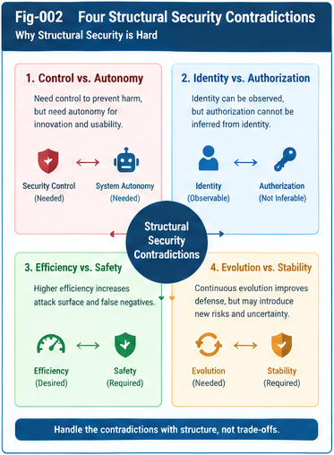

# ASSI-002 — Four Structural Contradictions of Cryptocurrency Security

**Project:** Adversarial Structural Security Intelligence (ASSI)  
**Version:** v0.1.0 — Research Foundation  
**Status:** Conceptual analysis and falsifiable research hypotheses; not an incident-forensics report or validated security product  
**Date:** 2026-11-02  
**License:** Apache-2.0  
**Series:** ASSI-001–012  

## Abstract

Cryptocurrency systems combine cryptographic verification, transferable digital assets, open transaction records, programmable execution, and diverse custody and governance arrangements. These properties create opportunities for reducing some forms of intermediary trust while exposing other dependencies that are easy to underestimate. This paper identifies **four structural tensions**: (1) asset liquidity and settlement utility versus custody and loss containment; (2) trust minimization at the protocol layer versus concentrated operational security responsibility; (3) public transaction visibility versus uncertainty about real-world controllers; and (4) organizational control concentration versus the independence of security expertise and enforcement. These are not universal impossibility theorems. They are recurring, design-dependent tensions whose severity must be measured rather than presumed.

We translate the four tensions into typed structural models, candidate metrics, counterhypotheses, and controlled experiments for **Adversarial Structural Security Intelligence (ASSI)**. The proposed approach combines Structural Trust Graphs, UTN-based compositional identity hypotheses, REN-style directional weak-evidence analysis, Bidirectional Conditional Evidence Feedback (BCEF), independently enforced authorization constraints, and adversarial security drives. The aim is not to assert that structural intelligence guarantees safety, but to make hidden dependencies, alternative explanations, failure paths, and residual risk explicit and testable.

**Keywords:** cryptocurrency security; trust relocation; custody; liquidity; irreversible settlement; structural trust graph; compositional identity; on-chain evidence; organizational governance; adversarial resilience; bounded loss.

---

## 1. Purpose, scope, and epistemic boundaries

This document preserves the original problem analysis that motivated ASSI. It addresses cryptocurrency exchanges, custodial services, wallets, smart-contract systems, bridges, and related operational infrastructure, while acknowledging that their security models differ substantially. A self-custodial wallet, a centralized exchange, a multisignature treasury, and a permissionless smart contract do not share one custody or governance architecture.

The four “contradictions” below are **structural tensions**, not claims that cryptocurrency is intrinsically insecure or that every platform exhibits the same failure. The questions are: under which architectures do the tensions emerge, what measurable risks do they create, and which controls reduce them without shifting risk invisibly elsewhere?

### 1.1 What this paper does not establish

- It does **not** independently verify any particular alleged exchange compromise, loss amount, exploit path, attribution, or organizational misconduct.
- It does **not** assume that all public-chain transfers reveal the real-world identity of a sender or beneficiary.
- It does **not** assume that cryptographic validity implies legitimate economic or organizational authorization.
- It does **not** claim that simulation, machine learning, or recursive self-improvement provides a safety guarantee.
- It does **not** infer poor security governance from ownership structure, nationality, family relationships, or other demographic attributes. Governance claims require evidence of actual decision rights, controls, incentives, and incidents.

If a contemporary event is later added as a case study, record separately: **verified facts**, **source-attributed technical assessments**, **unconfirmed allegations**, and **ASSI hypotheses**. Use dated primary sources, preserve uncertainty, and update the record when facts change.

## 2. A common analytical frame: from local validity to system security

A blockchain transaction may satisfy protocol verification while remaining unauthorized from the asset owner's perspective. Conversely, a valid operational policy may be difficult to enforce if control over signing keys, transaction construction, and policy updates is concentrated in one compromised service.

ASSI-001 distinguishes cryptographic validity, contextual authorization, structural security, and adversarial resilience. Here we add a typed causal frame:

1. **Asset:** what can be lost, frozen, misdirected, or made unavailable?
2. **Control:** which keys, roles, contracts, services, or coalitions can act on it?
3. **Trust dependency:** which external or internal assumptions make the action safe?
4. **Evidence:** what observations support each dependency or attack hypothesis?
5. **Boundary:** which independent controls limit the maximum consequence?
6. **Residual:** what failure mode remains after existing defenses are applied?

The analytical target is not merely whether a transaction is *valid*, but whether a sequence of individually valid operations can cross an unacceptable **structural loss boundary**.

---

## 3. Contradiction I — Liquidity and utility versus custody and loss containment

### 3.1 The tension

Crypto assets can be transferable around the clock, programmable, and accessible without relying on conventional bank opening hours. These properties can be valuable. Yet rapid transferability and settlement finality can also reduce the time available to detect or reverse an unauthorized transfer. Meanwhile, users seeking convenience often entrust assets to online custodians, exchanges, or signing services.

The resulting tension is:

> The same transferability that supports economic utility can amplify loss when an attacker obtains effective execution authority.

This is not a claim that “liquidity” and “security” are mathematical opposites. Market liquidity, transaction settlement speed, payment accessibility, and custody exposure are different variables. They should not be collapsed into one score.

### 3.2 The emergency-value thought experiment

Consider a disruption in which an individual possesses an asset with high nominal market value but lacks electricity, connectivity, a functioning merchant network, or access to a signing device. The asset may have high quoted value yet low **situational payment usability**. Conversely, an inexpensive physical good may have immediate survival utility.

This thought experiment does not prove that crypto lacks value; it illustrates that **nominal value, market liquidity, settlement capability, and contextual utility are distinct dimensions**. ASSI should model operational availability as well as theft risk.

### 3.3 Structural representation

Suggested nodes: `Asset`, `CustodyPool`, `HotSigner`, `ColdSigner`, `WithdrawalPolicy`, `NetworkDependency`, `RecoveryChannel`, `MerchantAcceptanceContext`.

Suggested edges: `can_authorize`, `can_transfer`, `depends_on`, `can_freeze`, `can_recover`, `shares_failure_domain`.

A key question is whether compromise of one online signing path can cause losses disproportionate to the amount needed for routine liquidity.

### 3.4 Candidate controls

- Segregate operational liquidity from long-term reserves.
- Cap withdrawal and signing exposure by independent limits.
- Require stronger approval for authority-changing operations than for ordinary transfers.
- Detect unexpected authority delegation and abnormal transaction construction.
- Provide an independently operated pause, recovery, and incident-response path where technically feasible.
- Test availability and recovery under infrastructure outages, not only malicious transactions.

### 3.5 Testable hypothesis H1

**H1:** For a given transaction-demand profile, an architecture with independently enforced exposure limits and segmented signing authority can reduce worst-case single-compromise loss relative to a monolithic hot-signing architecture, at measurable availability and operating-cost tradeoffs.

**Measures:** maximum simulated loss, tail-loss distribution, withdrawal completion rate, time to contain, recovery time, false blocking, and operational cost.

**Counterhypothesis:** Added controls may introduce common-mode dependencies, operational delays, or administrator override paths that eliminate the expected benefit.

---

## 4. Contradiction II — Protocol trust minimization versus concentrated operational responsibility

### 4.1 The tension

A consensus protocol can reduce the need to trust a particular settlement intermediary. It does not automatically secure wallets, front ends, custodians, signing systems, bridges, or administrative privileges. A centralized service may become a highly consequential concentration point even when its underlying settlement network is decentralized.

**Trust Relocation Principle:** When one layer reduces reliance on an intermediary, security responsibility does not disappear; it may move to another layer, where it must be explicitly modeled and bounded.

The term *trust minimization* should not be confused with enterprise **Zero Trust Architecture**, which concerns continuous verification and constrained access within a different security model.

### 4.2 Example: valid signature, invalid intent

A compromised transaction-construction service could submit a transaction that a signer approves under overly broad rules. The resulting signature might be cryptographically valid while violating the owner's intended destination, authorization scope, or risk ceiling. Two-factor login protection alone would not necessarily protect a backend signer or a privileged service-to-service workflow.

The defense question is not only **who can sign?** but **what actions can any signer cause, under which independent constraints?**

### 4.3 Structural Trust Graph

A proposed trust graph should include typed dependencies across:

- Key generation, storage, rotation, and recovery.
- Transaction preparation and signing authorization.
- Contract upgrade and administrative permissions.
- Off-chain identity, personnel, and approval workflows.
- RPC, oracle, bridge, and other external dependencies.
- Emergency controls, audit evidence, and restoration procedures.

Every high-consequence edge should carry: provenance, validity interval, authority scope, independent enforcement status, and a potential loss envelope. Inferred edges must be distinguishable from verified permissions.

### 4.4 Testable hypothesis H2

**H2:** A typed Structural Trust Graph combined with independent authorization constraints will reveal and block a higher proportion of consequential cross-layer attack paths than cryptographic validity checks alone.

**Measures:** high-severity path coverage, successful unauthorized transfers, unauthorized authority changes, false rejection rate, time to detection, and audit completeness.

**Counterhypothesis:** The graph may be incomplete or stale; its added complexity may conceal rather than reveal high-risk paths. An independent control that shares the same administrator or credential is not meaningfully independent.

---

## 5. Contradiction III — Public-chain visibility versus uncertain controller identity

### 5.1 The tension

Public ledgers expose many transaction-level relationships. They do not, by themselves, reliably identify the humans or organizations controlling addresses. The observed graph of transfers differs from the inferred graph of common control, coordinated behavior, or shared organizational identity.

The research opportunity is to exploit structured, replayable evidence without treating behavioral similarity as proof of real-world identity.

### 5.2 From UTN Naming to compositional identity

A simple assumption—one address cluster corresponds to one person—can produce false merges and false splits. In practice:

- One individual may control many addresses.
- One address may require multiple signers or be administered by a group.
- A team may operate through changing subsets of members.
- Independent actors may share exchanges, infrastructure, automated services, or behavioral patterns.
- A coalition may exist only for a particular activity or time interval.

Therefore an ASSI/UTN `Name` should first denote an **evidence-grounded structural identity hypothesis**, not necessarily a verified person. Candidate types include `Individual`, `Role`, `Team`, `Subgroup`, `Coalition`, `Service`, and `TimeBoundComposition`.

The model should represent overlapping membership, roles, control relations, and time validity. A hypergraph is one option; a property graph with explicit membership and activity nodes can also express these relationships.

### 5.3 Directional evidence and alternative explanations

REN-style directional weak-evidence scoring can prioritize hypotheses for further examination. However, transaction timing, common counterparties, and behavioral similarity may be correlated because they arise from one shared service. Counting them as independent evidence would inflate confidence.

An evidence record should therefore preserve source, dependence, alternative explanations, uncertainty, and the distinction between `observed` and `inferred` links. Real-world attribution requires independent corroboration; otherwise the output remains a structural hypothesis.

### 5.4 Testable hypothesis H3

**H3:** Composition-aware UTN identity modeling, paired with evidence-dependence controls, reduces erroneous identity merging and splitting relative to single-controller clustering on synthetic and independently labeled data.

**Measures:** pairwise precision/recall, cluster purity, false-merge and false-split rates, temporal stability, calibration, and abstention quality.

**Counterhypothesis:** Greater model flexibility may overfit and create unfalsifiable group explanations. Benchmark data must include negative cases and genuinely unrelated actors with superficially similar behavior.

---

## 6. Contradiction IV — Concentrated governance versus independent security enforcement

### 6.1 The tension

Fast-moving companies may centralize product decisions, infrastructure administration, financial authority, and incident response to improve execution speed. But if the same authority can approve a transaction, modify its safeguards, suppress an alert, and control the audit trail, the nominal existence of security policies provides limited protection.

The tension is between **operational coordination** and **independent challenge and constraint**. It is about verifiable governance mechanisms, not a presumption that any particular ownership or management style is inherently negligent.

### 6.2 Security expertise is not enough without decision rights

An expert security team may detect a dangerous operation but lack the ability to block it. Conversely, a formally independent committee may be ineffective if emergency override credentials are shared with the operational team. ASSI must model actual authority and enforceability, not only organizational charts.

### 6.3 Structural questions

- Who can change signing policy, and who independently authorizes that change?
- Can one compromised administrator disable monitoring and alter transaction limits?
- Are emergency controls independently operable and regularly exercised?
- Is audit evidence tamper-evident and available outside the compromised domain?
- Can safety concerns be escalated without depending on the person or system under review?
- Do third-party audits examine live operational controls, not only source code?

### 6.4 Testable hypothesis H4

**H4:** Explicit separation of high-consequence decision rights and independently exercised emergency controls reduces the maximum impact of administrator compromise compared with systems whose control and override paths share a common authority.

**Measures:** single-principal compromise blast radius, override-path coverage, containment time, audit survivability, policy-bypass success, and operational latency.

**Counterhypothesis:** Separation can be merely formal, introduce correlated dependencies, or cause dangerous delays in legitimate emergency response.

---



*Figure 2. Four interacting contradictions in cryptocurrency security: local cryptographic validity does not resolve system-level trust, identity, liquidity, and governance risks.*

---

## 7. The four tensions interact

The contradictions should not be studied as independent checklists. Their interactions can amplify risk:

| Interaction | Example structural consequence | Candidate ASSI response |
|---|---|---|
| Liquidity × Trust relocation | Large hot-asset pool controlled through one online signing path | Exposure graph, independent ceilings, segmented custody |
| Trust relocation × Governance | Same administrator controls signer and policy override | Separation-of-duties graph, independent hard policy |
| Visibility × Identity | Similar on-chain activity incorrectly attributed to one actor | Compositional UTN, provenance, alternative hypotheses |
| Identity × Governance | Inferred organizational links treated as proven culpability | Hypothesis-scoped IF, corroboration, abstention |
| Liquidity × Adversarial adaptation | Attack exploits narrow detection-to-settlement window | Pre-execution constraints, bounded exposure, rehearsed containment |

An important implication is that **a high anomaly score cannot compensate for the absence of enforceable loss limits**, and strong cryptography cannot compensate for a policy that authorizes the wrong action.

## 8. Bidirectional IF: from observations to hypothesis-scoped contradiction

ASSI proposes **Bidirectional Conditional Evidence Feedback (BCEF)** as a candidate reasoning mechanism. Its four tests are:

1. **Forward IF:** If hypothesis `H` holds, what observations should follow?
2. **Reverse IF:** Given observation `E`, how strongly does it discriminate `H` from alternatives?
3. **Counterfactual IF:** Could `E` still arise if `H` were false?
4. **Contradiction IF:** Which precisely scoped hypothesis is contradicted by `E`?

The distinction `H ⇒ E` does **not** imply `E ⇒ H`. Nor does disconfirming “one person controls both addresses” automatically disconfirm “two members of one team control them.”

### 8.1 Example: scope-sensitive negative evidence

Let:

- `H1`: two addresses are operated by one person;
- `H2`: two addresses are operated by different members of one organization;
- `H3`: two addresses are operated by unrelated entities.

Suppose the addresses have incompatible simultaneous activity patterns. Depending on the evidence and assumptions, this may weaken `H1`; it need not weaken `H2`, and it does not automatically establish `H3`. The result must be recorded as a **hypothesis-specific impact**, not a blanket identity rejection.

### 8.2 Impact on the Scoring Tree

A BCEF result may update more than a scalar score:

```yaml
if_impact:
  hypothesis_id: H1
  test_kind: contradiction
  observation_id: E17
  outcome: weakens
  scope: single_operator_only
  evidence_dependencies: [E12, E17]
  confidence_status: provisional
  actions:
    - reconsider_hypothesis_weight
    - retain_team_hypothesis
    - request_independent_evidence
  provenance: synthetic_case_example
```

This is an illustrative contract fragment, not a calibrated probabilistic update. ASSI must avoid double-counting correlated evidence, circular self-confirmation, and unsupported transfers of score between competing hypotheses.

## 9. From diagnosis to an engineering response

The four tensions motivate a layered ASSI architecture rather than a single anomaly detector:

1. **Structural Asset and Trust Graph:** describe assets, controllers, dependencies, and loss paths.
2. **Authorization and Policy Control Plane:** enforce non-bypassable rules for high-consequence operations.
3. **Structural Evidence Intelligence:** use UTN, REN, MDT, and BCEF for explainable, revisable hypotheses.
4. **Adversarial Simulation Laboratory:** test attacker and defender strategies in isolated, authorized environments.
5. **Security Residual and Validated RSI:** convert uncovered risks into questions, candidate controls, and independently tested improvements.
6. **Independent Safety and Recovery Plane:** maintain loss containment and restoration even when intelligence or primary operations fail.

**Safety invariant:** An adaptive model, Red Drive, or RSI component must not unilaterally change production signing authority, bypass hard controls, or gain unrestricted access to real assets.

### 9.1 Adversarial drives and learning

A candidate loop is:

`Red Drive → Blue Drive → Independent Evaluation → Security Residual → AQSI Question → Candidate Improvement → Verification → Governance Approval → Structural Relay`

This loop may improve defense against adaptive threats, but simulated success does not prove resilience to unknown real attacks. Holdout scenarios, external evaluation, controlled deployment, and rollback are essential.

### 9.2 Bounded loss before perfect defense

An operational security objective should consider both expected loss and catastrophic tail exposure:

\[
\min_{\pi}\; \mathbb{E}[L\mid\pi]
\quad\text{subject to enforceable exposure and authorization constraints.}
\]

Here `π` denotes a defense policy and `L` a loss measure under a specified threat model. The constraint is only meaningful if it is implemented independently of the component whose compromise is being evaluated. Some losses cannot be perfectly bounded in every architecture; any claimed bound must state its assumptions and excluded failure modes.

---

## 10. Proposed benchmark program

| Benchmark | Primary question | Baseline | Key measurements |
|---|---|---|---|
| BM-001 Trust/Exposure Graph | Does explicit dependency modeling reveal consequential compromise paths? | Conventional asset inventory and static rules | Path recall, loss exposure, graph freshness, analyst cost |
| BM-002 Compositional Identity | Does group-aware UTN avoid false identity conclusions? | Single-controller clustering | False merges/splits, calibration, abstention |
| BM-003 BCEF | Does hypothesis-scoped two-way IF improve decisions? | One-way heuristic scoring | False rejection, counterexample handling, evidence double-counting |
| BM-004 Authorization Containment | Can independent controls limit a compromised signer? | Signature-only or shared-policy signer | Unauthorized execution rate, maximum loss, false blocks |
| BM-005 Adversarial Relay | Does validated iteration generalize beyond trained scenarios? | Fixed defense without relay | Holdout attack success, regression rate, containment cost |

### 10.1 Minimal experimental sequence

**Stage A — Synthetic identity sandbox:** Generate individuals, groups, overlapping coalitions, shared services, and time-varying memberships with known ground truth. Compare flat clustering against compositional UTN and BCEF.

**Stage B — Isolated authorization sandbox:** Simulate a compromised signer and independent authorization constraints. Measure whether unauthorized authority changes and high-value transfers are stopped without excessive false rejection.

**Stage C — Controlled adversarial drives:** Generate new attack variants inside an isolated test environment. Record Security Residuals and test proposed improvements on unseen scenarios.

**Stage D — External validation:** Invite independent review of contracts, threat models, negative controls, benchmark leakage, and governance assumptions before broader claims.

No real-user deanonymization, unauthorized probing, or production-fund experimentation is required for these initial benchmarks.

## 11. Open questions and possible failure modes

1. Can a Structural Trust Graph remain current in systems with rapidly changing contracts, signers, and organizational roles?
2. Which trust dependencies are observable, and which must remain explicit unknowns?
3. How should an identity model distinguish shared infrastructure from shared control?
4. Can BCEF update hypothesis portfolios without overcounting evidence or producing unfalsifiable group explanations?
5. How can authorization controls remain independent when administrative recovery is centralized?
6. What is the appropriate tradeoff among settlement speed, user friction, availability, and bounded loss?
7. How should adversarial simulations represent social engineering and insider compromise without overclaiming realism?
8. When does RSI improve real defense, and when does it merely overfit the simulated attacker?
9. What constitutes sufficient evidence for a structural identity hypothesis to become a verified attribution?
10. How can ASSI preserve useful negative results and unresolved Security Residuals as reusable relay units?

## 12. Research contribution and limitations

This paper contributes a **structured research agenda**, not a demonstrated breakthrough in cryptocurrency security. Its distinctive proposal is the integration of four observed tensions with compositional identity, directional evidence, hypothesis-scoped bidirectional IF, independent authorization controls, and governed adversarial learning.

Much of the underlying technology has established precedents: threat modeling, graph analysis, separation of duties, formal verification, Bayesian evidence assessment, red teaming, incident response, and security governance. ASSI's proposed contribution lies in **interoperable structural contracts and a measurable feedback loop** connecting these mechanisms. That integration remains a hypothesis until comparative experiments establish benefits over appropriate baselines.

## 13. Relationship to the ASSI research series

- **ASSI-001 — From Cryptographic Validity to Structural Security:** foundational distinction and overall framework.
- **ASSI-003 — Trust Relocation and Structural Security Boundaries:** formalizes cross-layer trust and loss paths.
- **ASSI-004 — UTN and Compositional Identity Intelligence:** models individuals, teams, coalitions, and dynamic naming.
- **ASSI-005 — REN and Directional Weak-Evidence Intelligence:** develops evidence weighting, provenance, and alternatives.
- **ASSI-006 — Bidirectional Conditional Evidence Feedback:** specifies hypothesis-scoped IF and structural impact.
- **ASSI-007 — Structural Authorization and Independent Control Planes:** develops enforceable authorization boundaries.
- **ASSI-008 — Adversarial Security Drives and Competitive Relay:** models competing attack/defense strategies.
- **ASSI-009 — Security Residuals and Validated Recursive Self-Improvement:** studies governed improvement loops.
- **ASSI-010–012:** integrated architecture, benchmarks, and cross-domain transfer.

The corresponding specifications, cases, and validation plans will define concrete contracts and falsifiable acceptance criteria. Cross-references identify planned research components and should not be read as claims that those components are implemented or empirically validated.

---

## Conclusion

The security challenge of cryptocurrency systems is not exhausted by the correctness of signatures or consensus rules. Assets must remain usable without creating uncontrolled exposure; trust-minimizing protocols must account for relocated operational trust; transparent transactions must not be mistaken for verified human identity; and organizational authority must be constrained by genuinely independent security controls.

These four structural tensions motivate ASSI's central engineering proposition: **make trust dependencies explicit, make identity hypotheses compositional and revisable, make conditional evidence tests hypothesis-scoped, and make adversarial improvement subordinate to independently enforceable loss boundaries.** The next step is to test that proposition with synthetic, isolated, reproducible benchmarks rather than to assume it is already true.

**Research motto:** *Trust can move; responsibility remains. Intelligence can evolve; safety boundaries must endure.*
