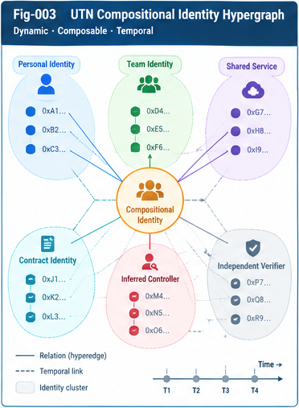

# ASSI-004 — UTN and Compositional Identity Intelligence

**Project:** Adversarial Structural Security Intelligence (ASSI)  
**Version:** v0.1.0 — Research Foundation  
**Status:** Architectural hypothesis and specification-oriented research; not an implemented or validated identity-attribution system  
**Date:** 2026-11-02  
**License:** Apache-2.0

## Abstract

Security investigations frequently attempt to infer who or what controls an observed address, account, service, or action. A hidden simplification in many identity-inference workflows is that each behavioral cluster corresponds to one stable actor. Real operations may instead involve individuals, delegated operators, teams, overlapping subgroups, temporary coalitions, shared services, and changing control arrangements. Consequently, contradictory evidence against a **single-operator** hypothesis need not contradict a **shared-team** or **shared-infrastructure** hypothesis. This paper develops **Compositional Identity Intelligence** as a proposed extension of **Universal Typing and Naming (UTN)** within Adversarial Structural Security Intelligence (ASSI). It separates observations from inferred relationships; distinguishes person, role, controller, organization, collaboration, and service; represents membership, control, and behavior as time-dependent and potentially many-to-many; and treats a name as an evidence-grounded, revisable reference rather than proof of a real-world identity. We propose typed identity hypotheses, compositional graphs and hyperedges, hypothesis-scoped bidirectional IF tests, structural naming lifecycle operations, and reproducible benchmarks for false merges, false splits, calibration, and temporal evolution. The immediate testbed is a synthetic and permissioned on-chain evidence sandbox. The objective is defensible reasoning and bounded uncertainty, not automated identification or accusation of private individuals.

**Keywords:** UTN; universal typing and naming; compositional identity; on-chain evidence; dynamic groups; hypergraph; entity resolution; hypothesis portfolio; provenance; REN; BCEF; temporal identity; security intelligence.

---

## 1. Motivation: the identity target may be a composition

A blockchain exposes standardized records of addresses, transactions, contract calls, and state changes. Such records support reproducible analysis of observable activity. They do **not**, by themselves, identify the natural person or organizational decision process behind an address. One person may control many addresses; many people may operate one address or signing service; several teams may share a custody platform; and a team may reconfigure its members, tools, and operational roles over time.

The central research question is therefore not merely:

> Which single person does this address belong to?

It is:

> Which **individual, service, role, group, coalition, or time-bounded composition** best explains the observed actions, under what evidence and uncertainty, and how should that explanation change when new evidence arrives?

A single-identity model is a useful special case, but should not be the default ontology. **ASSI-004 proposes composition-aware UTN from the start**, because retrofitting group semantics after hard-coded one-address/one-person naming risks contaminating clustering, contradiction handling, scoring, and audit history.

### 1.1 Central thesis

**Identity inference should be modeled as the maintenance of competing, typed, time-indexed structural hypotheses, not the irreversible assignment of one name to one observed cluster.**

A related rule is:

**Contradiction must be hypothesis-scoped.** Evidence that contradicts a common-human-operator hypothesis may be compatible with common organizational control, shared service use, or unrelated actors with correlated behavior.

### 1.2 Scope and non-goals

This paper addresses conceptual representation, inference contracts, and research validation. It does not claim that blockchain analytics can reliably reveal a real-world individual from public transactions alone. It does not provide operational deanonymization procedures, evasion tactics, or allegations against specific people. The proposed sandbox uses synthetic actors, consented/permissioned datasets, or carefully documented public organizational labels; real-world personal attribution requires independent, lawful corroboration and human review.

---

## 2. What UTN must type before it can name

UTN is treated here as a **typing-and-reference discipline**. The distinction matters: a stable identifier for an observed address is not equivalent to an identity claim about its controller.

### 2.1 Observation-layer types

| Type | Example | What is directly supported? |
|---|---|---|
| `ChainAddress` | Address A | An address appears in a specified chain context |
| `Transaction` | Transaction T | A recorded transaction and its chain metadata |
| `Contract` | Contract C | Code/state at a given chain and block context |
| `TransferEvent` | Event E | A recorded movement or contract-emitted event |
| `TimeWindow` | Interval W | The observation's temporal scope |
| `ServiceEndpoint` | Signing API S | A system component if documented by permitted evidence |
| `EvidenceRecord` | Record R | A source, observation method, and provenance |

The observation layer should be replayable. Chain identifiers, block references, transaction hashes, and source snapshots must be retained where applicable. Reorganizations, chain-specific semantics, and missing data must be represented explicitly.

### 2.2 Inference-layer types

| Type | Meaning | Common pitfall |
|---|---|---|
| `OperatorHypothesis` | One actor operates an observed resource | Confusing operator with owner |
| `ControllerHypothesis` | An actor can direct or authorize behavior | Inferring exclusive control from access |
| `IndividualHypothesis` | A natural person is involved | Treating a pattern as personal identity proof |
| `GroupHypothesis` | Multiple actors form an operational unit | Assuming every member acts on every event |
| `CoalitionHypothesis` | Multiple groups coordinate for a bounded purpose | Assuming permanent organizational unity |
| `SharedServiceHypothesis` | Similarity arises from common infrastructure | Mistaking service correlation for shared control |
| `RoleHypothesis` | An actor performs a functional role | Treating a role as a unique person |
| `UnresolvedHypothesis` | Evidence does not distinguish candidates | Forcing a premature assignment |

These types are not mutually exclusive: an address can be associated with a service, a role, and a group under different relations and time intervals.

### 2.3 Five distinct relations

At minimum, UTN should distinguish:

1. **Observed transaction relation:** directly supported on-chain activity.
2. **Operates relation:** a hypothesized actor operates a resource.
3. **Controls relation:** an actor has decision or authorization power over a resource.
4. **Member-of / participates-in relation:** an actor belongs to or participates in a group or activity.
5. **Shares-service relation:** actors use common infrastructure without necessarily sharing ownership or control.

A frequent inference error is to promote `shares_service(A,B)` into `common_controller(A,B)` without independent evidence. Type constraints should make such promotions explicit and reviewable.

---

## 3. The compositional identity model

### 3.1 Many-to-many, overlapping, and temporal membership

Let the system contain typed entities $V$, observed events $O$, candidate identity compositions $C$, and evidence records $E$. A composition is not necessarily a fixed set of people. It may be modeled as:

$$
C_i(t) = \{(v_j, r_j, w_j, [t_{start},t_{end}])\},
$$

where $v_j$ is an actor or subordinate composition, $r_j$ is a role, and $w_j$ is an optional, explicitly defined participation weight. The weight is not automatically a probability of guilt or ownership. Membership and role claims carry their own evidence references and confidence assessments.

An actor may participate in multiple compositions during overlapping periods. A composition may also contain subordinate compositions, yielding a nested or partially overlapping structure. Recursive membership requires cycle handling and clear semantics; a graph cycle must not silently imply organizational identity.

### 3.2 Graph versus hypergraph

A conventional edge $(u,v)$ expresses a pairwise relationship. Collaborative activity may involve a set of participants and resources:

$$
h = (\{v_1,v_2,\ldots,v_k\},\ \text{activity},\ \text{roles},\ \text{time},\ \text{evidence}).
$$

This motivates **hyperedges** or explicit `Activity` nodes connecting several actors. Either representation can work: a hypergraph is a conceptual model, not a mandatory database product. In an ordinary property graph, a first-class activity node with typed participant edges often preserves the same essential semantics.

### 3.3 Three continuity axes

A group's identity may persist despite changes in membership. Conversely, the same members may create a distinct operational unit. UTN must therefore track separately:

- **Membership continuity:** persistence or turnover of participating actors.
- **Control continuity:** persistence of decision rights, authorization authority, or command structure.
- **Behavioral continuity:** persistence of tactics, workflows, objectives, or operating patterns.

These are distinct, potentially conflicting signals. **Identity continuity is not equivalent to membership continuity.** A canonical name should not be carried forward merely because one axis appears stable.

### 3.4 Distinguish identity, coordination, and correlation

The following implications are generally invalid without additional premises:

- Similar behavior $\not\Rightarrow$ same operator.
- Shared infrastructure $\not\Rightarrow$ shared controller.
- Shared controller $\not\Rightarrow$ same natural person.
- Common organization $\not\Rightarrow$ identical activity for all members.
- Different time zones $\not\Rightarrow$ different organizations.
- Repeated coordination $\not\Rightarrow$ permanent coalition.

UTN should represent each claim at the appropriate type and relational level.

---



*Figure 3. UTN-typed, time-indexed compositional identity: overlapping participants and shared services support multiple controller hypotheses without implying verified identity or authority.*

---

## 4. Naming: stable references without premature attribution

A **UTN Name** should denote an explicitly typed referent under a declared scope. Naming is not the same as asserting a real-world identity.

### 4.1 Proposed naming layers

1. **Observed-object name:** deterministic reference to an address, event, contract, or recorded artifact.
2. **Structural-cluster name:** provisional reference to a cluster of observations under a specified algorithm/version.
3. **Operational-composition name:** provisional reference to a group, role structure, or coalition hypothesis.
4. **Verified-entity name:** a real-world organizational or personal attribution supported by independent, authorized evidence.

A structural cluster may have a stable research identifier while its interpretation changes. The identifier should remain distinct from any asserted real-world label.

### 4.2 Naming invariants

- Every name has a **type**, **scope**, **creation provenance**, and **status**.
- A name may be **provisional**, **corroborated**, **contested**, **deprecated**, or **retracted**.
- A change in evidence does not silently rewrite historical assertions.
- `merge` and `split` operations produce versioned lineage records.
- A name cannot be promoted from structural cluster to verified person solely through repeated algorithmic scoring.
- Competing names/hypotheses may coexist until evidence resolves them.
- Every user-visible attribution should state what is observed, inferred, and independently verified.

### 4.3 Candidate lifecycle

`OBSERVED → TYPED → HYPOTHESIZED → TESTED → CORROBORATED / CONTESTED / DEFERRED → REVISED / RETRACTED`

This is a conceptual lifecycle, not a claim that every entity eventually becomes identifiable. **DEFERRED** and **UNRESOLVED** are valid terminal states for a research run.

---

## 5. Hypothesis portfolios: not one forced answer

Consider two addresses, X and Y, with partially correlated activity. A composition-aware system should retain at least these alternatives:

- $H_1$: X and Y are operated by the same individual.
- $H_2$: X and Y are operated by different members of the same team.
- $H_3$: X and Y are unrelated users of a shared service.
- $H_4$: X and Y are independent entities with coincidental or externally induced correlation.
- $H_5$: evidence is insufficient to distinguish the above.

These are **candidate explanatory models**, not necessarily an exhaustive or mutually exclusive partition. For example, a team may also use a shared service. If probabilistic normalization is desired, the researcher must first define a mutually exclusive hypothesis space or use a model that permits overlapping relations.

### 5.1 The reverse-IF failure mode

Suppose the evidence indicates different activity schedules and different transaction styles for X and Y. An oversimplified reverse test says:

> If they are one operator, they should behave alike; they do not behave alike; therefore they cannot be one entity.

This may weaken a *specific* same-individual hypothesis under an explicit behavioral model. It does **not** automatically refute a shared-team hypothesis: distinct operators can work different shifts, use different tools, or play different roles.

More importantly, even the same-individual inference must be calibrated: one person can operate several tools or work at unusual times. A probabilistic expectation is not a logical necessity.

### 5.2 Hypothesis-scoped contradiction

A contradiction record should contain:

`test_id; target_hypothesis; required_assumptions; observed_evidence; alternative_explanations; outcome; scope; confidence; provenance`

An outcome may be `SUPPORTED`, `WEAKENED`, `CONTRADICTED_UNDER_ASSUMPTIONS`, or `INDETERMINATE`. The last two are especially important: a failed prediction does not justify a broader identity rejection unless the necessary premises are established.

---

## 6. Integration with REN and BCEF

**REN (Relational Evidence Navigation)** supplies directional weak-evidence evaluation and explicit counterevidence. **BCEF (Bidirectional Conditional Evidence Feedback)** supplies conditional tests and their structured impacts. **UTN** supplies the types, referents, names, and revision history on which both operate.

### 6.1 Four IF test families

| IF family | Question | Identity use |
|---|---|---|
| Forward IF | If $H$ holds, what should be observable? | Predict a role-specific pattern |
| Reverse IF | Does $E$ support $H$, relative to alternatives? | Assess diagnosticity, not logical converse |
| Counterfactual IF | Would $E$ also arise if $H$ were false? | Evaluate shared-service explanation |
| Contradiction IF | Which precise assumptions of $H$ conflict with $E$? | Scope a negative impact |

A useful probabilistic framing is the likelihood ratio $P(E\mid H)/P(E\mid H')$ when the distributions are defensibly estimated. A high similarity score alone is not this ratio. Bayesian or other probabilistic approaches require calibration and explicit priors; ASSI does not prescribe one universal inference algorithm.

### 6.2 Impact is structural, not merely numerical

A BCEF result may cause:

- **Metric impact:** adjust a score or uncertainty interval.
- **Evidence impact:** down-weight a dependent observation or identify counterevidence.
- **Structural impact:** split a proposed cluster, revise a control edge, or retain alternative group hypotheses.
- **Control impact:** request independent evidence, halt automatic attribution, or prioritize a new test.

Crucially, a contradiction to $H_1$ must not automatically raise $H_2$. A candidate receives positive support only when the evidence discriminates in its favor, or when a properly specified exclusive hypothesis model justifies posterior redistribution.

### 6.3 Evidence-dependence safeguards

One on-chain observation can generate multiple derived features and several IF tests. Counting each as independent support creates artificial confidence. Each feature and inference must link back to its evidence lineage; dependence-aware aggregation, ablation tests, and source-level deduplication are required before claims of improved confidence.

### 6.4 Meta-IF and AQSI

A higher-level IF can question whether the scoring rule itself is valid:

> If the same pattern is common among unrelated users of a custody service, should it retain its current identity-discriminating weight?

**AQSI** may propose follow-up questions, but its generated tests must be assessed for information value, privacy cost, and circularity. An automatically generated question is not evidence.

---

## 7. A proposed minimal UTN composition contract

The following YAML is an illustrative schema sketch, not a normative implementation specification. `SPEC-002-Compositional-Identity-and-UTN-Contract.md` will define field-level conformance.

```yaml
composition_hypothesis:
  hypothesis_id: H-TEAM-002
  type: GroupHypothesis
  subject_refs: [address_X, address_Y]
  claim: "Different operators may share a coordinating team"
  valid_time:
    start: "synthetic-window-01"
    end: "synthetic-window-03"
  roles:
    - subject: operator_candidate_A
      role: infrastructure_operator
    - subject: operator_candidate_B
      role: transaction_operator
  relations:
    - predicate: participates_in
      target: activity_candidate_17
      status: inferred
  evidence_refs: [E-001, E-004]
  counterevidence_refs: [E-009]
  alternatives: [H-SINGLE-001, H-SERVICE-003, H-INDEPENDENT-004]
  score:
    value: null
    interpretation: uncalibrated
  status: provisional
  provenance:
    dataset: synthetic_identity_sandbox
    model_version: assi-0.1-research
  review:
    independent_corroboration: false
    real_world_identity_asserted: false
```

The contract should preserve **valid time** (when a claim is thought to apply) separately from **record time** (when the system learned or revised the claim). This bitemporal distinction is necessary for replaying earlier conclusions without hindsight contamination.

### 7.1 Proposed conformance requirements

A future implementation should demonstrate that it can:

1. Assign stable names to directly observed objects without inferring persons.
2. Represent one-to-many, many-to-one, and overlapping membership/control relations.
3. Distinguish group membership, operational control, and service sharing.
4. Version membership and role changes over time.
5. Preserve multiple competing hypotheses and an unresolved state.
6. Apply a contradiction only to hypotheses whose assumptions it actually tests.
7. Trace scores and IF impacts to original, nonduplicated evidence.
8. Split, merge, deprecate, and retract names without erasing provenance.
9. Prevent automatic promotion to real-world personal attribution without independent review.
10. Export an auditable decision record with uncertainty and alternative explanations.

---

## 8. Worked synthetic case: one team, several operating combinations

Consider four simulated actors $A,B,C,D$. In a controlled dataset:

- Activity 1 involves $A+B$.
- Activity 2 involves $B+C$.
- Activity 3 involves $C+D$.
- Some activities share a service endpoint; others share a coordinating objective.
- The ground-truth organization includes several overlapping task groups, but no single individual performs all actions.

An overly aggressive clustering method might merge all addresses into one supposed person because of transitive similarity. An overly strict reverse-IF method might split every activity because time and behavior differ. Both are wrong at different levels.

**Composition-aware UTN** instead models:

- Distinct operational combinations, with time-bounded membership.
- Possible common organization or coordination as a separate hypothesis.
- Shared-service effects as competing explanations.
- Role-specific expectations rather than uniform behavior requirements.

A negative test against a single-operator explanation does not remove the team hypothesis. Conversely, a common service does not establish a team. The output may remain a portfolio of unresolved explanations if the evidence cannot distinguish them.

### 8.1 A test sequence

1. Type and name observed addresses, transactions, and services.
2. Generate candidate individual, team, coalition, and shared-service hypotheses.
3. Apply forward predictions conditional on each model's explicit assumptions.
4. Evaluate observed evidence against alternative explanations.
5. Record hypothesis-scoped contradictions and their evidence lineage.
6. Revise the composition graph; retain ambiguity where warranted.
7. Compare predictions with synthetic ground truth and held-out episodes.

This case is intended to test inference quality, not to infer any real person's identity.

---

## 9. Benchmark design: does composition awareness help?

### 9.1 Research questions

**RQ-1:** Does composition-aware modeling reduce false merges of unrelated actors relative to single-entity clustering?

**RQ-2:** Does it reduce false splits of legitimate teams with heterogeneous roles?

**RQ-3:** Does hypothesis-scoped reverse IF reduce invalid group rejection without excessively preserving implausible group hypotheses?

**RQ-4:** Can the system maintain identity continuity under member turnover, organizational split/merge, and service migration?

**RQ-5:** Does provenance-aware BCEF improve calibration and auditability under correlated evidence?

### 9.2 Baselines and ablations

Compare at least:

- **B0:** rule-based address grouping, no compositional identities.
- **B1:** behavioral clustering with fixed single-operator assumption.
- **B2:** composition-aware graph without BCEF.
- **B3:** composition-aware graph with unscoped IF updates.
- **B4:** composition-aware graph with hypothesis-scoped BCEF and provenance controls (proposed ASSI variant).

Use ablations removing temporal membership, shared-service alternatives, evidence-dependence correction, or counterfactual tests to isolate contributions. Keep the model and dataset split fixed when evaluating an individual mechanism.

### 9.3 Metrics

| Dimension | Example metrics | Interpretation |
|---|---|---|
| Entity resolution | Pairwise precision/recall/F1; false-merge and false-split rates | Separate over- and under-clustering |
| Group recovery | Membership precision/recall; overlapping-cluster metrics | Recover compositional ground truth |
| Role and control | Typed-edge precision/recall | Avoid conflating roles and ownership |
| Temporal continuity | Identity-switch count; change-point delay; lineage correctness | Track changing compositions |
| Inference quality | Calibration error; Brier score where applicable; abstention quality | Measure uncertainty honestly |
| BCEF safety | Wrong-scope contradiction rate; reversal error rate | Prevent invalid negative inference |
| Auditability | Provenance completeness; reproducible replay rate | Explain and reproduce decisions |
| Efficiency | Compute cost; latency; test count per useful revision | Measure practical overhead |

Report results by scenario: single operator, stable team, rotating team, temporary coalition, shared service, and adversarially misleading correlations. Group-level F1 alone can conceal unacceptable false accusations; track harmful false positives explicitly.

### 9.4 Experimental controls

- Generate labeled synthetic data with known actors, roles, teams, and control transitions.
- Hold out entire scenario families, not just randomly selected transactions, to test generalization.
- Include noise, missing observations, delayed records, and shared-service confounding.
- Freeze evaluation criteria before testing; record negative outcomes.
- Conduct sensitivity analysis on priors, thresholds, and temporal windows.
- Compare inference against an independent ground-truth oracle; do not use the same heuristic to create labels and judge performance.
- For any later permissioned real-world dataset, establish legal authority, privacy review, and independent attribution standards.

### 9.5 Falsification criteria

The proposal is weakened if composition-aware modeling fails to improve false-merge/false-split tradeoffs on held-out compositions; if BCEF adds no measurable discrimination after accounting for correlated evidence; if temporal updates produce unstable identities without useful uncertainty estimates; or if gains disappear when shared-service confounding is introduced. More complexity is not itself a success metric.

---

## 10. Threats to validity and failure modes

### 10.1 Non-identifiability

Different underlying control structures can produce indistinguishable on-chain observations. No inference engine can guarantee a unique answer where the data do not identify one. A defensible system must be able to abstain.

### 10.2 Behavioral mimicry and adaptive opponents

Adversaries can imitate common patterns or deliberately create misleading correlations. Behavioral resemblance is weak evidence unless evaluated against plausible alternative generators.

### 10.3 Service and custody confounding

Exchange deposits, custodial aggregation, relayers, bridges, batchers, and shared software can create correlations across unrelated customers. Such relations should be typed before identity clustering.

### 10.4 Selection bias and ground-truth leakage

Publicly labeled entities are not representative of all actors. Training and evaluating on the same label sources can overstate attribution quality.

### 10.5 Ontology drift

Operational roles and control mechanisms evolve. A fixed vocabulary can misclassify new patterns. UTN must allow schema extension without silently changing the meaning of older labels.

### 10.6 Privacy and downstream harm

False attribution may harm innocent people. Restrict personal claims, record confidence and provenance, separate investigation from enforcement, and require independent human and legal review for consequential action. Never treat a speculative cluster name as a factual accusation.

---

## 11. Relationship to the ASSI architecture

This paper supplies the **identity and naming layer** for ASSI's broader structural security model:

- **ASSI-001:** establishes the gap between cryptographic validity and structural security.
- **ASSI-002:** frames the cryptocurrency security contradictions and the on-chain visibility/identity gap.
- **ASSI-003:** supplies trust graphs, authorization boundaries, and provenance-aware security relationships.
- **ASSI-005:** develops REN-based directional weak-evidence assessment.
- **ASSI-006:** specifies BCEF's bidirectional tests and impact propagation.
- **ASSI-007:** applies structural authorization; speculative identity labels must not independently authorize punitive or irreversible action.
- **ASSI-008/009:** use adversarial simulation and residual-driven improvement to challenge identity assumptions.
- **ASSI-010/011:** integrate the architecture and benchmark the hypotheses.

Future normative interfaces are expected in `SPEC-002-Compositional-Identity-and-UTN-Contract.md` and `SPEC-003-Bidirectional-IF-and-Evidence-Impact-Contract.md`. The immediate experimental companion is `CASE-002-UTN-On-Chain-Identity-Sandbox.md`, followed by `CASE-003-Bidirectional-IF-and-False-Rejection.md`.

---

## 12. Open questions

1. What is the minimum expressive ontology that captures operational teams without overfitting every observed correlation?
2. When should a composition be named as a persistent group rather than a temporary activity?
3. How can role-based and control-based continuity be compared without conflating them?
4. How should overlapping hypotheses be scored without invalid probability normalization?
5. What evidence is sufficient to distinguish common control from shared service use?
6. How can IF tests be generated autonomously while preventing circular self-confirmation?
7. How should identity confidence decay or change under long observation gaps?
8. Which forms of evidence require hard exclusion, and which only warrant a score update?
9. How can a human reviewer reconstruct why a cluster was merged, split, or retracted?
10. Under what conditions does the additional complexity of compositional UTN provide measurable operational value?

---

## 13. Research contributions and limits

This paper proposes five contributions for further testing:

1. **Compositional identity as a first-class UTN referent**, not an afterthought to single-actor naming.
2. **Typed separation of observed relationships, operational control, membership, and shared services.**
3. **Hypothesis-scoped contradiction**, preventing negative evidence about one identity level from automatically rejecting another.
4. **Versioned, evidence-grounded names** with temporal lineage and reversible structural updates.
5. **A falsifiable benchmark program** measuring false merges, false splits, dynamic group recovery, calibration, and provenance.

The novelty claim is **integrative and architectural**, not that group identity, hypergraphs, Bayesian evidence, or temporal entity resolution are new inventions. Relevant prior disciplines include entity resolution, probabilistic graphical models, multi-target tracking, organizational network analysis, temporal knowledge graphs, and truth-maintenance systems. Their established methods should be compared directly in later benchmark work.

The principal limitation is evidentiary: on-chain records rarely establish real-world personal identity without independent sources. A sound system may improve structural explanation while leaving actual identity unresolved.

## 14. Conclusion

A structural security intelligence system must not assume that every behavioral pattern has one stable human owner. Individuals, roles, teams, services, and temporary coalitions can overlap, change, and jointly produce observations. UTN should therefore name **typed, evidence-grounded, time-bounded referents**, preserve competing explanations, and support revision without erasing history. REN and BCEF can test these explanations, but their impacts must remain scoped to the assumptions actually examined.

The governing principle is simple:

> **Rejecting the one-person hypothesis does not, by itself, reject the one-team hypothesis.**

By making compositional identity and hypothesis-scoped contradiction foundational, ASSI can investigate complex security behavior with fewer avoidable logical errors and a clearer path to empirical validation. Whether this yields better practical results remains a question for the proposed benchmarks—not an assumption of this research foundation.

---

## Suggested references and methodological anchors

The following are established research areas to consult when developing formal specifications and benchmarks; they are not presented as evidence that ASSI has already been experimentally validated:

- Entity resolution and record linkage, including probabilistic matching and clustering evaluation.
- Temporal knowledge graphs, event-centric modeling, and bitemporal data management.
- Hypergraphs, overlapping community detection, and role-aware organizational networks.
- Bayesian hypothesis testing, likelihood ratios, and calibrated uncertainty.
- Assumption-based truth-maintenance systems, belief revision, and provenance-aware inference.
- Security threat modeling, separation of duties, and privacy-preserving investigation practices.

**Repository placement:** `docs/ASSI-004-UTN-and-Compositional-Identity-Intelligence.md`  
**Next article:** `docs/ASSI-005-REN-and-Directional-Weak-Evidence-Intelligence.md`
