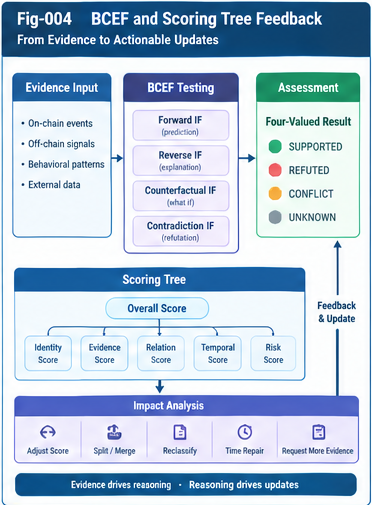

# ASSI-006 — Bidirectional Conditional Evidence Feedback

**Project:** Adversarial Structural Security Intelligence (ASSI)  
**Version:** v0.1.0 — Research Foundation  
**Status:** Proposed research architecture and falsifiable hypotheses; not a validated inference engine or production security control  
**Date:** 2026-11-02  
**License:** Apache-2.0

## Abstract

Similarity metrics and directional weak-evidence scores can rank plausible explanations, but a high score does not establish that an explanation survives conditional scrutiny. This paper proposes **Bidirectional Conditional Evidence Feedback (BCEF)**: a typed, hypothesis-scoped mechanism that generates forward predictions, evaluates observations against hypotheses, compares counterfactual alternatives, tests contradictions, and returns structured impacts to an evidence-aware Scoring Tree. BCEF is not a new law of logic, a substitute for Bayesian inference, or a guarantee of correct attribution. Its proposed contribution is an interoperable *engineering contract* connecting conditional tests to provenance-aware score revision, compositional identity revision, next-question selection, and independent safety controls. The design explicitly separates a prediction from its converse, a rejected individual-control hypothesis from an unresolved group-control hypothesis, and soft evidence updates from hard authorization policy. We specify test and impact units, update semantics, dependency and feedback-loop protections, an illustrative on-chain identity case, a defensive signing-service case, evaluation protocols, failure criteria, and open research questions. The principal research question is whether structured, bidirectional, counterfactual testing improves the calibration, falsifiability, and robustness of security judgments over comparable scoring-only baselines.

**Keywords:** BCEF; bidirectional IF; conditional reasoning; counterfactual testing; contradiction; hypothesis-scoped evidence; Scoring Tree; impact feedback; REN; UTN; compositional identity; AQSI; UCPSF; structural security; adversarial evaluation.

---

## 1. Motivation: what remains after metric and directional scoring?

A structural security system may already compute behavioral similarity, contextual relevance, direction-dependent evidence strength, and confidence in a candidate hypothesis. These computations help prioritize attention. They do not necessarily answer the next questions:

1. **If the hypothesis is true, what else should be observable?**
2. **If the observation occurs, how strongly does it distinguish this hypothesis from alternatives?**
3. **Could the same observation arise if the hypothesis were false?**
4. **Does any observation contradict a necessary condition of the hypothesis?**
5. **If a test changes the assessment, which score, relationship, or future test should change—and why?**

The proposed BCEF operator addresses these questions as a *conditional-test and impact-feedback layer* above, and recursively within, scoring. It builds on familiar conditional reasoning, hypothesis testing, causal inference, Bayesian updating, truth-maintenance systems, and model-based testing. Its distinctive proposed engineering integration is a common typed interface between these tests and structural intelligence components.

**Research proposition:** A scoring system that can explicitly challenge the conditions supporting its scores, retain alternatives, and audit its revisions may be more robust than a system that merely accumulates positive similarity signals. This is a hypothesis to test, not an established result.

### 1.1 Position in the ASSI series

- **ASSI-001:** Cryptographic validity does not imply structural security.
- **ASSI-002:** Four structural contradictions motivate broader security reasoning.
- **ASSI-003:** Trust and security responsibility relocate across boundaries.
- **ASSI-004:** UTN names can refer to individuals, teams, coalitions, roles, and time-bounded compositions.
- **ASSI-005:** REN provides typed, directional, provenance-aware evidence navigation.
- **ASSI-006 (this paper):** BCEF tests conditional implications and feeds *scoped impacts* back into scores, hypotheses, and structure.
- **ASSI-007 onward:** Independent authorization controls, adversarial drives, validated RSI, and benchmarks consume these outputs without delegating unconstrained authority to them.

### 1.2 Scope and non-goals

BCEF is intended for defensive analysis, authorized testing, controlled experiments, and auditable security decisions. It is not an automatic identification service for private individuals. It does not infer real-world identity from on-chain similarity alone, and it does not authorize fund transfers, override hard controls, or make unreviewed production policy changes.

---

## 2. Four conditional test modes

The phrase **Two-Ways IF** emphasizes looking in both explanatory directions. A usable implementation must distinguish at least four operations:

| Mode | Question | Main output | Typical error to avoid |
|---|---|---|---|
| **Forward IF** | If hypothesis H holds, what evidence E should occur under stated context C? | Predictions and expected observables | Treating an optional prediction as a necessary condition |
| **Reverse IF** | Given observed E, how much does E discriminate H from alternatives? | Comparative evidence impact | Affirming the consequent: H implies E, therefore E proves H |
| **Counterfactual IF** | Could E also occur if H were absent or another hypothesis held? | Alternative explanations and discriminating tests | Treating absence of a modeled alternative as proof of H |
| **Contradiction IF** | Is E incompatible with a specified requirement of H? | Scoped contradiction or model revision | Rejecting a broader group hypothesis when only a single-person hypothesis was tested |

**Terminology note:** “Reverse IF” here is *abductive/evidential evaluation*, not the logical converse of a material implication. It must not be implemented as a logically valid inversion of `H => E`.

### 2.1 Formal distinctions

Let H denote a hypothesis, E an observation, and C a context. A forward claim may be expressed as:

\[
H \land C \Rightarrow E.
\]

This does **not** license the converse:

\[
E \Rightarrow H.
\]

A probabilistic test may instead compare likelihoods:

\[
\mathrm{LR}(E;H,H_0,C)=\frac{P(E\mid H,C)}{P(E\mid H_0,C)},
\]

where H₀ is an explicitly chosen alternative. This ratio is meaningful only if the conditional distributions and evidence dependencies are modeled or estimated sufficiently well. If those quantities are unavailable, the system should emit a qualitative, explicitly uncalibrated result rather than invent a probability.

A contradiction requires careful semantics. A strict contradiction exists only when E violates a *necessary* condition of H under verified assumptions. Failure to observe an expected but non-necessary signal is normally **negative evidence**, not a logical refutation.

### 2.2 Four-valued test results

A binary Boolean result is inadequate for many security investigations. The minimum proposed outcome vocabulary is:

- **SUPPORTED:** the test contributes evidence in favor of a scoped hypothesis.
- **CHALLENGED:** the test contributes evidence against it, without logical refutation.
- **CONTRADICTED:** a validated necessary condition is violated, within a specified scope.
- **INDETERMINATE:** data, model, provenance, or test power is insufficient.

An implementation may separately represent **CONFLICTED**, when credible supporting and opposing evidence coexist. A test should preserve uncertainty instead of coercing unknown observations to false.

---

## 3. Hypothesis scope: individual, group, role, and coalition

The most consequential modeling constraint arises from **compositional identity**. A security event can be generated by one operator, a coordinated team, a shared service, a coalition, or several independent actors. These hypotheses are not interchangeable.

Consider addresses X and Y:

- **H1:** X and Y are operated by the *same individual*.
- **H2:** X and Y are operated by *different members of one team*.
- **H3:** X and Y are unrelated but use a *common service*.
- **H4:** X and Y are independently controlled and exhibit coincidentally similar behavior.

Different active hours may challenge H1, but they do not automatically refute H2. A shared transaction counterparty may support H3 at least as well as H1. An IF test that says “not one individual” must not silently rewrite that result as “not one organization.”

**Invariant BCEF-I1 — Hypothesis-scoped contradiction:** Every test result must identify the exact hypothesis version, composition level, context, assumptions, and conditions it evaluates. An impact cannot propagate to a broader or neighboring hypothesis without a separately justified relation.

### 3.1 Composition-aware alternatives

A hypothesis portfolio should preserve overlapping and temporally changing possibilities:

\[
\mathcal{P}_t=\{H_1^{(t)},H_2^{(t)},\ldots,H_k^{(t)}\}.
\]

Its members need not be mutually exclusive. A shared-service explanation can coexist with a team explanation. Where probabilities are used, the model must define an appropriate mutually exclusive partition or a joint model before normalizing scores to sum to one. Otherwise, report per-hypothesis scores without pretending they are posterior probabilities.

### 3.2 Naming is revisable

A UTN Name may denote a tentative structural cluster rather than a real person. BCEF may recommend `RETAIN`, `SPLIT`, `MERGE_CANDIDATE`, `REVOKE_LINK`, or `DEFER`, but any such action requires traceable evidence and governance. The observed transaction graph must remain separate from the inferred controller graph.

---

## 4. BCEF architecture: test, evaluate, impact, revise

The proposed cycle is:

```text
Typed observations + provenance + context
                |
                v
      REN directional evidence
                |
                v
       Hypothesis portfolio
                |
                v
   BCEF conditional test planner
    /        |         |        \
Forward   Reverse  Counterfactual Contradiction
    \        |         |        /
                v
      Test result + limitations
                |
                v
    Evidence dependency / scope gate
                |
                v
     Structured Impact Object
       /         |         \
Score revision  Structural revision  Next-question proposal
       \         |         /
                v
   Audited Scoring Tree version t+1
                |
                v
      Independent control plane
```

The independent control plane is a *consumer* of authorized risk signals, not a subordinate of BCEF. Its hard safety rules cannot be weakened by a favorable soft score.

### 4.1 The Scoring Tree is not just a scalar

A proposed Scoring Tree contains typed nodes for observations, feature derivations, evidence families, hypotheses, constraints, score components, and decisions. It should record both a numerical or ordinal assessment and the structural explanation supporting it.

An IF impact may therefore affect:

1. **Metric impact:** score, calibration band, threshold or weight proposal.
2. **Evidence impact:** reliability, provenance, duplication, dependency or counterevidence status.
3. **Structural impact:** proposed split, merge, edge revision, hypothesis re-opening or revocation.
4. **Control impact:** testing priority, required review, information acquisition or resource allocation.

A structural action is not equivalent to an immediately executable production mutation.

### 4.2 Update semantics

Let \(S_t(H)\) be a score associated with H at time t, and \(I_t\) a validated impact derived from a conditional test:

\[
S_{t+1}(H)=\operatorname{Update}(S_t(H),I_t,\mathcal{D}_t,\mathcal{G}_t),
\]

where \(\mathcal{D}_t\) represents evidence dependencies and \(\mathcal{G}_t\) represents governance and update constraints. `Update` is deliberately abstract: different score families require different calibrated update rules. A numeric `score_delta` must not be treated as a universal probability increment.

If a well-specified probabilistic model exists, posterior odds may be updated using likelihood ratios from **new, conditionally independent evidence**. If evidence is dependent, the joint likelihood or an appropriate dependency model is required. BCEF test results derived from existing observations are *interpretations of evidence*, not independent observations to be counted again.

---



*Figure 4. BCEF uses scoped conditional tests to produce traceable evidence impacts on scoring and hypothesis structure, while preserving dependence and authorization boundaries.*

---

## 5. Proposed typed contracts

The following examples are **illustrative design sketches**, not final normative schemas. The authoritative contract will be developed in `specs/SPEC-003-Bidirectional-IF-and-Evidence-Impact-Contract.md`.

### 5.1 Conditional test unit

```yaml
schema: assi.bcef.if-test.v0.1-draft
id: IF-EXAMPLE-001
mode: COUNTERFACTUAL
hypothesis:
  id: H-SINGLE-OPERATOR
  version: 3
  subject_type: individual_control
context:
  interval: synthetic-window-01
  environment: authorized-sandbox
premises:
  - ref: OBS-TIME-PATTERN
    provenance: synthetic_dataset
expected_observation:
  description: Activity pattern is discriminative under stated assumptions
  necessity: false
alternatives:
  - H-TEAM-MEMBERS
  - H-SHARED-SERVICE
assumptions:
  - Behavioral timing is reliably measured
  - Service automation may confound operator timing
validation:
  status: PROPOSED
  evaluator: independent-test-harness
```

### 5.2 Evidence impact unit

```yaml
schema: assi.bcef.impact.v0.1-draft
id: IMPACT-EXAMPLE-001
source_test: IF-EXAMPLE-001
result: CHALLENGED
scope:
  hypothesis_id: H-SINGLE-OPERATOR
  hypothesis_version: 3
  composition_level: individual
provenance:
  observations: [OBS-TIME-PATTERN]
  evidence_family: ACTIVITY_TIMING
  derivation_chain: [FEATURE-TIME-SUMMARY, IF-EXAMPLE-001]
  independent_new_evidence: false
impact:
  score_action: REASSESS_WITHOUT_DOUBLE_COUNTING
  structural_actions:
    - RETAIN_TEAM_ALTERNATIVE
    - REOPEN_SHARED_SERVICE_EXPLANATION
  policy_action: NONE
confidence:
  kind: qualitative
  value: LOW
  calibrated: false
follow_up:
  - Seek independent control evidence in the sandbox
  - Test whether a shared service explains both activity patterns
audit:
  requires_review: true
  immutable_source_links: true
```

The example intentionally contains **no arbitrary numeric probability or unvalidated score delta**. Where a numeric effect is necessary, its scale, uncertainty, calibration method, and dependency handling must be specified.

### 5.3 Minimum contract invariants

- **BCEF-I1 Scope:** Test and impact refer to exact hypothesis identifiers and versions.
- **BCEF-I2 Direction:** Forward implication is not silently inverted.
- **BCEF-I3 Necessity:** Absence of an optional signal is not a logical contradiction.
- **BCEF-I4 Provenance:** Every impact traces to observations and derivations.
- **BCEF-I5 Dependency:** Derived IF results are not double-counted as independent evidence.
- **BCEF-I6 Alternatives:** Relevant competing explanations remain representable.
- **BCEF-I7 Uncertainty:** Indeterminate and conflicting states are preserved.
- **BCEF-I8 Revision:** Every structural change is versioned, explainable and reversible.
- **BCEF-I9 Authority:** Soft scoring cannot bypass hard security policy.
- **BCEF-I10 Bounded recursion:** Tests have cost, depth and termination limits.
- **BCEF-I11 Separation:** Observed relations and inferred control relations remain distinct.
- **BCEF-I12 Review:** Consequential identity or authorization changes require appropriate independent review.

---

## 6. Recursive IF: testing the evidence, the scoring rule, and the test policy

BCEF can be applied at three levels.

### Level 1 — Evidence IF

Test a conditional relationship between observations and a candidate hypothesis. Example: if two synthetic accounts share control, should a particular authorization dependency be visible?

### Level 2 — Scoring IF

Test whether a scoring rule remains discriminative in the current environment. Example: if similar timing is common among users of the same automation provider, should the timing feature carry less weight when assessing common control?

### Level 3 — Meta-IF / policy IF

Test whether further investigation is justified. Example: if another test is expensive, low-power, and unlikely to change the decision, should the system defer that branch and examine a different hypothesis?

This yields a proposed recursive loop:

\[
\text{Question}\rightarrow\text{IF Test}\rightarrow\text{Evidence Impact}
\rightarrow\text{Structural Revision}\rightarrow\text{Next Question}.
\]

### 6.1 Termination and anti-self-confirmation controls

Recursion is not inherently self-improvement. A system that generates its own questions and rewards its own answers can become overconfident without gaining new information. A safe design should enforce:

- A finite test budget, recursion depth and time horizon.
- A requirement to identify **new independent evidence** versus re-analysis of old evidence.
- Frozen or independently validated evaluation sets.
- Explicit uncertainty propagation and a `DEFER` outcome.
- Escalation for high-consequence structural or policy changes.
- Replayable audit trails for every proposed update.

Where possible, test selection should maximize *expected decision-relevant information gain per unit cost*, with uncertainty in the information-gain estimate itself represented.

---

## 7. Worked synthetic case A: false rejection of a team hypothesis

**Scenario:** A synthetic dataset contains two addresses, X and Y, with correlated transfers, similar counterparties, and distinct active-hour distributions. The ground-truth generator assigns them to different operators within one simulated team that also uses a shared transaction service.

### 7.1 Scoring-only baseline

A similarity engine sees correlated behavior and creates a single-controller cluster. A subsequent timing inconsistency triggers a reverse test that rejects the cluster entirely. Both steps are flawed: the first overcommits to a single operator, and the second wrongly generalizes a single-operator contradiction to a group hypothesis.

### 7.2 BCEF hypothesis portfolio

| Hypothesis | Timing difference | Shared counterparties | Appropriate state |
|---|---|---|---|
| H1: same individual | May challenge H1 | Not uniquely discriminative | Reassess or challenge |
| H2: different members of one team | Compatible | Potentially relevant but not decisive | Retain, seek independent evidence |
| H3: unrelated users of shared service | Compatible | Often expected | Retain, test service explanation |
| H4: unrelated, coincidentally similar | Compatible | May be less likely under some models | Retain until discriminating evidence |

BCEF should produce a *scoped* impact that weakens or reopens H1 without automatically deleting H2. A later independent observation may support, challenge, or leave unresolved the remaining hypotheses.

### 7.3 Required evaluation

The desired outcome is **not** “identify the team at any cost.” The desired outcome is to reduce false rejection, false merging, and unjustified confidence while preserving valid alternatives. Measure accuracy on known synthetic labels and report uncertainty calibration. A model that simply refuses to make decisions may lower false positives while becoming unusable; coverage and abstention rates must therefore be reported together.

---

## 8. Worked synthetic case B: compromised signing-service defense

**Scenario:** In an isolated test environment, a signing service can produce cryptographically valid requests but has been compromised. A request seeks to move assets beyond a permitted exposure boundary.

### 8.1 Forward IF

If the request is legitimate under the business policy, it should satisfy the relevant intent authorization, contract allowlist, asset-exposure limit, and independent approval requirements.

### 8.2 Reverse and counterfactual IF

A valid signature alone does not establish business intent. Ask whether the same signature could be produced by the compromised service. Compare the request with legitimate workflows and alternative explanations.

### 8.3 Contradiction IF and safety outcome

If a verified hard policy prohibits the amount, destination, or approval state, the independent control plane rejects the action **regardless of the soft BCEF score**. BCEF may help explain the anomaly, prioritize review, and propose new tests; it must not be allowed to waive the prohibition.

**Separation principle:** Cryptographic validity is a necessary input for many authorized operations, not sufficient evidence of legitimate economic intent. Independent controls, loss caps, and recovery plans remain the safety backstop.

### 8.4 Test limitations

A simulated service compromise does not prove production resistance to insider collusion, supply-chain attacks, or correlated control-plane failure. Evaluate shared failure domains and tail loss separately.

---

## 9. Relationship to existing reasoning techniques

BCEF should be situated alongside established approaches rather than presented as if conditional reasoning itself were novel:

| Existing approach | Relevant contribution | BCEF integration question |
|---|---|---|
| Bayesian inference / likelihood ratios | Evidence-sensitive belief revision | How are typed provenance and dependence represented? |
| Causal and counterfactual inference | Alternative causal explanations | Which assumptions are identifiable from available data? |
| Truth-maintenance / belief-revision systems | Retraction and justification tracking | How do impacts revise structural names and edges? |
| Model-based and property-based testing | Conditional expected behavior | How are generated tests linked to risk scoring? |
| Rule engines and policy-as-code | Deterministic control constraints | How are hard rules isolated from soft evidence? |
| Adversarial testing / red teaming | Discovering blind spots | How do residuals become governed next-test proposals? |

The candidate novelty lies in **composable contracts and cross-layer orchestration**—especially hypothesis-scoped contradiction, composition-aware structural impact, and governed recursive test selection. Claims of empirical advantage require direct comparison with competent implementations of these baselines.

---

## 10. Integration with the SI ecosystem

### 10.1 REN: evidence navigation

REN supplies directional evidence units, provenance, alternative explanations, and calibrated or explicitly uncalibrated assessments. BCEF tests conditional claims about those units. The test does not automatically create new independent evidence.

### 10.2 UTN: typed and compositional referents

UTN identifies what the test refers to: address, observed cluster, operator hypothesis, team, coalition, role, or time-bounded composition. Its Naming layer should retain history and uncertainty. BCEF can propose name and relationship revisions, but real-world identification requires independent corroboration.

### 10.3 MDT: temporal difference

Metric Differential Trees can track how evidence, scores, roles, memberships, and hypotheses change across time. An IF test must specify the interval for which its assumptions hold.

### 10.4 AQSI: question generation

Autonomous Questioning Structural Intelligence can propose informative tests, counterexamples, and missing observations. A governance layer should limit autonomous exploration and prevent self-confirming cycles.

### 10.5 UCPSF: scoring and control

Universal Control Planes and Scoring Folding can route impacts, compare perspectives, and allocate evaluation resources. **A high aggregate score cannot override a mandatory safety constraint.**

### 10.6 SSICR, UIERU and validated RSI

Adversarial Drives can challenge BCEF assumptions; Relay can preserve reusable counterexamples and evaluation artifacts; validated RSI can propose improvements only after independent conformance and safety review. Security residuals remain explicit even when a test appears to succeed.

---

## 11. Experimental program and falsifiable hypotheses

The following are *proposed tests*, not reported findings.

### 11.1 Research hypotheses

- **BCEF-H1 — False-converse reduction:** Explicit reverse-test semantics reduce false inferences from `H => E` to `E => H` relative to an otherwise comparable baseline.
- **BCEF-H2 — Composition preservation:** Hypothesis-scoped contradictions reduce false rejection of valid group hypotheses relative to single-identity inference.
- **BCEF-H3 — Calibration:** Provenance- and dependency-aware impacts improve probability calibration or appropriately increase abstention on ambiguous cases.
- **BCEF-H4 — Structural revision:** Impact objects improve the correctness and auditability of split/merge/revoke decisions over scalar-only updates.
- **BCEF-H5 — Test efficiency:** Meta-IF selection reduces test cost at a matched error and coverage target.
- **BCEF-H6 — Security containment:** In signing-service simulations, independently enforced hard policies limit loss despite compromised signing capability; BCEF may improve triage but is not the sole containment mechanism.

### 11.2 Baselines and ablations

Compare against:

1. Similarity-only ranking and clustering.
2. Directional REN scoring without BCEF.
3. One-direction conditional tests without counterfactual alternatives.
4. BCEF without dependency checks.
5. BCEF without compositional identity.
6. BCEF without structural impacts (scalar-only updates).
7. Conventional Bayesian or rule-based alternatives where appropriately specified.

Ablate one mechanism at a time and keep model capacity, available evidence, annotation budget, and evaluation protocol as comparable as possible.

### 11.3 Metrics

| Evaluation dimension | Candidate measures |
|---|---|
| Identity inference | Precision, recall, F1, false merge/split, group false-rejection rate |
| Uncertainty | Brier score, log loss where probabilistic, calibration error, abstention/coverage |
| Conditional logic | False-converse errors, incorrectly generalized contradictions, test validity |
| Structural revision | Correct edge revisions, version consistency, audit completeness |
| Evidence quality | Double-count rate, dependency detection recall, provenance completeness |
| Efficiency | Tests per resolved case, information gain, compute and analyst cost |
| Security | Attack success, hard-policy violation count, maximum simulated loss, false blocks, response latency |

Use separate training, development, and blinded evaluation sets. Include shared-service confounders, overlapping teams, changing memberships, delayed evidence, missing data, and adversarially misleading features. Avoid reporting only aggregate accuracy: the hardest ambiguity cases are central to the research question.

### 11.4 Explicit failure criteria

BCEF should be considered unsuccessful or require redesign if it:

- Produces no meaningful improvement over strong baselines at matched coverage and cost.
- Inflates confidence by treating derived IF outcomes as independent observations.
- Incorrectly propagates an individual-level contradiction to a team-level hypothesis.
- Fails to retract stale or contradicted structural links.
- Increases harmful false positives or unsupported identity claims.
- Allows soft scores or generated rules to bypass hard authorization controls.
- Overfits its own generated tests without improvement on blinded adversarial cases.

---

## 12. Threat model and governance

BCEF itself can be attacked. Relevant threats include evidence poisoning, forged provenance, manipulated service patterns, biased question generation, adversarial confounders, compromised evaluators, and correlated failures in the control plane.

Defensive requirements include:

- Cryptographically or operationally verifiable evidence provenance where feasible.
- Restricted access to sensitive attribution hypotheses and audit logs.
- Clear separation between public chain observations and private identity information.
- Independent approval for high-consequence identity, enforcement, or production policy changes.
- Explicit privacy protections, retention limits, and appeal/review mechanisms where applicable.
- Reproducible tests in synthetic or properly authorized environments.
- No unreviewed autonomous signing, transfer, privilege escalation, or security-policy weakening.

The primary experimental path should rely on synthetic ground truth, permissioned datasets, and defensive simulations rather than speculative deanonymization of real individuals.

---

## 13. Proposed implementation sequence

**Phase 0 — Contract and conformance first.** Specify the IF Test Unit, Evidence Impact Unit, hypothesis scope, provenance graph, state transitions, and rejection rules. Write negative tests for false-converse reasoning and cross-level contradiction.

**Phase 1 — Offline BCEF sandbox.** Use a small synthetic UTN identity dataset with single operators, teams, overlapping groups, shared services, and temporal changes. Compare against scoring-only baselines.

**Phase 2 — Scoring Tree revision.** Add dependency-aware impact application, structural split/merge proposals, audit logs, and rollback. Verify no double-counting.

**Phase 3 — AQSI question selection.** Introduce budgeted next-test selection and blinded evaluation of test efficiency and calibration.

**Phase 4 — Defensive authorization sandbox.** Connect risk explanations to an independent policy simulator; test compromised signing-service scenarios without real funds.

**Phase 5 — Adversarial relay.** Use controlled Red/Blue/Evaluation/Governance Drives to generate residuals, evaluate candidate improvements, and preserve failures as reusable test cases.

No phase should be treated as complete solely because a demonstration runs. Conformance, repeatability, negative tests, and documented residual risk are required.

---

## 14. Open questions

1. How should conditional tests be represented when hypotheses overlap and are not mutually exclusive?
2. Which test-result semantics best separate strict logical contradiction from weak negative evidence?
3. How can the system distinguish new evidence from a reformulation of existing evidence at scale?
4. What dependency representations are expressive enough without making updates intractable?
5. How should a score update be calibrated when source reliability and contextual distributions drift?
6. What is the minimal contract for a reversible UTN group split or merge?
7. How can an evaluator detect incorrect assumptions in AI-generated IF tests?
8. When should a meta-IF stop testing and return `INDETERMINATE`?
9. How should human analysts review and contest consequential identity inferences?
10. Can BCEF transfer from blockchain analysis to cloud permissions, financial fraud defense, or AI-agent action governance without losing calibration?
11. How should hard policy and probabilistic soft evidence be formally separated across distributed services?
12. What independent benchmarks would disconfirm BCEF's claimed added value?

---

## 15. Conclusion

**Bidirectional Conditional Evidence Feedback** proposes a disciplined way to move from *how strongly evidence resembles a pattern* to *whether the conditions and explanations behind that judgment survive explicit tests*. Its four test modes—forward, reverse, counterfactual, and contradiction—must remain logically distinct. Its impacts must be scoped to the actual hypothesis tested, especially when the subject may be a dynamic team rather than a single person. Its feedback must revise not only numerical scores but, where justified, evidence relationships, identity structures, and future test priorities.

The critical engineering safeguards are equally central: no reversal of implication, no double-counting of derived evidence, no cross-level rejection of compositional identities, no forced certainty from missing data, and no substitution of soft reasoning for independent hard safety controls.

BCEF's value remains an empirical question. The ASSI research program should judge it by controlled comparisons, calibration, error reduction, structural auditability, and bounded-loss security outcomes—not by the elegance of its architecture alone.

**Core principle:** *Test the conditions behind the score; apply the result only where its evidence and assumptions justify; preserve the structural history of every revision.*

---

## References and companion documents

### Internal ASSI research sequence

- `docs/ASSI-001-From-Cryptographic-Validity-to-Structural-Security.md`
- `docs/ASSI-002-Four-Structural-Contradictions-of-Cryptocurrency-Security.md`
- `docs/ASSI-003-Trust-Relocation-and-Structural-Security-Boundaries.md`
- `docs/ASSI-004-UTN-and-Compositional-Identity-Intelligence.md`
- `docs/ASSI-005-REN-and-Directional-Weak-Evidence-Intelligence.md`
- `docs/ASSI-007-Structural-Authorization-and-Independent-Control-Planes.md` (planned)
- `specs/SPEC-002-Compositional-Identity-and-UTN-Contract.md` (planned)
- `specs/SPEC-003-Bidirectional-IF-and-Evidence-Impact-Contract.md` (planned)
- `cases/CASE-003-Bidirectional-IF-and-False-Rejection.md` (planned)
- `TESTABLE-HYPOTHESES.md` and `VALIDATION-ROADMAP.md` (planned)

### Established research areas to review during validation

Bayesian hypothesis testing and calibration; causal inference and counterfactual reasoning; assumption-based truth-maintenance and belief revision; property-based testing; graph and hypergraph entity resolution; adversarial evaluation; policy-as-code and separation of duties. These are relevant prior bodies of work, not claims of BCEF originality.

---

*ASSI v0.1.0 Research Foundation — proposed concepts, contracts, and testable hypotheses. No experimental performance claims are made in this document.*
