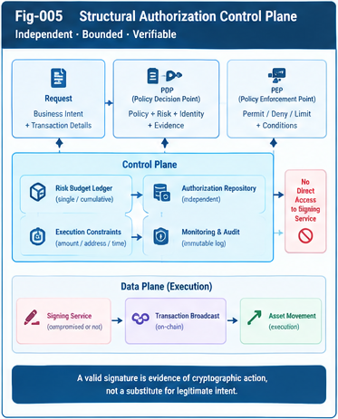

# ASSI-007 — Structural Authorization and Independent Control Planes

**Adversarial Structural Security Intelligence (ASSI)**  
**Research Foundation v0.1.0 · November 2026**  
**Status:** Architectural hypothesis and specification-oriented research; not a deployed security product.

## Abstract

Cryptographic authorization proves that an operation satisfies a cryptographic verification rule; it does not by itself establish that the operation reflects legitimate business intent, remains within an acceptable exposure boundary, or is resilient to compromise of the signing infrastructure. This paper develops a structural authorization architecture for high-value digital-asset systems. It distinguishes cryptographic validity, principal authority, transaction intent, policy admissibility, systemic exposure, and independent recovery. It proposes an independently enforced safety control plane that combines non-bypassable constraints with explainable, evidence-grounded risk analysis, including UTN, REN, and Bidirectional Conditional Evidence Feedback (BCEF). The paper specifies trust-boundary assumptions, decision semantics, compositional authorization, fail-safe behavior, attack simulations, and falsifiable evaluation criteria. Its central design requirement is that an adaptive intelligence system must not be able to silently override the controls that bound its own mistakes.

**Keywords:** structural authorization; independent control plane; cryptographic validity; transaction intent; bounded loss; policy enforcement; evidence intelligence; BCEF; zero trust; adversarial security; compositional identity; digital asset custody.

---

## 1. Problem Statement: A Valid Signature Is Not a Safe Transaction

In a digital-asset system, signature verification answers a narrowly defined question: did an authorized cryptographic key produce a signature valid for a specified message under the relevant verification rules? It does not necessarily answer whether:

- the human or organizational principal intended this particular economic action;
- the key or signing service was compromised;
- the transaction parameters match an approved business purpose;
- the destination, contract behavior, and delegated authority are acceptable;
- the transfer would violate asset exposure, concentration, or velocity limits;
- the operator approving the transaction is independent of the operator initiating it; or
- the organization could contain and recover from an authorization failure.

These are distinct claims with different evidence and enforcement requirements. ASSI therefore separates **cryptographic validity** from **structural authorization**. The latter is a system-level decision grounded in principal identity, delegated roles, transaction semantics, asset topology, operational context, and non-bypassable policy.

A core principle follows:

> Cryptographic validity is a necessary condition for many authorized transfers, but it is not sufficient evidence of legitimate intent or acceptable systemic risk.

This principle does not diminish cryptography. Rather, it specifies where cryptographic assurances end and other security responsibilities begin.

## 2. Scope, Assumptions, and Threat Model

### 2.1 Scope

The proposed architecture applies primarily to institutional custody, exchanges, treasury services, multisignature governance, and high-value automated transaction systems. The general approach may transfer to cloud administration, payment approval, AI-agent tool use, and other systems with high-consequence actions.

### 2.2 Trust and adversary assumptions

The model considers adversaries capable of one or more of the following:

1. Compromising an application server, API credential, or workflow service.
2. Controlling a transaction-proposing component or a hot-wallet signing interface.
3. Inducing an authorized operator to approve a misleading transaction.
4. Exploiting ambiguous contract or delegation semantics.
5. Corrupting monitoring data, identity labels, or risk signals.
6. Exploiting common-mode failure across apparently separate controls.
7. Manipulating an adaptive risk model or its feedback loop.

No architecture can guarantee protection against an adversary who simultaneously compromises every independent control, every trusted operator, and the recovery mechanism. Independence must therefore be treated as an explicit, testable assumption, not a label.

### 2.3 Security objectives

The system aims to reduce unauthorized execution, limit worst-case asset exposure, preserve availability for legitimate operations, detect anomalous authorization pathways, support auditable decisions, and provide recovery after partial compromise.

## 3. Six Layers of Authorization Meaning

A useful decomposition is:

| Layer | Core question | Typical evidence or control |
|---|---|---|
| L1. Cryptographic validity | Is the signature or proof valid? | Signature verification, nonce, domain separation |
| L2. Principal authority | Is this principal entitled to request the action? | Role, delegation, quorum, expiry |
| L3. Intent correspondence | Does the action match independently expressed intent? | Approved proposal, typed transaction summary, destination and amount checks |
| L4. Policy admissibility | Is this action permitted under hard constraints? | Allowlist, deny rule, limits, timelock, segregation of duties |
| L5. Structural exposure | What could this action enable beyond its immediate effect? | Asset graph, contract permissions, delegated control, aggregate exposure |
| L6. Recovery readiness | Can failure be contained and recovered from? | Revocation, pause, isolation, emergency procedures |

These layers are not guaranteed to be sequential in every implementation. Their purpose is to prevent a successful L1 check from being mistaken for evidence that L2–L6 have been satisfied.

### 3.1 Authorization as a typed decision

For a proposed operation `op` in context `ctx`, define:

\[
A(op,ctx)=\operatorname{Permit}
\quad\text{only if}\quad
C(op)\land P(op,ctx)\land I(op,ctx)\land B(op,ctx),
\]

where `C` denotes cryptographic checks, `P` hard policy compliance, `I` independently verifiable intent requirements, and `B` exposure-bound compliance. The expression is conceptual: actual implementations require typed inputs, precise policy semantics, race-free state updates, and authoritative enforcement.

Soft risk scores may trigger additional review but must not override a hard-policy denial.

## 4. Independent Safety Control Plane

ASSI proposes a **separation between an adaptive intelligence plane and an independently enforced safety plane**.

### 4.1 Adaptive intelligence plane

This plane may maintain trust graphs, identify anomalies, generate competing hypotheses, estimate risk, recommend additional tests, and propose policy improvements. Its components may include UTN, REN, BCEF, AQSI, and adversarial learning modules.

### 4.2 Independent safety plane

This plane enforces rules that remain authoritative even if the intelligence plane fails or is manipulated. Depending on deployment, it may include:

- transaction and cumulative value limits;
- asset compartmentalization and cold/hot custody separation;
- destination and contract capability restrictions;
- quorum or threshold authorization with genuinely independent key custody;
- time delays for high-impact changes;
- separation of proposal, approval, and execution privileges;
- immutable or tightly governed policy versioning;
- emergency isolation, pause, and recovery procedures.

A control is not independent merely because it runs in a different process. Independence must account for administrators, keys, update pipelines, credentials, networks, suppliers, and organizational authority.

### 4.3 Enforcement invariant

**Invariant SA-1:** An intelligence-generated risk assessment, policy suggestion, or self-improvement artifact must not directly change or bypass the authoritative hard-policy decision path.

Policy modifications require a separately authorized governance process, with versioning, testing, and rollback capability.

## 5. A Reference Decision Flow

The proposed control path is:

```text
Transaction Proposal
       |
       v
Canonical Parsing and Semantic Normalization
       |
       v
Cryptographic and Principal-Authority Checks
       |
       v
Independent Intent and Delegation Verification
       |
       v
Hard Safety Policy + Exposure Budget
       |                 \
       | DENY             \ PERMIT CANDIDATE
       v                   v
Audit + Alert       Soft Evidence Intelligence
                           |
                           v
                   BCEF / Risk / Review Triggers
                           |
                           v
                 Approve, Escalate, Delay, or Deny
                           |
                           v
                 Independent Enforcement Gateway
                           |
                           v
                    Execution + Audit Trail
```

The enforcement gateway must revalidate material state changes immediately before execution. A check performed earlier is not sufficient if balances, permissions, nonce, destination, or policy version have changed in the interim.

---



*Figure 5. Structural authorization requires independently enforced policy, transaction binding, and bounded exposure; cryptographic validity alone is insufficient.*

---

### 5.1 Decision states

A minimal decision vocabulary is:

- `DENY`: a hard rule fails or an authoritative requirement is unmet.
- `ESCALATE`: additional independent approval is required.
- `DEFER`: await a timelock, external verification, or resolution of uncertainty.
- `PERMIT`: all required checks pass at the authoritative execution boundary.
- `UNDETERMINED`: evidence or system state is insufficient; default behavior follows explicit fail-safe policy.

`UNDETERMINED` must not silently become `PERMIT` for high-consequence actions.

## 6. Structural Exposure and Bounded Loss

A transaction can be low in immediate transfer value yet high in *future control impact*. Granting an unlimited allowance, changing an administrator, delegating signing authority, or upgrading a contract can expose assets far beyond the apparent transaction amount.

ASSI therefore distinguishes:

1. **Immediate exposure:** assets directly transferred by the operation.
2. **Delegated exposure:** assets reachable through newly granted permissions.
3. **Cascading exposure:** assets reachable through dependent services or contracts.
4. **Aggregate exposure:** cumulative risk across transactions, principals, and time windows.
5. **Recovery exposure:** losses or downtime arising from failed containment.

An indicative policy objective is:

\[
\min_{\pi}\ \mathbb{E}[L\mid\pi]
\quad\text{subject to}\quad
L_{\mathrm{credible\ worst\ case}}(\pi)\leq L_{\max},
\]

where `π` denotes a security policy. A finite worst-case bound is meaningful only under explicit assumptions about compromised components and enforceable asset segmentation; it cannot be asserted from a model score alone.

### 6.1 Hard boundaries versus probabilistic estimates

A risk score can estimate whether a transaction resembles malicious behavior. A hard exposure rule determines whether it may execute. For example, a high confidence that a request is legitimate must not bypass a fixed per-transaction limit or an independent quorum requirement.

## 7. Compositional Authorization and UTN

Authorization subjects are not always individual persons. A proposal may involve a treasury committee, an operational team, an external custodian, a temporary incident-response group, or a dynamic coalition of signers.

The UTN model should distinguish:

- individual identity or credential;
- operational role;
- group or committee membership;
- delegated authority;
- time-bounded composition;
- control over a key, wallet, contract, or policy;
- evidence confidence and provenance.

**Membership is not equivalent to authority; shared infrastructure is not equivalent to common control.** A group may change members while retaining an authorization mandate; conversely, the same people may act under distinct mandates.

An authorization claim should therefore specify its exact scope: *who*, *in which role*, *under which mandate*, *for which action*, *during which interval*, and *with which independent approvals*.

### 7.1 Hypothesis-scoped contradiction

A failed test of “the same person operated two accounts” must not automatically reject “two members of the same organization operated them.” This distinction is relevant both to investigative attribution and to access-control models that rely on group identity.

## 8. REN and BCEF as Advisory Evidence Mechanisms

REN can estimate directional relevance of heterogeneous evidence, while BCEF tests conditional implications and feeds results back into a scoring structure.

Four useful BCEF modes are:

- **Forward IF:** If an operation is legitimate, what observable prerequisites or consequences should hold?
- **Reverse IF:** Does the observed evidence actually support the legitimacy hypothesis, or is it compatible with multiple explanations?
- **Counterfactual IF:** Would the same signals appear if the signer or workflow were compromised?
- **Contradiction IF:** Does the proposal violate an explicit intent, policy, or control-boundary assumption?

BCEF outcomes should be attached to a specific hypothesis, evidence source, and scope. A contradiction may reduce confidence in a particular explanation without proving that another explanation is true.

### 8.1 Evidence dependence

Derived features and repeated alerts from the same underlying event are not independent corroboration. ASSI should track evidence lineage and dependency groups, calibrate risk estimates, and retain unresolved hypotheses rather than collapsing uncertainty prematurely.

### 8.2 Safe integration

The advisory plane may recommend `ESCALATE`, `DEFER`, or `DENY`, subject to governance. It must not grant an exception to a non-bypassable policy rule. If the advisory plane becomes unavailable, the enforcement gateway follows a predefined fail-safe policy appropriate to the action's risk tier.

## 9. Control-Plane Governance and Policy Evolution

Security policy changes are themselves high-risk operations. ASSI treats them as separately authorized transactions with their own exposure and recovery requirements.

A governed change process includes:

1. A signed and versioned change proposal with explicit rationale.
2. Independent review of affected assets, permissions, and failure domains.
3. Test execution against regression suites and adversarial scenarios.
4. Verification that hard safety invariants remain intact.
5. Approval by authorized, independently controlled principals.
6. Staged rollout with monitoring, rollback criteria, and audit retention.

Adaptive RSI components may generate candidate improvements but may not autonomously promote them to production without the required governance gate.

## 10. Security Residuals and Adversarial Drives

A successful defense can still leave important residual risks: delayed detection, excessive operational friction, dependence on a single approval administrator, untested recovery procedures, or unexplained policy decisions.

ASSI proposes four interacting drives:

- **Red Drive:** generates adversarial scenarios in an authorized, isolated environment.
- **Blue Drive:** develops controls, containment, and recovery responses.
- **Evaluation Drive:** independently measures outcomes, including false positives and tail loss.
- **Governance Drive:** decides which validated changes can be adopted.

A representative loop is:

```text
Threat Model -> Adversarial Scenario -> Defense Response
       -> Residual Record -> AQSI Question -> Candidate Improvement
       -> Independent Evaluation -> Governance Decision -> Relay
```

The goal is not to claim that simulations prove safety, but to make weaknesses discoverable, measurable, and progressively harder to exploit.

## 11. Minimal Structural Authorization Contract

The following YAML is illustrative rather than a finalized machine-validated schema:

```yaml
authorization_request:
  request_id: "req-001"
  operation_type: "asset_transfer"
  canonical_payload_hash: "sha256:..."
  proposer:
    utn_subject_id: "subject:treasury-operator"
    role: "proposer"
  authorization_context:
    mandate_id: "mandate:treasury-2026"
    policy_version: "policy-v12"
    approval_set:
      - principal_id: "principal:reviewer-1"
        approval_proof_ref: "proof:..."
    expiry_time: "2026-11-03T00:00:00Z"
  transaction_semantics:
    asset_id: "asset:example"
    amount: "1000"
    destination_ref: "destination:approved-1"
    delegated_capabilities: []
  exposure:
    immediate_value: "1000"
    delegated_value_upper_bound: "0"
    cumulative_window: "24h"
  hard_policy:
    signature_valid: true
    mandate_valid: true
    independent_approval_valid: true
    exposure_budget_valid: true
    decision: "PERMIT_CANDIDATE"
  evidence_assessment:
    ren_score: null
    bcef_test_refs: []
    review_recommendation: "NONE"
  enforcement:
    authoritative_decision: "PENDING"
    execution_state_hash: null
    audit_record_ref: null
```

Production implementations must define numeric precision, asset units, replay protection, canonical encoding, cryptographic proof verification, state consistency, revocation semantics, and error handling.

## 12. Proposed Conformance Invariants

- **SA-1 — Non-bypass:** adaptive intelligence cannot override authoritative hard policy.
- **SA-2 — Intent separation:** a valid signature is not automatically sufficient proof of business intent.
- **SA-3 — Explicit delegation:** roles and group mandates have bounded scope and lifetime.
- **SA-4 — Exposure accounting:** immediate and delegated exposures are evaluated separately.
- **SA-5 — Common-mode awareness:** apparent control independence is tested against shared administrators and infrastructure.
- **SA-6 — Execution revalidation:** material policy and state assumptions are checked at execution time.
- **SA-7 — Evidence provenance:** risk evidence retains source, dependency, and hypothesis scope.
- **SA-8 — Uncertainty handling:** unresolved high-risk authorization does not default to unrestricted permission.
- **SA-9 — Governed evolution:** RSI proposals require independent approval and rollback provisions.
- **SA-10 — Auditable denial:** denial, escalation, and exception decisions produce reviewable records without exposing sensitive secrets.
- **SA-11 — Recoverability:** loss-containment and recovery paths are tested independently of normal execution services.
- **SA-12 — Least authority:** each principal and service receives only the capabilities required for its mandate.

These are research-level invariants; formal refinement and platform-specific verification are future work.

## 13. Case Study: Compromised Signing Service

Consider a hypothetical treasury system where an attacker gains control of a transaction-proposing service and can request cryptographically valid signatures through a compromised workflow. This is a synthetic defensive scenario, not a claim about any specific incident.

### 13.1 Baseline system

The baseline verifies signature validity and checks whether the requesting service has a recognized API credential. A compromised service may therefore propose an unauthorized high-value transfer or a permission-changing transaction that passes narrow cryptographic checks.

### 13.2 ASSI-enhanced system

The enhanced system additionally checks:

1. Whether the request matches an independently approved mandate.
2. Whether its semantic effect includes a transfer, approval, upgrade, or control delegation.
3. Whether immediate and reachable asset exposures fit hard budgets.
4. Whether approvals originate from independent failure domains.
5. Whether evidence-based anomaly signals warrant delay or escalation.
6. Whether the execution gateway still sees the approved policy and transaction state.

If a hard constraint fails, execution is denied regardless of the REN or BCEF score. If hard checks pass but contextual evidence is concerning, the system can require additional review under predefined rules.

### 13.3 Expected observation

The test should measure unauthorized execution attempts prevented, maximum simulated loss, legitimate transaction interruption, time to containment, and the resilience of controls when the intelligence plane is disabled or misled.

A favorable result would support the value of independent authorization boundaries; it would not demonstrate immunity to all attack classes.

## 14. Falsifiable Research Hypotheses

**H1 — Authorization layering:** Independent intent and policy checks reduce unauthorized execution relative to signature-only authorization under a fixed threat model.

**H2 — Exposure bounding:** Enforced exposure budgets reduce worst-case simulated loss even when an upstream signing workflow is compromised.

**H3 — Structural semantics:** Modeling delegated capabilities and reachable assets catches dangerous low-value permission changes missed by transfer-amount-only checks.

**H4 — BCEF utility:** Evidence-grounded conditional tests improve anomaly triage or decision calibration compared with fixed risk rules, without violating hard constraints.

**H5 — Compositional identity:** Role- and group-aware authorization reduces erroneous approval or denial decisions compared with single-principal-only models in dynamic team scenarios.

**H6 — Independence testing:** Explicit common-mode dependency analysis identifies more correlated control failures than a checklist based only on component count.

**H7 — Governed RSI:** Validated adversarial learning improves held-out scenario performance without increasing hard-policy violations or unacceptably degrading legitimate operations.

These hypotheses may fail, hold only in certain environments, or involve trade-offs. Their value lies in enabling comparison, not guaranteeing a predetermined outcome.

## 15. Benchmark and Validation Plan

### 15.1 Baselines

- B0: cryptographic signature and API credential validation only;
- B1: B0 plus static allowlists and transaction limits;
- B2: B1 plus independent approvals and semantic authorization;
- B3: B2 plus structural exposure modeling;
- B4: B3 plus REN/BCEF advisory scoring;
- B5: B4 plus governed adversarial improvement.

### 15.2 Scenario families

1. Compromised proposer with uncompromised independent approvers.
2. Compromised signing interface with intact exposure gateway.
3. Malicious delegation or allowance change with low immediate transfer value.
4. Colluding or shared-administrator approval paths.
5. Stale policy version or time-of-check/time-of-use mismatch.
6. Misleading risk evidence or unavailable scoring service.
7. Legitimate emergency transfer under high operational pressure.
8. Recovery after partial loss of authorization infrastructure.

### 15.3 Metrics

- unauthorized execution rate;
- maximum and tail simulated loss;
- false denial and false escalation rates;
- legitimate transaction completion latency;
- time to detect and contain;
- policy invariant violation count;
- common-mode failure detection rate;
- explanation completeness and audit reproducibility;
- operational and computational overhead.

### 15.4 Experimental discipline

Use synthetic assets and isolated test environments. Separate model-development scenarios from held-out adversarial scenarios. Report threat-model assumptions and ablation results. Compare costs and availability, not only security success. Treat any apparent improvement as provisional until reproduced independently.

## 16. Failure Modes and Limitations

ASSI does not eliminate the following risks:

- **Semantic ambiguity:** smart-contract effects may be difficult to predict exactly, especially across external calls and upgrades.
- **Compromised independence:** multiple approvals may share hidden administrators, vendors, or update channels.
- **Oracle and data risk:** inaccurate balances, price feeds, identity labels, or monitoring events can mislead exposure analysis.
- **Operational pressure:** emergency procedures can become bypass channels if poorly governed.
- **Advisory model failure:** REN/BCEF may be miscalibrated, manipulated, or unable to interpret novel activity.
- **Policy rigidity:** strict controls can block urgent legitimate operations and impose real business costs.
- **Adaptive overfitting:** adversarial RSI can improve performance against its own simulations while missing new real-world attack classes.
- **Residual tail risk:** exposure bounds depend on enforceable isolation and assumptions about the adversary's reach.

The design must be evaluated as a system of interacting controls, not as a promise of perfect prevention.

## 17. Interfaces to the ASSI Research Portfolio

| Document | Relationship to ASSI-007 |
|---|---|
| ASSI-001 | Cryptographic validity versus structural security |
| ASSI-002 | Four systemic contradictions motivating structural controls |
| ASSI-003 | Trust relocation and cross-layer boundaries |
| ASSI-004 | UTN and compositional subjects of authorization |
| ASSI-005 | REN and directional evidence for advisory risk assessment |
| ASSI-006 | BCEF conditional tests and hypothesis-scoped impacts |
| ASSI-008 | Adversarial Drives for authorization testing |
| ASSI-009 | Security Residuals and validated RSI |
| ASSI-010 | Integration into the ASSI grand architecture |
| ASSI-011 | Benchmarks and falsifiable validation |
| SPEC-004 | Normative authorization and safety-control contract (planned) |
| CASE-004 | Compromised signing-service defensive laboratory (planned) |

ASSI-007 is a conceptual and architectural input to `SPEC-004-Authorization-and-Safety-Control-Contract.md`; it is not a substitute for a machine-checkable implementation specification.

## 18. Open Research Questions

1. How can delegated asset exposure be bounded when contract semantics are partially unknown?
2. Which trust-graph features best reveal hidden common-mode failure domains?
3. What is the minimal independent authorization path that materially limits loss without making normal operations unusable?
4. How should policy evaluate rapidly changing group membership and temporary delegation?
5. Which BCEF tests improve decisions after accounting for evidence dependence and base rates?
6. How should safety policy behave when an oracle, identity service, or advisory model is unavailable?
7. What independent evidence is sufficient to approve high-impact governance or contract upgrades?
8. Can bounded-loss guarantees be expressed as formal invariants under realistic compromise assumptions?
9. How can adversarial simulation avoid overfitting and detect previously unseen control-plane bypass patterns?
10. What mechanisms best preserve emergency recovery when ordinary administrators are compromised?

## 19. Conclusion

Cryptographic verification is essential but not synonymous with safe authorization. High-value digital-asset systems must account for the full chain from principal authority and intent to delegated capabilities, systemic exposure, governance, and recovery. ASSI proposes a structural authorization architecture in which UTN, REN, and BCEF provide explainable evidence and hypothesis testing, while a separately governed control plane enforces non-bypassable safety rules. Adversarial Drives and validated RSI may improve the system over time, but they cannot replace independent enforcement and bounded-loss design.

The central engineering proposition is straightforward:

> **A secure system must verify not only whether an action can be signed, but whether it should be permitted—and must remain able to limit loss when its intelligent assessments are wrong.**

---

## Research Status and Attribution

This document presents a research proposal and architectural design, not a claim of a completed implementation or independently demonstrated effectiveness. Examples are synthetic unless explicitly sourced. The concepts draw on established security engineering ideas, including least privilege, separation of duties, defense in depth, zero-trust access principles, transaction authorization, and adversarial testing, while proposing a particular integration with the ASSI structural-intelligence research program.

**Project:** Adversarial Structural Security Intelligence (ASSI)  
**Document ID:** ASSI-007  
**Version:** v0.1.0  
**License target:** Apache-2.0 (subject to repository LICENSE)  
**Related work:** ASSI-001–006; ASSI-008–012; SPEC-004; CASE-004.
