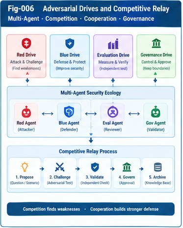

# ASSI-008 — Adversarial Security Drives and Competitive Relay

**Adversarial Structural Security Intelligence (ASSI)**  
**Research Foundation v0.1.0 · November 2026**  
**Status:** Research architecture and testable hypotheses; not an operational offensive platform or a demonstrated security guarantee.

## Abstract

Digital-asset security is a continuously contested system problem. Cryptographic correctness, authorization policy, organizational governance, infrastructure dependencies, and incident recovery may each be sound in isolation yet fail in combination. Static audits and periodic penetration tests are necessary but cannot exhaust the strategies of adaptive adversaries. This paper proposes **Adversarial Security Drives and Competitive Relay**: a governed, repeatable process in which constrained Red Drives generate candidate failure scenarios, Blue Drives propose defenses, an independent Evaluation Drive measures outcomes and residual risk, and a Governance Drive determines what may enter production. The resulting **Security Residuals** are represented as evidence-grounded structural units and relayed into further questioning, testing, and validated improvement. The approach integrates ASSI's structural trust graph, independent authorization control plane, UTN compositional identity, REN evidence navigation, BCEF conditional testing, AQSI autonomous questioning, SSICR competitive strategy analysis, UIERU relay, and bounded recursive self-improvement (RSI). It explicitly separates simulation success from real-world assurance and prohibits adaptive components from overriding hard safety controls. We define canonical drive contracts, evaluation criteria, anti-overfitting measures, and a staged benchmark program.

**Keywords:** adversarial simulation; competitive relay; security residual; red team; blue team; independent evaluation; structural intelligence; governed RSI; digital-asset custody; bounded loss; scenario generation; hypothesis testing.

---

## 1. Why Security Requires a Competitive Learning Loop

Security is not merely a property of a transaction, key, contract, or access rule. It is a property of their **composition under adversarial pressure**. Attackers may deliberately adapt to monitoring, exploit organizational handoffs, combine small permissions into large effects, and target recovery mechanisms rather than cryptography itself.

A one-time audit describes the system under a particular threat model and time horizon. In contrast, ASSI asks how a security system can continuously:

1. represent its current trust and authorization structure;
2. generate credible, bounded failure hypotheses;
3. exercise those hypotheses in an isolated environment;
4. measure whether independent controls limit loss;
5. preserve failures, uncertainty, and untested assumptions as residuals; and
6. relay validated improvements into subsequent tests and carefully governed deployments.

The intended shift is **from periodic security assessment to continuously validated structural defense**. This is a research objective, not a claim that simulation can discover every vulnerability.

### 1.1 The key distinction

A successful Red Drive does not prove a production system is vulnerable under identical conditions; a successful Blue Drive does not prove the production system is safe. Both are **conditional observations** whose relevance depends on fidelity, assumptions, and independent evidence.

### 1.2 Relation to earlier ASSI documents

- **ASSI-001** distinguishes cryptographic validity from structural security.
- **ASSI-002** identifies four structural tensions in cryptocurrency security.
- **ASSI-003** models trust relocation, dependencies, and security boundaries.
- **ASSI-004** treats individuals, teams, and temporary coalitions as distinct identity hypotheses.
- **ASSI-005** provides REN-based directional evidence assessment.
- **ASSI-006** specifies BCEF and hypothesis-scoped conditional testing.
- **ASSI-007** establishes independent authorization controls and bounded-loss priorities.

ASSI-008 turns these foundations into a **competitive experimental process**. ASSI-009 will examine Security Residuals and validated RSI in greater detail.

---

## 2. Threat Model and Non-Negotiable Safety Envelope

### 2.1 Defended systems

The primary target class is a high-value digital-asset system comprising some combination of custody services, key management, signing infrastructure, contract permissions, withdrawal workflows, identity providers, monitoring, and governance. All test systems must be owned or explicitly authorized for testing.

### 2.2 Adversarial capabilities as test assumptions

A scenario may assume compromise of an application credential, a signing-workflow component, a privileged session, an external dependency, or a limited governance role. These assumptions must be stated, versioned, and bounded. A scenario must not quietly grant an attacker capabilities that contradict its stated threat model.

### 2.3 Mandatory constraints

- **Authorized scope only:** no live attack against third-party infrastructure, production wallets, or uninvolved users.
- **Isolation:** simulated keys, assets, identities, and endpoints; no real-value transfers.
- **No autonomous production exploitation:** generated attack candidates remain in sandboxed test harnesses.
- **Independent hard controls:** the learning system cannot disable policy enforcement, exposure caps, or emergency recovery controls.
- **Human and governance approval:** any production-facing change follows documented review and rollback requirements.
- **Evidence provenance:** scenarios, results, and claims must identify their source, assumptions, and uncertainty.
- **Reproducibility:** record seeds, environment versions, policy revisions, and evaluation code.

The objective is **defensive evaluation and risk reduction**, not maximization of exploit capability outside authorized environments.

---

## 3. The Four-Drive Architecture

ASSI separates four functions to reduce conflicts of interest and prevent a single adaptive agent from defining its own success.

### 3.1 Red Drive — bounded adversarial hypothesis generation

The Red Drive constructs *candidate failure scenarios* under explicit capability and environment constraints. It searches for weaknesses in trust dependencies, authorization paths, control-plane separation, and incident response. It may propose sequences of abstract actions, but the execution interface is limited to a simulator or approved test harness.

**Outputs:** scenario description, assumptions, targeted safety invariant, expected observable effects, test prerequisites, and uncertainty.

**Prohibited inference:** a generated scenario is not evidence that a real organization has been compromised.

### 3.2 Blue Drive — defense and containment design

The Blue Drive proposes preventive, detective, containment, and recovery measures. Its objective is not solely to defeat a particular Red scenario; it must also preserve availability, usability, policy independence, and acceptable operational cost.

**Outputs:** candidate controls, policy deltas, monitoring rules, recovery procedures, and expected side effects.

### 3.3 Evaluation Drive — independent measurement

The Evaluation Drive runs reproducible tests and scores outcomes using predeclared criteria. It should be organizationally and technically independent from the mechanisms generating candidate attacks and defenses.

**Outputs:** invariant pass/fail, realized and potential exposure, detection and containment latency, false-positive cost, recovery time, test fidelity, and residual uncertainty.

An evaluation should report both **attack feasibility** and **defense consequence**, rather than collapsing all outcomes into a single win/loss label.

### 3.4 Governance Drive — controlled adoption

The Governance Drive decides whether a candidate change is rejected, revised, retained for research, or promoted through staged deployment. It enforces safety policy, separation of duties, change review, and rollback capability.

**Outputs:** approval decision, rationale, approvers, evidence requirements, permitted deployment scope, rollback triggers, and review deadline.

### 3.5 Functional separation is not sufficient by itself

Four software agents sharing one privileged administrator, credential store, or deployment pipeline may still inhabit a single failure domain. ASSI requires **independence to be assessed structurally**, not inferred from distinct agent names.

---

## 4. Canonical Competitive Relay Lifecycle

A single experimental cycle is defined as follows:

```text
Structural Trust / Authorization Model
                  |
                  v
      Threat Hypothesis Portfolio
                  |
                  v
       Red Drive: Scenario Unit
                  |
                  v
       Isolated Simulation Run
                  |
                  v
       Blue Drive: Candidate Control
                  |
                  v
    Independent Evaluation Drive
                  |
                  v
   Security Residual + Evidence Record
                  |
                  v
       Governance Decision Gate
            /           \
       Reject/Revise   Approve for staged test
            \           /
                  v
        Structural Relay Registry
                  |
                  v
     Next AQSI Question / Drive Cycle
```

The lifecycle supports **branching**: multiple Red hypotheses, Blue candidates, and alternative explanations may coexist. It must preserve failed candidates and negative results instead of recording only winning strategies.

### 4.1 Stage contracts

1. **Register:** identify the defended boundary, asset exposure, scenario owner, and test authorization.
2. **Generate:** produce a constrained scenario with explicit initial capabilities.
3. **Validate assumptions:** reject unrealistic or underspecified scenarios before execution.
4. **Simulate:** run in a reproducible, isolated environment.
5. **Respond:** exercise candidate controls without silently modifying the threat model.
6. **Evaluate:** score against frozen metrics and independent holdout scenarios.
7. **Extract residual:** record uncovered paths, unknowns, and unexpected effects.
8. **Relay:** link new questions, tests, and candidates to their provenance.
9. **Govern:** approve only changes that pass required checks.
10. **Monitor:** compare staged results with expected outcomes and trigger rollback when needed.

---



*Figure 6. Four-drive adversarial research and competitive structural relay, with independent evaluation and governance gates between experimentation and deployment.*

---

## 5. Structural Representation of Adversarial Scenarios

A security scenario is not merely a narrative. It is a structured object referencing the trust graph, roles, authorization edges, assets, control boundaries, and time-dependent conditions.

### 5.1 Suggested scenario fields

| Field | Meaning |
|---|---|
| `scenario_id` | Stable scenario identifier |
| `scope_id` | Authorized test environment |
| `assumed_capabilities` | Precisely bounded adversarial capabilities |
| `target_invariants` | Safety conditions under test |
| `preconditions` | Required system and policy state |
| `action_abstraction` | Simulator-safe sequence or transition graph |
| `observables` | Telemetry and expected evidence |
| `asset_exposure` | Maximum plausible loss under stated assumptions |
| `identity_hypotheses` | Individual/group/shared-service possibilities |
| `counter_hypotheses` | Alternative explanations to test |
| `provenance` | Source, author, generation method, version |
| `evaluation_plan` | Metrics, baselines, stop conditions |

### 5.2 Scenario graph versus identity graph

An observed transaction graph does not automatically establish common control. A scenario may model a coordinated group, but this is a **hypothesis**, not an inferred fact about real persons. UTN composition-aware typing and naming (ASSI-004) must preserve that distinction.

---

## 6. Competitive Strategy and Portfolio Selection

SSICR-inspired competition is useful when no single defense can cover every threat. ASSI therefore maintains portfolios of:

- candidate Red scenarios;
- candidate Blue controls;
- competing structural explanations;
- resource budgets and operational constraints; and
- residual risks awaiting further tests.

### 6.1 Multi-objective evaluation

For a defense policy $\pi$, a conceptual objective is:

$$
\min_{\pi}\; \mathbb{E}[L(\pi)] + \lambda_1 C_{\mathrm{operations}}(\pi) + \lambda_2 C_{\mathrm{false\;blocks}}(\pi) + \lambda_3 C_{\mathrm{recovery}}(\pi),
$$

subject to independently enforced safety invariants. Expected loss alone is insufficient; evaluation should also measure tail loss and worst-case exposure under the declared threat model.

The coefficients are policy choices, not universal constants. In practice, non-negotiable safety requirements should be modeled as **constraints**, not merely penalties that can be outweighed by a favorable score.

### 6.2 Avoiding a narrow arms race

If the Blue Drive only trains against the latest Red Drive, both may overfit. Use scenario diversity, historical incident replay, external review, held-out threat families, and tests designed by independent evaluators. Evaluate *generalization*, not only repeated success on familiar attacks.

---

## 7. Security Residuals as First-Class Relay Objects

A **Security Residual** is a documented gap between the system's required security behavior and what a test, incident, or analysis actually established.

Residuals may include:

1. **Coverage residual:** a plausible attack path was never tested.
2. **Prevention residual:** an unsafe action was not blocked.
3. **Detection residual:** the system observed the event too late or ambiguously.
4. **Containment residual:** the system detected the problem but could not limit spread.
5. **Recovery residual:** restoration exceeded the required time or depended on compromised authority.
6. **Evidence residual:** a conclusion rests on weak, dependent, or unverified evidence.
7. **Governance residual:** approval or separation-of-duty assumptions failed.
8. **Model residual:** the simulator omitted a dependency or adversarial capability.

A residual is not automatically a confirmed vulnerability. It may be an uncertainty requiring a better test.

### 7.1 Residual record

```yaml
residual_id: ASSI-RES-EXAMPLE-001
source_run: ASSI-RUN-EXAMPLE-017
classification: containment
observed_gap: "Simulated withdrawal was detected but not paused within the policy window"
assertion_status: simulated_observation
severity_basis:
  asset_exposure: synthetic
  exploitability: conditional
  uncertainty: medium
related_invariants:
  - AUTHZ-EXPOSURE-CAP
hypotheses:
  - "Control-plane propagation delay exceeds safe tolerance"
counter_hypotheses:
  - "Test harness injected unrealistic network latency"
next_questions:
  - "Does the delay reproduce under an independent harness?"
provenance:
  environment: isolated-testnet
  policy_revision: example-v3
  evidence_refs:
    - TEST-LOG-017
state: requires_independent_retest
```

The example is illustrative and contains no production identifiers.

---

## 8. Integrating UTN, REN, BCEF, and AQSI

### 8.1 UTN: type and name what the system actually knows

UTN distinguishes addresses, signing roles, services, human principals, teams, coalitions, and inferred control structures. Group membership may overlap or change over time. A failed single-operator hypothesis must not automatically invalidate a team-level hypothesis.

### 8.2 REN: assess evidence direction and dependence

REN scores how an observation supports or weakens a specified hypothesis in context. Repeated evidence from one telemetry pipeline must not be counted as independent corroboration.

### 8.3 BCEF: test both predicted consequences and alternatives

BCEF generates Forward, Reverse, Counterfactual, and Contradiction IF checks. It returns **hypothesis-scoped impacts** to the Scoring Tree or structural hypothesis portfolio. A contradiction should modify only the claims it actually tests.

### 8.4 AQSI: ask the next discriminating question

AQSI can propose tests with high expected information value: which observation would best distinguish an authorization failure from a telemetry artifact? Which independent control would most reduce tail exposure? Such proposals are **research candidates**, not self-authorizing production actions.

### 8.5 Relay across levels

The same validated observation can inform a local control, a domain-wide rule, or a cross-domain design principle. Relay records must preserve the originating assumptions so that conclusions are not transferred beyond their evidence.

---

## 9. Worked Synthetic Case A — Compromised Signing Workflow

**Environment:** an isolated custody simulator with synthetic assets and a signing-workflow component.

**Initial assumption:** an adversary can submit requests through a compromised workflow service but cannot modify the independently enforced asset-exposure policy.

**Red scenario:** attempt a transaction that is cryptographically well formed but violates the approved transaction intent or exposure limit.

**Blue candidates:** independent approval binding, destination constraints, delegated-authority checks, velocity limits, and emergency suspension.

**Evaluation:** measure whether the independent enforcement layer blocks the request, whether monitoring correctly classifies the attempt, and whether a simulated recovery path remains available.

**Possible residual:** the transaction is blocked, but the alert lacks enough provenance for rapid investigation. This is a detection/evidence residual even though prevention succeeded.

**Important:** the test must not imply that a compromised signer can be made harmless in all circumstances. Its assurance depends on which keys, policies, and independent enforcement capabilities remain uncompromised.

---

## 10. Worked Synthetic Case B — Coordinated Group and False Rejection

**Environment:** a synthetic on-chain dataset with multiple operators and overlapping group memberships.

A naive model assumes that addresses X and Y belong to the same person. Different activity schedules contradict that hypothesis. A second hypothesis holds that X and Y belong to distinct operators in the same coordinated team.

**Red/evaluation challenge:** introduce patterns that make the two hypotheses difficult to distinguish without independent evidence.

**BCEF requirement:** weakening the single-person hypothesis must not automatically weaken the shared-team hypothesis.

**UTN requirement:** preserve overlapping and time-bounded group relationships, with provenance and explicit uncertainty.

**Metrics:** false merges, false splits, calibration, abstention quality, and performance under changing group composition.

This case tests a **reasoning failure mode**, not an attack attribution capability. No real-person identification should be asserted from chain behavior alone.

---

## 11. Worked Synthetic Case C — Governance and Recovery Failure

**Environment:** a sandbox with separate policy approvers, deployment roles, and emergency recovery authorities.

A simulated compromise affects a privileged workflow administrator. The test asks whether that compromise can also change security policy, suppress evaluation records, or disable emergency response.

**Key structural question:** are the apparent control planes truly independent, or do they share a common administrative failure domain?

**Blue candidates:** independent approval paths, immutable audit trails, limited policy-change windows, and recovery procedures requiring distinct authorities.

**Evaluation:** test both containment and the organization's ability to recover when ordinary operators are unavailable.

**Residual:** a formally separate recovery role may still depend on the same identity provider as the compromised workflow. That dependency must be represented in the Structural Trust Graph.

---

## 12. Canonical Contracts (Research Draft)

### 12.1 Drive unit

```yaml
schema: assi.drive.v0.1
id: ASSI-DRIVE-EXAMPLE-001
role: RED               # RED | BLUE | EVALUATION | GOVERNANCE
scope:
  environment: isolated-simulator
  authorization_ref: TEST-AUTH-001
objective:
  invariant_under_test: AUTHZ-EXPOSURE-CAP
  expected_observation: "Independent policy rejects over-limit request"
inputs:
  trust_graph_version: tg-v4
  policy_version: policy-v3
  scenario_refs:
    - SCENARIO-001
constraints:
  real_asset_access: false
  external_target_access: false
  production_policy_mutation: false
budget:
  max_simulation_runs: 100
  max_compute_units: 500
stop_conditions:
  - authorization_scope_exceeded
  - safety_invariant_breach_in_harness
outputs:
  evidence_records: []
  residual_refs: []
  candidate_changes: []
status: proposed
```

### 12.2 Evaluation record

```yaml
schema: assi.evaluation.v0.1
run_id: ASSI-RUN-EXAMPLE-017
scenario_id: SCENARIO-001
independence:
  evaluator_role: independent
  holdout_scenario: true
metrics:
  policy_invariant_passed: true
  simulated_loss: 0
  maximum_exposure: 1000
  detection_latency_ms: 450
  recovery_time_ms: null
  false_block_rate: null
uncertainty:
  simulator_fidelity: limited
  transfer_to_production: unverified
artifacts:
  - TEST-LOG-017
result: conditional_pass
```

Values are synthetic and do not constitute security performance claims.

### 12.3 Governance decision

```yaml
schema: assi.governance-decision.v0.1
candidate_id: DEFENSE-CANDIDATE-003
decision: hold_for_review   # reject | revise | hold_for_review | stage | approve
required_evidence:
  - independent_reproduction
  - regression_suite_pass
  - rollback_test_pass
separation_of_duties:
  proposer_may_approve: false
  evaluator_may_modify_evidence: false
production_override_permitted: false
rationale: "Holdout coverage and recovery test incomplete"
```

The formal versions of these contracts belong in **SPEC-005** and **SPEC-006**.

---

## 13. Conformance Invariants

A candidate ASSI implementation should satisfy at least the following:

**DRV-INV-001 — Authorized Scope.** Every scenario and run references an approved, bounded environment.

**DRV-INV-002 — No Real-Asset Execution.** Research drives cannot initiate or authorize real-value transfers.

**DRV-INV-003 — Hard-Policy Independence.** Adaptive Red/Blue/RSI components cannot bypass independently enforced safety constraints.

**DRV-INV-004 — Role Separation.** Proposal, evaluation, and approval roles are distinguishable, with their actual failure-domain dependencies documented.

**DRV-INV-005 — Reproducible Evidence.** Each evaluation preserves environment, policy, seed, data, and test versions.

**DRV-INV-006 — No Silent Threat-Model Change.** A drive cannot claim success by silently expanding assumed capabilities or modifying initial conditions.

**DRV-INV-007 — Hypothesis-Scoped Feedback.** Contradictions modify only the hypotheses they actually test.

**DRV-INV-008 — Evidence Independence.** Derived and duplicated observations are not counted as independent corroboration.

**DRV-INV-009 — Explicit Residuals.** Unresolved uncertainties and failed evaluations remain in the registry.

**DRV-INV-010 — Holdout Evaluation.** Promotion decisions include tests not used to generate or tune the candidate.

**DRV-INV-011 — Governed Deployment.** Production-facing changes require separate approval, staged release, and rollback readiness.

**DRV-INV-012 — Safety Stop.** Any out-of-scope behavior terminates the run and produces an auditable incident record.

**DRV-INV-013 — Bounded Resource Use.** Drives obey compute, time, and scenario-count budgets.

**DRV-INV-014 — No Unverified Attribution.** Synthetic or weakly inferred group identities are not presented as confirmed real-world identities.

---

## 14. Benchmark Design

### 14.1 BM-004: Adversarial Security RSI (primary)

**Question:** Does governed competitive relay produce measurable defensive improvements that generalize beyond its training scenarios?

**Baseline A:** fixed security rules with periodic regression testing.

**Baseline B:** conventional scripted red-team scenarios without structural residual relay.

**Baseline C:** adversarial scenario generation without independent evaluation or governance.

**ASSI candidate:** structural graph + bounded Red/Blue Drives + independent Evaluation + residual registry + AQSI/relay + governed candidate promotion.

### 14.2 Metrics

| Dimension | Suggested measures |
|---|---|
| Prevention | unsafe-action success rate; hard-invariant violations |
| Containment | maximum exposure; loss tail; time to containment |
| Detection | precision, recall, detection latency, false alerts |
| Recovery | recovery time; recovery success under partial compromise |
| Generalization | performance on held-out attack families and unseen dependency changes |
| Efficiency | improvement per simulation run; compute and analyst time |
| Governance | unreviewed changes, rollback readiness, audit completeness |
| Scientific validity | reproducibility, uncertainty calibration, sensitivity to simulator assumptions |

### 14.3 Experimental design

1. Build a small custody-workflow simulator with synthetic assets, roles, and policy gates.
2. Freeze baseline policies and establish a seed set of scenarios.
3. Partition scenarios into development, validation, and independent holdout families.
4. Run each baseline and ASSI variant with comparable budgets.
5. Perform ablations: remove structural graph, BCEF, residual relay, independent evaluation, or governance gate one at a time.
6. Introduce dependency changes and novel team compositions after training.
7. Report confidence intervals and failures, not just best-case examples.
8. Repeat with independent test authors and alternate simulators.

### 14.4 Falsifiable hypotheses

- **H-008-01:** Structural scenario modeling detects more cross-boundary failure paths than a flat asset checklist at matched test cost.
- **H-008-02:** Competitive Relay improves holdout containment performance over scripted testing under equal resource budgets.
- **H-008-03:** Explicit residual tracking reduces rediscovery of previously documented failure modes.
- **H-008-04:** Independent evaluation reduces the gap between development performance and held-out performance.
- **H-008-05:** Hypothesis-scoped BCEF reduces false rejection of valid group-level explanations in compositional identity tests.
- **H-008-06:** Governed candidate promotion reduces unsafe policy regressions compared with unconstrained adaptive updates.
- **H-008-07:** Structural independence analysis identifies shared failure domains missed by nominal role separation.
- **H-008-08:** Adaptive simulation without independent holdouts exhibits measurable overfitting under distribution shift.

Each hypothesis is **open** until tested. A null or negative result must remain publishable and traceable.

---

## 15. Simulation Fidelity, Model Risk, and RSI Failure Modes

### 15.1 Simulator-to-world gap

Real systems have human behavior, incomplete telemetry, unknown dependencies, vendor failures, and changing adversarial incentives. A simulator can validate claims only under its modeled assumptions. Document which components are simulated, emulated, replayed, or externally validated.

### 15.2 Goodhart and reward hacking

If drives optimize one score, they may exploit defects in the evaluator rather than improve safety. Examples include suppressing alerts to reduce false positives or refusing all transactions to eliminate transfer loss. Balanced metrics and explicit service-availability constraints are required.

### 15.3 Self-confirming evidence loops

AQSI-generated questions, REN scores, and BCEF impacts may all derive from the same original telemetry. Without provenance and dependence controls, the system can manufacture apparent corroboration. Keep original observations separate from derived hypotheses and policy decisions.

### 15.4 Governance capture

If the same operator controls scenario generation, evaluation, approval, and rollback, the system has a governance single point of failure. Independence must include identity, credentials, administrative authority, and infrastructure dependencies.

### 15.5 Unbounded self-modification

An RSI system must not rewrite its own evaluation rules, safety limits, or approval requirements without separately authorized governance. Candidate improvements are proposals until independently validated and approved.

### 15.6 Red-team externality

Even abstract attack research can increase risk if artifacts are transferred into uncontrolled settings. Maintain authorization, disclosure review, and appropriate access restrictions for detailed test traces. Public research should prioritize defensive contracts and reproducible synthetic cases.

---

## 16. Implementation Roadmap

### Phase 0 — Contracts and invariants

Finalize structural unit, drive, evaluation, residual, and governance contracts. Specify safety boundaries before writing simulation agents.

### Phase 1 — Minimal sandbox

Implement a synthetic custody workflow with at least two independent policy domains, a signing-service failure assumption, and a deterministic test harness. Use hand-authored scenarios first.

### Phase 2 — Competitive Drive MVP

Introduce constrained Red and Blue scenario generation. Preserve reproducible evaluation and an independent residual registry. Avoid production integration.

### Phase 3 — Evidence and question integration

Add UTN compositional identity, REN evidence scoring, BCEF hypothesis tests, and AQSI question selection. Test dependence handling and false-rejection behavior.

### Phase 4 — Validated Relay

Run held-out benchmarks, ablations, and independent review. Permit only human-approved policy candidates into staged nonproduction or tightly controlled deployment tests.

### Phase 5 — Generalization research

Evaluate transfer to cloud access, treasury controls, AI-agent permissions, and other high-consequence authorization systems. Document where domain-specific assumptions fail.

**Release criterion:** a complete architecture document is not equivalent to an experimentally validated security framework. Version labels should reflect the evidence actually obtained.

---

## 17. Open Research Questions

1. How can a scenario generator search for novel structural failures without producing unrealistic or out-of-scope scenarios?
2. Which trust-graph representations best expose shared failure domains and cross-layer privilege escalation?
3. How should Red and Blue Drives allocate finite budgets across prevention, detection, containment, and recovery?
4. Can Security Residuals be typed and relayed without losing the assumptions under which they arose?
5. What is the minimum independent evidence needed before a simulated failure can justify a production policy change?
6. How should uncertainty from REN and BCEF propagate into competitive strategy selection?
7. When should AQSI stop exploring one hypothesis and switch to an alternative?
8. How can the system distinguish genuine defensive generalization from simulator overfitting?
9. How can dynamic team identities be modeled without asserting unsupported real-world attribution?
10. What formal properties can be proven about bounded exposure when a signing service is compromised but an independent policy layer survives?
11. Which governance separations remain effective when identity providers or administrators are shared?
12. How should negative results and failed defense candidates influence future Relay selection?
13. What kinds of RSI updates can safely be automated, and which require external human authorization?
14. How can open research publication support collective learning without exposing live operational weaknesses?

---

## 18. Relationship to the ASSI Research Program

| Artifact | Role |
|---|---|
| ASSI-003 | Trust relocation, structural dependencies, failure domains |
| ASSI-004 | Compositional identities and hypothesis portfolios |
| ASSI-005 | Directional evidence and dependence-aware scoring |
| ASSI-006 | Bidirectional IF and structural feedback |
| ASSI-007 | Independent authorization and bounded-loss controls |
| **ASSI-008** | Competitive Drives, evaluation, and Relay lifecycle |
| ASSI-009 | Security Residuals and validated RSI |
| ASSI-010 | Integrated architecture and reusable security units |
| ASSI-011 | Benchmark laboratories and falsifiable hypotheses |
| SPEC-005 | Formal Drive and Relay contract |
| SPEC-006 | Governed RSI and deployment contract |
| CASE-004 | Compromised signing-service defense |
| CASE-005 | Adversarial Drives and security RSI laboratory |

The integration draws on established red teaming, defense-in-depth, safety engineering, continuous validation, and governance practices. The proposed research contribution is their **specific composition** with structural identity, evidence-grounded hypothesis testing, residual relay, and controlled recursive improvement. Novelty and effectiveness remain subject to independent comparison.

---

## 19. Conclusion

A high-value security system cannot rely on cryptographic correctness, periodic audits, or adaptive intelligence alone. It must model how trust and authority are distributed, exercise those assumptions against adversarial scenarios, independently evaluate outcomes, preserve unresolved failures, and govern the adoption of improvements. ASSI's Adversarial Security Drives and Competitive Relay provide a proposed structure for doing so.

The central principle is:

> **Adversarial simulation discovers candidate weaknesses; independent evaluation establishes what the evidence supports; structural relay preserves what was learned; and non-bypassable controls limit loss when the learning system is wrong.**

The research challenge is not to make a simulator declare victory. It is to show, through reproducible tests and independent scrutiny, that structural adversarial learning improves real defensive decisions without weakening the boundaries it is meant to protect.

---

## Research Status and Attribution

**Document ID:** ASSI-008  
**Version:** v0.1.0  
**Project:** Adversarial Structural Security Intelligence (ASSI)  
**License target:** Apache-2.0, subject to repository `LICENSE`.  
**Status:** Research proposal; the described benchmarks and case studies are designs, not reported experimental results.  
**Related documents:** ASSI-001–007; ASSI-009–012; SPEC-005; SPEC-006; CASE-004; CASE-005.

**Research note:** This paper does not establish that any named cryptocurrency platform was compromised by a particular technique. Any real-world incident incorporated in later versions requires separately verified sources, scope-limited claims, and appropriate citations.
