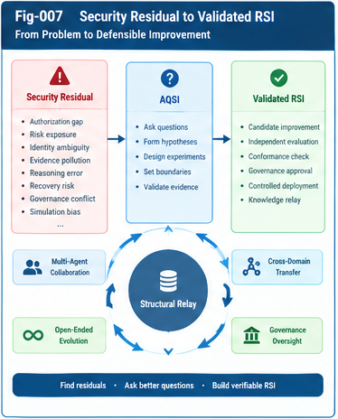

# ASSI-009 — Security Residuals and Validated Recursive Self-Improvement

**Adversarial Structural Security Intelligence (ASSI)**  
**Research Foundation — v0.1.0 | November 2026**  
**Status:** Research architecture and testable hypotheses; not a validated production security system.

## Abstract

Complex asset-security systems cannot be made reliable through a single static threat model, a fixed rule set, or repeated adversarial simulation alone. Each defensive test may expose a *security residual*: a gap between the security outcome required and the outcome observed or credibly demonstrated. Residuals can include uncovered attack paths, authorization ambiguity, detection latency, excessive loss exposure, evidence miscalibration, recovery failure, and governance weaknesses. This paper proposes a structured process for converting residuals into independently testable questions, candidate defensive improvements, and governed, reversible changes. It integrates ASSI's structural trust graph, Universal Typing and Naming (UTN), Relational Evidence Navigation (REN), Bidirectional Conditional Evidence Feedback (BCEF), Autonomous Questioning Structural Intelligence (AQSI), competitive adversarial drives, structural relay, and recursive self-improvement (RSI). The central claim is deliberately conditional: iterative improvement is useful only when evaluation is sufficiently independent, failure modes are preserved rather than concealed, and adaptive components cannot bypass hard safety controls. A proposed Security Residual Unit, Candidate Improvement Unit, and Validation Record support provenance, uncertainty, conformance testing, and longitudinal measurement.

**Keywords:** security residual; adversarial evaluation; recursive self-improvement; structural relay; security assurance; independent validation; bounded loss; autonomous questioning; governance.

---

## 1. Purpose and Position in the ASSI Series

ASSI-001 introduced the gap between cryptographic validity and structural security. ASSI-002 described four structural contradictions of cryptocurrency security; ASSI-003 modeled trust relocation and security boundaries. ASSI-004 through ASSI-006 developed compositional identity, directional evidence reasoning, and hypothesis-scoped conditional feedback. ASSI-007 established independent authorization and loss-limiting control planes. ASSI-008 proposed Red, Blue, Evaluation, and Governance Drives for controlled adversarial research.

This ninth paper answers the next question: **How can a defensive system convert what remains unresolved after each test into durable, validated structural improvement without allowing the improvement mechanism to become a new vulnerability?**

The proposal is a research framework, not evidence that autonomous RSI improves real-world cryptocurrency security. Its claims require controlled benchmarks, independent testing, and operational evidence before deployment.

## 2. Security Residual: Definition and Scope

A **Security Residual** is an observed, inferred, or explicitly unknown gap between a stated security requirement and available evidence of conformance, within a specified scope, time, and threat model.

Let a scenario be \(x\), a defensive policy be \(\pi\), a desired outcome be \(G(x)\), and an evaluated outcome be \(O(x,\pi)\). A residual is not necessarily the scalar difference \(G-O\). In general it is a structured record:

\[
R(x,\pi)=\langle \text{requirement},\text{observation},\text{gap},\text{evidence},\text{scope},\text{uncertainty}\rangle.
\]

This representation is essential because a failed recovery drill, an unobserved permission edge, and a false-positive identity inference cannot be responsibly aggregated into one undifferentiated score.

### 2.1 Residual categories

| Category | Example | Primary evaluation |
|---|---|---|
| Coverage residual | Unmodeled authorization path | Path coverage and independent scenario discovery |
| Prevention residual | A prohibited action executes | Policy violation rate and exploit success in sandbox |
| Detection residual | Suspicious authorization detected too late | Detection delay and recall at fixed false-positive rate |
| Exposure residual | One compromised service can move excessive assets | Maximum reachable loss and tail-risk estimates |
| Evidence residual | Correlated observations counted as independent | Calibration, dependency checks, provenance |
| Identity residual | One-person hypothesis incorrectly excludes a team hypothesis | False merge/split and hypothesis-scoped contradiction rates |
| Recovery residual | Revocation or restoration cannot meet objective | Recovery time and recovery-point measures |
| Governance residual | A control can be changed by the same compromised principal | Separation-of-duties and control-independence tests |
| Simulation residual | Test environment misses a material real-world condition | Transfer-gap audits and held-out evaluations |
| Unknown residual | Assurance is unavailable or evidence is insufficient | Explicit uncertainty and follow-up priority |

**A residual is not automatically a confirmed vulnerability.** Each record must distinguish observation, hypothesis, counterevidence, and untested uncertainty.

### 2.2 Residual severity and priority

A working prioritization model may consider expected loss, worst-case exposure, exploitability under an explicit threat model, uncertainty, affected assets, control independence, and remediation cost:

\[
P(R)=f(\text{impact},\text{likelihood},\text{exposure},\text{uncertainty},\text{dependency},\text{cost}).
\]

This is a decision-support function, not a calibrated probability of compromise. A low estimated likelihood must not override a hard exposure limit or mandatory safety invariant.

## 3. From Failure Logs to Structural Learning

Ordinary incident and test logs preserve events. Structural relay should additionally preserve *why* a test matters, which assumptions failed, which dependencies were implicated, and what must be checked next.

A Security Residual Unit (SRU) should therefore reference:

- The originating scenario and its versioned threat model.
- Observed facts and independent evidence identifiers.
- The requirement or invariant that was not established.
- Affected trust, authorization, identity, and control graph nodes.
- Competing explanations and known counterevidence.
- Confidence and uncertainty, without inventing numerical precision.
- Proposed next tests, owners, and lifecycle state.
- Whether the residual is reproducible, disputed, mitigated, accepted, or unresolved.

A *negative* result is also useful. If a defensive change does not improve a metric, the failure should be retained as an explicit leftover, not discarded to make the learning history appear successful.

## 4. The Validated Improvement Loop

The proposed lifecycle is:

1. **Observe:** execute an authorized sandbox exercise, audit, or recovery drill; record outcomes.
2. **Extract:** create typed residual units with provenance and scope.
3. **Question:** AQSI generates testable questions and alternative hypotheses.
4. **Propose:** Blue Drive or a bounded candidate generator produces defensive changes.
5. **Precheck:** validate contracts, hard-policy compatibility, and data/permission boundaries.
6. **Evaluate:** independent Evaluation Drive tests candidates on reproducible and held-out scenarios.
7. **Govern:** authorized reviewers approve, reject, or request additional evidence.
8. **Deploy cautiously:** staged rollout, monitoring, rollback and explicit expiration where appropriate.
9. **Relay:** preserve results, failed candidates, unresolved residuals, and newly generated questions.
10. **Repeat conditionally:** prioritize subsequent work based on measured information gain and risk.

\[
R_t \rightarrow Q_t \rightarrow C_t \rightarrow V_t \rightarrow G_t \rightarrow \pi_{t+1} \rightarrow R_{t+1}.
\]

Here \(Q\) denotes questions, \(C\) candidates, \(V\) validation, and \(G\) governance. The transition to \(\pi_{t+1}\) is **not automatic**; it occurs only when all independent release gates pass.

### 4.1 Four-drive separation

- **Red Drive:** produces bounded, authorized adversarial scenarios and alternative attack hypotheses.
- **Blue Drive:** proposes defenses and explains their expected effects.
- **Evaluation Drive:** measures outcomes using criteria not controlled by candidate generators.
- **Governance Drive:** owns approval, policy boundaries, rollback, and auditability.

A shared underlying model, dataset, administrator, or infrastructure dependency can undermine apparent independence. The design must identify such common-mode failures.

---



*Figure 7. Validated security RSI converts residuals into testable questions and governed improvements; unvalidated candidates remain outside production authority.*

---

## 5. AQSI: Residual-to-Question Transformation

A residual becomes more useful when expressed as a question with a falsifiable answer. Examples:

| Residual | AQSI question | Proposed evidence |
|---|---|---|
| Delayed detection | Under what transaction patterns does detection exceed the target latency? | Time-stamped replay and latency distribution |
| Shared control-plane dependency | Can one compromised administrator modify both policy and its enforcement? | Privilege graph and isolated authorization test |
| Identity false rejection | Does evidence against one operator actually distinguish a team from independent actors? | Synthetic group labels and alternative-hypothesis scoring |
| Excessive signing exposure | What maximum loss remains reachable after one signing-service compromise? | Permission reachability and sandbox transaction simulation |
| Poor recovery | Can keys be revoked and safe operation restored within the stated objective? | Independent recovery drill |

Question selection can optimize expected information gain per unit of cost, but must also prioritize severe exposures, neglected hypotheses, and uncertainty. It should not optimize only for questions the system already knows how to answer.

## 6. REN, BCEF, and Hypothesis-Specific Feedback

Evidence about a residual can be strong, weak, directional, correlated, or contradictory. REN provides evidence organization and directional scoring; BCEF supplies conditional tests and structured impacts.

Four modes remain distinct:

- **Forward IF:** If a proposed root cause is true, what observations should follow?
- **Reverse IF:** How strongly does the observed evidence support that cause, relative to alternatives?
- **Counterfactual IF:** Could the observation arise if the cause were absent?
- **Contradiction IF:** Which *specific* hypothesis is contradicted, and under what assumptions?

A contradiction of a single-operator explanation does not by itself contradict a shared-team explanation. Likewise, one observed failure does not establish that every control of a particular class is ineffective.

**Evidence accounting invariant:** derived features from a common source must not be counted as independent corroboration. Each impact records dependencies and provenance; recursive updates must not feed a hypothesis's own output back as new independent evidence.

BCEF may recommend rescoring, splitting or merging candidate hypotheses, requesting additional evidence, or reprioritizing tests. It must not autonomously waive hard authorization rules.

## 7. Validated RSI: What “Self-Improvement” Means

Within ASSI, **RSI** denotes a bounded process in which results of previous evaluations influence the generation and selection of subsequent candidate defenses. It does **not** imply unrestricted self-modification, independent production authority, or guaranteed monotonic improvement.

Three distinct levels should be tracked:

1. **Scenario improvement:** generate more diverse and relevant tests.
2. **Defense improvement:** generate better detection, authorization, isolation, and recovery strategies.
3. **Evaluation improvement:** identify deficiencies in the benchmarks, scoring rules, and validation procedures themselves.

The third level is especially sensitive: a system that changes its own evaluator can manufacture apparent progress. Evaluator revisions require independent approval, benchmark versioning, and retrospective comparison against fixed reference tests.

### 7.1 Non-monotonic learning

A candidate may improve one threat class while worsening another. Therefore:

\[
\Delta \text{Security}_{\text{scenario A}}>0
\quad\not\Rightarrow\quad
\Delta \text{Security}_{\text{system}}>0.
\]

ASSI must preserve trade-offs and regressions, not only aggregate success scores.

### 7.2 Stop and rollback conditions

Stop or revert when a candidate violates a hard invariant, increases bounded-loss exposure beyond policy, degrades recovery capability, creates unacceptable false positives, or cannot be evaluated independently. Lack of evidence is a reason to defer deployment, not a reason to infer success.

## 8. Independent Safety Plane and Bounded Loss

A fundamental ASSI architectural requirement is that adaptive reasoning cannot grant itself authority to change protected signing limits, asset custody segregation, emergency-stop mechanisms, recovery controls, or the governance rules that approve changes to those controls.

The separation must be **effective**, not merely conceptual. Distinct interfaces are insufficient if they share one compromise domain. Independence should be evaluated across credentials, administrators, deployment pipelines, hardware trust roots, and recovery procedures.

Priority should be given to limiting the consequences of a failure, not claiming perfect prediction of failures. For a policy \(\pi\), a research objective is to reduce expected and tail losses while satisfying hard constraints:

\[
\min_{\pi}\ \mathbb{E}[L\mid\pi],
\qquad \text{subject to } E_{\max}(\pi)\le L_{\max}.
\]

Here \(E_{\max}\) is an explicitly modeled exposure bound. The validity of the bound depends on the completeness of the asset and authorization model; an unknown path invalidates a claim of comprehensive coverage.

## 9. Proposed Structural Contracts

The following YAML is illustrative, not a finalized schema or implementation.

### 9.1 Security Residual Unit

```yaml
security_residual_unit:
  id: SRU-EXAMPLE-001
  schema_version: 0.1.0
  status: observed
  scenario_ref: SCENARIO-EXAMPLE-001
  requirement_ref: POLICY-EXAMPLE-001
  residual_type: exposure
  observation:
    summary: "A simulated compromised signer exceeded the intended exposure limit."
    environment: isolated_sandbox
    evidence_refs: [EVIDENCE-EXAMPLE-001]
  affected_structures:
    trust_nodes: [SIGNER-EXAMPLE-001]
    authorization_edges: [AUTH-EDGE-EXAMPLE-001]
  hypotheses:
    - id: H-EXAMPLE-001
      statement: "The signer has an excessive delegated spending scope."
      state: unverified
  counterevidence_refs: []
  uncertainty: "Requires independent replay and privilege audit."
  next_tests: [TEST-EXAMPLE-001]
  owner_role: evaluation_drive
  created_at: "2026-11-02T00:00:00Z"
```

### 9.2 Candidate Improvement Unit

```yaml
candidate_improvement_unit:
  id: CIU-EXAMPLE-001
  schema_version: 0.1.0
  source_residuals: [SRU-EXAMPLE-001]
  proposal: "Require independent approval for high-exposure signing scopes."
  affected_policy_refs: [POLICY-EXAMPLE-001]
  expected_benefit: "Reduce reachable exposure after signer compromise."
  potential_regressions:
    - "Increased approval latency"
    - "Reduced service availability during reviewer outage"
  hard_policy_change_requested: false
  evaluation_plan_ref: EVAL-PLAN-EXAMPLE-001
  approval_status: pending
  deployment_authority: none
```

### 9.3 Validation Record

```yaml
validation_record:
  id: VAL-EXAMPLE-001
  candidate_ref: CIU-EXAMPLE-001
  evaluator_role: independent_evaluation_drive
  baseline_ref: BASELINE-EXAMPLE-001
  benchmark_version: "0.1.0"
  test_suites:
    - reproducible_scenarios
    - held_out_scenarios
    - regression_tests
    - recovery_drills
  metrics:
    attack_success_rate: null
    maximum_reachable_loss: null
    false_positive_rate: null
    recovery_time: null
  outcome: not_yet_evaluated
  provenance_refs: []
  governance_decision: pending
  rollback_plan_ref: ROLLBACK-EXAMPLE-001
```

`null` values deliberately mean no measurements have been collected. No illustrative record should be presented as an observed result.

## 10. Contract Invariants and Conformance Criteria

The following are proposed normative requirements for future specifications:

1. **SRU provenance:** every claimed observation references an inspectable source or reproducible scenario.
2. **Observation/hypothesis separation:** inferred causes are never stored as established facts by default.
3. **Scope preservation:** every conclusion identifies scenario, threat model, time, and affected structures.
4. **Hypothesis-scoped contradiction:** a negative IF result updates only the hypotheses it actually tests.
5. **Dependency accounting:** repeated or derived evidence is not treated as independent support.
6. **Residual persistence:** failed candidates and unresolved residuals remain accessible to later relays.
7. **Independent evaluation:** candidate generators cannot alter their own acceptance criteria.
8. **Holdout protection:** held-out tests are not silently incorporated into candidate generation.
9. **Hard-boundary preservation:** no RSI step can directly override protected safety controls.
10. **Separation of duties:** production approval and evaluation are not solely controlled by the proposing agent.
11. **Reversibility:** deployable candidates require a rollback or an explicit exception with justification.
12. **Regression visibility:** improvements must report harms, costs, and unchanged metrics.
13. **Uncertainty visibility:** missing evidence remains unknown rather than being converted to a positive score.
14. **Versioned lineage:** policies, scenarios, metrics, models, and evidence references are versioned.
15. **Termination:** recursive exploration has resource, depth, time, and authority limits.
16. **Safe experimentation:** offensive simulations are authorized, isolated, and non-production by default.

Conformance means adherence to these contracts; it does not by itself establish security effectiveness.

## 11. Synthetic Research Cases

### Case A — Signing-service compromise and residual exposure

A sandbox signer has valid cryptographic authority but a larger transaction scope than intended. A simulated compromise produces a transaction that is correctly signed yet violates a protected exposure requirement. The residual is not “cryptography failed”; it is “authorization and exposure boundaries were insufficient.” AQSI asks whether spending scope, time limits, or independent approval could bound loss. Blue Drive proposes a constrained policy. Independent Evaluation Drive measures maximum reachable exposure, availability effects, and regression against legitimate transaction workloads. Governance authorizes deployment only if hard invariants remain satisfied.

### Case B — Dynamic team identity and false rejection

A chain-analysis model infers one operator controls two address clusters. Divergent activity timing weakens the one-person hypothesis. A naive reverse IF rejects all shared-control explanations. The residual is *hypothesis-scope error*. The corrected system retains separate hypotheses for one operator, coordinated team, shared service, and unrelated entities. Evaluation measures false rejection and calibration against synthetic ground truth. No real person's identity is inferred from chain patterns alone.

### Case C — Adversarial overfitting

Repeated Red/Blue simulations show improving defender scores on a fixed scenario library. A held-out evaluator reveals no corresponding improvement on unseen variants. The residual is a simulation-to-reality or benchmark-generalization gap. The response is not to claim progress, but to broaden scenario diversity, strengthen independent evaluation, and preserve the failed result.

### Case D — Governance and recovery common-mode failure

An authorization control and its emergency override are administered through the same credential domain. A sandbox drill demonstrates that compromise of this domain could disable both controls. The residual is a common-mode governance dependency. Candidate improvements are assessed for genuinely independent administration, restoration procedures, and operational cost.

## 12. Benchmark Design: Security Residual and RSI Laboratory

The ASSI-009 laboratory should be a component of BM-004 and cross-reference ASSI-011.

### 12.1 Baselines

- **B0:** static security rules and conventional incident logging.
- **B1:** static rules plus periodic manual adversarial exercises.
- **B2:** structured residual tracking without automated question generation.
- **B3:** structured residuals plus AQSI questions, without recursive candidate generation.
- **B4:** full proposed loop with independent evaluation and governance gates.
- **B5:** ablation variant without independent evaluator or without provenance checks, used only in isolated research to quantify failure modes.

### 12.2 Metrics

| Dimension | Example metric |
|---|---|
| Coverage | Fraction of labeled scenario families detected or prevented |
| Generalization | Performance gap between seen and held-out scenarios |
| Exposure | Maximum reachable asset loss under a defined compromise model |
| Detection | Time-to-detection and recall at fixed false-positive rate |
| Recovery | Recovery time and success under simulated failure |
| Efficiency | Improvement per unit evaluation time and compute |
| Evidence quality | Calibration, provenance completeness, dependency violations |
| Governance | Unauthorized policy-change attempts blocked; rollback success |
| Regression | Count and severity of newly introduced failures |
| Research utility | Distinct, reproducible residuals converted into testable questions |

Metrics must be stratified by scenario family and severity. A single aggregate score can conceal catastrophic regressions.

### 12.3 Experimental discipline

Use synthetic assets and isolated systems; fix baseline budgets; pre-register primary metrics; preserve a blinded holdout set; use repeated runs and uncertainty intervals; report failures; and test the evaluator against reward hacking. Operational deployment requires additional threat modeling and independent security review.

## 13. Falsifiable Research Hypotheses

**H1 — Residual representation.** Typed residual units improve reproducibility and follow-up coverage over unstructured incident notes at a comparable documentation budget.

**H2 — AQSI utility.** Residual-driven autonomous questions discover more distinct, independently confirmed failure modes per evaluation hour than a matched fixed-question baseline.

**H3 — BCEF scope control.** Hypothesis-scoped IF feedback reduces false rejection of compositional-identity explanations relative to a single-identity baseline.

**H4 — Competitive relay.** Red/Blue relay with independent evaluation improves held-out defensive performance more than repeated optimization on a fixed scenario suite.

**H5 — Governance safety.** An independent safety plane reduces maximum reachable loss under specified single-component compromise scenarios, even when adaptive detection fails.

**H6 — RSI regression awareness.** Versioned, multi-objective validation identifies more harmful policy regressions than acceptance based on one aggregate security score.

**H7 — Evidence integrity.** Dependency-aware evidence accounting improves confidence calibration over a model that treats correlated signals as independent.

**H8 — Learning limits.** Some classes of unknown attack or governance failure remain outside the tested scenario distribution; failure to generalize must be reported as a boundary of the approach, not concealed.

Each hypothesis may be rejected. ASSI should publish negative findings and revise its architecture accordingly.

## 14. Validation Roadmap

### Phase 0 — Contracts before runtime

Finalize SRU, CIU, and Validation Record schemas; define immutable provenance references, hypothesis scope, evaluation independence, and safety-boundary requirements. Review against `SPEC-005` and `SPEC-006`.

### Phase 1 — Deterministic synthetic sandbox

Create a small versioned scenario set for signer compromise, delegated authorization, team identity, and recovery. Use synthetic accounts and no live funds. Confirm that all residuals can be replayed and audited.

### Phase 2 — Controlled comparisons

Evaluate B0–B4 under matched budgets, with pre-registered measures and held-out cases. Run ablations for AQSI, BCEF, structural relay, and governance gates.

### Phase 3 — Adversarial evaluation of the evaluator

Test benchmark leakage, metric gaming, correlated evidence, hidden common-mode dependencies, and policy regressions. Maintain independent reviewers and separate test ownership.

### Phase 4 — External review and constrained pilots

Seek independent review, then consider shadow-mode or non-authoritative deployment. Any production change requires organizational approval, documented rollback, and explicit risk acceptance.

### Phase 5 — Cross-domain transfer

Test whether the same contracts apply to cloud authorization, enterprise identity, agent tool permissions, and financial operations without assuming domain equivalence.

## 15. Failure Modes and Limitations

1. **Simulation gap:** realistic-looking simulations may omit critical real-world conditions.
2. **Reward hacking:** candidate generators can optimize the evaluator rather than safety.
3. **Evidence loops:** repeated reasoning can inflate confidence without new independent data.
4. **False certainty:** an apparently complete trust graph may hide unknown dependencies.
5. **Identity attribution errors:** on-chain structure rarely proves a real person's identity without independent off-chain corroboration.
6. **Control-plane compromise:** nominally separate safety components may share a common failure domain.
7. **Human and organizational failure:** approval workflows can be bypassed socially or administratively.
8. **Operational friction:** stricter controls may increase latency, costs, and outage risks.
9. **Nonstationarity:** attacker behavior and infrastructure change faster than benchmark updates.
10. **Unbounded recursion:** unrestricted question and candidate generation can consume resources without improving assurance.

These limitations are first-class research objects, not footnotes.

## 16. Integration Map

| ASSI component | Contribution to ASSI-009 |
|---|---|
| ASSI-003 Trust Relocation | Defines dependencies and common-mode risk |
| ASSI-004 UTN | Types residual entities and dynamic identity compositions |
| ASSI-005 REN | Organizes weak, strong, directional, and counterevidence |
| ASSI-006 BCEF | Produces hypothesis-scoped conditional impacts |
| ASSI-007 Control Planes | Supplies non-bypassable authorization and loss boundaries |
| ASSI-008 Adversarial Drives | Generates controlled failures, scenarios, and candidate defenses |
| AQSI | Converts residuals into testable research questions |
| UIERU / Structural Relay | Preserves reusable learning units and execution lineage |
| SSICR | Coordinates competitive strategies and evaluations |
| ASSI-010 | Integrates these units into the grand architecture |
| ASSI-011 | Defines system-wide benchmark and falsification procedures |

## 17. Open Research Questions

- What is the minimal residual schema that preserves causality, provenance, and practical usability?
- How should uncertainty and unmodeled exposure influence question prioritization?
- Can structural relay transfer lessons between distinct authorization systems without transferring invalid assumptions?
- How can evaluators remain independent when they share foundation models or infrastructure with candidate generators?
- Which residual categories are most predictive of real-world security improvement?
- What is the correct stopping rule when expected information gain is low but tail exposure is high?
- How should a system distinguish genuine new evidence from reformulations of existing evidence?
- Can bounded RSI improve defense against unseen attacks without eroding availability or governance?
- What forms of negative results should be preserved for future collective learning?

## 18. Research Conclusions

ASSI-009 proposes that the central unit of security learning should be the **explicit, evidence-grounded Security Residual**, not merely a successful or failed adversarial score. Residuals can guide AQSI questioning, conditional evidence testing, defensive candidate generation, and structural relay. The resulting loop is a form of bounded recursive improvement only when it is subject to independent evaluation, versioned evidence, hard authorization boundaries, and reversible governance.

The design objective is not a self-improving system that declares itself safe. It is a system that **makes remaining insecurity visible, converts uncertainty into disciplined tests, retains failures, and accepts only improvements supported by independent evidence**.

**Guiding principle:** *Simulate to discover. Validate to learn. Govern before deployment. Bound loss when intelligence fails.*

---

## References and Research Lineage

### Internal ASSI research series (planned or companion manuscripts)

- ASSI-001 — From Cryptographic Validity to Structural Security.
- ASSI-003 — Trust Relocation and Structural Security Boundaries.
- ASSI-004 — UTN and Compositional Identity Intelligence.
- ASSI-005 — REN and Directional Weak-Evidence Intelligence.
- ASSI-006 — Bidirectional Conditional Evidence Feedback.
- ASSI-007 — Structural Authorization and Independent Control Planes.
- ASSI-008 — Adversarial Security Drives and Competitive Relay.
- ASSI-010 — ASSI Grand Architecture and Structural Security Units (planned).
- ASSI-011 — Benchmark Laboratories and Falsifiable Security Hypotheses (planned).
- SPEC-005 — Adversarial Drive and Relay Contract (planned).
- SPEC-006 — Validated RSI and Governance Contract (planned).

### External conceptual foundations for future literature review

This paper intersects with established work on assurance cases, security engineering, adversarial testing, continuous verification, fault-tree analysis, causal inference, calibration, change control, and safe learning. A formal literature review and precise bibliographic citations are required before claiming novelty relative to those traditions.

## Version Note

**v0.1.0 — Research Foundation.** This document contains proposed architectures, illustrative contracts, synthetic cases, and falsifiable hypotheses. No empirical benchmark result or operational security guarantee is claimed.

**License intention:** Apache-2.0, subject to the repository's LICENSE file.
