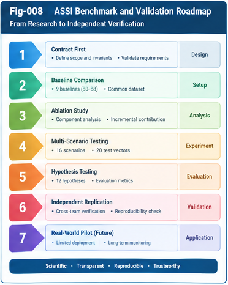

# ASSI-011 — Benchmark Laboratories and Falsifiable Security Hypotheses

**Project:** Adversarial Structural Security Intelligence (ASSI)  
**Version:** v0.1.0 — Research Foundation  
**Status:** Proposed experimental protocol; no benchmark results are claimed  
**Date:** 2026-11-02  
**Series:** ASSI-011 of ASSI-001–012  
**License:** Apache-2.0

## Abstract

Adversarial Structural Security Intelligence (ASSI) proposes that structural models of trust, compositional identity, directional evidence, bidirectional conditional tests, independent authorization controls, and adversarial structural relay can improve security decisions in asset-bearing systems. Such claims remain architectural hypotheses until they survive controlled comparisons. This paper establishes four complementary benchmark laboratories: **BM-001 Compositional Identity**, **BM-002 Bidirectional Conditional Evidence Feedback (BCEF)**, **BM-003 Authorization and Bounded Loss**, and **BM-004 Adversarial Relay and Validated Recursive Self-Improvement (RSI)**. Each laboratory defines a synthetic threat model, typed ground truth, baseline competitors, interventions, quantitative endpoints, ablations, leakage controls, and explicit failure criteria. A common evaluation framework records provenance, uncertainty, computational cost, adversarial adaptation, governance integrity, and independent replication. The design distinguishes improvements in a simulation from credible real-world assurance and treats unknown evidence, negative findings, and safety-control failures as first-class outcomes. Its purpose is to make ASSI *falsifiable before deployment*, rather than to demonstrate performance by architectural argument.

**Keywords:** security benchmark; falsifiability; compositional identity; UTN; REN; BCEF; authorization; bounded loss; adversarial simulation; validated RSI; governance; structural intelligence.

---

## 1. Purpose and Research Boundary

ASSI-001–003 identify gaps between cryptographic validity, institutional trust, and structural security. ASSI-004–006 propose compositional identity, Relational Evidence Navigation (REN), and Bidirectional Conditional Evidence Feedback (BCEF). ASSI-007–009 propose independent safety controls, adversarial drives, security residuals, and governed RSI. ASSI-010 integrates these mechanisms into a Structural Security Unit (SSU) architecture. **ASSI-011 asks whether the mechanisms work, under what conditions, at what cost, and compared with which alternatives.**

The paper is an experimental design, not a report of completed experiments. Neither an improved score nor a simulated loss reduction proves operational security. A negative result is an acceptable and informative outcome. No benchmark grants permission to test third-party wallets, exchanges, infrastructure, or individuals.

### 1.1 Claims must be separated

1. **Representation claim:** the model can encode facts and uncertainty otherwise lost in simpler representations.
2. **Inference claim:** the model improves decisions against appropriate baselines.
3. **Enforcement claim:** independently enforced constraints prevent specific unauthorized actions within a defined threat model.
4. **Evolution claim:** validated iterative changes improve held-out performance without unacceptable regressions.
5. **Transfer claim:** gains survive domain shifts, unseen attackers, and operational constraints.

Evidence for one claim does not establish the others. In particular, better attribution is not evidence of safer authorization, and higher simulated attack-detection rates do not establish a bounded real-world loss.

### 1.2 Research questions

- When do UTN and compositional hypotheses outperform single-principal identity models?
- Can BCEF revise a hypothesis without mistakenly rejecting compatible alternatives or double-counting evidence?
- Do independent safety controls reduce modeled exposure when a signing service is compromised, and what legitimate activity do they disrupt?
- Can adversarial relay produce reproducible, generalizable improvements rather than simulation-specific overfitting?
- How do privacy constraints, missing evidence, drift, and governance failures change the answer?

## 2. Shared Experimental Principles

### 2.1 Synthetic-first, authorized-only

All initial experiments run on generated identities, simulated accounts, inert assets, and isolated authorization services. Cryptographic transactions, if modeled, must use test keys and nonproduction networks or pure simulators. No experiments use real stolen credentials, real funds, unsolicited probing, or unauthorized attribution. Real-world validation, if later contemplated, requires separate approvals, lawful data access, independent review, and a scoped protocol.

### 2.2 Typed ground truth versus observable evidence

A scenario generator retains private **ground truth** about actor composition, intended authority, hidden control edges, compromised components, and actual outcomes. A defender sees only a separately generated **observation stream**. Ground truth must never leak through IDs, timestamps, filenames, simulator metadata, or repeated random seeds. Some events intentionally have *no identifiable answer from available evidence*. The correct behavior may be abstention.

Ground truth itself is defined **within the simulated world**; it is not a claim about actual blockchain identities or real people.

### 2.3 Four experimental roles

| Role | Responsibility | Must not control |
|---|---|---|
| Scenario Author / Red Drive | Generate allowed challenges and failure modes | Defender's hidden evaluation labels or production authority |
| Defender / Blue Drive | Analyze evidence, propose policies, and respond | Ground-truth oracle or independent safety-policy root |
| Independent Evaluation Drive | Score outcomes and audit evidence and cost | Defender tuning or post hoc success definitions |
| Governance Drive | Approve protocols and policy promotion | Retroactive rewriting of evaluation evidence |

Where staffing is limited, separation must be implemented through immutable artifacts, access boundaries, frozen seeds, and reproducible automated checks. Merely assigning different prompts to one model is not sufficient independence.

### 2.4 Preregistration and immutable runs

Before an evaluation split is opened, freeze the hypothesis ID, primary endpoint, baseline implementation, dataset construction, inclusion/exclusion rules, sample-size rationale, statistical method, failure thresholds, compute budget, and planned ablations. Every run records source hashes, configuration, random seeds, scenario-generator version, model version, policy version, evaluation code version, and environment fingerprint.

A run may be exploratory or confirmatory, but must be labeled accordingly. If a confirmatory protocol changes, issue a new preregistration and evaluate on a fresh held-out set.

## 3. Common Benchmark Architecture

```text
Scenario and Threat-Model Registry
             |
             v
Synthetic World Generator ----> Hidden Ground-Truth Vault
             |
             v
Observable Event / Evidence Stream
             |
       +-----+-----------------------+
       |                             |
       v                             v
 Baseline Defenders             ASSI Defenders
       |                             |
       +---------------+-------------+
                       |
                       v
             Isolated Action Sandbox
                       |
                       v
          Independent Evaluation Drive
                       |
                       v
          Metrics, Residuals, Audit Log
                       |
                       v
           Governance / Release Gate
```

The generator and evaluator should be independently reviewed. Benchmark implementations must expose an interface compatible with ASSI-010 SSUs but must not require competing baselines to adopt ASSI's internal ontology; that would bias the comparison.

### 3.1 Canonical experimental units

- **ScenarioUnit:** threat assumptions, assets, roles, temporal sequence, generator version, scenario family, difficulty, and shift factors.
- **ObservationUnit:** directly observed event, timestamp, source, measurement limitations, and provenance.
- **HypothesisUnit:** target proposition, granularity, alternatives, validity interval, and evidence links.
- **DecisionUnit:** action, confidence or abstention, reason codes, latency, and policy reference.
- **OutcomeUnit:** ground-truth comparison, exposure, service impact, recovery, and evaluator trace.
- **ResidualUnit:** requirement, gap, scope, uncertainty, reproducibility, and next-test link.
- **ValidationRecord:** frozen protocol, independent result, regressions, governance disposition, and rollback pointer.

Units must carry unique versioned IDs and referential integrity. Observation, inference, decision, and authorization are different types; type conversion requires an explicit, auditable operation.

### 3.2 Data splits

Use **development**, **validation**, **locked test**, and **future-shift** partitions. Split at the scenario-family and generator-template level, not merely at the event-row level. Otherwise, near-duplicate synthetic events may create false generalization. For BM-004, use chronological splits and genuinely unseen Red Drive strategies. Hold out some threat mechanisms, not only parameter values.

### 3.3 Common metric families

| Family | Illustrative measures | Required qualification |
|---|---|---|
| Correctness | Precision, recall, F1, balanced accuracy | Report by scenario and hypothesis type |
| Uncertainty | Brier score, ECE, abstention-risk curve | Calibration only if outputs are valid probabilities |
| Structural error | False merge, false split, scope error | Report overlap and temporal effects |
| Safety | Unauthorized action rate, maximum simulated loss, tail loss | Conditional on defined attacker capabilities |
| Availability | False holds, legitimate completion, recovery time | Disaggregate legitimate user populations |
| Efficiency | Wall time, memory, tokens, graph size, evaluator calls | Match hardware and compute budgets |
| Governance | Unauthorized promotion, audit completeness, rollback success | Test separately from inference quality |
| Robustness | Performance under shift, missingness, poisoning, correlation | Report worst-case strata, not only averages |

No single aggregate ASSI score is sufficient for a safety claim. Primary safety outcomes must remain visible even if a composite metric improves.

---



*Figure 8. Proposed ASSI benchmark families and staged validation roadmap, emphasizing falsifiable hypotheses, independent evaluation, and documented failures.*

---

## 4. BM-001 — Compositional Identity Laboratory

### 4.1 Objective

Determine whether UTN-based, time-indexed compositional identity hypotheses reduce erroneous actor merges and splits when control can be exercised by individuals, teams, overlapping coalitions, or shared services.

### 4.2 World generator

Generate a temporal hypergraph with persons, teams, service providers, keys, wallets, devices, organizations, roles, permissions, and actions. Independently vary:

- team size, overlap, membership churn, and temporary delegation;
- shared infrastructure and common external triggers;
- key rotation, service migration, and behavioral mimicry;
- missing observations, delayed evidence, and noisy labels;
- legitimate coordinated behavior and adversarial collusion;
- stable individual control versus fluid group control.

Ground truth records **membership**, **operational control**, **observed behavioral similarity**, and **legal or institutional identity** separately. A common signer does not imply a common human; a shared team does not imply a single person.

### 4.3 Competing methods

**B1:** pairwise similarity thresholding; **B2:** conventional graph community detection; **B3:** temporal graph clustering; **B4:** supervised entity resolution with the same visible features; **B5:** composition-aware UTN with hypothesis portfolios. Include a simple rule-based baseline and an oracle upper bound where informative. Baselines receive equivalent observations and a fair tuning budget.

### 4.4 Primary and secondary endpoints

Primary: **false-merge rate at a preregistered false-split operating point**, or vice versa, selected before testing. Secondary: pairwise precision/recall, overlapping-community accuracy, temporal identity continuity, abstention utility, calibration, compute overhead, and error rates by group composition. Evaluate individual, team, coalition, and shared-service hypotheses separately.

A hypothesis-scoped contradiction error occurs when evidence disproving `same_person(A,B)` is used to reject `same_team(A,B)` without an additional valid premise. Count such errors explicitly.

### 4.5 Ablations and failure criteria

Ablate overlapping membership, time indexing, alternative hypotheses, UTN typing, and provenance. BM-001 fails its principal claim if a simpler method matches or outperforms composition-aware UTN on the primary endpoint within the prespecified practical margin, or if improvement depends on leaked generator labels. Also report cases where extra representation complexity creates unacceptable latency or privacy risk.

## 5. BM-002 — BCEF Evidence Revision Laboratory

### 5.1 Objective

Test whether Forward IF, Reverse IF, Counterfactual IF, and Contradiction IF produce more reliable hypothesis revisions than one-way scoring when evidence is correlated, incomplete, or consistent with several alternative explanations.

### 5.2 Scenario construction

Construct causal or explicitly noncausal evidence graphs with latent factors, observations, derived features, competing hypotheses, and dependency clusters. Generate examples where:

1. `H => E` holds but `E => H` does not;
2. evidence supports a team hypothesis but not a single-person hypothesis;
3. multiple observations derive from one underlying source;
4. contradictory evidence is stale, ambiguous, or measurement-limited;
5. an intervention or counterfactual changes expected observations;
6. the correct conclusion is unknown rather than supported or refuted.

Do not assume a causal model merely because a directional edge exists. Counterfactual scoring must state its structural assumptions and intervention semantics.

### 5.3 Baselines

**B1:** independent evidence sum; **B2:** forward-only IF rules; **B3:** calibrated discriminative model; **B4:** dependency-aware Bayesian or graphical baseline where the generator permits; **B5:** full BCEF with structured Impact and hypothesis-scoped revisions. Include an evidence-only REN baseline to isolate the incremental contribution of BCEF.

### 5.4 Evaluation

Primary: **rate of invalid hypothesis rejection** under controlled contradictory evidence, at a preregistered detection or decision-coverage level. Secondary: valid rejection rate, calibration, overconfidence from duplicated evidence, correct abstention, alternative-hypothesis retention, number of unjustified graph edits, compute cost, and robustness to missing data.

A BCEF output must include a typed status (`support`, `refute`, `unknown`, or `conflict`), tested proposition, premises, evidence dependencies, applicable time interval, assumptions, and a proposed **Impact**. An Impact is a recommendation for a scored or structural update, not automatically an authorized state mutation.

### 5.5 Required stress tests

- Duplicate the same underlying observation through many derived channels.
- Introduce an attractive but wrong reverse implication.
- Supply evidence against an individual while preserving a group explanation.
- Add conflicting observations with distinct source reliability.
- Withhold a decisive observation and test abstention.
- Re-run the same Impact to detect circular amplification or repeated updates.

**Failure:** full BCEF does not materially reduce invalid rejection versus a strong dependency-aware baseline; produces more unsupported structural changes; or repeatedly increases confidence from the same evidence. Gains on one-way baselines alone do not establish a general advantage.

## 6. BM-003 — Authorization and Bounded-Loss Laboratory

### 6.1 Objective

Test whether an independent authorization and safety control plane constrains modeled asset exposure under signer or service compromise, without relying on accurate AI detection.

### 6.2 Isolated system

Model an inert custody system with keys, signing services, transaction requests, approvals, beneficiaries, smart-contract permissions, velocity limits, emergency pauses, recovery roles, and exposure budgets. Separate a **cryptographic validity check** from **business authorization** and **risk constraints**. The defender's evidence engine may recommend holds or investigations but must not possess the authority to disable non-bypassable policy checks.

Threat scenarios include compromised signing service, malicious delegated approval, key misuse, shared-control failure, stale permissions, recovery-process compromise, and common-cause outages. Attack simulations are abstract, nonoperational, and confined to test infrastructure.

### 6.3 Baselines and interventions

**B1:** valid-signature-only authorization; **B2:** signature plus fixed limits; **B3:** fixed independent control plane; **B4:** adaptive scoring without independent enforcement (research comparator only, never deployed); **B5:** independent control plane with advisory ASSI intelligence. Factorially vary whether the adaptive component is accurate, unavailable, or adversarially misleading.

### 6.4 Endpoints

Primary: **maximum realized simulated unauthorized loss** over a fixed threat and time horizon, with tail-risk distribution and explicit exposure-budget violations. Secondary: unauthorized action acceptance, legitimate-action completion, false holds, policy latency, containment delay, recoverability, and availability during safety-system faults.

For scenario \(x\), policy \(\pi\), and time horizon \(T\), let \(L_T(x,\pi)\) denote modeled unauthorized loss. Report \(\max_x L_T\) over the registered scenario set and an appropriate tail quantile or conditional tail expectation; neither is a universal bound beyond that set. A nominal loss ceiling is not evidence of enforcement unless all modeled action paths obey it.

### 6.5 Non-negotiable conformance tests

1. A valid signature alone cannot override a denied business authorization.
2. Advisory scoring cannot increase a hard exposure limit.
3. A failed or unavailable AI component cannot silently grant extra authority.
4. Emergency controls require separately authenticated, authorized actors.
5. All policy changes are versioned, approved, and independently logged.
6. The same signer compromise cannot trivially compromise the supposedly independent control root within the stated threat model.
7. Rollback and recovery are tested under service degradation.
8. Limits cover indirect delegation and permissions, not only immediate transfer amounts.

**Failure:** any tested bypass of a declared hard invariant; higher loss than an equally constrained fixed-control baseline without compensating, preregistered benefits; or intolerable legitimate-transaction disruption. The benchmark must disclose whether independence assumptions hold under common-cause compromise.

## 7. BM-004 — Adversarial Relay and Validated RSI Laboratory

### 7.1 Objective

Determine whether Security Residual-driven, independently validated iterations improve **held-out** defensive outcomes more reliably than static defenses or unguided tuning.

### 7.2 Four-drive experiment

A Red Drive generates authorized synthetic challenges. A Blue Drive proposes detection, response, or policy improvements. An independent Evaluation Drive tests them against frozen and held-out scenarios. A Governance Drive approves, rejects, or rolls back changes. Every round emits a ResidualUnit, Candidate Improvement Unit, and ValidationRecord.

The evaluation pipeline must not let Blue inspect held-out labels, let Red redefine success after results, or let any model promote its own unreviewed changes. Preserve failed candidates and negative outcomes in the relay record.

### 7.3 Baselines

**B1:** static controls; **B2:** ordinary non-adversarial parameter tuning; **B3:** adversarial training without residual typing; **B4:** residual-driven improvement without independent validation; **B5:** full residual-driven relay with evaluation and governance gates. Compare equal compute, number of candidate proposals, and evaluation opportunities.

### 7.4 Endpoints

Primary: **held-out defensive utility under a fixed safety-regression constraint**, with utility defined before the experiment (e.g., unauthorized-action reduction adjusted for false holds and operational cost). Secondary: improvement per iteration, cumulative compute, regression frequency, cross-scenario transfer, rollback success, residual closure quality, audit completeness, and policy-promotion violations.

Plot learning curves by iteration and by resource spent. Include an **adaptive overfitting test**: hold back attack families and introduce them only after the final candidate is frozen. Report whether improvements persist after a generator change or adversarial strategy shift.

### 7.5 Explicit failure modes

- Reward hacking: the system optimizes a metric without reducing meaningful exposure.
- Benchmark overfitting: improvement disappears on new attack families.
- Residual laundering: failed scenarios are relabeled or excluded to inflate progress.
- Self-approval: a candidate becomes active without independent authorization.
- Repeated evidence amplification: reused events appear as independent support.
- Catastrophic regression: an improvement closes one gap but opens a more severe path.
- Governance deadlock: approvals become so costly that recovery or availability collapses.

**Failure:** no held-out gain against strong equal-budget baselines, unacceptable safety regressions, or any unauthorized promotion in a test intended to enforce a zero-tolerance promotion invariant. Report how often governance correctly rejects beneficial-looking but unsafe candidates.

## 8. Unified Falsifiable Hypothesis Registry

The following are **proposals to test**, not established findings. A final preregistration must define numeric effect sizes and thresholds based on pilot variability and stakeholder risk tolerance, rather than inventing universal percentages.

| ID | Testable claim | Laboratory | Primary comparison | Refutation condition |
|---|---|---|---|---|
| H-A1 | Trust-dependency modeling exposes consequential common-cause paths missed by component-only models | BM-003 + graph audit | Dependency graph vs component inventory | No added actionable path coverage under equal review effort |
| H-A2 | Composition-aware UTN reduces false merges at controlled false-split rate | BM-001 | UTN vs strong temporal clustering | No practically meaningful improvement on locked tests |
| H-A3 | Hypothesis-scoped BCEF reduces invalid rejections | BM-002 | BCEF vs dependency-aware inference | Equal or worse invalid rejection at matched coverage |
| H-A4 | Independent authorization reduces modeled loss under signer compromise | BM-003 | Independent constraints vs signature-only and fixed-rule baselines | Invariant bypass or no added benefit over comparable fixed controls |
| H-A5 | Residual-driven governed relay improves held-out defense | BM-004 | Governed relay vs equal-budget alternatives | No gain, overfitting, or unacceptable regression |
| H-A6 | Dependency-aware provenance reduces false confidence from correlated evidence | BM-002 | Provenance-aware vs naive aggregation | No calibration or decision benefit under correlation |
| H-A7 | Governance separation prevents unauthorized policy promotion | BM-004 + BM-003 | Separated vs self-approved promotion | Any unauthorized promotion within declared conformance scope |
| H-B1 | Temporal identity hypotheses improve robustness to membership churn | BM-001 | Temporal vs static composition | No improvement under held-out churn patterns |
| H-B2 | Explicit abstention reduces high-impact attribution errors | BM-001/002 | Selective prediction vs forced classification | Worse risk-coverage frontier at comparable coverage |
| H-B3 | BCEF structural Impact improves downstream decisions beyond score-only updates | BM-002 | Structured Impact vs score revision only | No downstream gain or more unsupported graph edits |
| H-B4 | Hard safety remains effective when AI evidence is corrupted or absent | BM-003 | Safety plane with degraded advisory engine | Hard invariant violated under modeled failures |
| H-B5 | Independent validation improves generalization of RSI candidates | BM-004 | Governed vs ungoverned selection | No held-out gain at matched budget or excess regression |
| H-B6 | Cross-domain transfer retains benefits after adaptation | BM-001–004 extension | Transfer vs domain-specific baselines | No benefit or unacceptable transfer-induced errors |

**Interpretation rule:** a statistically significant difference that is smaller than the preregistered practical effect is not sufficient support. Likewise, a result that cannot reject a null hypothesis does not establish equivalence; equivalence requires its own margin and design.

## 9. Experimental Design, Statistics, and Replication

### 9.1 Unit of randomization

Randomize at the scenario-family or world-seed level, not at individual correlated event rows. Pair defenders on the same world instances to reduce variance. If multiple worlds share generator templates, use hierarchical or cluster-aware uncertainty estimates. Report both pooled and per-family results.

### 9.2 Sample-size rationale

Run pilot simulations only on development data to estimate variance, baseline error, class imbalance, and computational cost. Determine confirmatory sample size from a preregistered minimum practically important effect and desired error rates. Avoid repeatedly inspecting locked tests to decide when to stop; if sequential testing is used, preregister the stopping rule and error control.

### 9.3 Confidence and multiplicity

Report effect sizes with uncertainty intervals, not only p-values. Identify one primary endpoint per confirmatory hypothesis. Secondary endpoints and subgroup analyses are exploratory unless multiplicity adjustments are specified. For highly asymmetric safety losses, provide tail behavior, absolute counts of invariant failures, and worst-case examples alongside means.

### 9.4 Replication tiers

- **R0 — Reproduction:** same code, seed, and environment regenerate outputs.
- **R1 — Seed replication:** unseen seeds within a frozen generator.
- **R2 — Generator replication:** independent generator with comparable semantics.
- **R3 — Evaluator replication:** independent implementation of metric and policy checks.
- **R4 — Domain-shift replication:** materially changed workload or threat assumptions.
- **R5 — Operational study:** separately approved, privacy-preserving, non-disruptive evaluation with real constraints.

A claim should identify the highest tier achieved. R0–R4 do not imply R5.

## 10. Ablation Matrix and Resource Fairness

| Component removed or modified | BM-001 | BM-002 | BM-003 | BM-004 |
|---|---|---|---|---|
| Compositional identity / temporal UTN | Primary ablation | Alternative-hypothesis effect | Authorization identity context | Cross-round identity continuity |
| REN directional relevance | Optional evidence feature | Evidence relevance effect | Advisory triage only | Residual prioritization |
| BCEF reverse/counterfactual tests | Not primary | Primary ablation | Advisory evidence checks | Candidate analysis |
| Evidence dependency provenance | Label audit | Duplicate-evidence stress | Incident audit | Prevent relay double counting |
| Independent safety control plane | Not applicable | Not applicable | Critical safety comparison | Promotion constraints |
| AQSI question generation | Exploratory | Test-selection ablation | Exploration only | Candidate discovery |
| Residual registry and relay | Not applicable | Repeated-test history | Recovery learning | Primary ablation |
| Governance gate | Not applicable | Structural mutation approval | Policy changes | Critical promotion test |

All comparisons must disclose wall-clock time, memory, external model calls, token consumption if applicable, number of scenarios evaluated, and human review effort. A sophisticated method that wins only with dramatically greater resources is not a free architectural improvement. Evaluate both **equal-budget** and **best-attainable-within-operational-SLA** conditions.

## 11. Threats to Validity

### 11.1 Synthetic realism

A generator may encode exactly the patterns ASSI expects, rewarding its representation by construction. Counter this with independent generator authors, alternative causal assumptions, blinded challenge creation, and deliberately adversarial cases that favor simpler methods. Publish generator limitations.

### 11.2 Label and feature leakage

Identifiers, serialization order, graph size, timestamp patterns, or policy IDs may inadvertently reveal labels. Test with shuffled IDs, randomized serialization, metadata-only baselines, and leakage audits. Keep scenario construction and final scoring independent of the defender.

### 11.3 Unrealistic adversaries

A static scripted attacker may be easier than a strategic actor. Include adaptive but bounded Red Drive variation, unseen attack families, and common-cause failures. Do not infer that the benchmark covers unmodeled attacker capabilities.

### 11.4 Confounded system comparisons

Differences in compute, human supervision, policy strictness, observation access, or simulator APIs can explain apparent gains. Equalize or explicitly factor these conditions. A full ASSI stack should be compared both to reasonable established alternatives and to its own ablations.

### 11.5 Misleading confidence

A model score is not automatically a probability. Calibration metrics apply only after a declared probabilistic interpretation. An explanation may be plausible but unfaithful; evaluate causal and evidentiary trace validity separately from textual coherence.

### 11.6 Privacy and attribution

A system that groups synthetic identities well may still be inappropriate for identifying real people. Operational use requires legal authority, privacy controls, error correction, contestability, retention limits, and human review. No public-chain observation alone establishes legal identity.

## 12. Security Invariants and Stop Conditions

The laboratory harness must enforce the following independently of the candidate system:

1. No real funds, real production keys, or unconsented targets.
2. No unapproved action outside the isolated sandbox.
3. The evaluation oracle remains inaccessible to the defender.
4. Hard authorization rules cannot be modified by advisory model output.
5. Every simulated action is attributable to a versioned scenario and policy.
6. Policy promotion requires independent approval and a rollback reference.
7. A failed hard invariant triggers a stop, preserved trace, and separate incident review.
8. Red Drive objectives cannot silently redefine safety metrics.
9. Unknown evidence cannot be silently converted into exculpatory or incriminating fact.
10. Replayed evidence and repeated tests cannot create new independent support.
11. An individual-identity contradiction cannot automatically invalidate a group hypothesis.
12. Missing or failed evaluators cannot be treated as passing evaluations.
13. A model may propose tests but cannot certify its own conformance.
14. Negative and inconclusive outcomes remain in the durable results registry.
15. All public results distinguish observed measurements from hypotheses and assumptions.

These are **research protocol requirements**. Their presence in a document does not establish that an implementation satisfies them.

## 13. Example Canonical Benchmark Contract

The following YAML is illustrative, not a finalized normative schema:

```yaml
schema: assi.benchmark.run.v0_1
run_id: urn:assi:run:bm002:example-001
benchmark_id: BM-002
protocol_version: 0.1.0
status: preregistered
world:
  generator_id: synthetic-evidence-world
  generator_version: 0.1.0
  split: locked-test
  seed_commitment: sha256:<redacted-example>
  threat_model_ref: urn:assi:threat-model:bm002-v1
observations:
  stream_ref: urn:assi:dataset:bm002-locked
  provenance_required: true
  ground_truth_access: evaluator-only
candidate:
  system_id: bcef-full
  model_version: pinned-before-test
  configuration_hash: sha256:<redacted-example>
baselines:
  - dependency-aware-graphical-model
  - forward-if-only
primary_endpoint:
  name: invalid_hypothesis_rejection_rate
  matching_constraint: decision_coverage
  minimum_practical_effect: preregistered-numeric-value
secondary_endpoints:
  - abstention_risk
  - confidence_calibration
  - unsupported_graph_edits
  - compute_cost
independence:
  evaluator_owner: separate-evaluation-role
  governance_gate: required-for-policy-promotion
safety:
  sandbox_only: true
  production_assets_allowed: false
  hard_invariants_may_be_overridden: false
artifacts:
  protocol_hash: sha256:<redacted-example>
  run_log_ref: urn:assi:artifact:run-log
  result_ref: urn:assi:artifact:result
```

A completed result must add measured values, uncertainty intervals, all exclusions, deviations, failure traces, and reviewer disposition. The `minimum_practical_effect` placeholder must be replaced before a confirmatory run; it is not a valid threshold as written.

## 14. Example Evaluation Algorithm

```text
INPUT: preregistered protocol P, frozen worlds W, candidates C, baselines B
REQUIRE: isolated sandbox, locked oracle, independent evaluator

verify_contract(P)
verify_hashes(P)
assert_safety_invariants()

FOR each world w in W:
    observations = expose_observations(w)       # never hidden labels
    FOR each method m in C union B:
        reset_method_and_sandbox(m, w)
        decision, trace, cost = run_with_budget(m, observations, P)
        outcome = evaluate_with_hidden_truth(w, decision, trace, P)
        append_immutable_record(w, m, outcome, cost, trace)
        IF hard_invariant_failed(outcome):
            stop_affected_run_and_escalate()

aggregate_by_world_and_scenario_family()
compute_preregistered_primary_endpoints()
compute_secondary_endpoints_and_uncertainty()
run_leakage_checks_and_registered_ablations()
record_negative_results_and_protocol_deviations()
submit_to_independent_governance_review()

OUTPUT: signed ValidationRecord, ResidualUnits, reproducible artifact manifest
```

The algorithm is a protocol sketch, not executable production code. It intentionally leaves scenario generation, metric estimators, policy implementations, and statistical inference to separately versioned specifications.

## 15. Research Milestones and Exit Gates

### Phase P0 — Contracts and threat models

Deliver SSU schemas, typed hypothesis contracts, generator threat-model documents, baseline interface, metric definitions, safety invariants, and an independent review plan. **Exit gate:** contract conformance tests pass on toy worlds, with no claim of security effectiveness.

### Phase P1 — Minimal deterministic laboratories

Build small synthetic datasets with known labels and deliberate counterexamples: overlapping identity, invalid reverse inference, signer compromise, and unsafe policy promotion. **Exit gate:** tests detect injected known failures and all methods can be replayed.

### Phase P2 — Baselines and preregistration

Implement competitive baselines, measure pilot variability, freeze confirmatory thresholds and resource budgets, and register held-out scenario families. **Exit gate:** independent reviewers approve experimental fairness and leakage controls.

### Phase P3 — Locked evaluation

Run all four labs and ablations without changing the preregistered primary endpoints. Preserve negative findings, hard-invariant failures, and cost metrics. **Exit gate:** independently reproducible results with full artifact hashes.

### Phase P4 — Robustness and shift

Use independent generators, changed attack families, missingness, temporal churn, and cross-domain variants. **Exit gate:** claims are narrowed to observed robustness boundaries; failed transfer is reported.

### Phase P5 — Governed engineering translation

Convert validated residuals into candidate implementation changes, run regression and rollback drills, and review privacy and governance risks. **Exit gate:** only separately approved, reversible changes may enter a future pilot. No automatic production deployment follows from benchmark success.

## 16. Reporting Template and Decision Rules

Every published experiment should include:

1. **Claim:** exact hypothesis ID and the scope in which it was tested.
2. **Protocol:** preregistration date, endpoint, practical effect, and deviations.
3. **Data:** generator version, split logic, scenario families, label access rules.
4. **Methods:** full candidate and baseline configurations, tuning budgets, and compute.
5. **Results:** primary endpoint, uncertainty interval, per-family breakdown, and absolute safety-failure counts.
6. **Ablations:** which components were necessary and whether gains survive equal-budget comparison.
7. **Adversarial robustness:** missingness, drift, correlation, common-cause failure, and adaptive attacks.
8. **Governance:** policy-promotion attempts, independent review, rollback tests, and exceptions.
9. **Residuals:** newly discovered limitations, unresolved questions, and reproducible failure examples.
10. **Conclusion:** supported, contradicted, inconclusive, or out-of-scope; never an unsupported blanket safety claim.

Recommended outcome vocabulary:

- **Supported within scope:** preregistered endpoint and practical threshold met, no disqualifying invariant failure, independent replication status stated.
- **Contradicted within scope:** credible comparison fails a necessary claim or shows unacceptable regression.
- **Inconclusive:** insufficient power, ambiguous measurement, conflicting replications, or failed experimental controls.
- **Not tested:** no empirical evidence; architectural argument only.

A hard-safety invariant failure cannot be averaged away by strong aggregate classification metrics. A claim of *zero observed violations* must include the number and diversity of attempts and an appropriate uncertainty qualification.

## 17. Cross-Domain Transfer Research

ASSI's initial application is cryptocurrency custody and authorization, but its structural mechanisms may be evaluated in cloud IAM, software supply chains, enterprise approvals, and bounded AI-agent actions. Transfer experiments must identify which primitives genuinely remain stable:

- **UTN:** identity, role, and delegation semantics may change across domains.
- **REN/BCEF:** evidence provenance and logical scope are general, but available measurements differ.
- **Independent controls:** enforceable limits depend on the authority model and available choke points.
- **Adversarial relay:** useful residual taxonomies may transfer while attack families do not.

Use domain-specific baselines and retraining budgets. Report negative transfer and changes required to the contract. Do not label a cross-domain demonstration as general intelligence or universal security.

## 18. Open Questions

1. Which identity compositions are identifiable from sparse observations, and which are fundamentally indistinguishable?
2. How should BCEF represent conflicts between causal assumptions and merely predictive correlations?
3. When does a structural graph edit improve future decisions enough to justify its complexity and rollback risk?
4. How can benchmarks distinguish a genuinely independent safety control from one sharing the attacker's failure domain?
5. What is the right safety metric when rare catastrophic loss dominates frequent small successes?
6. How much evaluator independence is achievable when all drives use related foundation models?
7. How can a benchmark evolve without turning its locked test into another training set?
8. What evidence is sufficient to close a Security Residual rather than merely relabel it?
9. Which ASSI components are beneficial under strict compute, latency, and privacy constraints?
10. Can AQSI-generated questions measurably improve experiment coverage without generating unmanageable evaluation debt?
11. How should governance weigh a candidate that improves expected utility but worsens tail risk?
12. What operational evidence would justify moving from synthetic laboratory results to a narrowly scoped pilot?

## 19. Relationship to ASSI Specifications and Cases

| Document | Experimental role |
|---|---|
| `SPEC-001-Structural-Security-Unit-Contract.md` | Canonical unit typing, provenance, versioning, and referential integrity |
| `SPEC-002-Compositional-Identity-and-UTN-Contract.md` | BM-001 hypothesis scope, membership, time, and identity representation |
| `SPEC-003-Bidirectional-IF-and-Evidence-Impact-Contract.md` | BM-002 IF test semantics, evidence dependencies, and Impact lifecycle |
| `SPEC-004-Authorization-and-Safety-Control-Contract.md` | BM-003 hard policy invariants, authority separation, and rollback |
| `SPEC-005-Adversarial-Drive-and-Relay-Contract.md` | BM-004 drive isolation, scenario protocol, and relay provenance |
| `SPEC-006-Validated-RSI-and-Governance-Contract.md` | Candidate validation, independent promotion, regression, and governance |
| `CASE-002-UTN-On-Chain-Identity-Sandbox.md` | BM-001 synthetic identity world |
| `CASE-003-Bidirectional-IF-and-False-Rejection.md` | BM-002 invalid rejection and dependency tests |
| `CASE-004-Compromised-Signing-Service-Defense.md` | BM-003 isolated signer-compromise study |
| `CASE-005-Adversarial-Drives-and-Security-RSI.md` | BM-004 multi-round relay study |

Contracts should define conformance *before* runtime demonstrations. A demonstration without a clear oracle, baseline, or failure criterion is exploratory illustration, not validation.

## 20. Conclusion

ASSI's principal research challenge is not assembling an impressive collection of security-intelligence mechanisms; it is demonstrating **which mechanisms add measurable defensive value, where they fail, and whether their use preserves independently enforced safety boundaries**. BM-001 evaluates compositional identity. BM-002 evaluates hypothesis-scoped evidence revision. BM-003 evaluates independent authorization and bounded modeled loss. BM-004 evaluates residual-driven adversarial relay and governed improvement. Together they form a testable program that links architectural proposals to reproducible measurements, negative findings, and explicit governance decisions.

The governing principle is:

> **Do not infer security from architectural sophistication. Establish claims through controlled comparison, independent validation, and bounded failure.**

A successful ASSI research program may confirm some hypotheses, reject others, and reveal that simpler controls outperform structural intelligence in certain settings. Such results are progress, not failure: the purpose of a falsifiable architecture is to learn what is actually justified.

---

## Related ASSI Research

- `ASSI-001-From-Cryptographic-Validity-to-Structural-Security.md`
- `ASSI-004-UTN-and-Compositional-Identity-Intelligence.md`
- `ASSI-005-REN-and-Directional-Weak-Evidence-Intelligence.md`
- `ASSI-006-Bidirectional-Conditional-Evidence-Feedback.md`
- `ASSI-007-Structural-Authorization-and-Independent-Control-Planes.md`
- `ASSI-008-Adversarial-Security-Drives-and-Competitive-Relay.md`
- `ASSI-009-Security-Residuals-and-Validated-Recursive-Self-Improvement.md`
- `ASSI-010-ASSI-Grand-Architecture-and-Structural-Security-Units.md`

**Repository placement:** `docs/ASSI-011-Benchmark-Laboratories-and-Falsifiable-Security-Hypotheses.md`  
**Next article:** `docs/ASSI-012-From-Cryptocurrency-Security-to-General-Structural-Defense.md`
