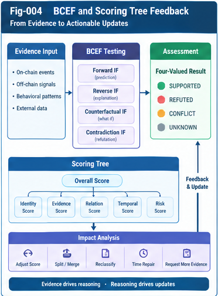

# SPEC-003 — Bidirectional IF and Evidence Impact Contract

**Project:** Adversarial Structural Security Intelligence (ASSI)  
**Version:** v0.1.0 — Research Foundation  
**Status:** Proposed normative research contract; not implemented, empirically validated, or security-certified  
**Date:** 2026-11-02  
**License:** Apache-2.0  
**Repository path:** `specs/SPEC-003-Bidirectional-IF-and-Evidence-Impact-Contract.md`  
**Depends on:** `specs/SPEC-001-Structural-Security-Unit-Contract.md`, `specs/SPEC-002-Compositional-Identity-and-UTN-Contract.md`  
**Related research:** ASSI-004, ASSI-005, ASSI-006, ASSI-007, ASSI-009, ASSI-010, ASSI-011  
**Next specification:** `SPEC-004-Authorization-and-Safety-Control-Contract.md`

## Abstract

Bidirectional Conditional Evidence Feedback (BCEF) is a proposed structural reasoning protocol that tests the conditions underlying a security hypothesis and returns an inspectable **Evidence Impact** rather than a bare numerical score. Four complementary tests—**Forward IF**, **Reverse IF**, **Counterfactual IF**, and **Contradiction IF**—help distinguish expected observations, diagnostic interpretations, discriminating alternatives, and genuinely incompatible claims. The term *bidirectional* denotes reasoning in multiple directions across an explicitly represented hypothesis–evidence relationship; it does not imply that logical implication is reversible.

This specification defines canonical BCEF test and impact records, typing and temporal constraints, four-valued assessment semantics, dependency-aware evidence accounting, hypothesis-scoped contradiction, scoring-tree revision proposals, governance gates, recursion bounds, provenance requirements, conformance invariants, and reproducible test vectors. It integrates with the Structural Security Unit (SSU) envelope of SPEC-001 and the compositional-identity portfolio of SPEC-002. BCEF may inform an adaptive decision-support system but **MUST NOT directly grant authorization, relax hard safety controls, or establish verified identity**. The mechanisms described here are proposals for implementation and controlled evaluation, not claims of measured security improvement.

**Keywords:** BCEF; conditional evidence; Forward IF; Reverse IF; Counterfactual IF; Contradiction IF; evidence impact; scoring-tree feedback; hypothesis portfolio; provenance; dependency graph; UTN; REN; structural security.

---



*Figure 4. BCEF uses scoped conditional tests to produce traceable evidence impacts on scoring and hypothesis structure, while preserving dependence and authorization boundaries.*

---

## 1. Scope and Normative Vocabulary

### 1.1 Interpretation

The capitalized terms **MUST**, **MUST NOT**, **SHOULD**, **SHOULD NOT**, and **MAY** describe proposed requirements for an implementation claiming conformance to this research contract. They do not assert endorsement by a standards body. An implementation MUST identify its conformance profile, supported features, exceptions, and test evidence.

### 1.2 In scope

1. Typed conditional tests against explicit, versioned hypotheses and alternatives.
2. Evidence references, dependency families, source quality, and temporal validity.
3. Test outcomes that distinguish support, refutation, unresolved evidence, and conflict.
4. Structured impacts on hypothesis assessments, scoring trees, graph structure, and future questions.
5. Proposal, evaluation, commit, rejection, supersession, and rollback lifecycles.
6. Controls against implication reversal, evidence reuse, circular scoring, scope leakage, and feedback amplification.
7. Interfaces to UTN identity, REN directional relevance, independent authorization, and adversarial laboratories.

### 1.3 Out of scope

BCEF does not define a universal causal-discovery engine, a calibrated Bayesian posterior, a general-purpose theorem prover, or a production policy decision point. No score is automatically a probability. A counterfactual query is not necessarily an identified causal effect. No inferred association is automatically a verified identity, and no adaptive inference constitutes an authorization credential.

### 1.4 Core separation of concerns

A compliant system MUST maintain four distinguishable layers:

| Layer | Object | Question | Authority |
|---|---|---|---|
| Observation | Evidence unit | What was recorded, by whom, and when? | Source provenance only |
| Interpretation | Feature / relation / conditional test | What might this observation mean? | Analytical, defeasible |
| Hypothesis assessment | Hypothesis portfolio and score | Which explanations remain supported or contested? | Decision support only |
| Consequential control | Independent policy and enforcement | Is this action permitted now? | Explicit policy authority |

**Normative boundary:** information can flow from inference into a separately evaluated policy input, but inferred confidence MUST NOT be silently converted into execution authority.

---

## 2. Conceptual Model and Definitions

A **Hypothesis** is a typed, falsifiable or at least discriminable claim about a subject, relation, control arrangement, event, or state within a specified context and interval. An **Alternative** is a competing explanation that could also account for relevant observations. An **Evidence Unit** is a provenance-bearing observation or derived assertion with an epistemic status and dependency lineage. A **Conditional Test** is a recorded evaluation of a precisely stated conditional question. An **Evidence Impact** is the typed, reviewable output of a test, including proposed changes and reasons. A **Scoring Tree** is a versioned assessment structure with explicit dependency semantics. A **Structural Patch** proposes a graph or tree change; it is not a self-authorizing mutation. A **Control Plane** evaluates the admissibility of consequential changes.

The conceptual loop is:

```text
Observations / UTN identity relations / REN directional candidates
                         |
                         v
            Hypothesis portfolio + alternatives
                         |
                         v
       BCEF conditional test selection and execution
       (forward / reverse / counterfactual / contradiction)
                         |
                         v
          Evidence Impact + dependency accounting
                         |
                  review and gates
                         v
     Versioned assessment update / structural proposal
                         |
                         v
         AQSI follow-up questions / validation relay

Independent authorization and hard safety enforcement remain
outside the self-modifying assessment loop.
```

An assessment MAY remain unresolved. A system MUST NOT fabricate certainty merely to fill a required output field.

---

## 3. Formal Semantics of the Four IF Modes

Let `H` denote a scoped hypothesis, `E` an observation predicate, `C` a context and set of assumptions, `A` an explicit alternative, and `I` a specified intervention. The symbols below denote questions to evaluate, not claims that all corresponding probabilities or causal quantities are identifiable.

### 3.1 Forward IF (`forward_if`)

**Question:** *If H holds under C, what observations should be expected?*

The test evaluates a prediction such as `H ∧ C ⇒ E_expected`, recording assumptions, observability, measurement tolerance, and any predicted distribution. A missing observation is evidence against H only when the expected signal was observable, detection was sufficiently reliable, and the specified observation window has closed. A forward test MUST record whether its antecedent is assumed, independently supported, or merely posited.

**Example:** If one signing service controls a set of operations, the model predicts a bounded pattern of service-level authorization logs. Absence of logs is not a contradiction if the log source was unavailable.

### 3.2 Reverse IF (`reverse_if`)

**Question:** *Given E, which hypotheses might explain it, and how does E discriminate between H and A?*

Reverse reasoning is **diagnostic**, not the logical converse of a forward implication. From `H ⇒ E` and `E`, one MUST NOT conclude `H`. A reverse test SHOULD compare at least one explicit alternative and SHOULD represent how likely the evidence would be under each, where such likelihoods can be defensibly estimated. Otherwise it MUST label the assessment qualitative or unresolved.

**Example:** Coordinated transactions are compatible with a single operator, a team, a shared automated service, or independent participants reacting to a common market event.

### 3.3 Counterfactual IF (`counterfactual_if`)

**Question:** *If a specified condition or intervention differed, what would the model predict, and which alternatives would separate?*

A counterfactual test MUST distinguish a **model-based scenario comparison** from a **causally identified counterfactual**. It MUST record the intervention, held-fixed assumptions, causal model or simulation basis, confounders known to be unaddressed, and identifiability status. A synthetic intervention MAY support experiment design without establishing causal truth in a live environment.

**Example:** In a sandbox, disable a shared routing service and compare predicted coordination under team-control and shared-service hypotheses. This is evidence about the sandbox model unless independently connected to production behavior.

### 3.4 Contradiction IF (`contradiction_if`)

**Question:** *Is a proposition incompatible with the exact hypothesis and conditions being tested?*

A contradiction requires a declared incompatibility rule, a valid scope, sufficient observation coverage, and a traceable derivation. A failure of `H_individual` MUST NOT automatically refute `H_team` or `H_shared_service`. Contradictions MUST be tagged with the specific hypothesis version, predicate, role, interval, context, and assumptions they challenge.

**Example:** Simultaneous verified physical actions in distant locations may refute a narrowly defined single-person, direct-action hypothesis, but do not by themselves refute coordinated team operation or remote delegation.

### 3.5 Comparison matrix

| Mode | Input focus | Legitimate output | Forbidden shortcut |
|---|---|---|---|
| Forward | Hypothesis → expected observation | Prediction fit / failure with observability | Treating missing telemetry as automatic refutation |
| Reverse | Observation → candidate explanations | Comparative support among alternatives | Affirming the consequent |
| Counterfactual | Intervention / altered premise | Scenario discrimination and uncertainty | Claiming causality from an unvalidated simulator |
| Contradiction | Hypothesis + incompatibility rule | Scoped refutation or conflict | Refuting a broader composition by invalidating a narrower one |

---

## 4. Canonical Objects and SSU Compatibility

All BCEF records MUST be wrapped in, or losslessly linked to, the canonical SSU envelope from SPEC-001. They MUST preserve typed identifiers, schema version, epistemic status, creation and observation times, provenance references, access classification, and audit lineage. SPEC-002 governs identity-related target references and UTN namespaces.

### 4.1 Required object types

| Type | Suggested type identifier | Primary purpose |
|---|---|---|
| Conditional test | `assi.bcef.conditional_test.v0_1` | Immutable request and execution context |
| Test result | `assi.bcef.test_result.v0_1` | Findings, uncertainty, trace and status |
| Evidence impact | `assi.bcef.evidence_impact.v0_1` | Proposed hypothesis and structural changes |
| Assessment revision | `assi.bcef.assessment_revision.v0_1` | Committed versioned change |
| Structural patch | `assi.bcef.structural_patch.v0_1` | Graph/tree edit proposal |
| Review decision | `assi.bcef.review_decision.v0_1` | Independent approval or rejection record |
| Dependency record | `assi.evidence.dependency.v0_1` | Lineage and correlation accounting |

Identifiers MUST be globally distinguishable within their namespace and MUST NOT be reused for semantically different records. A revised claim MUST obtain a new version or new immutable identity with an explicit supersedes link.

### 4.2 Conditional test required fields

A conforming conditional test MUST include:

- `test_id`, `schema_version`, `mode`, `created_at`, `requested_by`, and `purpose`;
- `target_hypothesis_id`, `target_hypothesis_version`, and `hypothesis_scope`;
- `question`, `antecedent`, `consequent`, and `assumptions` where meaningful;
- `context`, `time_window`, and `observability`;
- `evidence_refs`, `evidence_snapshot_id`, and `dependency_policy`;
- `alternative_hypothesis_refs` or an explicit explanation for omission;
- `evaluation_method`, `uncertainty_model`, and `resource_budget`;
- `authorization_class` fixed to an inference-only category;
- `status` and `provenance`.

Mode-specific required fields are defined in Section 5. The test record MUST be immutable after execution begins; corrections use a new version and preserve the original.

### 4.3 Test result required fields

The result MUST include `test_id`, `result_id`, `executed_at`, `evidence_snapshot_id`, `evaluation_trace`, `finding`, `epistemic_status`, `limitations`, and `evaluator_id`. The result MUST identify which inputs were observed, derived, assumed, simulated, or unavailable. An empty or failed test MUST NOT be encoded as a negative finding.

### 4.4 Evidence Impact required fields

The impact MUST include `impact_id`, `source_result_id`, `target_scope`, `dependency_lineage`, `impact_class`, `proposed_operations`, `expected_effect`, `risk_flags`, `review_requirements`, and `lifecycle_state`. An impact MAY recommend no change, additional observation, new alternative hypotheses, score revision, graph split/merge, or policy review. It MUST NOT carry an executable grant of privilege.

---

## 5. Mode-Specific Validation Requirements

### 5.1 Forward IF

Required: `prediction_spec`, `observation_channel`, `detection_assumptions`, `evaluation_window`, and `missingness_policy`. The test MUST discriminate `prediction_not_observed` from `observation_not_available`. A quantitative forward result MUST state calibration provenance or mark its values uncalibrated.

### 5.2 Reverse IF

Required: `candidate_explanations`, `discriminating_features`, `alternative_coverage`, and `converse_warning_acknowledged`. When no alternatives are supplied, the result MUST NOT be labeled as uniquely identifying a cause or controller. The method MUST account for selection effects and common causes where known.

### 5.3 Counterfactual IF

Required: `intervention_spec`, `baseline_world`, `modified_world`, `held_fixed_conditions`, `model_id`, `identifiability_status`, and `simulation_or_observation`. The evaluator MUST report out-of-model factors and whether the intervention is actually realizable. A model-only comparison MUST NOT be represented as an observed real-world intervention.

### 5.4 Contradiction IF

Required: `incompatibility_rule_id`, `rule_version`, `negated_claim`, `scope_binding`, `observation_completeness`, and `derivation_trace`. The system MUST verify that the rule applies to the **same proposition, role, context, and time** as the targeted hypothesis. If that binding fails, the result is `not_applicable` or `unresolved`, not `refuted`.

### 5.5 Evidence source classes

The evaluator SHOULD distinguish at least `direct_observation`, `independently_attested`, `derived_feature`, `inferred_relation`, `simulation_output`, and `analyst_assumption`. These categories describe provenance, not a universal reliability ranking. A high-confidence simulation output is not independent confirmation of a real event.

---

## 6. Four-Valued Assessment and Uncertainty

### 6.1 Evidence-state lattice

A conforming result MUST preserve at least the following assessment states:

| State | Meaning | Permitted interpretation |
|---|---|---|
| `support_only` | Supporting evidence, no qualified refutation in snapshot | Provisional support |
| `refute_only` | Qualified refutation, no qualified support in snapshot | Scoped refutation |
| `both` | Qualified support and refutation coexist | Explicit conflict; investigate |
| `neither` | Neither support nor refutation established | Unresolved / insufficient information |

The four values are **not** four probabilities and do not impose a total confidence ordering. `both` MUST NOT be collapsed to `neither`, and `neither` MUST NOT be collapsed to `refute_only`. A separate operational status MAY represent `not_applicable`, `invalid_input`, `not_executed`, or `resource_exhausted`.

### 6.2 Scores and calibration

A score, if used, MUST declare its scale, orientation, aggregation rule, and whether it is calibrated. `0.8` on an ordinal ranking is not `80% probability`. Confidence intervals and posterior probabilities MAY be used only when their estimation assumptions and calibration evidence are available. Comparisons between incompatible score scales MUST be rejected or explicitly transformed through a versioned adapter.

### 6.3 Unknown and negative evidence

The absence of a record MUST NOT automatically be treated as evidence that an event did not occur. Negative evidence requires an explicit expectation of observation, source availability, coverage estimate, and closed evaluation window. Missingness mechanisms SHOULD be modeled where relevant.

### 6.4 Scope and time

Every assessment MUST bind to a hypothesis version and interval. An observation at `t2` MUST NOT silently rewrite what was known at `t1`; the system SHOULD preserve observation time, event time, assessment time, and supersession time separately.

---

## 7. Dependency-Aware Evidence Accounting

### 7.1 Evidence dependency graph

Every derived feature MUST link to its source observations or to an explicitly identified unknown lineage. Evidence items sharing an originating event, source, feature extractor, or test output MUST be represented as potentially dependent. A duplicate transcript, repeated log ingestion, and model-generated paraphrase of the same event do not constitute three independent confirmations.

### 7.2 Dependency policy

A test MUST select one of the following policies and state why it is appropriate:

- `deduplicate_by_lineage`: repeated derivatives of a common source contribute once to the specified assessment channel;
- `dependency_aware_model`: use an explicit, validated correlation/dependence model;
- `qualitative_only`: preserve relational evidence without unsupported numerical aggregation;
- `unresolved_dependency`: block score amplification pending lineage review.

A naive independence assumption MUST NOT be the silent default.

### 7.3 Circularity controls

If `impact_A` updates `score_B`, and `score_B` influences a later test that cites `impact_A`, the second test MUST not treat the updated score as independent external evidence. The dependency graph MUST include assessment and impact nodes, not only raw observations. Circular references MAY be stored for diagnostic purposes, but a score update MUST be rejected when its claimed new evidence consists solely of its own prior conclusion.

### 7.4 Evidence snapshots

All reproducible test runs MUST bind to an immutable evidence snapshot or content-addressed manifest. Late-arriving evidence triggers a new test execution; it MUST NOT silently mutate a completed result. Evidence withdrawal or provenance invalidation MUST trigger impact re-evaluation for affected descendants.

### 7.5 REN interface

REN directional relevance MAY prioritize evidence discovery and test selection. Its direction field, perspective, and context MUST be included in the test record. Directional relevance is not automatically an evidentiary likelihood ratio, and its contribution MUST be dependency-accounted with other evidence.

---

## 8. Evidence Impact: Typed Operations and Safety

### 8.1 Impact classes

The `impact_class` field MUST use a versioned registry. Initial classes are:

| Class | Proposed effect | Default handling |
|---|---|---|
| `no_change` | Preserve current assessment | Record and close |
| `reweight` | Modify a hypothesis assessment contribution | Validate dependency and scale |
| `qualify` | Add uncertainty or narrow claim scope | Review semantic consistency |
| `challenge` | Mark hypothesis as contested | Preserve competing evidence |
| `split_hypothesis` | Replace overly broad claim with scoped alternatives | Require portfolio review |
| `merge_hypotheses` | Propose equivalence or shared controller | Require identity-specific review |
| `add_relation` | Propose typed graph edge/hyperedge | Validate UTN relation semantics |
| `retire_relation` | Supersede relation for a time interval | Preserve history |
| `request_evidence` | Open observation or validation task | AQSI/analyst queue |
| `request_countertest` | Request independent discriminating test | Separate evaluation run |
| `escalate_safety_review` | Notify independent safety process | No automatic policy mutation |

A proposed operation MUST specify its target, preconditions, expected postconditions, affected dependency set, reversibility, and reviewer class. Unknown impact classes MUST be rejected or safely ignored without applying a mutation.

### 8.2 Atomicity and version checks

A commit MUST validate `base_assessment_version` and all affected graph versions. On conflict, the system MUST reject or rebase the proposal with an explicit new evaluation; it MUST NOT silently overwrite concurrent updates. A batch containing several coupled graph operations MUST commit atomically or record partial failure without claiming success.

### 8.3 Scoring-tree feedback

A BCEF result may change the **structure** of the scoring tree as well as a numeric weight. Examples include introducing an alternative explanation branch, splitting one identity hypothesis into individual/team/shared-service branches, attaching an observability qualifier, or marking two evidence leaves as dependent. Such edits MUST preserve an auditable before/after diff and the reason for the edit.

A score-only implementation MAY claim a restricted `bcef-score-profile`, but MUST NOT claim the full structural-impact profile. Structural feedback SHOULD be evaluated against a score-only baseline in BM-002.

### 8.4 Impact versus authorization

`escalate_safety_review` means “request independent consideration,” not “execute emergency control.” A BCEF impact MUST NOT contain credentials, authority delegation, transaction signing commands, policy overrides, or hidden execution instructions. The independent safety plane defined in SPEC-004 alone governs consequential actions.

---

## 9. Canonical Machine-Readable Examples

The following YAML examples are **illustrative contract profiles**, not a published JSON Schema and not proof of interoperability. Implementations SHOULD publish machine-validated schemas and test them against the examples.

### 9.1 Conditional test request

```yaml
ssu:
  id: "utn:assi:test:bcef-00042"
  type: "assi.bcef.conditional_test.v0_1"
  schema_version: "0.1.0"
  epistemic_status: "hypothesized"
  created_at: "2026-11-02T12:00:00Z"
  provenance:
    producer_id: "utn:assi:agent:evaluator-1"
    source_refs: ["utn:assi:evidence:obs-010", "utn:assi:evidence:obs-011"]
  access_classification: "restricted-research"
test:
  test_id: "utn:assi:test:bcef-00042"
  mode: "contradiction_if"
  purpose: "Discriminate individual direct control from team control"
  target_hypothesis_id: "utn:assi:hypothesis:single-operator"
  target_hypothesis_version: 3
  hypothesis_scope:
    actor_type: "individual"
    role: "direct-physical-operator"
    activity: "onsite-device-use"
    interval: ["2026-10-30T08:00:00Z", "2026-10-30T08:10:00Z"]
  question: "Can one individual directly perform both verified onsite actions?"
  antecedent: "Both events are attributable to one direct physical operator"
  consequent: "Spatiotemporal feasibility constraint holds"
  assumptions: ["Both observations are independently verified"]
  incompatibility_rule_id: "utn:assi:rule:physical-exclusivity"
  rule_version: 2
  negated_claim: "One individual directly performed both events"
  scope_binding: "exact-role-and-interval"
  observation_completeness: "qualified"
  derivation_trace_ref: "utn:assi:trace:042"
  evidence_refs: ["utn:assi:evidence:obs-010", "utn:assi:evidence:obs-011"]
  evidence_snapshot_id: "utn:assi:snapshot:20261102-1"
  alternative_hypothesis_refs:
    - "utn:assi:hypothesis:team-operator"
    - "utn:assi:hypothesis:shared-service"
  dependency_policy: "deduplicate_by_lineage"
  evaluation_method: "rule-check-with-provenance"
  uncertainty_model: "qualitative_only"
  context: {domain: "synthetic-identity-lab"}
  time_window: ["2026-10-30T08:00:00Z", "2026-10-30T08:10:00Z"]
  observability: {source_available: true, coverage: "qualified"}
  resource_budget: {max_evidence_units: 100, max_depth: 2}
  requested_by: "utn:assi:agent:research-controller"
  authorization_class: "inference-only"
  status: "submitted"
```

### 9.2 Test result and evidence impact

```yaml
result:
  result_id: "utn:assi:result:042"
  test_id: "utn:assi:test:bcef-00042"
  executed_at: "2026-11-02T12:00:05Z"
  evaluator_id: "utn:assi:agent:independent-evaluator"
  evidence_snapshot_id: "utn:assi:snapshot:20261102-1"
  finding: "refute_only"
  epistemic_status: "derived"
  evaluation_trace: "utn:assi:trace:042"
  limitations:
    - "Applies only to direct individual action, not delegation"
    - "Synthetic observations do not validate production attribution"
impact:
  impact_id: "utn:assi:impact:042"
  source_result_id: "utn:assi:result:042"
  target_scope:
    hypothesis_id: "utn:assi:hypothesis:single-operator"
    hypothesis_version: 3
    role: "direct-physical-operator"
  dependency_lineage:
    - "utn:assi:evidence:obs-010"
    - "utn:assi:evidence:obs-011"
  impact_class: "split_hypothesis"
  proposed_operations:
    - operation: "qualify"
      target: "utn:assi:hypothesis:single-operator"
      preconditions: {base_assessment_version: 3}
      postconditions: {assessment_state: "refute_only"}
      reversible: true
    - operation: "request_countertest"
      target: "utn:assi:hypothesis:team-operator"
      preconditions: {exists: true}
      postconditions: {new_task_required: true}
      reversible: true
  expected_effect: "Narrow individual hypothesis without rejecting team hypothesis"
  risk_flags: ["identity-scope-leakage"]
  review_requirements: ["identity-portfolio-reviewer"]
  lifecycle_state: "proposed"
  authority_effect: "none"
```

### 9.3 Interpretation

The example demonstrates a scoped refutation. It does **not** establish that the team hypothesis is true. It also does not authorize changes to a live account or security policy. The impact remains proposed until a separate reviewer approves a conforming assessment update.

---

## 10. Lifecycle and State Transitions

### 10.1 Test lifecycle

```text
DRAFT -> VALIDATED -> SUBMITTED -> RUNNING -> COMPLETED
                   \            \          -> FAILED
                    -> REJECTED    -> CANCELLED
```

A test MUST NOT execute unless its required mode-specific fields and evidence references pass validation. A completed test is immutable. Re-execution with changed evidence or methods creates a new result and preserves a supersession link.

### 10.2 Impact lifecycle

```text
PROPOSED -> VALIDATED -> UNDER_REVIEW -> APPROVED -> COMMITTED
     |          |              |             |
     v          v              v             v
  REJECTED   REJECTED       REJECTED      SUPERSEDED
                                              |
                                              v
                                           ROLLED_BACK
```

`APPROVED` does not mean `COMMITTED`; a commit requires version checks and authorized assessment-write capability. Rollback MUST create a compensating versioned event rather than deleting the historical record. A policy-impact proposal MUST be routed to the independent policy workflow and MUST NOT be committed as an assessment edit.

### 10.3 Idempotency

Every mutation proposal MUST include an idempotency key and base version. Replaying the same approved impact MUST NOT apply its score delta twice. Retries MUST distinguish transport failure from successful commit with lost acknowledgment.

### 10.4 Expiration and invalidation

A test MAY have an expiration time. When evidence is withdrawn, its lineage becomes invalid, or a relevant rule changes, dependent results MUST be flagged for re-evaluation. A prior result may remain in the audit record while no longer being admissible as current evidence.

---

## 11. Recursive IF and Bounded Meta-Evaluation

### 11.1 Three levels

- **Level 1 — Evidence IF:** Does an observation support or refute the scoped hypothesis under declared conditions?
- **Level 2 — Scoring IF:** Is the aggregation rule, dependency model, or scoring-tree structure appropriate for the evidence?
- **Level 3 — Meta-IF:** Is the test-selection policy itself producing biased, circular, costly, or systematically uninformative tests?

A meta-test MUST NOT treat its own evaluation as independent evidence of success. Each level MUST declare its target object type, evaluator, and allowed impact classes. Recursive evaluation SHOULD be separated by evidence snapshots or held-out validation sets.

### 11.2 Termination and budget

The system MUST enforce finite limits on recursion depth, number of tests, wall-clock execution, compute budget, and aggregate impact attempts. When a limit is reached, it MUST emit `resource_exhausted` or a comparable unresolved status rather than inferring success. Repeated tests without new information SHOULD be deduplicated and recorded as an explicit residual.

### 11.3 Value of information

A test-selection strategy MAY prioritize expected discrimination, uncertainty reduction, cost, and operational risk. Such estimates MUST declare their assumptions and MUST NOT override mandatory independent safety gates. AQSI may propose questions, but selection and execution remain governed by resource and access policies.

---

## 12. Interfaces to the ASSI Ecosystem

### 12.1 SPEC-001: SSU envelope

BCEF units inherit canonical identity, type, provenance, lifecycle, temporal, access, and audit requirements. Domain-specific fields MUST NOT weaken those common invariants.

### 12.2 SPEC-002: UTN and compositional identity

Identity tests MUST bind to typed actor roles, relations, and valid-time intervals. They MUST preserve competing hypotheses and MUST NOT infer verified identity or authorization from behavioral evidence alone. Merge/split operations follow SPEC-002 lifecycle and review requirements.

### 12.3 REN and BM-ODWEI

REN supplies direction-sensitive candidate evidence and perspective context. BCEF tests the resulting conditional claims and returns structured impacts. The same evidence lineage MUST be preserved across discovery, scoring, and conditional evaluation to prevent double counting.

### 12.4 MDT and scoring forests

The scoring forest consumes approved impacts through a versioned adapter. It MUST record whether an update changes weights, dependencies, topology, scope, or uncertainty annotations. The original observation history and prior assessment versions remain inspectable.

### 12.5 SPEC-004: independent authorization

BCEF outputs are non-authoritative analytical artifacts. Independent authorization evaluates action, resource, principal, intent, limits, and current policy using its own protected enforcement path. A BCEF `support_only` state is never a grant token.

### 12.6 ASSI-008 and ASSI-009: adversarial drives and validated RSI

Red and Blue drives MAY generate competing hypotheses and tests within isolated environments. Independent Evaluation validates claims against held-out evidence; Governance controls promotion. A failed test or misleading impact becomes a Security Residual. Recursive self-improvement MUST NOT self-certify its own correctness.

---

## 13. Reference Validation and Evaluation Algorithms

### 13.1 Test admission

```python
# Reference pseudocode; not a production implementation.
def admit_bcef_test(test, registry, evidence_store, policy):
    require_valid_ssu_envelope(test)
    require_supported_mode(test.mode)
    require_immutable_hypothesis_version(test.target_hypothesis_id,
                                         test.target_hypothesis_version)
    require_scope_and_time_binding(test)
    require_mode_specific_fields(test)
    require_snapshot_exists(test.evidence_snapshot_id)
    require_evidence_references_resolve(test.evidence_refs,
                                        test.evidence_snapshot_id)
    require_dependency_policy(test.dependency_policy)
    require_authorization_class(test, "inference-only")
    require_budget_within_limits(test.resource_budget, policy)
    if test.mode == "reverse_if":
        require_no_affirming_consequent_shortcut(test)
    if test.mode == "counterfactual_if":
        require_identifiability_label(test)
    if test.mode == "contradiction_if":
        require_exact_scope_binding(test)
    return "VALIDATED"
```

### 13.2 Impact evaluation and commit

```python
# Evaluation and commit are separate trust domains.
def evaluate_impact(result, proposed_impact, dependency_graph, registry):
    require_result_is_completed_and_immutable(result)
    require_result_matches_impact(result, proposed_impact)
    require_lineage_closed_or_explicitly_unknown(proposed_impact)
    reject_duplicate_or_self_derived_evidence(proposed_impact, dependency_graph)
    require_hypothesis_scope_preserved(proposed_impact)
    require_no_execution_authority(proposed_impact)
    require_versioned_operations(proposed_impact)
    return independent_review_package(result, proposed_impact)

def commit_assessment_impact(approved_package, assessment_store):
    require_independent_approval(approved_package)
    require_assessment_write_capability(approved_package)
    require_versions_match(approved_package, assessment_store)
    require_idempotency_not_previously_applied(approved_package)
    return assessment_store.atomic_versioned_commit(approved_package)
```

These algorithms illustrate obligations, not sufficient security controls. A real implementation also needs authentication, authorization, schema validation, isolation, durable logs, integrity checks, concurrency handling, and independent security review.

---

## 14. Conformance Invariants

A full-profile implementation MUST satisfy all the following invariants. The identifiers are stable within this version.

| ID | Invariant | Failure prevented |
|---|---|---|
| BCEF-INV-001 | Every test has a valid SSU envelope and immutable ID/version | Ambiguous or rewritten evidence |
| BCEF-INV-002 | Each test declares one of four supported modes | Semantic ambiguity |
| BCEF-INV-003 | Every test binds to an exact hypothesis version and scope | Scope leakage |
| BCEF-INV-004 | Forward missingness is conditioned on observability | False rejection |
| BCEF-INV-005 | Reverse inference never treats `H ⇒ E` as `E ⇒ H` | Affirming consequent |
| BCEF-INV-006 | Counterfactual outputs distinguish simulation from causal identification | False causal claims |
| BCEF-INV-007 | Contradiction requires an applicable, versioned incompatibility rule | Unsupported refutation |
| BCEF-INV-008 | `support_only`, `refute_only`, `both`, and `neither` remain distinguishable | Conflict erasure |
| BCEF-INV-009 | Scores declare scale, semantics, and calibration status | False probabilistic certainty |
| BCEF-INV-010 | Every derived evidence contribution preserves lineage | Evidence laundering |
| BCEF-INV-011 | Dependent evidence cannot silently multiply independent support | Double counting |
| BCEF-INV-012 | Test outputs cannot independently validate their own inputs | Circular amplification |
| BCEF-INV-013 | Completed results bind to immutable evidence snapshots | Nonreproducible conclusions |
| BCEF-INV-014 | Impacts are typed proposals with explicit preconditions | Hidden structural mutation |
| BCEF-INV-015 | Hypothesis splits/merges preserve alternatives and history | False identity collapse |
| BCEF-INV-016 | Graph/tree commits require version checks and atomicity | Lost or partial updates |
| BCEF-INV-017 | Replayed impacts are idempotent | Repeated score inflation |
| BCEF-INV-018 | Assessment updates and policy authorization are separate | Privilege escalation |
| BCEF-INV-019 | Recursive IF has finite depth and resource limits | Unbounded evaluation |
| BCEF-INV-020 | Evidence invalidation propagates to dependent assessments | Stale certainty |
| BCEF-INV-021 | Audit history is append-only or equivalently tamper-evident | Undetectable revision |
| BCEF-INV-022 | Independent review is required for consequential structural promotion | Self-certified RSI |
| BCEF-INV-023 | Access controls prevent restricted evidence leakage through test results | Information exposure |
| BCEF-INV-024 | Unknown fields or unsupported modes cannot trigger mutations | Schema confusion |

**Conformance rule:** an implementation MUST publish machine-checkable evidence for each claimed invariant or explicitly declare the unsupported profile. Passing these checks does not by itself establish overall security.

---

## 15. Conformance Test Vectors

The following vectors are minimum examples. A conforming test harness SHOULD include valid and invalid schema fixtures, state-transition tests, and property-based variants.

| ID | Input condition | Expected result | Invariant(s) |
|---|---|---|---|
| BCEF-TV-001 | Valid forward prediction, complete independent telemetry | Accept and evaluate | 001–004 |
| BCEF-TV-002 | Expected event absent; telemetry unavailable | `neither` / unresolved, not refutation | 004, 008 |
| BCEF-TV-003 | `H ⇒ E` and E observed, no alternatives | Reject unique-H conclusion | 005 |
| BCEF-TV-004 | Reverse test compares single actor/team/shared service | Preserve alternative portfolio | 003, 005, 015 |
| BCEF-TV-005 | Simulation-only counterfactual labeled observed causal fact | Reject mislabeling | 006 |
| BCEF-TV-006 | Contradiction for individual applied to team hypothesis | Reject scope propagation | 003, 007, 015 |
| BCEF-TV-007 | Two qualified conflicting evidence branches | Return `both`, preserve conflict | 008 |
| BCEF-TV-008 | Missing evidence with no qualified support or refutation | Return `neither` | 008 |
| BCEF-TV-009 | Ordinal score presented as calibrated probability | Reject semantic mismatch | 009 |
| BCEF-TV-010 | Two derived features share one originating event | Do not count as independent confirmations | 010, 011 |
| BCEF-TV-011 | Test result cites its own previous score as new evidence | Reject circular amplification | 012 |
| BCEF-TV-012 | Evidence snapshot changed after completed result | Require new execution/version | 013 |
| BCEF-TV-013 | Structural patch without preconditions | Reject impact | 014 |
| BCEF-TV-014 | Merge two actors without retaining alternatives/history | Reject or require revision | 015 |
| BCEF-TV-015 | Concurrent update changes target base version | Reject stale commit | 016 |
| BCEF-TV-016 | Approved impact replayed after successful commit | No second application | 017 |
| BCEF-TV-017 | `support_only` result requests transaction approval | Reject execution authority | 018 |
| BCEF-TV-018 | Recursive test exceeds max depth | Stop with unresolved budget status | 019 |
| BCEF-TV-019 | Source evidence revoked | Flag descendants and schedule reassessment | 020 |
| BCEF-TV-020 | Completed result overwritten without audit version | Reject mutation | 021 |
| BCEF-TV-021 | RSI candidate self-approves structural promotion | Reject without independent review | 022 |
| BCEF-TV-022 | Restricted evidence disclosed through unredacted explanation | Deny or redact by policy | 023 |
| BCEF-TV-023 | Unknown mode `auto_grant_if` | Reject | 002, 024 |
| BCEF-TV-024 | Contradiction rule references wrong time interval | `not_applicable` / unresolved | 003, 007 |

### 15.1 Required negative testing

Negative tests MUST check not only schema rejection but also **absence of side effects**: no unauthorized assessment mutation, no policy update, no leaked secret, no duplicate impact application, and no overwritten audit record. The harness SHOULD compare system state before and after every rejected request.

### 15.2 Property-based tests

Recommended properties include invariance under evidence-record permutation, invariance under exact duplicate ingestion, preservation of alternative hypotheses after narrow refutation, monotonic audit-history growth, deterministic replay from a fixed snapshot, and no policy-authority changes under arbitrary inference-only inputs.

---

## 16. Worked Synthetic Case A — Hypothesis-Scoped Identity Refutation

### 16.1 Setup

A synthetic ledger contains two nearly simultaneous operational events with independently verified direct physical actions in locations that cannot be traversed within the observed interval. The hypothesis portfolio is:

- `H1`: one individual directly performed both physical actions;
- `H2`: a coordinated team performed them;
- `H3`: a shared service coordinated otherwise independent operators;
- `H4`: unrelated actors reacted to a common external trigger.

REN may mark temporal coordination as relevant to H1–H3. A reverse test that jumps from coordination to H1 is invalid because the observation is not unique to H1.

### 16.2 BCEF sequence

1. **Forward IF:** Under H1, predict compatible direct-action timing; record sensor reliability and interval.
2. **Reverse IF:** Compare coordination under H1, H2, H3, and H4 without claiming uniqueness.
3. **Contradiction IF:** Apply physical-exclusivity rule only to H1's direct-action role; if premises hold, mark H1 `refute_only`.
4. **Counterfactual IF:** In a synthetic simulator, remove the shared coordination service and compare H2/H3 predictions; mark model dependence.
5. **Impact:** Qualify or retire the narrow H1 claim, preserve H2–H4, and request a discriminating observation.

### 16.3 Success and failure

Success means rejecting a false single-person attribution without falsely rejecting team/shared-service alternatives, preserving provenance, and issuing no unauthorized identity binding. Failure includes an unsupported merge, overbroad contradiction, or unjustified confidence increase in H2 after H1 is refuted. The latter is a crucial distinction: eliminating one alternative does not automatically validate another when the candidate set is incomplete.

---

## 17. Worked Synthetic Case B — Compromised Signing Service

### 17.1 Setup

A simulated signing service emits cryptographically valid requests that differ from an independently recorded transaction-intent policy. The attacker controls a test service key, not the independent enforcement plane. All assets and requests are synthetic.

### 17.2 Conditional tests

- **Forward IF:** If the service is acting under authorized intent, expected recipient and exposure constraints should match the independent policy record.
- **Reverse IF:** A valid signature could arise from legitimate automation, credential compromise, or authorized but anomalous operation; the signature alone does not distinguish these explanations.
- **Counterfactual IF:** In an isolated simulator, compare outcomes with and without independent transaction-exposure enforcement; do not extrapolate the model to production without validation.
- **Contradiction IF:** A signed request incompatible with a verified policy constraint refutes the narrow claim “this request satisfies the specified authorization policy,” not the broader claim “the key signature is cryptographically valid.”

### 17.3 Impact and enforcement

BCEF proposes `escalate_safety_review`, a hypothesis challenge, and a new investigation task. The **independent safety plane**, not BCEF, decides whether the request is blocked according to its pre-existing policy. A high BCEF score cannot relax a transaction cap. Conversely, even a failed BCEF inference must not disable the independent cap.

### 17.4 Metrics

Measure unauthorized exposure, false blocks, detection delay, evidence traceability, assessment consistency, and independent-control bypass attempts. A proposed improvement is not validated until tested on held-out scenarios and compared with non-BCEF baselines.

---

## 18. Threat Model and Defensive Controls

| Threat | Attack surface | Required mitigation |
|---|---|---|
| Evidence poisoning | Observations and imported features | Provenance, source attestation, cross-checks |
| Evidence laundering | Derived features and model summaries | Lineage closure and dependency graph |
| Affirming the consequent | Reverse IF | Alternatives and converse prohibition |
| Scope laundering | Identity contradictions | Exact role/time/hypothesis binding |
| Simulation overclaim | Counterfactual IF | Identifiability and simulation labels |
| Recursive self-confirmation | Meta-IF and score feedback | Snapshot separation and independent validation |
| Score inflation | Repeated impact application | Idempotency, deduplication, version checks |
| Structural hijacking | Graph split/merge proposals | Typed patches and independent review |
| Privilege escalation | Inference-to-policy boundary | Non-bypassable independent authorization |
| Explanation leakage | Test traces and evidence links | Access control, redaction, minimal disclosure |
| Resource exhaustion | Autonomous test generation | Bounded recursion, quotas, cancellation |
| Stale or revoked sources | Historical evidence | Invalidation propagation and reassessment |

The threat model MUST include malicious or compromised internal evaluators, not only external attackers. Auditability is necessary but insufficient: evidence stores, signing authorities, reviewers, and enforcement paths require independent protection.

---

## 19. Validation Program and Falsifiable Hypotheses

### 19.1 Benchmark BM-002

Use a synthetic, reproducible evidence-and-hypothesis laboratory with known ground truth and controlled ambiguity. Include correlated observations, missing telemetry, overlapping identity compositions, alternative explanations, and time-varying evidence. Record dataset generation seeds, snapshot manifests, evaluator versions, and test costs. Separate development and held-out test sets by scenario families, not merely by random row splits.

### 19.2 Baselines and ablations

| Label | Method | Question answered |
|---|---|---|
| B0 | Static rule-only inference | What do explicit rules achieve? |
| B1 | Metric similarity only | Does conditional testing add discrimination? |
| B2 | Metric + REN directional relevance | Does BCEF add value beyond directional ranking? |
| B3 | One-way Forward IF | Do reverse and counterfactual tests add value? |
| B4 | Four IF modes, score-only impact | Does structural impact add value? |
| B5 | Full BCEF, no dependency control | How much does lineage accounting matter? |
| B6 | Full BCEF with dependency control | Proposed integrated approach |
| B7 | Full BCEF without independent reviewer | Does review prevent harmful promotion? |

The benchmark SHOULD report cost-adjusted performance and not simply reward a system for issuing more tests.

### 19.3 Falsifiable hypotheses

**H-BCEF-01 — Scoped contradiction.** Compared with a naive contradiction propagator, hypothesis-scoped BCEF reduces false rejection of valid team/shared-service hypotheses. **Falsification:** no reduction on held-out compositional cases or unacceptable missed genuine contradictions.

**H-BCEF-02 — Reverse discrimination.** Explicit alternatives reduce false unique-attribution claims relative to converse-style inference. **Falsification:** equal or higher false attribution at matched coverage and cost.

**H-BCEF-03 — Missingness handling.** Observability-aware Forward IF reduces false negative conclusions from absent telemetry. **Falsification:** no improvement in missing-data strata or major loss of useful detection.

**H-BCEF-04 — Dependency accounting.** Provenance-aware deduplication reduces overconfident assessment updates under correlated evidence. **Falsification:** no calibration or error benefit, or worse performance at comparable recall.

**H-BCEF-05 — Structural impact.** Versioned graph/tree patches improve hypothesis-portfolio consistency over score-only updates. **Falsification:** no held-out consistency gain or greater false merges/splits.

**H-BCEF-06 — Counterfactual utility.** Model-labeled counterfactual tests improve selection of discriminating follow-up observations. **Falsification:** no value-of-information improvement against cost-matched controls.

**H-BCEF-07 — Independent review.** Review gates reduce harmful structural promotions without disproportionate delay. **Falsification:** no risk reduction or unacceptable review latency and operational cost.

**H-BCEF-08 — Recursive boundedness.** Finite-depth meta-IF improves detection of flawed scoring rules without uncontrolled compute growth. **Falsification:** negligible detection gain or resource budget violations.

**H-BCEF-09 — Non-authority boundary.** Inference-only outputs cannot induce unauthorized actions even under adversarial inputs. **Falsification:** any reproducible inference-to-authorization bypass; this is a safety gate, not a tradeable average score.

### 19.4 Metrics

Minimum metrics SHOULD include false rejection rate, false attribution/merge/split rate, hypothesis coverage, conflict preservation, calibration error where probabilistic outputs exist, evidence dependency violations, test discriminative utility, structural patch precision, reviewer override rate, audit replay fidelity, runtime cost, and unauthorized execution count. Report confidence intervals where justified and publish failure cases, not only aggregate successes.

### 19.5 Independent validation

A benchmark MUST not treat its simulator as an oracle for real-world security. Independent evaluators SHOULD audit test labels, hidden assumptions, causal claims, and policy-boundary behavior. Production deployment requires additional domain-specific threat analysis and authorization testing beyond BM-002.

---

## 20. Conformance Profiles and Interoperability

### 20.1 Profiles

- **`bcef-core-v0.1`**: all four IF modes, explicit scope, provenance, four-valued findings, immutable results, and no execution authority.
- **`bcef-impact-v0.1`**: core plus typed impacts, versioned scoring-tree/graph proposals, review and rollback.
- **`bcef-recursive-v0.1`**: impact plus bounded scoring IF and meta-IF, dependency-aware recursion, and independent validation records.
- **`bcef-full-assi-v0.1`**: recursive plus SPEC-001/002 compatibility, SPEC-004 authorization separation, and full conformance-vector evidence.

A restricted profile MUST identify omitted features. A product MUST NOT claim `bcef-full-assi-v0.1` solely because it emits the four mode names.

### 20.2 Interoperability rules

Implementations SHOULD publish a schema registry, canonical identifier format, stable enumerations, time representation, cryptographic integrity strategy, redaction behavior, and error taxonomy. Unknown required fields MUST cause validation failure; unknown optional extension fields MAY be preserved but MUST NOT change normative semantics. Backward-incompatible changes require a new schema version and migration plan.

### 20.3 Privacy and retention

Evidence may contain sensitive operational, identity, or transaction information. A conforming system MUST enforce least-privilege access to raw evidence, derived explanations, and graph links. It SHOULD support retention schedules, minimization, and privacy-preserving test fixtures while retaining sufficient non-sensitive audit metadata for reproducibility.

---

## 21. Implementation Roadmap

**Phase 0 — Contract-first:** freeze type names, field requirements, mode semantics, and test-vector fixtures; publish machine-readable schemas.

**Phase 1 — Deterministic evaluator:** implement four IF modes against synthetic, fully labeled observations, with no scoring-tree writes.

**Phase 2 — Provenance and dependence:** add immutable snapshots, evidence lineage, duplicate detection, and invalidation propagation.

**Phase 3 — Structural impact sandbox:** enable versioned assessment proposals, patch validation, independent review, and rollback in a non-production graph.

**Phase 4 — Adversarial benchmark:** run BM-002 with held-out identity, authorization, and evidence-poisoning cases; publish negative results.

**Phase 5 — Governed integration:** connect to the independent safety control plane via read-only decision-support interfaces; verify that no inference-only output can modify protected policy.

**Phase 6 — Replication and transfer:** independently reproduce results and test semantic portability in a second domain before making generalization claims.

A phase MUST NOT be declared complete merely because its documentation exists; completion requires reproducible conformance and evaluation artifacts.

---

## 22. Open Questions

1. What is the smallest useful set of formal conditional semantics that remains interoperable across heterogeneous SI engines?
2. Can a four-valued evidence lattice coexist with calibrated probabilities without conflating conflict and uncertainty?
3. How should dependence be represented when feature extractors and model summaries share partially hidden training or observation lineage?
4. Under what assumptions can counterfactual simulations yield actionable discrimination without unjustified causal attribution?
5. How should graph-edit impact be scored when a split improves calibration but increases model complexity?
6. What constitutes independent evaluation when Red, Blue, and Evaluation agents share a foundation model or data pipeline?
7. How can evidence withdrawal propagate efficiently through large, cyclic hypothesis graphs?
8. What is the correct termination criterion for recursive IF when additional testing has diminishing expected value?
9. Which components of BCEF transfer to cloud IAM, AI agents, enterprise approval, and software supply chains without semantic distortion?
10. How can explanation access be minimized without sacrificing accountability and reproducibility?

These questions remain research tasks; the specification does not assert that they have been resolved.

---

## 23. Conclusion

BCEF is proposed as an **evidence-to-impact contract**, not a machine for manufacturing certainty. Forward IF checks expectations, Reverse IF compares explanations without reversing implication, Counterfactual IF explores discriminating changes with explicit model limitations, and Contradiction IF refutes only the precisely scoped proposition whose incompatibility is established. Their output is a provenance-bearing, dependency-aware, versioned Evidence Impact that may propose scoring and structural revisions but cannot grant authority.

The central design rule is:

> **Test the conditions behind the score; preserve the scope of every contradiction; let evidence revise structure, but never let inference silently become authority.**

Implementations should be judged by falsifiable experiments, conformance tests, independent review, and failure containment—not by architectural elegance alone. SPEC-004 addresses the separate contract for authorization and independent safety control.

---

## Appendix A — Proposed Error Taxonomy

| Code | Meaning | Safe handling |
|---|---|---|
| `BCEF_E_SCHEMA` | Missing or malformed contract field | Reject before execution |
| `BCEF_E_MODE` | Unsupported IF mode | Reject |
| `BCEF_E_SCOPE` | Invalid hypothesis/role/time binding | Reject or unresolved |
| `BCEF_E_SNAPSHOT` | Missing or mutable evidence snapshot | Reject |
| `BCEF_E_DEPENDENCY` | Unresolved lineage or circular contribution | Block score amplification |
| `BCEF_E_OBSERVABILITY` | Missingness cannot be interpreted | Unresolved |
| `BCEF_E_IDENTIFIABILITY` | Counterfactual causal claim not justified | Relabel model-only or reject |
| `BCEF_E_RULE` | Contradiction rule not applicable | `not_applicable` |
| `BCEF_E_VERSION` | Stale assessment base version | Reject commit |
| `BCEF_E_AUTHORITY` | Attempted inference-to-authorization transition | Reject and alert |
| `BCEF_E_BUDGET` | Test or recursion budget exceeded | Stop unresolved |
| `BCEF_E_ACCESS` | Evidence disclosure exceeds permission | Deny or redact |

Errors MUST be recorded without leaking restricted source content to unauthorized callers.

## Appendix B — Suggested Audit Record

```yaml
audit_event:
  id: "utn:assi:audit:bcef-commit-042"
  event_type: "assessment-impact-commit"
  event_time: "2026-11-02T12:10:00Z"
  actor_id: "utn:assi:reviewer:identity-review-1"
  test_id: "utn:assi:test:bcef-00042"
  result_id: "utn:assi:result:042"
  impact_id: "utn:assi:impact:042"
  evidence_snapshot_id: "utn:assi:snapshot:20261102-1"
  target_id: "utn:assi:hypothesis:single-operator"
  before_version: 3
  after_version: 4
  review_decision: "approved"
  authorization_scope: "assessment-write-only"
  idempotency_key: "bcef-impact-042-v3"
  structural_diff_ref: "utn:assi:diff:042"
  integrity_manifest_ref: "utn:assi:manifest:042"
  policy_mutation: false
```

The audit record is illustrative. A production system MUST authenticate actors and protect audit integrity using an independently specified security mechanism.

## Appendix C — Research and Specification Crosswalk

| Source | Contribution to SPEC-003 |
|---|---|
| ASSI-004 / SPEC-002 | Compositional identity, scoped contradiction, temporal UTN relations |
| ASSI-005 | REN directional relevance and weak-evidence provenance |
| ASSI-006 | Four IF modes, recursive IF, structured Evidence Impact |
| ASSI-007 / SPEC-004 | Independent authorization and non-bypassable controls |
| ASSI-008 | Red/Blue/Evaluation/Governance drives and competitive relay |
| ASSI-009 | Security Residual and validated recursive improvement |
| ASSI-010 / SPEC-001 | SSU envelopes, architecture, shared typed interfaces |
| ASSI-011 | BM-002 falsifiable benchmark laboratory |

## Appendix D — Change Notes

- **v0.1.0 (2026-11-02):** Initial proposed contract for four IF modes, scoped contradiction, four-valued assessment, dependency-aware impact feedback, versioned graph edits, bounded recursive IF, authorization separation, 24 conformance invariants, and 24 test vectors.

**Repository placement:** `specs/SPEC-003-Bidirectional-IF-and-Evidence-Impact-Contract.md`  
**Previous specification:** `specs/SPEC-002-Compositional-Identity-and-UTN-Contract.md`  
**Next specification:** `specs/SPEC-004-Authorization-and-Safety-Control-Contract.md`
