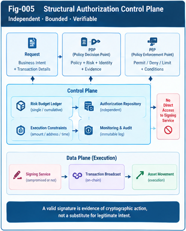

# SPEC-004 — Authorization and Safety Control Contract

**Project:** Adversarial Structural Security Intelligence (ASSI)  
**Version:** v0.1.0 — Research Foundation  
**Status:** Proposed normative research contract; not implemented, independently validated, or security-certified  
**Date:** 2026-11-02  
**License:** Apache-2.0  
**Repository path:** `specs/SPEC-004-Authorization-and-Safety-Control-Contract.md`  
**Depends on:** `SPEC-001-Structural-Security-Unit-Contract.md`; `SPEC-002-Compositional-Identity-and-UTN-Contract.md`; `SPEC-003-Bidirectional-IF-and-Evidence-Impact-Contract.md`  
**Related research:** ASSI-001, ASSI-003, ASSI-004, ASSI-006, ASSI-007, ASSI-008, ASSI-009, ASSI-010, ASSI-011, ASSI-012  
**Next specification:** `SPEC-005-Adversarial-Drive-and-Relay-Contract.md`

## Abstract

A cryptographically valid signature is evidence that a particular signing operation occurred under a particular key; it is not, by itself, proof of legitimate organizational intent, acceptable exposure, correct beneficiary, or compliance with independent safety constraints. **SPEC-004** defines a proposed authorization and safety-control contract for Adversarial Structural Security Intelligence (ASSI). It separates an adaptive **Intelligence and Recommendation Plane** from an independently governed **Safety Enforcement Plane**, and specifies how transaction requests, verified principals, structural identities, policy versions, exposure budgets, approval proofs, execution attestations, recovery controls, and audit evidence interact.

The specification introduces an authorization decision protocol with explicit *deny*, *allow*, *hold*, and *escalate* outcomes; default-deny semantics; immutable decision contexts; independently verifiable approval evidence; time- and scope-bound execution capabilities; exposure accounting; non-bypassable emergency controls; and rollback/recovery requirements. UTN and compositional identity provide typed subject representations; REN and BCEF provide advisory evidence and hypothesis testing. **No inference, score, simulation, or recursively generated proposal can independently grant authority or relax protected controls.** The contract is intentionally testable, includes negative conformance vectors, and distinguishes proposed requirements from empirically established security guarantees.

**Keywords:** structural authorization; independent safety control; bounded loss; policy enforcement; cryptographic signing; compositional identity; capability security; least privilege; separation of duties; governance; evidence provenance; adversarial resilience.

---

## 1. Purpose, Scope, and Normative Language

### 1.1 Purpose

This document defines a reference contract for deciding whether a consequential action may proceed. The immediate motivating domain is cryptocurrency custody, treasury transfer, exchange liquidity, and smart-contract administration. The same contract shape may be adapted to cloud privileges, enterprise approvals, AI-agent tool calls, and software-release authority, provided that domain-specific semantics are independently defined and validated.

### 1.2 In scope

- Typed requests, principals, roles, delegated capabilities, beneficiaries, assets, and execution contexts.
- Independent policy evaluation and enforcement, including hard safety boundaries.
- Human and machine approvals, separation of duties, quorum, and freshness.
- Exposure budgets across direct transfers, approvals, contract privileges, and contingent liabilities.
- Evidence-to-decision interfaces and prohibition of inference-based privilege escalation.
- Signing-service compromise, policy tampering, replay, stale decisions, and failure containment.
- Emergency holds, recovery, controlled policy change, and tamper-evident audit records.
- Conformance profiles, negative tests, independent evaluation, and falsifiable research claims.

### 1.3 Out of scope

This document does not define a production-ready key-management system, formally prove a protocol secure, specify a particular blockchain consensus protocol, replace legal compliance, or guarantee that any single control will stop all loss. It does not authorize real-world offensive activity. Test cases assume owned assets, explicit permission, and isolated synthetic environments.

### 1.4 Normative vocabulary

**MUST**, **MUST NOT**, **SHOULD**, **SHOULD NOT**, and **MAY** indicate proposed requirements for an implementation claiming conformance to this research contract. A claim of conformance requires implementation evidence and a declared profile; the present document itself is not a certification.

---

## 2. Fundamental Security Distinctions

### 2.1 Six non-equivalent questions

For an action `a`, the following predicates are distinct:

1. **Cryptographic validity:** Is the signature or proof well-formed and valid for the stated message and key?
2. **Principal legitimacy:** Is the authenticated principal recognized for the relevant scope and time?
3. **Delegated authority:** Does that principal possess the required capability under the active policy?
4. **Intent integrity:** Does the requested action match independently authenticated business intent?
5. **Exposure acceptability:** Is the action, including its indirect effects, inside approved risk limits?
6. **Execution integrity:** Is the executed effect identical to the approved, bound action?

A valid result for predicate 1 MUST NOT be treated as establishing predicates 2–6. Likewise, high confidence in an inferred structural identity MUST NOT establish principal legitimacy or delegated authority.

### 2.2 Authorization as an intersection of constraints

A conceptual admissibility condition is:

$$
\mathrm{Permit}(a,c) = V_{\mathrm{principal}} \land V_{\mathrm{capability}} \land V_{\mathrm{intent}} \land V_{\mathrm{policy}} \land V_{\mathrm{exposure}} \land V_{\mathrm{approvals}} \land V_{\mathrm{execution\ binding}}.
$$

Each term is evaluated under a versioned decision context `c`. The expression is a design abstraction, not a claim that all real-world risk can be reduced to Boolean predicates. If any mandatory term is false, the outcome is **DENY**. If mandatory information is missing or a trusted dependency is unavailable, the outcome is **HOLD** or **DENY**, never implicit approval.

### 2.3 Authority does not flow through inference

`Observed -> Derived -> Hypothesized -> Supported` is an epistemic progression, not an authority progression. An authorization principal MUST be established through an independent, domain-authorized identity and entitlement process. A UTN node representing a suspected team, coalition, or signing-service operator is not automatically an authenticated principal.

---

## 3. Plane Separation and Trust Boundaries

### 3.1 Reference architecture

```text
   Observations / UTN / REN / BCEF / Security Residuals
                           |
                           v
             Adaptive Intelligence Plane
        hypotheses | risk signals | recommendations
                           |
                  advisory-only boundary
                           v
                  Request Gateway
                           |
                           v
      Independent Policy Decision Point (PDP)
       verified principal | intent | policy | exposure
                           |
                signed, bounded decision
                           v
      Independent Policy Enforcement Point (PEP)
         action binding | freshness | replay guard
                           |
                    Signing / Execution
                           |
                 Reconciliation / Audit

  Separate governance: policy custody, emergency hold,
  approval authorities, recovery, and independent evaluation.
```

---



*Figure 5. Structural authorization requires independently enforced policy, transaction binding, and bounded exposure; cryptographic validity alone is insufficient.*

---

### 3.2 Separation requirements

**AUTH-PLANE-001.** The adaptive intelligence plane MUST NOT have direct write access to protected policy, entitlement, approval, exposure-budget, or enforcement state.

**AUTH-PLANE-002.** A PDP MUST authenticate its inputs and resolve the active policy from a protected, versioned source rather than from an untrusted recommendation.

**AUTH-PLANE-003.** A PEP MUST independently verify the authenticity, scope, expiry, and one-time-use status of any authorization decision before execution.

**AUTH-PLANE-004.** The signing or execution service MUST be unable to broaden the action authorized by the PEP. Where technical architecture cannot enforce this, the implementation MUST disclose the residual trust assumption and MUST NOT claim the stronger profile.

**AUTH-PLANE-005.** Governance authorities for relaxing hard limits MUST be independent of the adaptive agent that proposed the change.

### 3.3 Independence is an operational property

Separate software modules on the same fully compromised administrative domain do not necessarily constitute independent control. An implementation MUST document the trust roots, administrative boundaries, key custody, policy update paths, and shared failure modes. Stronger profiles SHOULD use separate security domains, isolated credentials, and independently controlled recovery paths.

---

## 4. Canonical Authorization Objects

Every object defined below SHOULD use the SSU envelope from SPEC-001: `unit_id`, `unit_type`, `schema_version`, `created_at`, `valid_time`, `provenance`, `authority_scope`, `lifecycle_state`, and `audit_refs`. Exact serialization MAY vary by profile, but semantic meaning MUST be preserved.

### 4.1 Authorization Request Unit (ARU)

Required fields:

| Field | Meaning |
|---|---|
| `request_id` | Globally unique, immutable request identifier |
| `principal_ref` | Independently authenticated principal, not merely inferred UTN identity |
| `action_type` | Typed operation, e.g. transfer, contract approval, role change |
| `resource_refs` | Assets, accounts, contracts, services, or privileges affected |
| `destination_ref` | Canonical recipient or target, when applicable |
| `action_parameters` | Exact amount, network, contract method, limits, and relevant arguments |
| `intent_proof_refs` | Authenticated business-intent evidence |
| `requested_at` / `expires_at` | Bounded validity window |
| `nonce` | Replay-resistant challenge bound to the request |
| `context_hash` | Digest of all security-relevant request fields |
| `evidence_refs` | Optional advisory risk evidence; no implicit authority |

Security-relevant fields MUST NOT be silently normalized or altered between approval and execution. Canonicalization MUST be unambiguous, deterministic, and versioned.

### 4.2 Verified Principal and Entitlement Unit (VPEU)

A VPEU binds a principal to an independently established authentication method, entitlement source, role or capability, scope, delegation chain, validity interval, and revocation status. It MUST distinguish `authenticated_principal_ref` from `inferred_identity_ref`. A compositional UTN team hypothesis MAY be linked for analysis but MUST NOT substitute for entitlement proof.

### 4.3 Policy Rule and Policy Bundle Unit (PRU/PBU)

A PBU contains signed policy version, activation epoch, policy owner, rule identifiers, precedence, protected invariants, emergency restrictions, and change-control evidence. Rule precedence MUST be deterministic. Explicit deny and hard-boundary rules MUST take precedence over advisory allow recommendations.

### 4.4 Exposure Budget Unit (EBU)

An EBU defines resource scope, valuation method, budget period, allowed exposure, currently reserved exposure, realized exposure, contingent exposure, data freshness, and budget authority. Exposure accounting MUST be concurrency-safe. An implementation MUST document treatment of unknown valuation and unbounded delegated permissions.

### 4.5 Approval Attestation Unit (AAU)

An AAU binds an authenticated approver, role, exact request digest, policy version, approval intent, validity interval, and revocation status. Approval identities MUST be distinct where separation-of-duties policy requires it; multiple credentials controlled by one principal MUST NOT be counted as independent approvers.

### 4.6 Authorization Decision Unit (ADU)

An ADU records `decision_id`, request digest, policy digest, evaluation epoch, evaluated predicates, decision outcome, reasons, exposure reservation, approval references, expiry, enforcement audience, and integrity proof. It MUST be bound to a single immutable request context or an explicitly defined narrow batch.

### 4.7 Execution Attestation Unit (EAU)

An EAU binds the approved decision to the exact signed or executed action, execution environment, final status, external transaction identifier if any, observed effects, reconciliation state, and audit references. Execution failure, partial execution, and uncertain finality MUST be represented distinctly.

### 4.8 Emergency Control and Recovery Unit (ECRU)

An ECRU describes the hold or recovery trigger, authorized initiator, affected scope, activation time, revocation epoch, restoration prerequisites, independent approvals, and immutable evidence trail.

---

## 5. Decision Outcomes and State Machine

### 5.1 Four explicit outcomes

| Outcome | Semantics | Execution permitted? |
|---|---|---|
| `DENY` | A mandatory constraint fails or action is prohibited | No |
| `HOLD` | Missing, stale, conflicting, or unavailable mandatory information | No |
| `ESCALATE` | Additional authorized review or approvals required | No |
| `ALLOW` | All mandatory checks satisfied under a bounded decision | Only after PEP verification |

`ESCALATE` is not an authorization and MUST NOT be interpreted as an eventual allow. A risk signal may cause a HOLD or ESCALATE only if a preapproved policy defines that effect; an AI recommendation cannot rewrite policy precedence.

### 5.2 Lifecycle

```text
CREATED -> CANONICALIZED -> AUTHENTICATED -> POLICY_EVALUATED
                                              |
                       +----------------------+-------------------+
                       |                      |                   |
                     DENIED                 HELD             ESCALATED
                                              |                   |
                                      REEVALUATED <---- APPROVALS_COLLECTED
                                              |
                                          ALLOWED
                                              |
                                        RESERVED
                                              |
                                      PEP_VERIFIED
                                              |
                                        EXECUTED
                                              |
                                       RECONCILED
```

Any terminal outcome MAY be superseded by a new decision with a new identifier and new evaluation epoch; the original record MUST remain auditable. A previously issued ALLOW MUST be invalidated if the policy, entitlement, emergency-hold epoch, request binding, or relevant approval state changes in a way that affects authorization.

### 5.3 Fail-closed requirements

Unknown principal, ambiguous target, malformed signature, expired approval, unavailable budget service, inconsistent policy digest, missing audit requirement, or unreachable enforcement dependency MUST NOT produce an ALLOW. Fail-closed behavior may reduce availability; that tradeoff MUST be measured rather than concealed.

---

## 6. Identity, Intent, and Delegated Authority

### 6.1 Identity classes

The authorization pipeline MUST distinguish:

- **Observed address or credential:** an on-chain address, API token, key identifier, or signing artifact.
- **Inferred structural actor:** a UTN hypothesis such as one operator, team, coalition, or shared service.
- **Verified principal:** a separately authenticated and governed person or service identity.
- **Authorized role:** a versioned entitlement scoped to resource, action, amount, and time.
- **Approving authority:** a principal empowered to approve a particular request under separation-of-duties rules.

### 6.2 Delegation constraints

Delegation MUST be explicit, scoped, time-bound, and revocable. The effective capability is no broader than the intersection of delegator authority, delegated scope, and active policy. Delegation chains MUST be checked for cycles, expiration, revocation, and confused-deputy behavior.

### 6.3 Business intent

For high-consequence actions, an authenticated intent artifact SHOULD bind beneficiary, asset, amount or maximum amount, purpose, request digest, and approval epoch. An implementation MUST specify whether intent comes from an authenticated business workflow, a preauthorized schedule, or a separate accountable principal. An LLM-generated explanation MUST NOT be treated as authenticated intent proof.

### 6.4 Compositional identity boundary

SPEC-002 may maintain competing hypotheses that several addresses are operated by one person, a team, or a shared service. Those hypotheses MAY raise risk or request review. They MUST NOT automatically merge entitlements, approvals, or ownership. A contradiction of a one-person hypothesis MUST NOT invalidate a separately verified team entitlement, and a supported team hypothesis MUST NOT create one.

---

## 7. Structural Exposure and Bounded-Loss Accounting

### 7.1 Exposure is not transfer amount alone

An action's exposure may include:

$$
E_{\mathrm{total}} = E_{\mathrm{direct}} + E_{\mathrm{delegated}} + E_{\mathrm{contingent}} + E_{\mathrm{cascade}} - E_{\mathrm{verified\ offsets}}.
$$

This is a conceptual decomposition. Components may overlap, and an implementation MUST avoid double counting and unjustified netting. A conservative upper-bound approach SHOULD be used when dependent exposures cannot be estimated reliably.

Examples of indirect exposure include unlimited token allowances, contract upgrade authority, custody role grants, withdrawal destination changes, and revocable or irreversible administrative capabilities.

### 7.2 Budget scopes

A deployment SHOULD define budgets by asset, account, principal, destination class, transaction class, time window, and aggregate organization exposure. Correlated actions across multiple accounts MUST be considered where feasible. Limits MUST distinguish instantaneous, cumulative, and contingent exposure.

### 7.3 Reservation and concurrency

Budget reservations MUST be atomic relative to competing requests. A PDP/PEP combination MUST NOT approve two simultaneous actions that each fit a remaining budget but jointly exceed it. Reservations MUST have unique identifiers, expiries, idempotent release rules, and reconciliation against final execution outcomes.

### 7.4 Unknown and stale values

A stale price feed, unbounded allowance, unknown downstream effect, or uncertain settlement state MUST be represented explicitly. The system MUST NOT substitute zero exposure for unknown exposure. Policies MAY deny, hold, or require independent escalation for unknown exposure.

### 7.5 Bounded loss, not zero loss

A bounded-loss claim MUST specify threat assumptions, maximum permitted exposure, enforcement assumptions, time horizon, and excluded failure modes. An aggregate limit alone cannot guarantee a maximum realized loss if the underlying execution system or policy enforcement root is compromised. Research evaluations MUST report these limitations.

---

## 8. Independent Safety Controls

### 8.1 Mandatory control classes

A deployment SHOULD select an appropriate combination of:

1. Per-action and aggregate exposure limits.
2. Destination allowlists or high-risk destination restrictions.
3. Time delays for sensitive actions.
4. Distinct approver quorum and separation of duties.
5. Transaction simulation or semantic checks where meaningful.
6. Protected policy and signing-key custody.
7. Emergency hold and revocation mechanisms.
8. Rate limits, session constraints, and anomaly-triggered review.
9. Post-execution reconciliation and incident recovery.

Controls MUST be evaluated against realistic failure assumptions; their presence on a diagram is not proof of independence or effectiveness.

### 8.2 Non-bypassability

Hard safety controls MUST be enforced by components whose authority cannot be overridden by an adaptive model, risk scorer, experimental drive, or self-improvement process. If a control can be disabled by the same credential used to execute the protected action, the implementation MUST disclose this shared failure mode.

### 8.3 Safety policy monotonicity during emergencies

When an emergency hold is active, an adaptive component MAY propose a narrower restriction but MUST NOT independently relax the hold. Restoration requires a separately authorized recovery process with explicit evidence and review. The system MUST reject stale pre-hold authorization decisions.

---

## 9. REN, BCEF, and Advisory Risk Interfaces

### 9.1 Permitted uses

REN directional evidence and BCEF conditional tests MAY produce advisory signals such as unusual beneficiary relationship, possible shared-service control, conflicting identity evidence, changed behavior, or unresolved security residual. Signals MUST retain provenance, dependency metadata, hypothesis scope, uncertainty, and timestamps.

### 9.2 Prohibited authority transfers

- A high risk score MUST NOT automatically revoke an independently verified principal's identity record without a governed process.
- A low risk score MUST NOT waive required approvals, exposure limits, or policy checks.
- A BCEF `SUPPORTED` result MUST NOT be interpreted as a signed authorization.
- A BCEF `REFUTED` result MUST NOT erase audit history or grant an alternative hypothesis authority.
- Evidence Impact proposals MUST NOT directly mutate protected enforcement policy.

### 9.3 Policy-controlled advisory gates

A preapproved policy MAY specify that certain risk classes require HOLD or ESCALATE. The mapping from risk evidence to enforcement effect MUST be versioned, testable, and governed. Evidence confidence, dependency, and calibration MUST be considered; policy MUST define safe behavior when the signal is unavailable or contested.

### 9.4 Avoiding circular validation

An authorization outcome MUST NOT be recycled as independent evidence that the original hypothesis was true. If execution results later inform REN or BCEF, their provenance MUST record the dependence on the prior decision and action.

---

## 10. Signing and Execution Binding

### 10.1 Exact-action binding

The authorized digest MUST cover all fields that can materially alter the effect: network or environment, sender, recipient, asset, amount, contract address, method selector, calldata or parameters, fee ceilings where relevant, nonce, expiry, and policy epoch. Domain-specific canonicalization MUST specify treatment of chain identifiers, decimals, proxies, and contract upgrades.

### 10.2 Single-use capabilities

An ALLOW decision SHOULD issue a narrowly scoped, short-lived execution capability. The PEP MUST enforce audience restriction, expiry, request digest, revocation epoch, and replay protection. A capability MUST NOT be transferable to a different recipient, action, or amount.

### 10.3 Post-signature verification

Where possible, the system MUST compare the final signed payload with the authorized canonical action before broadcast or submission. Any mismatch MUST cause DENY or HOLD. If the execution network can transform effects after submission, the system MUST reconcile observed effects and represent uncertainty explicitly.

### 10.4 Finality and reorganization

For blockchains, an EAU MUST distinguish submitted, included, finalized under the chosen confirmation rule, reverted, and unknown states. A reorganization or failed execution MUST NOT silently release exposure reservations without reconciliation rules.

---

## 11. Policy Change, Governance, and Recovery

### 11.1 Protected change protocol

Every change to entitlements, hard limits, approval quorum, emergency controls, or policy precedence MUST be represented as a proposed change with reason, diff, risk assessment, designated approvers, activation epoch, rollback plan, and immutable audit references. The proposer MUST NOT unilaterally approve and deploy a high-impact relaxation.

### 11.2 Two-phase promotion

A recommended policy change SHOULD pass through:

```text
PROPOSED -> REVIEWED -> TESTED -> APPROVED -> STAGED -> ACTIVATED
                         |                      |
                      REJECTED               ROLLED_BACK
```

Tested does not mean safe under all conditions. Independent evaluation SHOULD include negative test vectors, simulation under bounded permissions, and checks for weakened invariants.

### 11.3 Emergency hold

Emergency holds MUST have an authenticated trigger, scope, effective epoch, and revocation effect. Systems SHOULD support holding outgoing transfers, privileged contract changes, and signing operations independently where architecture permits. Emergency activation and restoration MUST be separately auditable.

### 11.4 Recovery assumptions

A recovery plan MUST document what happens if signing keys, approval credentials, policy administrators, telemetry, or the enforcement environment are compromised. Recovery MUST NOT rely exclusively on the same authority assumed compromised. If no independent recovery authority exists, the deployment MUST state that limitation.

---

## 12. Canonical YAML Contract Examples

The following examples are **illustrative**, not a complete machine-validated schema. Exact names and field encodings may be adapted only with documented mapping and conformance tests.

### 12.1 Authorization request

```yaml
unit_type: assi.authorization.request
schema_version: '0.1.0'
unit_id: aru:synthetic:0001
request_id: req:synthetic:0001
principal_ref: principal:verified:treasury-operator-7
inferred_identity_refs:
  - utn:hypothesis:team-alpha
operation:
  action_type: asset.transfer
  network: sandbox-chain-A
  source_ref: account:treasury-A
  destination_ref: account:approved-vendor-B
  asset_ref: asset:TEST-USD
  amount: '25000.00'
  max_fee: '25.00'
  nonce: 'synthetic-482'
intent_proof_refs:
  - intent:approved:invoice-173
requested_at: '2026-11-02T18:00:00Z'
expires_at: '2026-11-02T18:05:00Z'
context_hash: sha256:EXAMPLE_REPLACE_WITH_REAL_DIGEST
evidence_refs:
  - ren:signal:synthetic-22
provenance:
  source: authenticated-treasury-workflow
  synthetic: true
```

### 12.2 Independent decision

```yaml
unit_type: assi.authorization.decision
schema_version: '0.1.0'
unit_id: adu:synthetic:0001
decision_id: decision:synthetic:0001
request_ref: req:synthetic:0001
request_context_hash: sha256:EXAMPLE_REPLACE_WITH_REAL_DIGEST
policy_ref: policy:treasury:version-12
policy_digest: sha256:EXAMPLE_POLICY_DIGEST
policy_epoch: 42
outcome: ALLOW
checks:
  principal_authenticated: PASS
  entitlement_valid: PASS
  business_intent_bound: PASS
  approvals_satisfied: PASS
  exposure_budget_reserved: PASS
  emergency_hold_inactive: PASS
reservation_ref: reserve:synthetic:0001
approval_refs:
  - approval:synthetic:manager-1
  - approval:synthetic:controller-2
execution_scope:
  audience: pep:treasury-gateway-A
  one_time: true
  expires_at: '2026-11-02T18:04:00Z'
  revocation_epoch: 19
integrity_proof: signature:EXAMPLE_NOT_A_REAL_SIGNATURE
```

### 12.3 Exposure budget

```yaml
unit_type: assi.authorization.exposure_budget
schema_version: '0.1.0'
unit_id: ebu:synthetic:treasury-A-daily
scope:
  account_ref: account:treasury-A
  asset_ref: asset:TEST-USD
  window: rolling-24h
limits:
  direct_max: '100000.00'
  contingent_max: '200000.00'
accounting:
  realized: '30000.00'
  reserved: '25000.00'
  contingent: '0.00'
  valuation_time: '2026-11-02T17:59:30Z'
  concurrency_token: 'budget-revision-287'
policy_ref: policy:treasury:version-12
```

### 12.4 Emergency hold

```yaml
unit_type: assi.authorization.emergency_control
schema_version: '0.1.0'
unit_id: ecru:synthetic:hold-9
control_type: EMERGENCY_HOLD
scope:
  accounts: [account:treasury-A]
  actions: [asset.transfer, contract.admin_change]
activated_at: '2026-11-02T18:01:00Z'
revocation_epoch: 20
initiator_ref: principal:verified:incident-controller-1
reason_code: SIGNING_SERVICE_COMPROMISE_SUSPECTED
restoration:
  state: NOT_AUTHORIZED
  required_independent_approvals: 2
  required_checks:
    - credential_rotation_verified
    - signing_path_integrity_reviewed
    - outstanding_reservations_reconciled
```

### 12.5 Denial caused by unknown indirect exposure

```yaml
unit_type: assi.authorization.decision
schema_version: '0.1.0'
decision_id: decision:synthetic:0002
request_ref: req:synthetic:unbounded-allowance
outcome: HOLD
reason_codes:
  - INDIRECT_EXPOSURE_UNBOUNDED
  - CONTRACT_EFFECT_NOT_VERIFIED
required_next_actions:
  - independent_contract_review
  - constrain_allowance_scope
execution_capability: null
```

---

## 13. Reference Decision Algorithm

```text
function authorize(request, trusted_context):
    assert trusted_context.is_independent_of_adaptive_plane
    canonical = canonicalize_and_validate(request)
    if canonical.invalid: return DENY("MALFORMED_REQUEST")
    if replayed(canonical.nonce): return DENY("REPLAY")

    policy = load_protected_active_policy()
    if policy.unavailable_or_unverifiable: return HOLD("POLICY_UNAVAILABLE")
    if emergency_hold_applies(canonical, policy.epoch):
        return DENY("EMERGENCY_HOLD")

    principal = independently_authenticate(canonical.principal_ref)
    if not principal.valid: return DENY("UNVERIFIED_PRINCIPAL")
    if not validate_entitlement(principal, canonical, policy):
        return DENY("INSUFFICIENT_AUTHORITY")
    if not verify_intent_binding(canonical, policy):
        return HOLD("INTENT_NOT_ESTABLISHED")
    if not verify_required_approvals(canonical, policy):
        return ESCALATE("APPROVALS_REQUIRED")

    exposure = compute_conservative_exposure(canonical)
    if exposure.unknown: return HOLD("EXPOSURE_UNKNOWN")
    reservation = atomically_reserve_budget(exposure, policy)
    if not reservation.success: return DENY("EXPOSURE_LIMIT")

    if policy.advisory_gate_requires_review(canonical.evidence_refs):
        release_reservation(reservation)
        return ESCALATE("INDEPENDENT_RISK_REVIEW")

    decision = sign_bounded_decision(
        canonical.digest, policy.digest, policy.epoch,
        reservation.id, current_revocation_epoch(),
        short_expiry(), one_time=true)
    append_audit(decision)
    return ALLOW(decision)

function enforce(decision, exact_action):
    if not verify_independent_decision_signature(decision): return DENY
    if decision.expired or decision.used: return DENY
    if current_revocation_epoch() != decision.revocation_epoch: return DENY
    if emergency_hold_applies(exact_action): return DENY
    if digest(canonicalize(exact_action)) != decision.request_digest: return DENY
    if not verify_live_reservation(decision.reservation_ref): return DENY
    atomically_mark_used(decision.id)
    return execute_with_bound_signing_authority(exact_action)
```

**Reference algorithm caveats:** the pseudocode omits distributed transaction failure recovery, key compromise, network partitions, and chain-specific execution semantics. A production design MUST address atomicity across PDP, budget service, PEP, and execution, including crash recovery and uncertain finality. `atomically_mark_used` MUST not accidentally create irreversible denial-of-service without an auditable retry policy.

---

## 14. Threat Model and Trust Assumptions

### 14.1 Threat actors and failures

- Compromised signing service with access to a valid cryptographic key.
- Stolen approver credential or collusion among nominal approvers.
- Malicious or mistaken adaptive agent producing favorable risk scores.
- Forged or stale REN/BCEF evidence, or dependency-amplified confidence.
- Request mutation between approval and signing.
- Concurrent spending designed to exceed aggregate limits.
- Policy downgrade, rollback, or inconsistent policy epochs.
- Replay of a valid authorization capability.
- Compromised oracle, inaccurate price feed, or unknown contract side effects.
- Emergency-control bypass, recovery-authority compromise, or audit tampering.

### 14.2 Required assumptions disclosure

A conformance report MUST list trusted computing bases and assumptions: policy authority, key custody, identity proofing, approval channel, execution environment, ledger finality, time source, budget ledger, audit integrity, and recovery governance. It MUST identify which failures are contained, detected, or outside scope.

### 14.3 Shared failure domains

Two approvals from separate accounts on one compromised administrator device may not be independent. Two software checks controlled by the same root account may fail together. Independence MUST be assessed against actual administrative, operational, and cryptographic boundaries, not component names.

---

## 15. Conformance Invariants

A conforming implementation MUST satisfy applicable invariants and document exceptions under its declared profile.

| ID | Proposed invariant |
|---|---|
| AUTH-I01 | A valid signature alone never implies authorization. |
| AUTH-I02 | Inferred UTN identity never automatically becomes a verified principal. |
| AUTH-I03 | REN/BCEF scores never directly grant or expand authority. |
| AUTH-I04 | Protected policy has a verifiable version, digest, and activation epoch. |
| AUTH-I05 | Deny and hard-boundary rules cannot be overridden by advisory allow. |
| AUTH-I06 | Missing mandatory evidence produces DENY/HOLD/ESCALATE, never ALLOW. |
| AUTH-I07 | Authorization binds all security-relevant action fields. |
| AUTH-I08 | Approval attestations bind exact request digest and policy scope. |
| AUTH-I09 | Required distinct approvers cannot be satisfied by one underlying principal. |
| AUTH-I10 | Delegation cannot expand beyond delegator authority or policy. |
| AUTH-I11 | Budget reservations are atomic across concurrent requests. |
| AUTH-I12 | Unknown exposure is never treated as zero. |
| AUTH-I13 | Indirect and contingent exposure are handled by declared rules. |
| AUTH-I14 | Execution capability is audience-, action-, and time-bound. |
| AUTH-I15 | Execution capability is replay-protected and revocable. |
| AUTH-I16 | PEP verifies policy/revocation freshness before execution. |
| AUTH-I17 | Emergency hold supersedes stale previously issued ALLOW decisions. |
| AUTH-I18 | Adaptive agents cannot directly relax protected policy or hold state. |
| AUTH-I19 | Policy relaxation requires separately authorized governance approval. |
| AUTH-I20 | Execution payload must match authorized canonical payload. |
| AUTH-I21 | Partial, failed, and uncertain execution outcomes remain distinguishable. |
| AUTH-I22 | Budget reservations are reconciled with observed execution outcomes. |
| AUTH-I23 | Decision and execution records preserve provenance and audit linkage. |
| AUTH-I24 | Evidence used for advisory decisions retains hypothesis and dependency scope. |
| AUTH-I25 | Recovery does not rely solely on authority assumed compromised. |
| AUTH-I26 | A claimed independence boundary is backed by a documented threat model. |
| AUTH-I27 | Policy updates are versioned, auditable, and have rollback procedures. |
| AUTH-I28 | Conformance claims identify test evidence and untested assumptions. |

---

## 16. Conformance Test Vectors

All vectors are synthetic and MUST be run without live funds or third-party systems. Expected outcomes assume a policy requiring verified principal, authenticated intent, two distinct approvals above a defined threshold, and an active independent exposure limit.

| Test | Scenario | Expected outcome / property |
|---|---|---|
| AUTH-T01 | Valid signature, no entitlement | DENY |
| AUTH-T02 | Verified principal, authorized bounded transfer | ALLOW only after all checks |
| AUTH-T03 | High REN trust score, missing approval | ESCALATE or HOLD; never ALLOW |
| AUTH-T04 | BCEF supports team hypothesis, no verified team entitlement | DENY |
| AUTH-T05 | Signature key stolen; destination not approved | DENY |
| AUTH-T06 | Request digest differs after approval | PEP DENY |
| AUTH-T07 | Replay same execution capability | Second attempt DENY |
| AUTH-T08 | Expired approval attestation | HOLD or ESCALATE |
| AUTH-T09 | Two approval keys controlled by same principal | Quorum unsatisfied |
| AUTH-T10 | Delegated role exceeds original authority | DENY |
| AUTH-T11 | Two concurrent requests jointly exceed budget | At most budget-compliant subset proceeds |
| AUTH-T12 | Unlimited token allowance with unknown contingent exposure | HOLD or DENY |
| AUTH-T13 | Stale price feed with material valuation effect | HOLD |
| AUTH-T14 | Emergency hold activated after ALLOW | PEP DENY stale capability |
| AUTH-T15 | Policy downgrade signed by unauthorized agent | Reject update |
| AUTH-T16 | Missing policy service or unverifiable digest | HOLD/DENY |
| AUTH-T17 | Advisory evidence source unavailable | Follow predefined fail-closed policy; no implicit ALLOW |
| AUTH-T18 | Execution changes chain identifier | PEP DENY |
| AUTH-T19 | Contract method changes between approval and signing | PEP DENY |
| AUTH-T20 | Execution reverted after budget reservation | Reconcile; do not silently assume success |
| AUTH-T21 | Execution submitted but finality unknown | Preserve uncertainty and reservation policy |
| AUTH-T22 | Single compromised admin controls both nominal control planes | Strong independence profile fails |
| AUTH-T23 | AI-generated proposal relaxes daily limit | Proposal only; cannot activate |
| AUTH-T24 | Emergency recovery approved by compromised signing key alone | Reject restoration |
| AUTH-T25 | Conflicting UTN identity hypotheses | No privilege inference; governed review |
| AUTH-T26 | Valid old policy epoch after revocation | PEP DENY |
| AUTH-T27 | Incorrect decimal conversion increases amount | Canonicalization/PEP reject |
| AUTH-T28 | Post-execution ledger shows unexpected delegated authority | Residual created; incident escalation |

### 16.1 Required negative testing

A test suite MUST include malformed input, boundary amounts, concurrent requests, stale epochs, compromised components, ambiguous identity, unavailable dependencies, and conflicting evidence. Positive-path tests alone do not establish conformance.

### 16.2 Reproducibility

Each test record SHOULD include scenario seed, synthetic environment image or version, policy digest, exact request and approval objects, expected outcome, observed outcome, execution trace, and evaluator identity. Independent evaluation SHOULD use held-out scenarios not authored solely by the implementation team.

---

## 17. Conformance Profiles

### 17.1 Profile A — Research Contract

Supports typed ARU, VPEU, PBU, ADU, and audit records; four explicit outcomes; default deny; no automatic privilege promotion from intelligence; deterministic policy evaluation; and negative test vectors. This profile is suitable for a synthetic reference laboratory, not live asset custody.

### 17.2 Profile B — Independent Enforcement Laboratory

Adds independent PDP/PEP trust boundaries, signed bounded decisions, action digest binding, atomic exposure reservation, replay protection, revocation epochs, emergency hold, and synthetic signing-service compromise tests.

### 17.3 Profile C — Governed Operational Candidate

Adds separately controlled policy governance, approval-channel independence, audited recovery, deployment-specific threat modeling, monitoring, reconciliation, change management, and independent external evaluation. **Profile C is not a certification or a declaration of production readiness.** Actual deployment requires domain-specific security review and compliance obligations.

A higher profile MUST satisfy lower-profile requirements except for explicitly documented, independently reviewed replacements with equivalent or stronger guarantees.

---

## 18. Security Residuals and Validated RSI Interface

### 18.1 Residual generation

A policy denial, false hold, excessive latency, incorrect exposure estimate, missed unauthorized action, approval failure, or recovery failure MAY generate a Security Residual Unit. The record SHOULD include observed event, expected invariant, evidence, affected scope, loss or exposure, root-cause hypothesis, and validation status.

### 18.2 Improvement candidates

AQSI MAY formulate questions from residuals, and Red/Blue Drives MAY propose mitigations. Candidates MAY include new evidence gates, improved exposure models, refined policy checks, or more robust recovery mechanisms. Such proposals MUST enter a governed change workflow; they MUST NOT directly alter protected controls.

### 18.3 Independent validation

Before promotion, candidates SHOULD be compared with the current baseline on held-out adversarial scenarios, including usability costs, false holds, residual loss, failure containment, and regression of protected invariants. An apparent gain on simulation data MUST NOT be assumed to generalize to live threats.

### 18.4 Safety invariant preservation

Validated RSI MUST preserve hard authorization boundaries unless a separately authorized governance decision explicitly changes them. The governance process itself MUST be outside the authority of the candidate under evaluation.

---

## 19. Benchmark Design and Evaluation Metrics

### 19.1 Benchmark BM-003: Compromised Signing-Service Defense

Use an isolated ledger and synthetic assets. Compare four conditions:

- **B0 — Cryptographic validity only:** valid signing credentials suffice for execution.
- **B1 — Static role and transaction rules:** entitlement and fixed limits, but limited independent enforcement.
- **B2 — Independent safety plane:** PDP/PEP, exposure reservation, approval, and emergency controls.
- **B3 — B2 plus governed REN/BCEF advisory signals:** adaptive review recommendations under fixed authority boundaries.

All variants MUST use equivalent attack budgets, synthetic assets, and declared threat assumptions. B3 SHOULD be evaluated with and without advisory signals to isolate their contribution.

### 19.2 Metrics

| Metric | Interpretation |
|---|---|
| Unauthorized execution rate | Fraction of prohibited attempts that reach consequential execution |
| Realized synthetic loss | Value lost under declared threat and valuation assumptions |
| Maximum exposure breach | Peak excess over approved aggregate or per-action limits |
| False-hold rate | Authorized requests blocked or delayed incorrectly |
| Decision latency | Time from request to stable authorization outcome |
| Recovery time | Time to restore safe operation after incident |
| Approval independence violations | Cases where colluding/identical principals satisfy distinct-role quorum |
| Replay and mutation acceptance | Invalid execution capabilities accepted |
| Audit completeness | Decisions/executions with sufficient reconstructable evidence |
| Policy regression count | Previously enforced invariants violated after change |
| Advisory calibration | Quality of REN/BCEF signals under controlled ground truth |

Evaluation MUST report confidence intervals or uncertainty where meaningful, not only point estimates. Security gains SHOULD be presented alongside availability and operational cost.

---

## 20. Falsifiable Research Hypotheses

The following are **proposed hypotheses**, not validated results.

**H-AUTH-01 — Independent containment.** Under signing-service compromise, B2 reduces unauthorized executed value compared with B0 and B1 without relying on the compromised signing service as the only enforcement root. *Falsifier:* no reproducible reduction under matched scenarios or shared compromise bypasses the purported independent boundary.

**H-AUTH-02 — Aggregate exposure safety.** Atomic reservation reduces budget overshoot under concurrent authorization attempts compared with non-atomic accounting. *Falsifier:* overshoot remains under the declared concurrency and failure model.

**H-AUTH-03 — Exact action binding.** Canonical digest binding reduces successful request-mutation and replay cases. *Falsifier:* equivalent mutation/replay acceptance in the bound implementation.

**H-AUTH-04 — Compositional identity separation.** Explicit separation of inferred identity and verified principal reduces false authorization merges relative to identity-heuristic baselines. *Falsifier:* no reduction or increased misauthorization in held-out dynamic-team scenarios.

**H-AUTH-05 — Indirect exposure accounting.** Modeling delegated and contingent exposure detects risky approvals missed by direct-transfer-only rules. *Falsifier:* no additional true detection or unacceptable false holds without net benefit.

**H-AUTH-06 — Independent emergency control.** Revocation epochs and hold enforcement reduce the number of stale decisions executable after incident activation. *Falsifier:* stale decisions remain executable at comparable rates.

**H-AUTH-07 — Advisory value under fixed controls.** Governed REN/BCEF signals improve review prioritization without relaxing hard safety invariants. *Falsifier:* no held-out benefit or evidence-driven privilege escalation occurs.

**H-AUTH-08 — Governed policy evolution.** Independently tested policy changes reduce recurring residuals without increasing critical regressions compared with ungated adaptive changes. *Falsifier:* improvements fail on held-out scenarios or regressions exceed predeclared limits.

**H-AUTH-09 — Separation-of-duties integrity.** Principal-level quorum validation catches nominally distinct approvals controlled by one actor better than credential-count baselines. *Falsifier:* equivalent acceptance of shared-control approvals.

**H-AUTH-10 — Recovery independence.** Recovery mechanisms rooted outside the compromised signing domain shorten safe recovery and reduce re-compromise relative to same-domain recovery. *Falsifier:* no improvement under matched failure assumptions.

---

## 21. Cross-Specification Interfaces

| Interface | Producer | Consumer | Boundary rule |
|---|---|---|---|
| SSU envelope and provenance | SPEC-001 | All AUTH units | Preserve type, version, and audit lineage |
| UTN/compositional identity | SPEC-002 | Risk assessment and principal cross-reference | Inferred identity is not verified authority |
| BCEF Evidence Impact | SPEC-003 | Advisory risk gate | Impact is not authorization or policy mutation |
| Authorization decision | SPEC-004 PDP | SPEC-004 PEP | Signed, scoped, fresh, one-time enforcement |
| Adversarial test scenario | SPEC-005 | BM-003 and BM-004 | Synthetic and permission-bounded |
| Validated improvement candidate | SPEC-006 | Policy governance | Approval outside candidate's authority |

### 21.1 Compatibility and versioning

A contract revision MUST specify compatibility impact, migration rules, canonicalization changes, and effects on previously issued authorization capabilities. Incompatible semantic changes MUST NOT silently reuse the same version identifier.

### 21.2 Event ordering

Cross-spec events SHOULD carry causality references and monotonic policy/revocation epochs. Wall-clock timestamps alone MUST NOT determine authorization freshness in environments where clock skew or event reordering could create bypasses.

---

## 22. Open Problems and Research Limitations

1. **True independence:** What minimum administrative and cryptographic separation is sufficient against realistic shared compromises?
2. **Indirect exposure:** How should unlimited approvals, upgradeable contracts, and compositional privilege chains be conservatively bounded without blocking all activity?
3. **Intent proof:** How can human business intent be authenticated without turning an approval workflow into a single point of compromise?
4. **Distributed atomicity:** How can budget reservations, decision issuance, and asynchronous execution remain consistent across crashes and partitions?
5. **Policy conflicts:** How should emergency rules, jurisdictional constraints, and multiple sovereign control planes resolve precedence without unauthorized relaxation?
6. **Adaptive advisory gates:** How should REN/BCEF uncertainty be calibrated when evidence is correlated, adversarially planted, or sparse?
7. **Recovery:** How can an organization recover safely when both signing and approval authorities may be compromised?
8. **Cross-domain transfer:** Which authorization invariants generalize from crypto custody to cloud, enterprise, and AI-agent systems, and which are domain-specific?
9. **Usability and availability:** At what point do independent controls create harmful delays, false holds, or operational concentration risk?
10. **Governed evolution:** How can policy improvements be tested against strategic adversaries without exposing sensitive defense details or granting experiment agents operational authority?

These questions SHOULD remain explicit in `OPEN-QUESTIONS.md`, `TESTABLE-HYPOTHESES.md`, and `VALIDATION-ROADMAP.md` rather than being represented as solved engineering facts.

---

## 23. Implementation and Validation Roadmap

**Phase 0 — Contract-first modeling.** Define canonical SSU mappings, policy schemas, decision outcomes, and negative invariants. Produce synthetic examples and a schema linter.

**Phase 1 — Deterministic reference PDP.** Implement principal validation, scoped entitlement, policy precedence, intent binding, and explicit DENY/HOLD/ESCALATE/ALLOW outcomes. Verify T01–T10 and T16–T17.

**Phase 2 — Independent PEP and exposure ledger.** Implement signed decision capabilities, canonical action binding, replay protection, revocation epochs, atomic reservations, and crash recovery. Verify T11–T14, T18–T21, T26–T27.

**Phase 3 — Governance and recovery.** Implement policy version custody, distinct approvals, emergency holds, recovery paths, and audit reconstruction. Test administrator and signing-service compromise assumptions.

**Phase 4 — REN/BCEF advisory integration.** Add optional evidence-based review gates while keeping protected policy unchanged. Run dependency-aware ablations and false-hold measurements.

**Phase 5 — Adversarial evaluation.** Use SPEC-005 Red/Blue/Evaluation/Governance Drives on synthetic BM-003 scenarios. Require independent held-out evaluation and recorded residuals.

**Phase 6 — Governed RSI and transfer.** Feed validated residuals to SPEC-006 candidate workflows. Evaluate policy improvements without permitting self-approval or unbounded production experimentation.

No phase authorizes deployment of live asset custody without independent, domain-specific security assessment.

---

## 24. Conclusion

Structural authorization is not a stronger signature algorithm. It is an architecture that separates **what was cryptographically signed**, **who is independently authorized**, **what business intent was established**, **what exposure is acceptable**, and **what the execution system is permitted to do**. UTN and compositional identity enrich the model of actors; REN and BCEF enrich evidence and conditional reasoning; neither may silently acquire the authority of a verified principal or protected policy.

The central contract is therefore:

> **Evidence may inform a decision; only independently governed authority may permit an action; enforcement must remain effective when intelligence or signing services fail.**

ASSI's broader research objective is not perfect prediction of adversarial behavior. It is to make authorization boundaries inspectable, consequential actions constrained, residual failures measurable, and security improvements independently testable—while keeping loss bounded under explicitly declared assumptions.

---

## Appendix A — Minimal Contract Validation Checklist

- [ ] SSU envelope and schema version present.
- [ ] Principal independently authenticated; UTN inference kept separate.
- [ ] Exact action and intent canonicalized and bound.
- [ ] Entitlement and delegation checked at active policy epoch.
- [ ] Distinct approvers verified at principal level.
- [ ] Exposure includes declared indirect and contingent components.
- [ ] Exposure reservation is atomic and recoverable.
- [ ] Missing mandatory data cannot produce ALLOW.
- [ ] PDP and PEP independence assumptions documented.
- [ ] Decision capability signed, scoped, fresh, and replay-protected.
- [ ] Emergency hold invalidates stale capabilities.
- [ ] Signed/executed action matches approved action.
- [ ] Execution and budget reconciliation are auditable.
- [ ] AI/REN/BCEF cannot relax protected controls.
- [ ] Policy relaxation and recovery have independent governance.
- [ ] Negative conformance vectors and held-out scenarios evaluated.

## Appendix B — Proposed Audit Event Taxonomy

| Event | Required linkage |
|---|---|
| `AUTH_REQUEST_CREATED` | Request digest, principal, context |
| `PRINCIPAL_VERIFIED` | Credential method, verification epoch |
| `POLICY_EVALUATED` | Policy digest, rule outcomes |
| `APPROVAL_ACCEPTED` | Approver, role, exact request digest |
| `EXPOSURE_RESERVED` | Budget scope, reservation ID, amount |
| `AUTH_DECISION_ISSUED` | Outcome, reasons, expiry, revocation epoch |
| `PEP_REJECTED` | Decision and violated invariant |
| `EXECUTION_SUBMITTED` | Signed action digest, execution channel |
| `EXECUTION_RECONCILED` | Finality state, realized effects, budget update |
| `EMERGENCY_HOLD_ACTIVATED` | Scope, authority, epoch |
| `POLICY_CHANGE_PROPOSED` | Diff, proposer, tests |
| `POLICY_CHANGE_ACTIVATED` | Independent approvals, version, epoch |
| `SECURITY_RESIDUAL_RECORDED` | Evidence, expected vs observed invariant |
| `RECOVERY_COMPLETED` | Checks, approvals, restored scope |

Audit events MUST avoid embedding unnecessary secrets, personal data, or raw private keys. Integrity protection, retention, access control, and privacy requirements remain deployment-specific.

## Appendix C — Relationship to the ASSI Research Series

- **ASSI-001–003:** Why cryptographic validity and trust relocation do not eliminate structural security obligations.
- **ASSI-004:** UTN and compositional identity, with explicit separation between inferred and verified principals.
- **ASSI-005:** REN directional weak-evidence intelligence as a risk-information source.
- **ASSI-006:** BCEF hypothesis-scoped conditional testing and structured Evidence Impact.
- **ASSI-007:** Independent authorization control planes and bounded-loss principles.
- **ASSI-008:** Adversarial Drives and Competitive Relay for testing controls.
- **ASSI-009:** Security Residuals and governed, validated RSI.
- **ASSI-010:** Grand architecture and shared Structural Security Units.
- **ASSI-011:** Benchmark laboratories and falsifiable security hypotheses.
- **ASSI-012:** Cross-domain structural-defense transfer with domain-specific boundaries.

**Repository placement:** `specs/SPEC-004-Authorization-and-Safety-Control-Contract.md`  
**Previous specification:** `specs/SPEC-003-Bidirectional-IF-and-Evidence-Impact-Contract.md`  
**Next specification:** `specs/SPEC-005-Adversarial-Drive-and-Relay-Contract.md`
